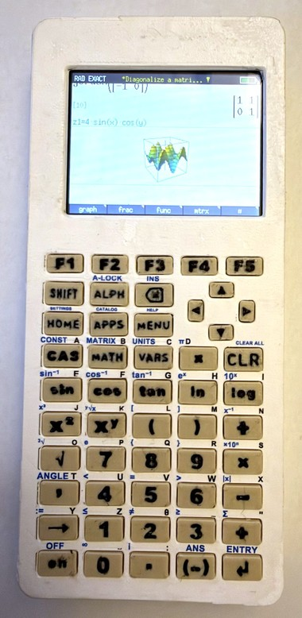
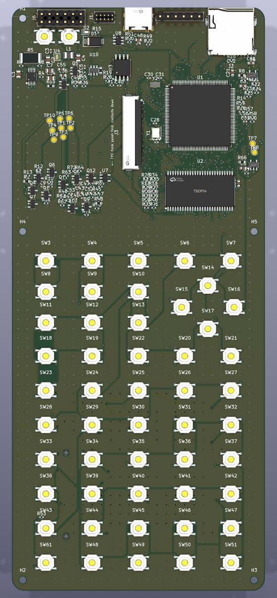
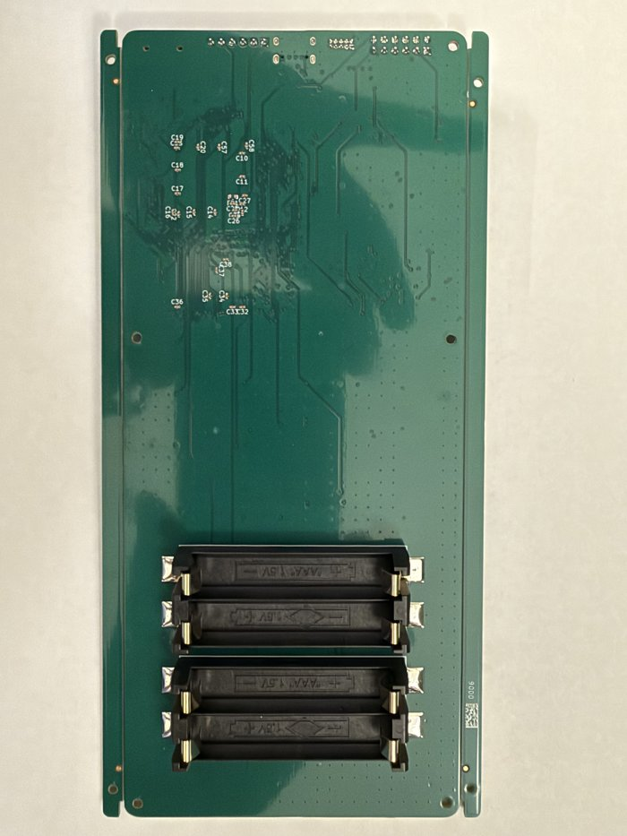
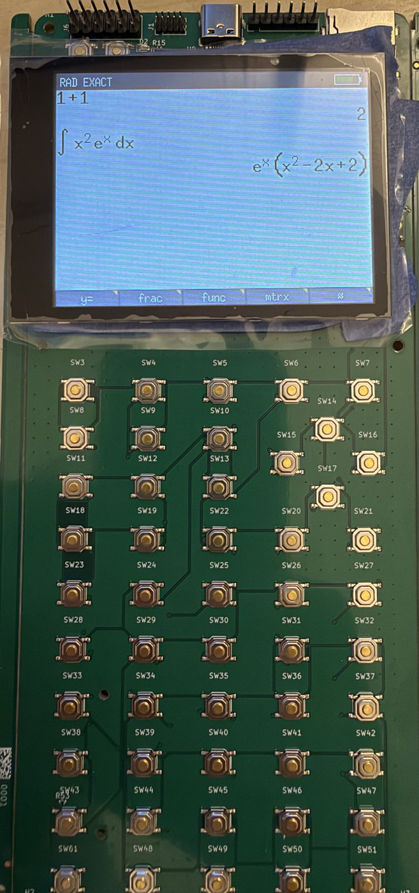

# Open Graphing Calculator

An open-source graphing calculator: an STM32H743 board with a 3.2" IPS touch display, a full symbolic CAS,
2D (textbook) math, graphing, statistics, matrices, solvers, finance, base-n, units and an RPN mode, and a
3D-printed case. The firmware also runs in a macOS simulator and in the browser.

**[Try it in your browser](https://bdemsky.github.io/open-graphing-calculator/)**: the real firmware, compiled
to WebAssembly, nothing to install.

## The board

| Top | Bottom | First power-up |
|---|---|---|
|  |  |  |

The board was designed by Claude, from the block diagram and part choices to the schematic, placement and
routing (with the Freerouting autorouter and its own finishing passes), all generated by scripts in
[`hardware/gen/`](hardware/gen/) into a KiCad project
([`hardware/kicad/`](hardware/kicad/)). The three boards built so far worked on first power-up, with no
rework. Above, a rev A board as it comes from JLCPCB, still with its panel rails. The
top carries the MCU, the SDRAM, the display connector, the microSD socket, USB-C, the debug headers and the 50
key switches; the bottom, the decoupling capacitors and the two holders for the four AAA cells. On the right,
the first power-up with the display taped on.

## Try it in your browser

**[Open the calculator](https://bdemsky.github.io/open-graphing-calculator/)** (GitHub Pages; with every
module installed, so the full CAS, the manual, animation and the rest are there). Click the keys or type on
your keyboard; the shortcuts are listed under the calculator. Some things to try:

- Type `integrate(x^2*exp(x),x)` and press Enter: the antiderivative, in textbook form.
- `sum(1/k^2,k,1,inf)` gives π²/6; `solve(x^3-6*x^2+11*x-6=0,x)` gives [1,2,3]; `factor(x^4-1)`.
- F1 (graph), type `sin(x)`, F5: a graph cell in the notebook. ENTER on it opens the full graph screen
  (trace, zoom, CALC).
- F1 (graph), F1 again (3D), type `4*sin(x)*cos(y)`, F5: a 3D surface. ENTER opens it; F3 (view) has
  colour by height, contours and a contour map.
- SHIFT then MENU opens the built-in manual for the screen you are on.

The page is [`firmware/web/dist/calculator.html`](firmware/web/dist/calculator.html), one self-contained
file: download it (Raw, then save) to run it offline in any modern browser; it needs no server and no
network. `make web` in `firmware/` rebuilds it ([`firmware/README.md`](firmware/README.md), "Web
simulator"). The page leaves out the Python module, which runs only on the calculator and the simulator.

## Build your own

One calculator is a 4-layer board assembled by JLCPCB, a display, four AAA cells and a 3D-printed PETG case.
Nothing on the board is hand-soldered. Allow about three weeks for parts (the boards and the display both
ship from China) and a weekend for printing and assembly.

| Step | What | Guide |
|---|---|---|
| 1. Order the boards | Upload `hardware/fab/` to JLCPCB: Gerbers, BOM and pick-and-place, PCB and assembly in one order. Use the files exactly as committed: they are the rev A files the working boards were built from. About $30 a board beyond the order's fixed costs; five is a good batch. | [`hardware/ORDER.md`](hardware/ORDER.md) §1 |
| 2. Order the rest | The display (EastRising ER-TFT032IPS-3.2 with the capacitive touch panel, from BuyDisplay), a Raspberry Pi Debug Probe (optional, for debugging), M2 × 3 mm heat-set inserts, M2 × 16 mm screws, AAA cells, PETG filament (white, beige, black), and the face-artwork supplies. | [`hardware/ORDER.md`](hardware/ORDER.md) §2–4 |
| 3. Bring up the board | Inspect it, power it from a current-limited bench supply, flash the bring-up image and run its self-test, then flash the calculator. The prebuilt images are in `firmware/release/`; you don't need to build the firmware. | [`hardware/BRINGUP.md`](hardware/BRINGUP.md), [`firmware/release/FLASHING.md`](firmware/release/FLASHING.md) |
| 4. Print the case | Front, back, battery door and 50 loose keys with inlaid legends. An earlier version was printed and assembled on a 0.4 mm nozzle in PETG; the current shells (no key-mat pegs, corner catches) have not been printed yet. | [`enclosure/README.md`](enclosure/README.md) |
| 5. Assemble | Face artwork (optional), heat-set inserts, keys, display, board, back. | [`enclosure/README.md`](enclosure/README.md) |

You need a soldering iron (for the heat-set inserts), a bench power supply with a current limit, and a
printer that can pause for a filament change (for the key legends). The first flash goes over the board's
USB-C port with dfu-util (ROM bootloader) or over SWD with the Debug Probe and OpenOCD; both are in
`FLASHING.md`.

## What's here

| Directory | Contents |
|---|---|
| [`firmware/`](firmware/README.md) | Firmware, CAS, simulators, help manual, tests, release images. The keyboard layout is [`firmware/keys/layout.py`](firmware/keys/layout.py). |
| [`hardware/`](hardware/ARCHITECTURE.md) | The PCB: the as-built rev A KiCad files and fab outputs, the Python generators, ordering and bring-up guides. |
| [`enclosure/`](enclosure/README.md) | The case, keys and battery door (build123d), slicing scripts, face artwork, print and assembly instructions. |

The keyboard has five soft keys under the display, whose labels change with the screen, and SHIFT and ALPHA
layers printed above the keys. Every key is described once in `firmware/keys/layout.py`, which generates the
firmware key map, the case legends, the web simulator and the key documentation.

## License

MIT ([`LICENSE`](LICENSE)) for everything in this repository (firmware, CAS, tools, the KiCad
design and its generators, the case), except the third-party code and data bundled in
[`firmware/third_party/`](firmware/third_party/README.md) (MicroPython, TinyUSB, CMSIS, KaTeX, the X11
fonts, Kconfiglib), each under its own license in its folder.

The KiCad library has footprints but no 3D models, except the battery holder's (the case's door
check uses it). KiCad opens, checks and exports Gerbers without them; only the 3D viewer shows
bare footprints.

Designed by Claude.
