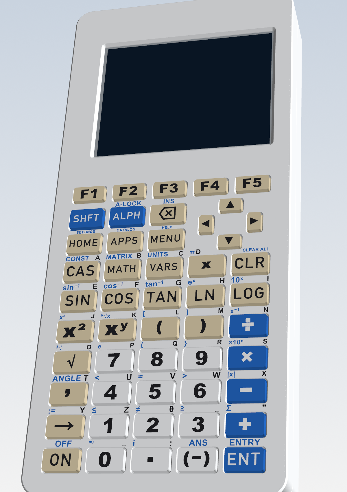

# Enclosure

The case, keys and battery door are parametric CAD (`case.py`, build123d). The CAD reads the PCB
layout, so the case always matches the board. This page is the short path to a working case: what
to print and how to put it together. The details are in the reference docs listed at the end.

## What has been tested

An earlier version of the parts below was printed on an Elegoo Neptune 4 Pro (Klipper, 0.4 mm nozzle)
in Elegoo Rapid PETG and assembled into a working calculator. The current files differ from that print
as noted in the table and have not been printed yet.

| Part | Status |
|---|---|
| Front (original height), back shell, battery door | an earlier version printed and assembled; **the current files have not been printed yet**. Since that print the front lost the pegs for the retired spring key mats and both shells gained the corner catches |
| Loose keys (50 solid caps, two-colour legends) | printed and every key works in the closed case (those had notches for the key-mat pegs; the current keys have none) |
| Face artwork (toner transfer of the SHIFT / ALPHA labels) | designed, **not yet done for real** |
| Display bar clips (`--bar-clips`) | designed, **not yet printed** |
| Corner catch (two snap catches at the screwless top-right corner) | designed, **not yet printed** |
| Lower fronts (`--low`), `--clips`, rev2 back shell | experimental, see the reference docs |

## 1. Build the print files

You need macOS (the legends use the system fonts), the repo's Python venv with build123d, trimesh,
manifold3d, shapely, scipy, matplotlib, fonttools, pymupdf and pypdf, and `hardware/build/calc.net`
(run `hardware/build.sh` once). Then, in `enclosure/`:

    ../.venv/bin/python case.py           # front, back shell, door, keys, face artwork PDFs (a few minutes)

It checks the parts against each other in 3D (front against both back shells, keys against the
front and the switches, the door's fit) and writes every file to `out/`, already in its print
orientation. No part needs supports. The table below lists the files to print.

## 2. Print

| File (`out/`) | Filament | Time, filament | Notes |
|---|---|---|---|
| `top_shell_base.stl` | white | 1 h 45 min, 33 g | the front, face-down |
| `back_shell_base.stl` | white | about 1 h 40 min | floor on the bed |
| `battery_door.stl` | white | 20 min, 8 g | plate on the bed; print it with the back shell (2 h, 56 g for both) |
| `keys_loose_all_base.stl` + `keys_loose_all_legend.stl` | beige + black | 1 h 40 min, 32 g | all 50 keys on one plate, legend-up, two colour swaps |
| `catch_test_{top,back}.stl` | white | 28 min, 7 g (both) | optional: `case.py --catch-test`, the corner of each shell, to try the corner catch's click first |
| `keys_loose_test_*` (8 keys) | beige + black | 20 min | optional: print first to check the legends and the fit |

For a single key, rebuild with `case.py --loose --pick NAMES` (comma-separated key names, for
example `--pick 0,4,F1`) and print `keys_loose_pick_{base,legend}.stl`.

**Settings** (Elegoo Rapid PETG, 0.2 mm layers, Arachne walls). The profiles are in `slicing/`;
`slicing/slice.sh` slices with them from the command line.

| | Shells and door | Keys |
|---|---|---|
| Slice with | `slicing/slice.sh case OUT.gcode PART.stl ...` | `slicing/slice.sh keys OUT.gcode BASE.stl LEGEND.stl` |
| Nozzle | 262 °C (265 first layer) | 250 °C (255 first layer); black legend 250 °C |
| Bed (textured PEI) | 72 °C first layer, then 70 | same |
| Walls, infill | 2 walls, 15 % cubic, 5 top / 4 bottom layers | 2 walls |
| Brim | 5 mm, outer only | **none** (a brim fills the gaps between the keys; `slice.sh` refuses one) |
| Colour swaps | none | two `PAUSE`s: beige, then black for the legend, then beige |

The keys are a sea of small islands on the bed, so put them on the flattest part of the bed: check
the printer's bed mesh and set `PLATE_XY="x y"` (the plate centre in bed mm) for
`slice.sh keys`. Hotter beige (262 °C) strung badly between the keys. At each pause, swap the
filament by hand, purge until clean, remove the purge and resume. `slice.sh` leaves out the
slicer's own prime after a pause, because the tested printer's `RESUME` macro purges; it blobbed
the first key (see [docs/PRINTING.md](docs/PRINTING.md)).

Other PETG brands, the slicer GUI, warping, shrinkage and the checks after each print are in
[docs/PRINTING.md](docs/PRINTING.md).

## 3. Assemble

Parts: five M2 × 3 mm heat-set inserts (OD about 3.5 mm), five M2 × 16 mm socket-head screws,
0.25 mm VHB tape (e.g. 3M 5909), Kapton tape, a closed-cell foam pad (non-conductive, about
1-3 mm thick), four AAA cells.

1. **Face artwork (optional).** Transfer the SHIFT / ALPHA labels onto the bare front first:
   [docs/FACE_ARTWORK.md](docs/FACE_ARTWORK.md). The method is untested in practice; rehearse on
   a spare front.
2. **Inserts.** Melt the five inserts into the front's bosses with a soldering iron at about
   240 °C. Let the iron's weight take each one in straight, until it is flush with the boss.
3. **Keys.** Lay the front face-down on a soft cloth. Drop each key into its hole from the inside,
   legend first; the flange holds it in. Keys of the same size fit each other's holes, so follow
   the layout ([renders/keypad_top.png](renders/keypad_top.png)). ON and ENTER, at the bottom
   corners, go in with a slight tip past the short bosses there. Keep the front face-down from
   now on.
4. **Display.** Fold the display's FPC 180° round the panel's left edge, flat against the panel
   back, and hold it with Kapton tape. Plug its end into J3 on the board (contacts down) and close
   the latch. Put a frame of VHB tape on the ledge round the window, then push the panel into its
   pocket face-down, FPC edge to the left, until the five snap fingers click over it. The fingers
   barely hold it, so stick the foam pad on the panel's metal back, off the folded FPC on the left
   (keep x < 23 mm free), so the closed case presses the panel forward.
5. **Board.** Lower the board onto the bosses, component side down, with the folded FPC between
   the panel and the board. Check that no key has lifted out of its hole.
6. **Back shell.** Put the back shell on and press the microSD corner (the one corner without a
   screw) until its two catches click. Fix it with the five screws from the back, snug only (PETG
   creeps). To open the case, take the screws out and pull that corner apart firmly. Shells
   printed before the catches: tape a printed 8 mm round × 11.7 mm pin between the back shell's
   floor and the board's bare back under the microSD socket (centre at board (71, 11.5)) instead.
7. **Batteries and door.** Insert the cells. Slide the door's two tabs under the floor at the
   bottom of the opening, lay it in and press the top end until it clicks. To open it, push a
   fingernail into the notch at the top end, toward the bottom, and lift.

The debug headers and the RESET / BOOT buttons are inside the case. Firmware updates over USB
need no opening (`calcctl flash`).

More detail on each step (FPC routing, display stack-up, door) is in
[docs/REFERENCE.md](docs/REFERENCE.md#assembly-details).

## Reference docs

| Doc | What |
|---|---|
| [docs/PRINTING.md](docs/PRINTING.md) | slicing (scripted and GUI), colour swaps, warping, shrinkage, checks after printing |
| [docs/FACE_ARTWORK.md](docs/FACE_ARTWORK.md) | the label transfer: printing the sheet, aligning it, sealing |
| [docs/REFERENCE.md](docs/REFERENCE.md) | every `case.py` option and output file, legends and colours, keys and switches, variants, tools |
| [V3_THIN.md](V3_THIN.md) | design note: thinner fronts, display clips, bar clips |
| [DFM_REVIEW.md](DFM_REVIEW.md) | design-for-manufacturing review behind the current geometry |
