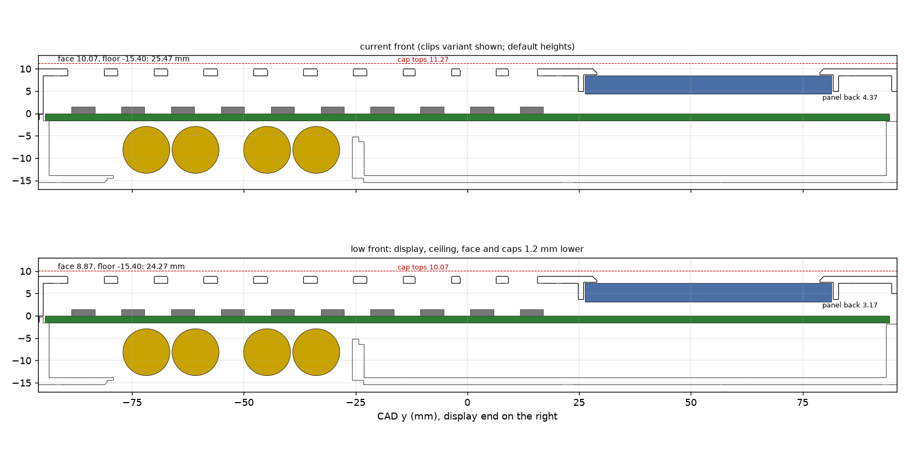

# A thinner case: stack-up, options, and the display clips

This note covers how a thinner calculator could be made and what each step costs. The front
(everything above the PCB) gets the most attention. It also covers the display snap fingers,
which do not hold the panel.

Three variants of the top shell for new prints come out of it. All fit the printed back
shells (rev1 and rev2) as they are. The default build does not change. (This note was first
written for the spring key mats, since retired; the keys are now the solid loose keys of
[docs/REFERENCE.md](docs/REFERENCE.md#keys), and the key heights below are theirs.)

| Flag | Files (enclosure/out/) | What changes |
|---|---|---|
| `case.py --clips` | `top_shell_clips_base.stl` | Display snap fingers only: deeper lips, thicker fingers, six of them. Same heights. A drop-in replacement for the current top shell. |
| `case.py --bar-clips` | `top_shell_barclip_base.stl`, `barclip_test.stl`, `barclip_dummy.stl` | Display held by two bar clips (1.5 mm grab) instead of the snap fingers; original height, no pin trimming. See [Bar clips](#bar-clips---bar-clips). |
| `case.py --low` | `top_shell_low_base.stl`, `keys_loose_low_all_{base,legend}.stl` | The clips, plus the display, ceiling, face and keys all 1.2 mm lower. Same PCB and back shell. J5/J6 header pins must be cut (see below). |

**Status after printing** (Neptune 4 Pro, Rapid PETG):

| Variant | Status |
|---|---|
| default height (`top_shell_base.stl`) | printed (with key-mat pegs inside, since removed) and used; the recommended front. Its snap fingers barely hold the display: use a foam pad behind it (section 2). |
| `--clips` | experimental: the stiffer fingers still grab only about 0.35–0.5 mm. |
| `--bar-clips` | designed and checked in CAD, **not yet printed**. Print the test piece first. |
| `--low` (printed as `--low --drop 1.8`, then for a key mat) | too shallow as it stands: the debug header pins J5/J6 hit the inside of the face (1.5 mm short) unless they are trimmed. Advanced only. |

All heights are in mm, measured from the PCB top surface (Z = 0), as in case.py.

## 1. Current stack-up: 25.47 mm, or 26.67 mm over the key caps

| Layer | From | To | Thickness | Notes |
|---|---|---|---|---|
| Back-shell floor, or the door in the battery opening | -15.40 | -13.80 | 1.60 | `FLOOR` |
| Air between the cells and the door | -13.80 | -13.40 | 0.40 | |
| AAA cells (Ø10.5) | -13.40 | -2.90 | 10.50 | **Sets the back depth.** Holder bodies reach -12.99. |
| Holder cradle floor | -2.90 | -1.60 | 1.30 | BH-AAA-B5AA001 |
| PCB | -1.60 | 0 | 1.60 | |
| **Display region** (board y 13–68) | | | | |
| Parts under the panel | 0 | 2.16 | | Tallest: U3 SOIC-8 (2.16), J3 FPC connector (2.0), U1 LQFP (1.6), 0805s (1.45) |
| Folded panel FPC with the touch IC, parts facing down | ~3.0 | 4.37 | ~1.37 | The 43 mm section along the left side lies over 0805s and SOT-23s |
| Panel (ER-TFT032IPS-3.2 with CTP) | 4.37 | 8.47 | 4.10 | **Sets the ceiling, and so the whole front.** |
| Face plate | 8.47 | 10.07 | 1.60 | `PLATE`; the VHB tape sits in a 0.25 mm recess |
| **Keypad region** | | | | |
| Tact switch TS-1187A | 0 | 1.50 | 1.50 | |
| Gap from key bottom to plunger | 1.50 | 2.00 | 0.50 | `LOOSE_GAP` |
| **Solid key below the flange** | 2.00 | 7.67 | **5.67** | **This is the wasted height.** The keypad only inherits it from the display. |
| Key flange, against the ceiling at rest | 7.67 | 8.47 | 0.80 | |
| Face plate | 8.47 | 10.07 | 1.60 | |
| Caps above the face | 10.07 | 11.27 | 1.20 | |

- **Back depth:** the AAA cells set it everywhere. The back-shell floor is flat at -13.8, so
  the display end carries about 12 mm of air below the PCB.
- **Front height:** the display sets it, because the face is one flat plate. In the keypad
  region the keys are 9.27 mm tall only because the ceiling sits at the panel front; below the
  flange they are solid filler.
- **Flat faces:** the shells print face down (the front) and floor down (the back). A
  stepped or wedge-shaped face or floor turns the lower area into a large ceiling over air,
  which would need supports.

## 2. The display snap fingers: why they don't hold, and the fix

### Diagnosis

The current fingers have these numbers:
- 0.9 mm thick at the root, tapering to 0.8 mm at the tip (2 perimeters);
- 5 mm wide;
- a lip of 0.25 mm. The finger's inner face sits 0.05 mm outside the nominal panel outline,
  so the lip reaches only 0.20 mm under the panel's border;
- a lip seat 0.15 mm below the panel back.

The engagement is eaten from four directions:

- **Panel tolerance.** The outline tolerance is ±0.2 mm. A small module leaves 0.10 mm per
  side, and the panel can shift sideways between opposite fingers. On the worst side the lip
  covers 0–0.1 mm.
- **FDM.** A 0.25 mm lip is about half a 0.45 mm line. Its flat seat is 0.1 mm tall, half a
  layer. As printed, the lip is a small rounded ramp, not a hook.
- **Flexible fingers.** The fingers are soft: about 3 N at full lip deflection. A
  ramp-on-ramp contact pushes them open.
- **Nothing behind the panel.** Only the VHB tape holds the panel against the bezel. When
  the case closes, nothing presses on the panel's back: there is 2.8 mm of air over U1 and
  3.2 mm over U2. So the panel slides back as soon as the tape lets go.

Five fingers with no finger on the left (the FPC fold side) is a smaller factor.

### The limit on a deeper lip

A finger hangs from the ceiling. Its free length runs from the root, at most `TOP - MIN_SKIN`,
to the seat. That length is fixed at about 5.3 mm by the panel thickness. Bending strain goes
roughly as thickness × deflection / length², so a deeper lip and a thicker finger both raise
the strain. Table 2 shows the trade-off.

**Table 2: finger options and their strain**

| Finger | Lip | Strain to snap in | Force at full deflection |
|---|---|---|---|
| Current: 0.9/0.8 × 5 mm, root 0.8 mm into the plate | 0.25 | 1.18 % | ~3 N |
| 1.1/0.9 × 7 mm, root 1.0 mm into the plate (0.6 mm skin) | 0.40 | 1.95 % (2.20 % with a +0.2 mm panel) | ~11 N |
| 1.0/0.8 × 7 mm (adopted) | 0.50 | 2.19 % (2.40 % with a +0.2 mm panel) | ~8 N |
| 1.2/0.9 × 7 mm | 0.60 | 3.2 % | ~20 N |

The 0.6 mm lip is too much strain for PETG bent across its layers. Lengthening the finger
through the face skin into the plate does not help either: a 0.6 mm skin hinge would see
about 5 % strain.

### The clips variant (`--clips`): a drop-in top shell for the next prints

The variant uses:
- lip 0.50 mm, reaching 0.45 mm past the nominal outline: 2.25× today, and still 0.35 mm
  for a small, off-centre panel; the ramp under it (about 35° from vertical) is the lead-in;
- fingers 1.0 mm thick at the root, tapering to 0.8 mm (2 perimeters);
- fingers 7 mm wide, about 1.7× as stiff as today (a 0.5 mm lip on the 1.1/0.9 mm finger
  would reach 2.7 % strain with an oversize panel);
- slots 0.2 mm deeper into the plate (0.6 mm skin, `MIN_SKIN`);
- a flat seat one whole layer (0.2 mm) tall, so the lip prints as a real step;
- a second finger on the right edge, six in all. The top-left finger moves to x 35, clear
  of D1. The top-right finger moves to x 57, clear of the microSD socket J2.

Insertion strain is 2.19 % nominal and 2.40 % for an oversize panel. That is above the 1.2 %
the old design aimed for and below PETG's yield strain of about 2.5 %. The fingers bend only
while the panel goes in.

- **If a finger cracks:** drop to lip 0.35 and 1.0/0.9 mm thickness (about 1.6 %).
- **Checks:** the variant passes the 3D check against the loose keys. It shows no interference
  with the rev1 or rev2 back shell, and passes printcheck.py: longest overhang 4.8 mm, no thin
  walls.
- **Fit:** everything else is identical, so it is a drop-in replacement.

### What actually stops the panel sliding back: clamp it

Snap lips only hold the panel while it is assembled. In use, the panel should be clamped
between the bezel and something behind it.

- **Current shell, no reprint:** stick foam pads on the panel's metal back, over the two big
  ICs. Use closed-cell PU (PORON) or EVA with adhesive:
  - about 3 mm thick over U1 (LQFP, top 1.6; gap 2.77);
  - about 3.5 mm thick over U2 (TSOP, top 1.2; gap 3.17).

  Closing the case compresses them about 0.3–0.5 mm. Keep the pads off the folded FPC on the
  left (x < 23 mm). This fixes the sliding at once. The load on the ICs is small. The foam
  covers part of the MCU's top, but most of the MCU's heat leaves through the board.
  These thicknesses come from the footprint height estimates. On the printed case the panel,
  pushed back, sits 2.5 mm below its seat ("Measured panel play" below), so check the gap and
  choose a non-conductive pad of about 1–3 mm that the closed case compresses a little.
- **Low shell:** the same approach, with pads about 2.0 mm (U1) and 2.5 mm (U2) thick.
- **Foam rather than a printed support frame on the current board:** a printed frame needs
  landing spots on the PCB under the panel, and that area is packed with 0402s. Its legs
  would also have to be cut to ±0.1 mm. Foam takes up the tolerance.

## 3. How low the front can go

### With the current PCB (the `--low` variant)

**Display.** The panel back can drop from 4.37 to **3.17** (−1.2 mm). The limit is the folded
FPC section with the touch IC, which lies over three 0805 capacitors (C1, C7, C54; 1.45 mm max)
and several SOT-23s. `panel_clearance()` lists the parts under the panel from their footprints
and estimated maximum heights:

| Part | Height | Clearance |
|---|---|---|
| C1, C7, C54 (0805) | 1.45 | 0.35 mm under the FPC stack (taken as 1.37 mm thick) |
| SOT-23s | 1.25 | 0.55 mm under the FPC stack |
| U3 (SOIC-8) | 2.16 | 1.0 mm under the panel |
| J3 (FPC connector) | 2.0 | 1.17 mm under the panel |

**Measure before printing:** the folded FPC section's thickness. If it is 1.5 mm or more,
lower the panel by 1.0 mm instead (`LOW_DROP`). The FPC tail's dip into J3 gets about 1.2 mm
shallower, which leaves roughly 0.3 mm of slack in the tail. The layout allows ±0.5 mm.

**Keys.** The loose keys keep their bottom (2.0) and the 0.5 mm gap over the plunger and get
1.2 mm shorter with the ceiling; `--low` writes them on one plate (`keys_loose_low_all_*`). The
low bosses under ON and ENTER drop by 1.2 mm too.

**Headers.** The 2.54 mm headers J5 and J6 have pins up to 8.54. The face is now at 8.87, so
the blind pockets can only reach 8.27. Cut the pins to 7.7 mm above the PCB, about 0.85 mm
off. That leaves about 5 mm of pin above the plastic, still enough for jumper sockets.
Nothing else is affected:
- J1 tops out at 4.0;
- the USB-C pocket ends at 5.03;
- the microSD socket, D1 and the RESET/BOOT switches are under 2.6.

**Result:**
- ceiling 7.27, face 8.87, caps 10.07;
- the case is **24.27 mm** thick at the face and 25.47 mm over the caps (−1.2 mm);
- same back shell and door, rev1 or rev2.

**Checks.** The low variant passes the 3D check against its loose keys and shows no
interference with either back shell.

Not done for this variant: the overlay. It follows `TOP` and works unchanged, but was not
regenerated.

### With a new PCB revision (v3 board), still using the same back shell

**Display on the board.** Clear the PCB top under the panel completely and move those parts
to the bottom side. Under the display the bottom side has about 12 mm of free depth to the
shared back shell's floor, so nothing there limits height. The parts to move are:
- U1 MCU, U2 SDRAM and U3 flash;
- the power, backlight and test-point areas;
- J3: put it on the bottom side and pass the panel FPC through a slot at the board's left
  edge, instead of folding it under the panel.

The panel's metal back then sits on the board with **0.1–0.2 mm of polyimide (Kapton) tape**
between them. With 0.15 mm tape and solder mask, the panel back is at about 0.2. The PCB
itself is the support, and the bezel clamps the panel against it. The snap fingers become an
assembly aid only.

On today's board, every part under the panel would touch. These are the ones that must move:
- U3 2.16, J3 2.0, J2 (the microSD socket overlaps the panel's top edge, y 13–15.7, 1.85);
- U1 1.6, the 0805s 1.45, the SOT-23s 1.25, L1 1.2, U2 1.2;
- the crystals, and all the 0402/0603s;
- TP1–TP10 (exposed pads; move them or cover them with the tape).

Vias under the panel must be tented. Tape is the right choice for insulation. A printed
sheet one or two layers thick (0.2–0.4 mm) has pinholes and uneven thickness, so it is no
insulator, and it costs more height. A printed part is only worth using as a spacer where
there is a gap to fill, as with today's board.

Result: ceiling about 0.2 + 4.1 = **4.3**.

**Keys.** The solid loose keys need little height of their own under the face: the bottom
sits 0.5 mm over the plunger (2.0 with today's switch), and the flange with its chamfer needs
about 1.8 mm above that. They fit any ceiling from about 3.8 up, so with the current switch the
display (4.3) sets the ceiling. Lower tact switches would only matter for a still thinner
front. These are in the local JLC parts snapshot; confirm stock live:

| Part | Size | Height | Force | LCSC | Stock (snapshot) |
|---|---|---|---|---|---|
| Omron B3SN-3012P | 6×6 | 0.9 | 1.6 N, the same force class as today | C306881 | ~11k |
| ALPS SKRBACE010 | 4.8×4.8 | 0.55 | 2.6 N | C139789 | ~19k |
| TJ-416-Q | 4.4×4.4 | 0.55 | | C240766 | |

**Plate.** It could go from 1.6 to 1.2 mm (6 layers), saving 0.4. The plate would then be
too thin for deep finger roots and header pockets, so keep 1.6 unless every last 0.4 mm
matters.

Result: ceiling about 4.3, face about **5.9**, keys about 7.1. The case is **about 21.3 mm**
at the face (22.5 over the keys) with the unchanged back shell: −4.2 mm.

## 4. The back and the batteries, briefly

These all leave the shared back shell, so they are a later step.

| Option | Saving | Effort and risk |
|---|---|---|
| Thinner floor and door, 1.6 → 1.2, and cell clearance 0.4 → 0.3 | ~0.5 | New back and door; easy |
| AAA cells in a back-shell compartment with spring contacts instead of PCB holders (how commercial calculators do it) | ~1.0 (no 1.3 mm cradle floor) | New PCB pads and wires, new back; medium |
| AAAA (Ø8.3) | 2.2 | Cells are hard to find and hold about half the capacity; few holders at JLC |
| LiPo pouch about 5 mm thick (e.g. 504070, ~2000 mAh, more energy than 4 alkaline AAA) | ~6.5 (below the PCB: 1.6 + 0.3 + 5 + 0.3 + 1.2 = 8.4) | Needs a charger IC (the board has none: only the USB/battery power path) and a pouch with a protection circuit. The TPS62162 buck drops out below about 3.4 V on a single cell; a buck-boost (e.g. TPS63802) fixes that. Pouch swelling and shipping rules. Medium to high. |
| Cells in a PCB cut-out | — | The keys are directly above the cells; this would need the keypad moved. Not practical. |
| Cells beside the PCB | — | Two AAA end to end need 89 mm; the inside of the case is 83 mm. Not practical. |
| 18650 or coin cells | — | Thicker (18.6 mm), or far too little capacity |
| Stepped or wedge-shaped back (thin under the display, where the back is empty) | up to 11 at the display end | The higher part of the floor prints as a large ceiling over air, so it needs supports or a two-piece back. The thick end would be the bottom (where the cells are), which tilts the screen away on a desk. |

For reference, a 4×AAA graphing calculator, the Casio fx-CG50, is listed at 18.6–20.6 mm
thick. The TI-84 Plus CE (LiPo) is about 0.75–0.8 in (19–20 mm). Both keep the cells in the
back shell rather than under the PCB, and their keys sit only about 2–3 mm proud of the face.

## 5. Recommendation

*Written before any variant was printed. Since then the default-height front with loose keys and
a foam pad is the tested build, `--clips` did not hold much better, and the printed `--low` front
needs the J5/J6 pins trimmed (see the status table at the top). The bar clips are the current
candidate for holding the display.*

**(a) Enclosure only, current PCB:**
- Print `--clips` now as the drop-in top shell.
- Add foam behind the panel. Do this today, even in the printed shell, because it is what
  stops the sliding.
- For the next full front, print `--low` (with its keys) and cut the J5/J6 pins.
  First measure the folded FPC section; if it is thicker than ~1.45 mm, use `LOW_DROP` = 1.0.

Result: **24.3 mm**, from 25.5. It uses the same back shell and door. A new back with a thinner
floor and door would bring it to about 23.8 mm.

**(b) With a new PCB (v3):**
- Put the display on the board (Kapton between them).
- Move every part under the panel, and J3, to the bottom side, and pass the FPC through a slot.
- Replace J5/J6 with 1.27 mm headers or pads.
- Keep the current switches; the loose keys get shorter with the ceiling.

Result: front face about 5.9, so **about 21.3 mm** with the current back (−4.2 mm).

With a new back as well:

| New back with | Total thickness | Notes |
|---|---|---|
| AAA in a compartment | about 20 mm | Roughly fx-CG50 class |
| A 5 mm LiPo and a charger | about 15 mm | |

Every option keeps both faces flat, because a stepped or wedge-shaped face is what FDM
printing on the face cannot do without supports.

## Measured panel play and `--drop`

On the first printed case the panel, pushed back onto the board, sits 2.5 mm below its bezel
seat (`PANEL_PLAY`): the footprint-based heights above are conservative. `case.py --low --drop D`
lowers the front by D mm (accepted up to `PANEL_PLAY - DROP_MARGIN` = 2.0) and writes
`*_low<D>*` files, e.g. `--low --drop 1.8` → `top_shell_low1p8_base.stl` and
`keys_loose_low1p8_all_*.stl`: face 8.27, case 23.67 mm thick (24.87 over the keys), keys
1.8 mm shorter, 0.7 mm of play left for the foam pad and assembly. The J5/J6 header pins must then
be cut to about 7.1 mm above the PCB.

## Bar clips (`--bar-clips`)

**Status: designed and checked in CAD, not yet print-tested.** Print the test piece first (below).

The snap fingers hang from the ceiling, so they bend across the layer lines, and their length
is fixed at about 5.5 mm by the panel thickness. A 0.5 mm lip already strains them about
2.2 %; a 1.5 mm grab would need about 6.6 %. The bar clips bend along the layers instead, like
the battery-door latch. This front keeps the original height (face 10.07), so the J5/J6 pins
stay as they are.

**Design** (`bar_clip()` in case.py):
- One bar beside each long edge of the panel (top and bottom), centred at board x 45. Each bar
  is 40 mm long between its two posts, 0.85 mm thick (two walls) and 4.87 mm tall (Z 3.0–7.87).
  It is held only by the posts, with 0.8 mm fillets where it meets them, and it flexes sideways,
  in the print plane.
- The bar's inner face is 0.25 mm outside the nominal panel outline. A 4 mm hook in the middle
  of the bar reaches 1.5 mm under the panel border. Its flat seat is at Z 4.07, 0.3 mm below
  the nominal panel back, which leaves room for a +0.2 mm panel and a slightly sagging hook tip.
  Under the seat, a 45° lead-in runs down to Z 1.92: pressing the panel in pushes the bar
  outward, and it springs back over the border.
- The snap fingers are gone, including the right-hand one. The pocket ribs stay on the left
  and right edges and beyond the posts.

**Strain** (`barclip_numbers()`, printed by the build). The hook section is about 2.5 mm deep,
so it is taken as rigid. Each half of the bar is then a guided cantilever from the post fillet
to the hook (a = 17.6 mm): strain = 3 d t / a².

| Hook travel while the panel goes in | Strain | Force on the hook |
|---|---|---|
| 1.50 mm, nominal panel | 1.23 % | 3.3 N |
| 1.60 mm, panel 0.2 mm oversize, centred | 1.32 % | 3.5 N |
| 1.75 mm, any panel pushed against this bar (worst case) | 1.44 % | 3.8 N |

The grab is 1.5 mm nominal. In the worst case (a panel 0.2 mm undersize, shifted fully toward
the other bar) it is 1.05 mm, still about 2× the `--clips` lip.

**Printing the bar.** The shell prints face-down, so the bar's first layer has nothing under it.
It prints as a 40 mm bridge from post to post. In ElegooSlicer it is an overhang wall: one
0.85 mm loop at overhang speed. To keep a sagging bridge from fusing to the face:
- the bar stops 0.6 mm below the ceiling;
- the plate above it is pocketed 1.0 mm deep (0.6 mm skin left, as `--clips` does).

That leaves 1.6 mm of air (eight layers) under the bridge. The bridge starts at print height
2.2 mm, with the pocket floor at 0.6 mm.

There is also an alternative that needs no bridge. The bar could be part of the face plate,
freed by a slot through it, as the door latch is. That would leave visible slots in the face
beside the window, so it was not used. The bridge does not need to be pretty: only the bar's
sides take load, and its top edge faces air.

Under the hook's seat there is a 1.75 mm ledge. It overhangs toward the bed, so it may sag a
little. The 0.3 mm seat drop allows for that.

**Checks** (in `barclip_front()`):
- The clips clear the parts under the posts, the bar, its swing room and the hook by at least
  0.3 mm. The closest are D1 (0.50 mm under the top-left post) and J2 (1.15 mm).
- Nothing in the shell is inside the bar's swing room (1.75 + 0.3 mm).
- The posts stay out of the folded FPC section (which only spans the left edge) and leave the
  left corner rib stubs in place. The bosses and the key area are clear.
- No interference with the rev1 or rev2 back shell.
- No 3D interference with the loose keys.
- printcheck.py passes (longest downward span 4.8 mm, no thin walls).

**Test piece first** (`barclip_test.stl`, about 10 min). It is the bottom-edge clip with its
posts, 3 mm of frame beyond each post, and the face strip from just inside the window to 7 mm
outside the panel. It prints face-down like the shell. `barclip_dummy.stl` is an optional
stand-in for the panel edge: 4.1 mm thick, printed flat, 14 min for both parts together.
Things to check:
- whether the bar bridged clear of the face (look into the gap from the side);
- whether the dummy, or the real panel's long edge, snaps in under the hook and stays held.

The full front (`top_shell_barclip_base.stl`) takes about 1 h 25 min.

**Foam pad (optional).** The hooks retain the panel. They do not clamp it, and the seat leaves
0.3 mm of play. For a panel that does not move at all, stick a closed-cell foam pad (PORON or
EVA) on the panel's metal back, as in section 2: about 3 mm thick over U1, 3.5 mm over U2. Keep
it off the folded FPC on the left (x < 23 mm) and away from the hooks. Closing the case
compresses it about 0.3–0.5 mm and holds the panel against the bezel.

**To take the panel out,** reach in from the back. Push each bar outward, toward the case edge,
in the 2 mm of swing room beside it, and lift the panel past the hooks.

**If the bridge fuses or the bar cracks:**
- Fused bridge: raise `BAR_GAP_TOP`. The force drops with the bar's height; the strain does not
  change.
- Cracked bar: lower `BAR_GRAB` to 1.2 mm (1.0 % nominal), or lengthen `BAR_L` a few mm. The
  build re-checks the parts under the posts (D1 and SW2 at the top left, J2 at the top right).

