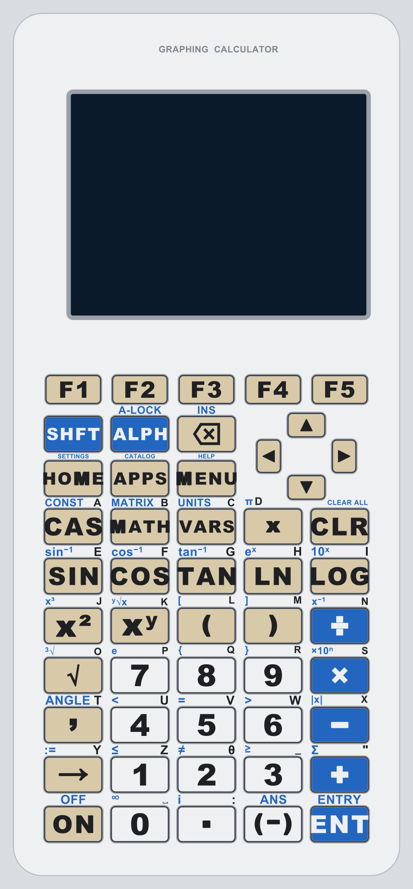

# Face artwork (label transfer)

The SHIFT functions (blue), the ALPHA letters (black) and a small name line go onto the white front
as a **gel-medium toner transfer** of a colour laser print. The front itself has no printed
labels: small text inlaid in the first layers of a face-down print comes out as dots and smears.

> **Status: untested in practice.** The artwork and its alignment marks are designed and checked
> in software, but the transfer has not yet been done on a real front. Rehearse on a spare
> front (a misprinted one, or a test piece) before you do the real one.

## How it works

Acrylic gel medium is brushed on the face. The mirrored print is pressed into it toner-down. Once
the medium has cured, the paper is rubbed off with water. The toner stays in a thin clear film of
medium; where there is no toner the film is clear and the white plastic shows. So the artwork is
**only the labels**: no background and nothing over the key holes or the display window. The paper
over the openings is glued to nothing and washes away.

`overlay.py` draws the artwork from `firmware/keys/layout.py` (labels, colours) and the shell
geometry in `case.py`, so it always matches both. `case.py` runs it; run
`../.venv/bin/python overlay.py` alone after changing only the labels or colours
(`--preview DIR` also writes PNGs of the pages, if `pdftoppm` is installed).

- **Labels** sit on the webs above each key: the SHIFT function on the left, the ALPHA letter on
  the right, Arial Bold, 1.35-2.8 mm, fitted per row with a margin to every opening. The smallest
  are SETTINGS, CATALOG and HELP between rows A and B. `overlay.py` checks that no toner lies over
  an opening or outside the face.
- **Alignment marks**, none of which transfers (each lies past the front's edge or over an
  opening; `overlay.py` checks it):
  - L marks just outside the front's four corners;
  - an outline just inside every key hole, with a centre cross;
  - L marks inside the four corners of the display window.

## Files (`out/`)

US Letter, 1:1 vector PDF (and SVG). Each page has two 100 mm scale bars and the steps.

| File | Print on | What |
|---|---|---|
| `overlay_proof.pdf` | plain paper | not mirrored: labels and marks, with the shell outline and openings as hairlines; checks the scale and the fit |
| `overlay_transfer.pdf` | plain laser paper, 90-100 g/m² | **mirrored**: the print that is transferred |

## Materials

- A **colour laser** printer (toner; inkjet ink dissolves in the medium and smears).
- Plain, uncoated laser paper, 90-100 g/m² (coated or glossy paper does not release).
- Acrylic **gel medium**, matte or soft gel (e.g. Liquitex Matte Gel, Golden Soft Gel Matte), or a
  photo-transfer medium (e.g. Mod Podge Photo Transfer Medium); a soft 25 mm flat synthetic brush.
- A rubber brayer (roller), 50-100 mm, or just your fingers.
- Wet-and-dry sandpaper, 400 and 600 grit; isopropyl alcohol; a lint-free cloth; a sponge and a
  bowl of water.
- **Water-based polyurethane** varnish, satin (e.g. Minwax Polycrylic), or a satin acrylic clear
  spray.
- Sharp knife, steel ruler, cutting mat; a ruler or calipers that read 100 mm.

Not recommended: **acetone transfer**. Acetone crazes and hazes PETG, the toner bonds poorly to
smooth plastic, and fine text is lost. Fallback if the gel transfer fails: **waterslide decal
paper** for laser printers (clear film; the white of the face shows through), cut to the label
area and sealed the same way.

## Print and check

1. Print `overlay_proof.pdf` on plain paper at **100 % / actual size** ("fit to page" off).
2. Measure both 100 mm scale bars (the printer can scale the two directions differently): the end
   ticks must be 100.0 mm apart, within about 0.3 mm. The grey cut rectangle measures
   103.0 × 209.8 mm (the front plus 8 mm all round). If either is off, fix the printer setting, not the file.
3. Cut the proof along the grey rectangle. Lay it face-up on the table and put the bare front on it
   face-down, its corners in the corner L marks. Look through the holes from the back: every key
   outline sits evenly inside its hole, the window L marks evenly inside the window, every label
   on the web above its key.
4. Print `overlay_transfer.pdf` the same way, best quality, on laser paper. It reads backwards;
   that is correct. Use it within a day (paper takes up moisture). Cut it along the grey
   rectangle.

## Apply

Do this on the bare front, before the inserts and keys.

1. **Prepare the face.** Sand it lightly, 400 then 600 grit, wet, in straight strokes along the
   length, until it is evenly matt (on a textured-PEI face, until the tops of the texture are
   flat). Don't round the edge chamfers. Wash, dry, wipe with isopropyl alcohol; don't touch it
   afterwards.
2. **Coat.** Brush a thin, even coat of gel medium on the face only, strokes one way, none in the
   key holes (wipe out any with a cotton bud). Work quickly: it skins over in a few minutes.
3. **Place.** Lay the print **toner-up** on a flat table. Lower the front onto it face-down, its
   corners in the corner L marks. Look through the holes from the back and slide the front gently
   until every key outline sits evenly in its hole. Press down. Holding paper and front together,
   turn them over. Smooth the paper from the middle out, on the face only, with the brayer or your
   fingers, until no bubble is left. Wipe off medium squeezed out at the edges.
4. **Dry** for 24 hours with the paper on.
5. **Rub off the paper.** Wet it with the sponge, wait 1-2 minutes, then rub with a fingertip in
   small, light circles; the fibres roll off. Let it dry: a white haze of fibres shows. Repeat,
   more gently each time, until the labels are crisp and the haze is gone (usually 2-4 passes).
6. **Seal.** After a few hours, brush or spray 2-3 thin coats of water-based polyurethane (satin),
   drying between coats. Keep it out of the openings. Wait a day before assembly.

If a label is damaged, sand the face back with 400 grit and start again.
