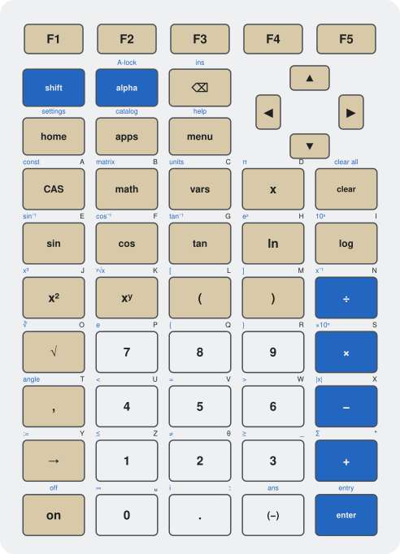

# Open Graphing Calculator: firmware and simulator

Firmware for the Open Graphing Calculator, an STM32H743 graphing calculator (`../hardware/ARCHITECTURE.md`, final hardware revision:
EastRising **ER-TFT032IPS-3.2** ST7789 IPS panel with the ER-TPC032-3.1 capacitive touch panel, FocalTech FT6236), a graphing calculator app with soft keys
and its own keyboard layout ([`keys/layout.py`](keys/layout.py)), the real CAS (`cas/`), and macOS and browser simulators that run the same app code. The boards don't
exist yet. Everything here builds, and the app, console, touch handling and graphics are tested in the
simulators. The hardware drivers are **compile-verified only** (see
[Assumptions and unknowns](#assumptions-and-unknowns-need-hardware)). Flashable images and instructions are
in [`release/`](release/FLASHING.md).

```
make sim     # build/sim/calcsim               macOS simulator (ASan/UBSan on)
make test    # unit tests + scripted UI tests + help examples  (screenshots -> sim/screenshots/)
make fw      # build/fw/calc.{elf,bin,hex,map} STM32H743 image + size report
make bringup # build/bringup/bringup.{elf,bin,hex}  minimal first-flash image (see release/FLASHING.md)
make release # fw + bringup -> release/ (calc.bin = flash bank 1, calc_bank2.bin = bank 2), MANIFEST.txt, SHA256SUMS;
             # bumps the PATCH of what changed (see "Versions and releases"); make release-tag after committing
make web     # web/dist/calculator.html             browser simulator (make web-test runs it under node)
make all     # sim, fw, bringup, test
make gen     # regenerate keymap + font tables (also automatic when inputs change; the help manual
             # is compiled from help/*.txt into $(BUILD)/gen/ on every build that needs it)
make check-pins   # validate the firmware pin/AF table against ST's pin data and pinmap.py
```

Requirements: Apple clang, GNU make (3.81 is fine), python3, ARM GNU toolchain 15.3
(`/Applications/ArmGNUToolchain/15.3.rel2`, override with `ARM_BIN=`). No other dependencies.

## Layout

```
include/hal.h            the platform interface (display, keypad, timer, power, storage, console)
core/                    portable runtime: main loop, debug console, framebuffer graphics + dirty
                         rectangles + text log, fonts, key queue, touch gesture recognizer (touch.c),
                         RLE/CRC, LCD test patterns, RAM tests, pstore.c (power-loss-safe snapshot log
                         on NOR flash), sections.h (flash bank 2 placement macros)
core/gen/                generated: keymap_gen.[ch] (from hardware/gen/design.py), fonts_gen.c
app/                     calculator application (screens, line editor, graphing, menus, help viewer,
                         session persistence, APPS/VARS/MEM); extension points in app/registry.c,
                         documented in app/EXTENDING.md
modules/                 code modules that run in place from the QSPI (app/modx.h): animation/,
                         geometry/ (the Geometry app; its core side is app/geo_core.c), casx/,
                         mathquest/ (docs/QSPI_CONTENT.md section 12); python/ (MicroPython + the
                         calc library, a code-load module copied to SDRAM; app/py_core.c, 12.8)
help/                    the built-in manual: one text file per topic group (tools/gen_help.py)
cas_stub/                numeric stand-in for the CAS (implements cas/include/cas.h)
cas/                     the real CAS library (owned by another agent, not modified here)
platform/web/            WebAssembly HAL + exported API (web_api.h) for the browser simulator
web/                     browser simulator: page sources, CAD picture + key map, build/test tools;
                         web/notebook/: the browser notebook (CALCULATOR.HTML on the CALC drive)
platform/sim/            simulator HAL (stdin/stdout console, PNG screenshots, file-backed flash)
platform/stm32h743/      hardware HAL: startup, linker script, clocks, MPU/cache, FMC SDRAM + LCD,
                         keypad, UART, I2C2/INA226, I2C4/FT6236 touch, ADC, DAC backlight (closed
                         loop), QSPI, SD stub, power states; bringup/ = the bring-up image's main()
release/                 flashable images, SHA256SUMS, MANIFEST.txt, FLASHING.md
openocd/                 OpenOCD configs (Raspberry Pi Debug Probe / ST-Link) + flash/debug scripts
tools/                   gen_keymap.py, gen_font.py, gen_help.py (help manual compiler), check_pins.py,
                         calcctl.py (console client), fb2png.py, release_info.py (checks the release
                         images), flash_budget.py (bank 1/2 usage)
tests/unit/              host unit tests (core, editor, keymap, RLE, gfx, CAS stub, memtest, touch gestures,
                         pstore with power loss injected at every step)
tests/ui/                scripted UI tests (console command files) run by tests/run_ui.py
sim/screenshots/         PNGs produced by the UI tests
third_party/             pinned vendor code (see third_party/README.md)
```

### Software architecture

```
 platform main() ──► hal_init() ──► calc_main()            (core/calc.c)
                                        │
        ┌───────────────────────────────┼───────────────────────────────┐
   key queue (core/keyq)          debug console (core/console)     app (app/*)
   ▲ keypad ISR / sim / console   ▲ UART RX ring / stdin           │ screens draw into the
   │ ON key → cas_interrupt()     │ one line per loop iteration    ▼ framebuffer (core/gfx)
   touch gestures (core/touch)
   ▲ FT6236 via hal_service() / console `touch` / web_touch
                                                                   gfx_flush(): dirty rects
                                                                   → hal_display_flush()
```

- **Main loop** (`core/calc.c`): `hal_service()` (deferred driver work: touch-controller reads after its
  interrupt, power-monitor alerts), drain key events into the app, drain touch gestures into the app
  (`app_touch_event`), flush dirty rectangles, run at most one console line (only when the key and touch
  queues are empty, so injected input is processed before the next command), tick the app (cursor blink,
  key repeat, auto power-off), flush, then `hal_idle()`.
- **Touch** (`core/touch.c`): platforms report the current contacts in screen coordinates; a recognizer
  turns them into `down`, `drag` (with deltas), `up`, `tap`, `pinch` (scale + centre), `pinch_end` and
  `cancel` (a second finger during a drag). Screens get them through `screen_t.touch`. Touch is optional:
  every function stays reachable by keys.
- **Framebuffer**: 320×240 RGB565 in SDRAM at a fixed address (0xD000_0000 on hardware). The app only
  draws into it. `gfx` records dirty rectangles (merged, at most 16) and pushes only those to the panel.
  A cursor blink costs one 10×20 rectangle. The simulator keeps a separate "panel GRAM" and `lcdcheck`
  verifies panel == framebuffer, which tests the dirty-rectangle logic.
- **Text log**: every `gfx_text` call records (x, y, string), and fills and overdraws remove the entries
  they cover. The console's `text` and `expect text` commands use this to check screen contents as text.
- **CAS boundary**: the app talks to the CAS only through `cas/include/cas.h`: `cas_eval` for the home
  screen, `cas_compile`/`cas_fn_eval` for graphs, tables and numeric fields. The CAS arena is SDRAM after
  the framebuffer and the graph cache (about 32 MB − 300 KB). The app sets `cas_set_stack_limit()` from
  `hal_cas_stack_limit()`: on hardware all but 24 KB of the 96 KB main stack, in the browser 768 KB (the
  Emscripten stack is 1 MB), in the macOS simulator the CAS default (2 MB).

### Selecting the CAS

| `make ... CAS=` | Effect |
|---|---|
| `src` (default) | Compiles every `cas/src/**/*.c` (the real CAS, developed separately) for host, ARM and web with the CAS's own looser warning set. |
| `stub` | `cas_stub/cas_stub.c`: numeric parser/evaluator. Supports arithmetic, implicit multiplication, functions, degrees, exact small fractions, variables, `ans`, and numeric `solve`/`integrate(f,x,a,b)`/`diff(f,x,a)`/`limit`. Symbolic `factor`/`expand`/`simplify` work only without free variables; otherwise they return a clear "needs the CAS library" error. `tests/unit/test_cas_stub.c` always links the stub. |
| `lib` | Links prebuilt archives `CAS_LIB_HOST=` / `CAS_LIB_FW=` (defaults `cas/build/{host,arm}/libcas.a`). |
| `auto` | `src` if `cas/src` contains C files, else `stub`. |

Use a separate build directory to keep both versions, e.g. `make BUILD=build/stub CAS=stub sim test`.
`CAS=` sets the Kconfig choice "CAS implementation" of that build directory's `.config`
(`make menuconfig`); the other build options (content tier `TIER=core|standard|advanced`, the manual,
recovery, flash budget) are described in `Kconfig` and [`docs/QSPI_CONTENT.md`](docs/QSPI_CONTENT.md).
The version string (`version` command) reports which CAS is linked. The UI tests run against either:
lines that depend on the CAS use the console's `ifcas stub|src COMMAND` (e.g. `√(2)` stays exact with the
real CAS, the stub prints `1.41421356237`).

App ↔ CAS syntax (checked with `eval` against the real CAS): the CAS menu templates `factor(`, `expand(`,
`simplify(`, `solve( ,x)`, `diff( ,x)`, `integrate( ,x)`, `integrate( ,x,0,1)`, `limit( ,x,0)`, `approx(`
are accepted as is. The real CAS has no `cbrt`/`nthroot`, so MATH's ∛ and ˣ√ now insert `( )^(1/3)` and
the infix `^(1/n)` (both CAS builds accept them). It has no degree operator either: the editor turns `°`
into `*(pi/180)` in RADIAN mode and into nothing in DEGREE mode (`ʳ` the other way round), so `sin(30°)`
is ½ in both modes. `Ans` is sent as `(ans)`, `ᴇ` as `*10^`, `≠ ≤ ≥` as `!= <= >=`.

## Calculator application

The keyboard is our own logical layout on the fixed PCB key matrix: 49 matrix keys + ON at the positions of
`hardware/gen/design.py` LAYOUT (the PCB switch ids there are only position names). What every key is lives in
one data file, [`keys/layout.py`](keys/layout.py): legends, what each key types or does in the main, SHIFT and
ALPHA layers, keycap colours and web-simulator shortcuts. It generates the firmware key codes
(`core/gen/keymap_gen.{c,h}`, semantic names such as `KEY_SIN`, `KEY_X`, `KEY_ASSIGN`, `KEY_F1`), the keycap
legends and the face artwork (`../enclosure/case.py`, `../enclosure/overlay.py`), the web simulator's labels and shortcuts, the table below, the keyboard map
[`keys/keyboard.svg`](keys/keyboard.svg) and the help page `keys` (`make keydoc`; `make test` checks they are
current).



The display is 320×240 landscape: an 18 px status bar, the body (the 10×20 font gives 32 columns × 10 rows)
and a 16 px **soft-key bar** at the bottom that labels F1..F5 for the current screen. How to add screens,
apps, soft keys, menus, VARS entries, settings rows, saved state and help pages:
[`app/EXTENDING.md`](app/EXTENDING.md).

### Keys

SHIFT legends are printed above each key on the left (blue, like the SHIFT key), ALPHA letters on the right
(white, like the legend on the ALPHA key). ALPHA once = lowercase, twice = uppercase, SHIFT ALPHA = letter lock (ALPHA again
switches the lock to uppercase, CLEAR ends it). Both states show in the status bar and the cursor.

<!-- keys:begin (generated by tools/gen_keydoc.py from keys/layout.py) -->
| Key | Main | SHIFT | ALPHA |
|---|---|---|---|
| **F1** | soft key 1 (label on the screen) |  |  |
| **F2** | soft key 2 |  |  |
| **F3** | soft key 3 |  |  |
| **F4** | soft key 4 |  |  |
| **F5** | soft key 5 |  |  |
| **shift** | next key: its SHIFT function (blue legend) |  |  |
| **alpha** | next key: its letter (black legend); twice: capital | **A-lock** letters until ALPHA or CLEAR |  |
| **⌫** | delete the character before the cursor | **ins** insert / overwrite |  |
| **home** | calculator (home or RPN) screen | **settings** settings (mode, format, display) |  |
| **apps** | app launcher | **catalog** every command A-Z |  |
| **menu** | options of the current screen | **help** help for the current screen or menu item |  |
| **▲** |  | backlight brighter |  |
| **◀** |  | start of the line |  |
| **▶** |  | end of the line |  |
| **▼** |  | backlight dimmer |  |
| **CAS** | CAS menu (factor, solve, d/dx, ∫, limit ...) | **const** physical constants | A |
| **math** | MATH menu (abs, round, mod, !, roots ...) | **matrix** matrix menu | B |
| **vars** | variables, functions, lists, results | **units** units and conversions | C |
| **x** | `x` the variable: x (t, θ or n in the other graph modes) | **π** `π` pi | D |
| **clear** | clear the line / leave the screen | **clear all** asks, then clears the variables, entry line and history (RPN: the stack) |  |
| **sin** | `sin(` | **sin⁻¹** `sin⁻¹(` | E |
| **cos** | `cos(` | **cos⁻¹** `cos⁻¹(` | F |
| **tan** | `tan(` | **tan⁻¹** `tan⁻¹(` | G |
| **ln** | `ln(` | **eˣ** `e^(` | H |
| **log** | `log(` | **10ˣ** `10^(` | I |
| **x²** | `²` square | **x³** `³` cube | J |
| **xʸ** | `^` power | **ʸ√x** `^(1/)` root: x SHIFT xʸ y = y-th root of x | K |
| **(** | `(` | **[** `[` | L |
| **)** | `)` | **]** `]` | M |
| **÷** | `/` | **x⁻¹** `⁻¹` reciprocal | N |
| **√** | `√(` square root | **∛** `()^(1/3)` cube root | O |
| **7** | `7` | **e** `e` Euler's number | P |
| **8** | `8` | **{** `{` list | Q |
| **9** | `9` | **}** `}` | R |
| **×** | `*` | **×10ⁿ** `ᴇ` exponent: 6.02 SHIFT × 23 | S |
| **,** | `,` | **angle** angle units (° ʳ) | T |
| **4** | `4` | **<** `<` | U |
| **5** | `5` | **=** `=` | V |
| **6** | `6` | **>** `>` | W |
| **−** | `-` | **\|x\|** `abs()` absolute value | X |
| **→** | `→` store: 5 → a | **:=** `:=` define: f(x):=x² | Y |
| **1** | `1` | **≤** `≤` | Z |
| **2** | `2` | **≠** `≠` | θ |
| **3** | `3` | **≥** `≥` | _ (units) |
| **+** | `+` | **Σ** `sum(,k,1,n)` summation | " |
| **on** | on; stops a long computation | **off** off (the session is kept) |  |
| **0** | `0` | **∞** `∞` infinity | space |
| **.** | `.` | **i** `i` imaginary unit | : |
| **(−)** | `⁻` negative sign | **ans** `Ans` last answer |  |
| **enter** | evaluate / select | **entry** recall earlier entries |  |
<!-- keys:end -->

### Soft keys

| Screen | F1..F5 | SHIFT F1..F5 |
|---|---|---|
| home | y= (functions), frac, func, mtrx (2D templates), ≈ (evaluate as a decimal; empty line: last result ≈ / exact) | table, solve, simplify (last or selected result, or the line), rewrite (menu: factor, expand, partfrac, trig forms, collect), graph |
| Y=, window, graph, table, table setup, slider | y=, window, zoom, trace, graph | plots (stat plots), tblset, format (settings), calc (graph analysis), table |
| RPN | swap, drop, roll, pick, undo | dup, over, rot, simplify (level 1), rewrite (menu, level 1) |
| RPN interactive stack | echo, pick, roll, rolld, dropn | edit |
| list editor | stat, calc, tests, plots, graph | sortA, sortD, clrlist, csv, distr |
| stat forms / results | — / calc | — / back |
| matrix editor | names, math, edit | |
| solver screens | equation, poly, linear, —, solve | |
| finance screens | tvm, amort, cashflow, interest, solve | days |
| base-n | hex, dec, oct, bin (input base), bits (word size menu) | |
| settings | about, —, —, help, done | |
| help | index, back, ▲ page, ▼ page, exit | |
| menus / messages | ▲ page, ▼ page, —, help, back / ok | |

MENU opens the screen's context menu: every soft key of the screen (plain and SHIFT) by name, plus Help.
Tapping a label in the bar presses its key. The bar is one shared component (`app/softkeys.c`, `softkeys_t`
in `app/ui.h`); screens only declare labels and actions.

### Screens

| Screen | Function |
|---|---|
| home | **A notebook** (`app/home.c`, `app/nbdoc.h`, see "Home notebook" below): calculations are math cells, graphing from it (the graph key F1, its 2D/3D switch, then graph; SHIFT F5) adds a graph cell, MENU is the notebook menu, the title bar shows the notebook ("Notebook: Unsaved", "Notebook: *Lab 1"). Entry editor with insert (default) or overwrite (SHIFT ⌫). LEFT/RIGHT, SHIFT LEFT/RIGHT jump to the start/end. ⌫ deletes the token before the cursor (`sin(` is one token). CLEAR clears the line, or the history if the line is empty; SHIFT CLEAR clears both. ENTER evaluates, F5 (≈) evaluates as a decimal; ENTER on an empty line repeats the last entry. Starting with an operator inserts `Ans`. SHIFT (−) = Ans, SHIFT ENTER = entry recall (cycles), UP selects history items and ENTER pastes one. `→` stores (`5→a` becomes `a:=5`), SHIFT → types `:=`. `f(2)` calls a user function when `f` is defined (one-letter names otherwise multiply: `x(x+1)`). Results follow the number format and complex settings. **2D math** (`app/m2d_*.c`, settings DISPLAY TEXTBOOK, default): history in textbook form (stacked fractions, roots, exponents, \|x\|, log bases, d/dx, ∫/Σ/lim with limits, ∇·F, matrices, ×10ⁿ), wide results scroll when selected (LEFT/RIGHT); Textbook entry with boxes: xʸ exponent, √ and SHIFT √ (∛) roots, SHIFT − \|x\|, SHIFT + Σ, soft keys frac (n/d), func (Σ Π d/dx ∫ log_b ⁿ√ \|x\|), mtrx; UP/DOWN between boxes, recall/paste restores boxes. Live preview of the result under the entry (PREVIEW), repeating decimals `0.(3)` in and out (REPEAT). |
| settings (SHIFT HOME) | Data-driven, scrolling list of rows (`mode_registry`): ANGLE RAD/DEG, RESULT EXACT/APPROX, DIGITS, FORMAT NORMAL/SCI/ENG, DECIMAL FLOAT/0–9 (FIX), COMPLEX REAL/a+bi/r∠θ, DISPLAY TEXTBOOK/CLASSIC, PREVIEW ON/OFF, REPEAT 0.(3)/OFF, THEME LIGHT/DARK (every screen; `app/theme.h`), FONT NORMAL/LARGE (14×28 on home and menus), GRAPH mode, ENTRY ALG/RPN, GRID, AXES, LIGHT. The status bar shows FIXn/SCI/ENG. |
| RPN (settings ENTRY) | RPN home screen (`app/rpn.c`, help page `rpn`): stack of CAS values (hidden variables `_rpnN`: uncertainties stay correlated, floats keep their digits), command line at the bottom. ENTER pushes (DUP on an empty line); + − × ÷ xʸ and function keys act on the stack (a number being typed is pushed first); `)` SWAP, ⌫ DROP, CLEAR clears the stack, SHIFT ENTER UNDO, SHIFT (−) LASTARG, `,` STACK menu (ROLL, ROLLD, PICK, DUPN, DROPN, …), soft keys for the common stack commands, UP interactive stack, DOWN edits level 1, `→` stores level 1. CAS/MATH/catalog commands apply to the stack (arguments in stack order). Saved with the session (≤ 32 KB of levels). |
| Y= (F1 on home and graph screens) | Y1–Y6 with colour swatch, line style and enable toggle. LEFT from column 0 moves to `=` (ENTER toggles), then to the swatch (ENTER cycles 8 colours), then to the style (line/thick/thin/dotted/shade above/below). UP from the first entry: header with the graph mode FUNC/PAR/POL/SEQ/IMPL/DE (also settings row GRAPH) and, in SEQ, TIME/WEB. Each mode has six entries: X1T/Y1T(t), r1(θ), u1(n) with u1(n-1)/u1(n-2) and initial values, relations in x and y (`x^2+y^2=16`, `y<sin(x)`), differential equations y1'=f(x, y) with initial points IC1 `(0,1),(2,-1)`. The x key types the mode's variable (x, t, θ, n). |
| window (F2), table setup (SHIFT F2) | Xmin/Xmax/Xscl/Ymin/Ymax/Yscl (plus Tmin/Tmax/Tstep, θmin/θmax/θstep or nMin/nMax/PlotStart/PlotStep for the graph mode; the form scrolls) and TblStart/ΔTbl. Fields accept expressions (e.g. `2π`) and invalid ranges are refused. |
| graph (F5) | Axes, ticks, optional grid, all enabled entries of the graph mode in their colours and styles (asymptote suppression; parametric/polar curves; sequences as time or web plots; implicit relations by marching squares with inequality shading; DE: slope fields and RK4 solution curves through the initial points, ENTER on the free cursor or a long press adds one, ⌫ on a traced one removes it, `app/gr_de.c`). Arrows give a free cursor with X/Y readout. Free single-letter parameters (`a*x^2+b`) get sliders (drag, `+`/`−`, `,`, ENTER = settings; no recompilation while dragging). CLEAR returns home. See `app/graph.h`. |
| trace (F4) | Cursor on a function. LEFT/RIGHT step a pixel (t, θ, n in the other modes) and pan at the edges. UP/DOWN switch function (then stat-plot overlays). Typing a number moves there. ENTER re-centres. |
| calc (SHIFT F4) | Graph analysis: value, zero, minimum, maximum, intersect, dy/dx, ∫f(x)dx (shaded), inflection, arc length, table at cursor (bounds by cursor, typed values or taps; Brent / Gauss-Kronrod in double; results labelled on the graph and stored in `ans`). |
| zoom (F3) | Zoom In/Out (×2 about the cursor or centre), ZStandard, ZDecimal, ZSquare, ZTrig, ZoomFit. |
| table (SHIFT F5) | X plus up to 3 Y columns, scrolling, and a full-precision readout of the selected cell. |
| CAS | factor, expand, simplify, solve(,x), d/dx diff(,x), integrate(,x), integrate(,x,a,b), limit(,x,a), approx, ∇f ∇·F ∇×F ∇²f (gradient, divergence, curl, Laplacian). Each inserts a template with the cursor inside. SHIFT CAS: physical constants. |
| math, SHIFT , | MATH (abs, round, floor, ceil, ³, cbrt, nthroot, min, max, mod, !), angle (° ʳ). Relations are SHIFT 4 5 6 (< = >) and SHIFT 1 2 3 (≤ ≠ ≥). |
| catalog (SHIFT APPS) | Every CAS command and function (generated from the help pages, ~250 entries), alphabetical. Letter keys jump (ALPHA lock is automatic). |
| APPS | The registered apps (`app_registry`; Graph and 3D graph are registered but not listed: the graph key and graph cells open them, CATALOG and `app` still do): Table, Graph analysis, Statistics, Distributions, Stat plots, Matrix, Solver, Finance, Base-n, Units & constants, Settings, Memory, Help. |
| vars | Variables and Functions stored in the CAS, Y-VARS (`Y1(`…: `Y1(2)` evaluates Y1 at 2), plus categories registered by apps. |
| help (SHIFT MENU) | Help for the current screen, the highlighted settings row, or the highlighted menu/catalog entry; inside help it opens the index. |
| Statistics (APPS) | `app/stat_*.c`, help topic `stat`: list editor (L1–L6, RESID, named lists, column formulas, sort), CALC (1-/2-Var, 11 regressions with RESID and RegEQ→Y=), TESTS (Z/T/2-samp/prop/χ²/F/LinRegT/ANOVA tests and intervals with shaded-curve Draw), DISTR (normalcdf… also CAS functions, `cas/src/stats.c`), stat plots on the graph, CSV import/export on the microSD card (`core/fat.c`). |
| Memory (APPS) | About (version, memory, saved session), Save session now, Clear CAS variables, Clear home history, Reset settings, Reset all (with confirmation). |
| HOME | Back to the home (or RPN) screen (`ui_home()`) from anywhere. CLEAR also leaves menus and screens. |
| SHIFT ▲/▼ | Backlight ±10 %. |
| SHIFT ON | Power off (hibernate, the session is saved). ON wakes and restores it. Auto power-off after 5 minutes idle. ON alone interrupts a running CAS evaluation (`cas_interrupt` from the key ISR). |
| SHIFT math, SHIFT vars, APPS | MATRIX menu (NAMES `[A]`..`[J]` = CAS variables `matA`..`matJ`, MATH, EDIT: grid editor, `app/matrix.c`); UNITS menu (units by category, CODATA 2022 constants, `convert`, `app/units_menu.c`; ALPHA 3 types `_`); APPS Solver (equation solver, polynomial roots, linear systems, `app/solver.c`), Finance (TVM, amortization, NPV/IRR, Nom/Eff, days between dates, `app/finance.c`), Base-n (HEX/DEC/OCT/BIN, 8-64 bit words, `app/basen.c`). Shared widgets: `app/xform.c` (row form, cell grid). |

### Help manual

Since the QSPI content work ([`docs/QSPI_CONTENT.md`](docs/QSPI_CONTENT.md)) the default (standard
tier) build keeps only the help tables and the `@essentials` pages in flash; the full manual is the
`manual` module in the QSPI (`build/modules/MANUA010.MOD`: release files carry the version in their 8.3
name, docs/QSPI_CONTENT.md 3.5), installed from a microSD card, over the
console or with a probe; without it help shows the essentials and "Manual not installed". The core tier
(`make TIER=core`) keeps the whole manual in flash as before. The numbers below are from before the
manual grew; `make fw` / `tools/gen_help.py --report` print the current ones.

`help/*.txt` (markup described in `app/EXTENDING.md`) is compiled by `tools/gen_help.py` into
`$(BUILD)/gen/help_gen.c`: 243 topics (getting started, keys, editing, every screen and menu, settings rows,
touch, power, errors, and one page per CAS command/function with syntax, description, examples and
links), ~93 KB of text compressed to ~49 KB (each topic separately: LZ77 + one static canonical Huffman
code; the decoder needs ~1.3 KB of tables) plus ~8.5 KB of index tables, all in flash bank 2. The build
fails on broken links, duplicate ids or characters the font lacks; `make help-test` evaluates every
`example:` with a `result:` (376 of them) with the real CAS. The viewer (`app/help.c`) word-wraps
headings, paragraphs, bullets, code, links and key caps; UP/DOWN scroll, `+`/`-` page, LEFT/RIGHT select
links, ENTER follows, DEL goes back, CLEAR closes, touch drag/tap.

### Saved session

Everything the user set up survives power-off, battery changes and firmware updates (`app/session.c`):
Settings, home history and entry line, Y= functions/colours/enables, WINDOW/TBLSET, the CAS
variables, user functions, assumptions and `ans` (as text records via `cas_save`/`cas_restore`), plus
any blob an app registers (`persist_registry`). The blobs are serialized (≤ 256 KB) and written to the
QSPI flash as a snapshot in a 2 MB − 4 KB log at 0xE00000 (`core/pstore.c`: header with sequence number
and CRC-32s written last, wear-levelled ring, the previous snapshot survives a power loss at any point,
unchanged sessions are not rewritten). Saved on power-off (`platform_hibernate_save()` from
`hal_power_off()` / Standby entry; on hardware only while 3V3_BUS is on), one minute after the last key,
and from MEM; restored at boot. A typical session is a few hundred bytes to a few KB: one or two 4 KB
sector erases (~50–100 ms on the W25Q128). The simulators emulate the hardware's wake-is-a-reset: waking
restarts the app from the saved snapshot; `--flash FILE` keeps it across simulator runs.

**Touch** (capacitive panel; everything also works by keys):

| Screen | Gesture |
|---|---|
| menus (CAS, MATH, TEST, ZOOM, CATALOG, ANGLE, APPS, VARS, MEM) | tap an item to choose it; drag up/down to scroll |
| home | tap a history entry to select it, tap it again to paste it (like ENTER); tap the entry line to move the cursor; tap empty space to deselect |
| `Y=` | tap the colour swatch to cycle the colour, the `=` to toggle the function, the expression to edit it at the tapped column |
| GRAPH | drag to pan (live preview, re-plotted on release); pinch to zoom about the point between the fingers; tap to put the TRACE cursor on the nearest curve with a coordinate label (free cursor if nothing is plotted there); long press snaps to the nearest zero, extremum, intersection or y-intercept; tap the trace coordinates for TABLE centred there; drag a slider knob |
| TABLE | tap a cell to select it; drag to scroll X |
| settings | tap an option to select it |
| soft-key bar (every screen) | tap a label to press that soft key (after SHIFT: its SHIFT function) |
| WINDOW / TBLSET | tap a field to edit it |
| help | drag to scroll, tap a link to follow it |
| message boxes, test patterns | tap to close |

A tap also ends a one-shot SHIFT/ALPHA state. Touches are ignored while the calculator is off (only ON wakes
it).

### Python

APPS > Python is a Python console: MicroPython v1.29.0 (`third_party/micropython`, unmodified) with double
floats, long integers, `math`, `cmath`, `random`, `time`, `re`, `json`, `heapq`, `collections`, `struct`,
`array`, `io`, and the library `calc`, which gives Python the CAS (`modules/python/py_calc.c`; help pages
`python`, `python-calc`):

```
>>> solve(x**2-2, x)                  # the console starts with from math/calc import *, x y z t
[-sqrt(2), sqrt(2)]
>>> integrate(1/(1+x**2), x), diff(sin(x)*x)
(atan(x), cos(x)*x+sin(x))
>>> (x+1)**2 == x**2+2*x+1, Expr(1)/3 + Expr(1)/6, approx(calc.eval('pi'))
(True, 1/2, 3.141592653589793)
>>> latex(sqrt(x)/2)
'\\frac{\\sqrt{x}}{2}'
>>> plot(x**2, -3, 3)                 # Y1 = x^2 on GRAPH, shown when the line has run
```

- The screen (`modules/python/py_ui.c`): output above, the entry line (the core's editor, so the CAS and
  MATH menus and the catalog insert into it) below. ENTER runs a line; after `:` the block continues
  indented and an empty line runs it; F1 run, F2 tab (SHIFT F1 dedent), F3 chars (`' # % ! & | ;` ...),
  F4 break (drop the block), F5 clear; UP/DOWN history; ON raises `KeyboardInterrupt` in a running
  program (also in `time.sleep` and in a CAS call). Exceptions print their traceback in red.
- Console: `py STATEMENT` (a REPL entry: `out=` lines, `error=TYPE`), `pyexec "CODE"` (a cell: output,
  `value=` repr of the last expression, `latex=` for a `calc.Expr`; a value longer than 160 characters comes
  as `value+=` pieces first, like `out+=`), `py buf TEXT` / `py cell` (a cell longer than a console line:
  TEXT is appended as is, `py cell` runs the buffer like `pyexec` and empties it), `py add LINE` / `py run` (a program),
  `py expect CODE OUTPUT` (tests), `py reset [bare]`, `py breakafter N` (tests: press ON at the Nth
  poll), `py screen`; `state` keys `py_module`, `py_last`, `py_exc`, `py_line`, `py_block`, `py_heap`.
  `tools/calcctl.py --sim build/sim/calcsim 'py 2**100'` works the same way.
- How it runs: the module is the first **code-load** module (docs/QSPI_CONTENT.md 12.8): MicroPython's
  static data and pointer tables rule out the position-independent XIP image, so the core copies the
  image (196 KB of code and data, 46 KB bss) into an executable 1 MB SDRAM area at the end of the arena
  (MPU region 5) and relocates it when it binds. Its 2 MB GC heap is the module's RW block
  (`PYTHON_HEAP_KB`), its C stack is limited to `PYTHON_STACK_KB` (40 KB) of the main stack, the VM hook
  polls the ON key, the watchdog and USB. Kconfig: `MOD_PYTHON` (in the factory content, default y),
  `PYTHON_HEAP_KB`, `PYTHON_STACK_KB`, `MODX_CODE_KB`; the core tier has no Python.
- Tests: `tests/ui/84_python*.txt`, and `make python-test` (`tests/run_python.py`): 503 of MicroPython's
  own `tests/basics` and `tests/python/test_calc.py` in the simulator's interpreter.

### Home notebook

The home screen is a notebook (help pages `home-notebook`, `notebook-menu`, `graph-cells`; design in
[`docs/NOTEBOOK.md`](docs/NOTEBOOK.md), "One document"). It looks and types like the calculator's home
screen always did: each calculation is a math cell (input and textbook result), with Ans, ENTRY recall,
UP + ENTER copying an earlier entry down, the CAS/MATH menus and the result actions.

- **Graphing ends in the notebook**: the graph key (F1 "graph") opens the graph editor, 2D (Y=) first;
  its 2D/3D switch (F1 "3D" / "2D", or a tap on the "2D 3D" chips at the top) changes to the 3D
  entries and back. The graph key there (or a ZOOM, WINDOW's graph, TABLE's
  graph) adds a 2D or 3D graph cell of the functions and window and comes back with it selected; trace / calc
  from Y= make the cell and open the graph app on it; SHIFT F5 from the home screen adds a
  cell at once (an empty Y= opens Y= for it) (`app/home.c`
  "graphing into the notebook"). Graphs started elsewhere are the plain graph app.
- **Graph cells**: a plot inline, with its own copy of the
  functions, window and style (`app/gcell.c`); many can be in a notebook. The selected cell pans with the
  arrows and zooms with + −, and by touch: drag pans, pinch zooms, a drag on its bottom edge changes its
  height (the graph app's gesture and preview code, `gr_preview` / `gr_pinch_window`). ENTER opens the
  graph app on the cell (trace, CALC, Y=, window; its own y= and graph keys stay in the app) and HOME
  writes the app's state back. **3D graph cells** (the graph key's 3D side, MENU Insert 3D graph): the 3D graph's surfaces and view in a
  cell (`g3_render` into the cell's image); arrows / drag turn, + − / pinch zoom, ENTER opens the 3D graph
  on it. **Animated graph cells** (functions of t, 2D or 3D; docs/NOTEBOOK.md "Animated graph cells"):
  "anim" in the caption, settings (t range, seconds, loop / bounce / once) in the spec's "a" line; no
  autoplay on the calculator: F5 play (the Animation module's timing), LEFT / RIGHT step t, ENTER opens
  the graph app with its animation set to the cell's; without the module a still frame and a note. The
  browser page plays them at once from frames sampled in one round trip (`nb frames`, `nb frames3d`).

- **Notebook menu**: MENU on the home screen (its soft keys stay the edit bar: MENU F1 undo, ...): Save,
  Save as, Open, New, Rename, Export to the card, Insert text cell, Insert Python cell, Run all, Edit in
  place, Re-run, Delete cell, Insert 3D graph.
- **Storage**: unsaved, the notebook is kept in the session (blob "home" v2, up to 60 KB of the newest
  cells); Save makes it a named notebook in the notebook store (`.ipynb`), saved like every notebook (power
  off, low battery, 2 minutes idle, opening another, export). Opening another notebook over unsaved
  calculations stores them as "Notebook N" first.
- **One document**: the document model (`nb_t`, its string arena, the graph cells) is core code in the
  SDRAM, so the home notebook works without the Python module (core tier: calculations, text and graph
  cells, the session); saving, opening, `.ipynb`, Python cells, the list of notebooks and the editor of a
  cell of several lines come from the module. The home screen is the only view of the notebook on the
  calculator; the browser page is the other one.
- **NOTEBOOK.HTML** on the CALC drive (`app/nbhtml.c`): the open notebook as one static page (no
  JavaScript, nothing from the network; phones' file viewers show it): text cells as HTML (the Markdown
  subset), math inputs as text with their results as PNG pictures of the calculator's textbook drawing,
  graph cells as PNG plots (316 px wide, the inline size), Python cells as code and output, inline CSS,
  the name as the title and the firmware version in the footer. Built into an SDRAM buffer (1.5 MB) at every
  generation of the drive, so its size is known; the drive is generated again when the notebook changed and
  the calculator was left alone for 10 s (the host quiet for 2 s, at most every 30 s), at once when another
  notebook is loaded, never while the browser page follows (`app/usb_app.c` `html_refresh`); the PNG writer is `app/png.c` (the
  Python module's image compiles the same file for the `.ipynb` pictures). `tools/nbhtml_check.py` (make test) checks it.
- Console `state` keys: `history`, `last_input`, `last_output`, `home_sel`, `home_kind`, `home_nb`,
  `home_title`, `home_dirty`, `home_mode`, `home_edit`, `home_gactive`, `home_bound`, `gcell_fn`, `gcell_fns`,
  `gcell_window`, `gcell_h`. Tests: `tests/ui/110_home_notebook.txt` .. `116_graph_flow.txt`,
  `tests/unit/test_nbdoc.c`.

### Notebook

Notebooks are the home screen's (see "Home notebook"): cells of **Text** (Markdown with `$math$` in textbook form), **Math** (one
CAS line, the result in textbook form), **Python** (code run by the Python module's
interpreter: output, the value of the last expression, errors with their traceback) and **Graph**. The
module's Notebook screen (APPS > Notebook, MENU Open) is the list of notebooks (open, new, rename,
delete, copy to the card, previous version) and the editor of a cell of several lines (ENTER on a Python
cell of the home screen); opening a notebook or finishing an edit goes back to the home screen. The files are Jupyter notebooks (nbformat 4.5),
so a laptop opens them in Jupyter or VS Code (help pages `notebook`, `notebook-cells`, `notebook-files`;
design and the `.ipynb` mapping in [`docs/NOTEBOOK.md`](docs/NOTEBOOK.md)).

- Where: the notebook's module side is part of the Python module (`modules/python/nb_*.c`, about 45 KB of code, its
  buffers in the module's bss), so the internal flash carries only its core side (`app/py_core.c`: the
  screen `scr_notebook`, one service entry `py_core_t.nb_io`; ~2 KB) and the document (`app/nbdoc.c`).
  The core tier has no Notebook screens; its home screen is still a notebook.
- Storage without a card: a notebook store of 4 MB in the QSPI at 0xA00000 (the module store is now 10 MB;
  `modules/python/nb_store.c`): 4 KB sectors with a header (version, index, CRCs, name), written in ring
  order (wear levelling), committed by the last sector's header (power-loss safe: a cut keeps the version
  before), the previous version of each notebook kept while there is room. Up to 256 KB a notebook. On a
  microSD card: `CALC/NOTEBOOKS/NAME.ipynb` (the FAT layer now writes long names). Changes are kept in
  memory and written at power-off, on opening another notebook, before an export and 2 minutes after the
  last change (docs/NOTEBOOK.md "Saving").
- USB: the CALC drive has a `NOTEBOOKS` folder with every stored notebook as `NAME.ipynb` (read straight
  from its QSPI sectors); a `.ipynb` dropped on the drive (root or `NOTEBOOKS`) is imported (parsed whole,
  stored, a toast and `RESULT.TXT`), replacing one of the same name, whose previous version is kept.
- Console: `nb list | new [NAME] [card] | open NAME [card] | close | delete | rename | revert | copy NAME
  card|flash | add KIND [TEXT] | set N TEXT | kind N KIND | del N | run [N] | runall | clear | restart |
  cell N | expect N FIELD TEXT | json | store [fail N|remount|wipe]`; `state` keys `nb_open`, `nb_cells`,
  `nb_view`, `nb_sel`, `nb_kind`, `nb_src`, `nb_val`, `nb_out`, `nb_err`.
- Tests: `tests/ui/100_notebook*.txt`, `tests/unit/test_notebook.c` (JSON, PNG, the store with power cuts),
  `tests/unit/test_vdrive.c` (the subdirectory), and `make nb-validate`: notebooks exported by the
  simulator checked with the `nbformat` package and converted by `jupyter nbconvert` (a virtualenv in
  `build/nbvenv`; skipped when it cannot be made).

## Simulator

```
build/sim/calcsim [--script FILE] [--shots DIR] [--live FILE.png] [--flash FILE] [--sd FILE] [--realtime]
```

- The debug console is on stdin/stdout, or a file with `--script`. The simulator exits at end of input.
  The exit status is 1 if any `expect` failed.
- `screenshot NAME.png` writes the simulated panel (relative to `--shots`). `screenshot NAME.png fb`
  writes the raw framebuffer instead. The panel is black while the calculator is "off".
- `--live FILE.png` keeps a PNG of the panel up to date (about 10 Hz) so you can watch it in an image
  viewer. There is no interactive window.
- Time: when input is not a terminal, the clock is **virtual** and advances only during `wait MS`, so
  screenshots are deterministic (the cursor is always in its "on" phase right after a key).
  `--realtime` forces the wall clock.
- `--flash FILE` backs the 16 MB "QSPI" storage with a file (NOR semantics: writes only clear bits), so the
  saved session survives simulator runs. Without it the flash starts empty (erased) in RAM.
- `--sd FILE` is the microSD card: a raw FAT16/FAT32 card image (e.g. `dd` of a real card). Without it the
  slot is empty; the console `fs insert MB` / `fs format` / `fs eject` make a RAM card (tests), `fs ls|cat|put`
  inspect it (also in the web simulator).
- Power: `power off` / `key SHIFT ON` saves the session and darkens the panel; `key ON` restarts the app
  from the saved session (as the hardware's Standby wake = reset does); `reboot` restarts it without saving.

Example:

```
printf 'type "2+3*4\\n"\nstate last_output\nscreenshot home.png\n' | build/sim/calcsim --shots /tmp
python3 tools/calcctl.py --sim build/sim/calcsim --shot /tmp/s.png 'key F1'
```

### UI tests

`tests/ui/*.txt` are plain console scripts. `tests/run_ui.py` runs each one in a fresh simulator. A
test fails if any command answers `ERR`, the number of responses doesn't match, or the exit status is
nonzero. The current tests cover the home screen (arithmetic, Ans, fractions, √, →, errors, entry
recall), Y=/GRAPH/TRACE/ZOOM/TABLE (including checks that function colours are actually drawn), the CAS
menu and templates (diff/integrate/limit with the real CAS), CATALOG letter jump, MATH (∛, ˣ√), settings and
degree/radian marks, WINDOW/TBLSET validation, patterns, power off/on, screen dump and dirty-rectangle
consistency, touch (`07_touch.txt`: menu taps and scrolling, history select/paste, cursor placement,
Y= toggles, graph trace-by-tap, drag-pan, pinch-zoom, cancel, settings taps, messages, patterns, touch while
off), the saved session (`08_session.txt`: CAS variables/functions/ans, history, entry, settings, Y=, window
survive power off/on and `reboot`; MEM reset all), number formats and complex modes (`09_format.txt`),
APPS/VARS/MEM (`10_apps_vars.txt`) and the help viewer (`11_help.txt`: contextual help
on every screen, settings rows, menu and catalog items, links, history, paging, touch), Textbook entry
(`20_textbook.txt`: templates, box navigation, ⌫, recall, session, Classic), the live preview
(`21_preview.txt`), repeating decimals (`22_repdec.txt`), dark theme and large font (`23_theme_font.txt`)
and the 2D history (`24_output2d.txt`: wide results, fallback, touch). `tests/unit/test_m2d.c` checks the
template serialization, linear ↔ box conversion, the 2D parser and the repeating-decimal and theme logic.
Graphing (`30_graph_modes.txt`
PAR/POL/SEQ/IMPL, `37_slope_field.txt` DE slope fields and solution curves, `31_graph_calc.txt` CALC, `32_graph_sliders.txt`, `33_graph_touch_styles.txt` labels, snapping,
styles).
`tests/unit/test_touch.c` checks the gesture recognizer itself, `tests/unit/test_graph.c` the graph numerics and modes, `tests/unit/test_pstore.c` the snapshot
log (power loss at every step of a save, corruption fallback, wear spreading). `make help-test` runs the
generated `$(BUILD)/gen/help_examples.txt` (every help example against the CAS).

Screenshots in `sim/screenshots/`: `home.png`, `yeq.png`, `graph.png` (sin x, x², 1/x), `trace.png`,
`graph_ztrig.png`, `table.png`, `cas_menu.png`, `catalog.png`, `mode.png`, `window.png`,
`pattern_orient.png`, `off.png`, `touch_graph_zoomed.png`, `textbook_entry.png`, `textbook_history.png`,
`output2d.png`, `preview.png`, `repdec.png`, `dark_home.png`, `dark_menu.png`, `dark_graph.png`,
`dark_help.png`, `dark_large_home.png`, `dark_large_menu.png`.

## Web simulator

`make web` builds `web/dist/calculator.html`: one self-contained page (about 340 KB, no network requests)
with the app compiled to WebAssembly, on a picture of the calculator rendered from the enclosure CAD.
Click or tap the keys, or use the keyboard (the shortcuts are listed under the calculator). Open the
file directly in a browser. `window.calc` in the devtools console is the API below, so for example
`calc.console("state")` runs debug-console commands.

- **Toolchain**: Emscripten **6.0.12** from a local emsdk checkout in `../tools/emsdk` (gitignored, no
  sudo): `git clone https://github.com/emscripten-core/emsdk.git ../tools/emsdk && cd ../tools/emsdk &&
  EMSDK_PYTHON=<python ≥ 3.10> ./emsdk install 6.0.12 && ./emsdk activate 6.0.12`. Override with
  `EMSDK=` or `EMCC=`. The Makefile uses emsdk's bundled python and node.
- **Platform** (`platform/web/web_hal.c`): the same core/app/CAS sources. The main loop is split into
  `calc_setup()` and `calc_step()` (`core/calc.c`; `calc_main()` is unchanged in behaviour), so nothing
  blocks. The page's `requestAnimationFrame` loop calls `web_frame(dt)`, which advances a virtual clock by
  the frame time (capped at 1 s) and runs `calc_step()` until the app is idle. Key presses call
  `web_key(id, down)`, which goes through `keyq_push()` and so also runs the ON-key CAS-interrupt hook.
  The panel is converted from RGB565 to RGBA (`web_lcd_rgba`) only when `web_lcd_serial()` changes.
  The backlight level dims the canvas. Storage is RAM only: the saved session survives power off/on but not a page reload.
- **JS API** (`web/page/calc_api.js`, browser and node): `CalcSim.create(createCalcModule)`, then
  `key(name, down)`, `tap(name)`, `frame(ms)`, `lcdRGBA()`, `framebuffer565()`, `console(line)`,
  `touch(x, y, state)`. `console(line)` runs a line to completion with the native simulator's virtual-time
  rules (time advances only during `wait`, 10 ms per idle loop), so console scripts behave the same.
- **Display touch**: every pointer on the LCD canvas becomes a finger (`web_touch(x 0..319, y 0..239,
  state 1 down / 2 move / 0 up)` for the first, `web_touch_id(id, x, y, state)` for more), fed into the
  same gesture recognizer as the hardware, so tap/drag/pinch work on phones and tablets. The mouse wheel
  over the LCD makes a synthetic pinch (zoom on the graph). `web_touch_state()` reads the primary contact
  back.
- **Modules**: Memory › Modules lists every module bundled into the emulator (manual, Animation, Math
  Quest, ...) as "emulator X.Y.Z" rows next to the card's, to install, remove or revert with taps. The
  "Install all modules" link under the calculator installs them all (`sim.installAllModules()`, console
  `module bundled install`) and remembers it: later visits install them again at startup and keep the
  session (saved progress) in localStorage; clicking it again stops that. `calculator.html?preset=all`
  does the same at startup, `?preset=mathquest` installs and opens Math Quest.
- **CAS**: same switch as the other targets (the real CAS is the default), e.g. `make BUILD=build/stub CAS=stub
  WEB_HTML=build/stub/calculator.html web` for the numeric stand-in (`CAS=lib` is not supported for web).
- **Picture** (`make web-image`, uses `../.venv`): `web/tools/render_calc.py` renders a front orthographic
  view of `../enclosure/out/*.stl` (top shell with its face overlay and labels, keycaps, touch panel with the viewing area as dark
  glass) with pyvista. The parallel scale is fixed, so each CAD point maps to an exact pixel. It writes
  `web/assets/calc_{1x,2x}.webp` (413×900 and 827×1800), `keymap.json` (display active area `case.AA` of
  the 3.2" EastRising panel, viewing area `case.VA`, both also in CAD mm, and every key rectangle with its
  logical name and legends, in 1x pixels) and `debug_overlay.png` (the rectangles drawn on the picture). The
  320×240 canvas covers the 64.8 × 48.6 mm active area (0.2025 mm per pixel) at the picture's scale;
  `make web-test` checks this within 1 px. Re-run it after changing the enclosure or `keys/layout.py`. The
  page's keyboard shortcuts and key labels come from `keys/layout.py` (`web/tools/build_html.py`).
- **Tests** (`make web-test`): `web/test/run_web_test.js` runs five key sequences (`seq_*`) and every
  `tests/ui/*.txt` script in fresh WASM instances and in `calcsim`. It saves the WASM screenshots
  (`web/test/*.png`, `web/test/ui/*.png`, native copies of the sequences in `web/test/native/`) and requires
  them to be pixel-identical to the native ones, with no `ERR` and no failed `expect`. It then loads the
  built page's scripts in a node `vm` with a minimal fake DOM, clicks hot-spots, sends keyboard events,
  runs animation frames and checks the results, and checks touch forwarding. Finally,
  `web/tools/composite.py` writes `web/test/composite_graph.png` (a graph screenshot placed in the display
  rectangle) for a visual alignment check.
- **Differences from `calcsim`**: in the browser, time is the real frame time, so the cursor blinks and
  auto power-off happens after 5 idle minutes (ON wakes the calculator). The browser has one thread, so
  ON cannot interrupt a CAS evaluation that is already running: the page is unresponsive until the
  evaluation returns. `reset`/`bootloader` are ignored and `--flash`/`--live` don't exist. `screenshot`
  only prints the name, and the node harness saves the image.

### Sparkle Town, standalone

`make sparkle-web` builds `web/dist/sparkle.html`: the Math Quest module (Sparkle Town) alone, full
window, at the screen's real resolution, with sound -- for a Mac (Safari) without the calculator. Open it
from disk. It boots straight into the game (the module installed from the bundled library, a virtual
card), keeps the progress in localStorage (every 10 s and when the page is hidden or closed) and stays
inside the game: other screens switch back to it (`web_sparkle_lock`).

- **High resolution**: the page picks a display scale S (2..8) from the screen; the module draws in
  physical pixels at S (`modx_api_t.display_scale`) and brackets its shapes, texts and pictures with
  `modx_api_t.hr` (API size 6, `app/modx.h`; `modules/mathquest/mq_hr.c`). `platform/web/web_sparkle.c`
  (built only with `-DWEB_SPARKLE`, objects in `build/web-sparkle`) turns the drawing into commands the
  page runs once a frame on a canvas the size of the play area in device pixels: anti-aliased circles,
  rings, rounded rectangles, polygons and lines; text by style in the rounded system font (SF Pro
  Rounded), fitted to the box the 1x layout gave it; pictures from `web/assets/sparkle_art.webp`. What the
  core draws itself (soft-key bar, toasts, messages) is copied as 1x pixels in drawing order, its text in
  the web font (`gfx_dirty_hook`, `gfx_text_hook`). The 1x framebuffer is still drawn, so the console,
  `state`, `text` and screenshots work as usual.
- **Vector art** (`make sparkle-vector`, `tools/gen_mq_vector.py` -> `modules/mathquest/art_vector`): the Mac's own
  set, SVG in one kawaii style -- the cast in all its faces, stickers, every home item frame, and the things the
  module names with `MODX_HR_SPRITE` (buildings, backgrounds, game objects, squishies, patterns, buttons). The page
  (`web/page/sparkle_vector.js`, `sparkle_rigs.js`) rasterises each SVG at the device-pixel size it is drawn at
  (cached), animates the moving parts by the module's clock, draws the soft keys as vector pills; the atlas below
  stays as the fallback for anything without vector art (theme packs unless a build adds theirs,
  `SPARKLE_EXTRA_VECTOR`). `web/test/run_mac_shots.js` saves real-browser screenshots to `web/test/mac/`.
- **Art** (`make sparkle-art`, `tools/gen_mq_art_hires.py`, needs `../.venv`): the cast, stickers and every
  home item frame drawn again from `tools/gen_mq_art.py` / `gen_mq_items.py` at 24 / 16 / 10 pixels per
  art pixel, with the shapes rasterised exactly and 3 x 3 supersampled, the outline pass a disc dilation,
  faces as round eyes with a sparkle. Pictures are found by the hash of their 1x colours, so changed art
  falls back to pixel art until the tool runs again (`--check` tells; `make sparkle-test` runs it). Still
  pixel art: the views inside the window items (set pixel by pixel), theme-pack sprites (unless a build
  adds their art, `SPARKLE_EXTRA_ART`) and the core's own pixels (pills of the soft-key bar).
- **Layout**: the canvas is the window at devicePixelRatio; the 4:3 play area as large as fits, centred;
  the sides carry the scene's edge colours outward into a pastel background with drifting sparkles.
  `window.sparkleSides(ctx, info)` can paint them instead, and `MODX_HR_SCENE` lets the module name its
  scene and colours for that later.
- **Input**: clicks and drags are touch; Safari's trackpad pinch (gesture events; ctrl+wheel elsewhere)
  is a two-finger pinch; arrows = D-pad, digits, Enter = ENTER, Backspace = DEL, Escape = CLEAR, F1-F5 the
  soft keys, `.` `-` `/`; `?` shows the cheat sheet (shown once at the first start).
- **Sound** (`web/page/sparkle_audio.js`): Web Audio, all synthesised, started by the first click or key.
  Every `MODX_SFX_*` has its sound; every `MODX_MUS_*` track loops with four intensity layers (pad and
  bass, melody, drums, sparkle arpeggios); the rhythm track runs at 90 / 110 / 130 bpm from the moment it
  is asked for, like Bongo Beats' beat clock. A corner menu: sound on/off, volume, keys, full screen.
- **A local build** may add `window.SPARKLE_CONFIG` (`files` for the virtual card, a `theme` pack chosen at
  the first start, its own `persistKey`), `window.SPARKLE_EXTRA_ART` and `window.SPARKLE_EXTRA_VECTOR` (`[{svg,
  meta, hash}]`: vector pictures keyed by the hash of the pack's pixel pictures) at the page's
  `<!--SPARKLE_EXTRA-->` marker.
- **Tests** (`make sparkle-test`, `web/test/run_sparkle_test.js`): boots the page in a node vm with a
  recording canvas and checks the game is reached, the layout and scale, that every picture on the map
  has its art, the key map, clicks and pinches, the sound ids of a scripted play, the lock, the progress
  across a reload, and the page and art sizes.

## Browser notebook

`web/notebook/` is a Jupyter-style page in one HTML file that shows and edits the notebook of the
calculator's home screen (named or unsaved), over the USB serial port: `CALCULATOR.HTML` on the CALC drive (user guide: help page
`browser`, manual chapter "Use the calculator from a computer's browser"). The calculator is the single
source of truth: the notebook lives in the calculator (its home screen, its store), the page is a second view and editor of
it, and cells run once, on the calculator. Connecting does not change the calculator's screen. Chrome and Edge connect (Web Serial, `requestPort` filtered on
1209:0001, 115200 nominal); Safari and Firefox get a banner ("Open this file in Chrome or Edge to connect to
the calculator") and open notebook files read-only. No network request at all: everything is inlined and the
page's Content-Security-Policy (`default-src 'none'`, `connect-src 'none'`, fonts/images only `data:`/`blob:`)
forbids fetching anything.

- **Sources** (`web/notebook/src/`, plain JavaScript, no framework): `proto.js` the console protocol
  (`CalcLink`: line framing, one command at a time with OK/ERR terminators, `# ` log lines aside,
  `BEGIN`..`END` blocks as data, `pyexec` with `py buf`/`py cell`, Ctrl-C), `sync.js` the notebook client
  (`NbClient`: the calculator's open notebook followed through its events, the page's edits as commands;
  docs/NOTEBOOK.md "The browser page"), `model.js` (cells, `.ipynb` nbformat 4.5 in and out, for files shown
  read-only), `markdown.js` (Markdown with `$`/`$$` math; raw HTML shown as text, links only
  http(s)/mailto, images only `data:` and attachments), `plot.js` (canvas plotter: grid, axes, 1-2-5 ticks,
  legend, gaps at undefined points and poles, pan/zoom by drag, wheel, pinch, keys), `app.js` (the page:
  cells, command/edit modes and Jupyter's keys, locks, toolbar, the calculator's list of notebooks, files,
  connection and reconnection), `page.html`, `style.css` (light and dark), `help.html`.
- **Build**: `web/notebook/build.py` (Python only, byte-for-byte reproducible) inlines KaTeX 0.16.22
  (`third_party/katex`, MIT: `katex.min.js`, its CSS with 11 of its 20 fonts as base64 woff2; the
  rarely used Fraktur, Script, SansSerif and bold-italic fonts are left out, KaTeX falls back to a local
  font for them) and the sources: about 620 KB. KaTeX rather than MathJax: MathJax's smallest browser
  bundle with fonts is several times larger, and the CAS's `latex()` output needs only KaTeX's subset.
  `make notebook` builds `$(BUILD)/gen/calculator_notebook.html`; the `webui` data module (interface
  `webui` ABI 1, `WEBUnnn.MOD`, Kconfig `MOD_WEBUI`, in the factory content of the standard and advanced
  tiers and in `MODULES/` of the release; the core tier has no module store and so no page) carries it,
  and `make release` also copies it to `release/CALCULATOR.HTML`. Dropping `WEBUI010.MOD` on the CALC
  drive installs or updates it. Internal flash: the drive entry, the long-name support and the Ctrl-C
  break, about 750 bytes (standard tier: bank 1 +96, bank 2 +648 bytes, 79.8 % and 79.6 %; core tier +96 / +420).
- **One notebook**: connecting sends `nb sync on` and reads the whole notebook (`nb doc`): the home
  screen's, the unsaved one too (`name` "", `open` 0; a name typed in the page saves it, `nb saveas`). A
  notebook opened or created on either side is the other's too. Home graph cells are drawn from their
  `spec` (each function sampled with `nb sample ID N A B K`, a 3D cell as `nb png ID`). From then on
  the calculator sends an event line `# nb1 REV DIRTY TYPE [ARGS]` for every change, from either side, and
  the page reads what changed (`nb get ID`, `nb ids`, `nb head`, `nb draft`); a gap in REV, or `nb rev` (the
  keepalive, every 2 s) giving another revision, and it reads everything again. Edits are cell by cell:
  a cell in edit mode is locked (`nb lock ID`; the calculator refuses to edit, retype or delete it and says
  "being edited in the browser"), its text is sent 300 ms after typing pauses (`nb set ID TEXT`, longer
  ones in `py buf` pieces + `nb setbuf ID`), and Esc, another cell or running it unlocks it. A cell the
  calculator edits is read-only here ("editing on the calculator") and shows its text as typed. Runs are
  `nb run ID` / `nb runall` / `nb restart`: once, in the notebook's interpreter and the CAS session; the
  outputs come back as the calculator stores them and are shown with KaTeX, a plot as a canvas sampled
  by the calculator (`nb sample ID 400 XMIN XMAX`, again on pan and zoom). Interrupt sends Ctrl-C (see
  [Console protocol](#console-protocol)). The protocol is in docs/NOTEBOOK.md "The browser page".
- **Files**: Open sends a `.ipynb` to the calculator (`nb put begin NAME SIZE`, base64 lines, `nb put
  end`: stored, parsed by the calculator's reader, opened on both); Save and Download write `nb json`
  (the calculator's export, saved there first) through the File System Access API or a download. Not
  connected, Open shows a file read-only (graph cells of earlier pages, with samples in
  `metadata.calculator.series`, still draw), and the last state seen is kept in `localStorage` and shown
  read-only when the page opens without the calculator.
- **Reconnection**: when the port's stream ends (the device left the bus: the drive's media change, a
  restart), the page turns read-only and polls `navigator.serial.getPorts()` every 500 ms for a permitted
  port with the calculator's VID:PID, opens it again (also on the `connect` event) and reads the notebook
  again; at start it opens a permitted port by itself.
- **Tests** (`make notebook-test`, part of `make test`; node, no browser, skipped without node):
  `test/proto.test.js` and `test/model.test.js` (protocol framing, replies, the notebook client's event
  handling with a scripted calculator, `.ipynb` round trips including a notebook written by the calculator,
  Markdown, the plotter's ticks and pole gaps), `test/sim.test.js` (the protocol and the notebook client
  against the simulator through a child process: cells, long cells and values, tracebacks, Ctrl-C, a
  notebook made, run, sampled, locked, exported and checked with `nbformat` when `build/nbvenv` has it
  (`make notebook-venv`), imported back, `CALCULATOR.HTML` on the simulated drive byte for byte),
  `test/page.test.js` (the built page: one file, nothing fetched, reproducible; then its script in a small
  fake DOM, `test/fakedom.js`, with a fake Web Serial port wired to a real-time simulator whose flash is a
  file: connect opens the notebook on the calculator, edits from the page and from the calculator's keys,
  locks both ways, runs from both sides, a graph, interrupt, the unsaved mark and the idle save, a missed
  event, switching notebooks from both sides, import and export, the device dropping off and coming
  back, disconnect, and the read-only mode without Web Serial). `tests/ui/103_notebook_sync.txt` covers
  the calculator's side (the marks, refusals, the page's edits, and when the notebook is saved).
- **To check by hand in Chrome** (the tests do not render): the layout and typesetting look right in light
  and dark mode; Connect lists the calculator and the page shows its home notebook (the calculator stays on its screen); typing in a cell shows on the
  calculator within half a second and the cell says "being edited in the browser" there; editing on the
  calculator shows "editing on the calculator" here with the typing; Shift-Enter, Esc/Enter and the command
  keys; a graph pans and zooms smoothly and samples again; Interrupt stops `while True: pass`; Open sends a
  file to the calculator, Save writes it in place and Jupyter opens it; unplugging and plugging the cable
  reconnects.

## Console protocol

The same protocol runs on hardware (**USART1, PA9 TX / PA10 RX, 115200 8N1**, on the DEBUG header for
the Raspberry Pi Debug Probe) and in the simulator (stdin/stdout). It is built to be driven by a program.

- Requests are one line of ASCII, terminated by `\n` or `\r`. Arguments are separated by spaces;
  double quotes group arguments, with `\"`, `\\` and `\n` escapes. Lines starting with `#` are comments
  and get no response.
- Every request produces zero or more output lines, then **exactly one** terminator line: `OK` or
  `ERR <message>`. Data lines are usually `key=value`.
- Asynchronous lines start with `# ` (boot banner, power events, faults). Clients should skip them.
- Commands run in order. Key events injected by a command are fully processed before the next command
  is read. `wait MS` returns its `OK` after MS milliseconds of main-loop time.
- `echo on` echoes typed characters (for a human in a terminal). It is off by default.
- A Ctrl-C byte (0x03) is a break, at once, also while a command is running: the ON key's hook (`keyq_break`:
  `KeyboardInterrupt` in Python, "interrupted" in the CAS). On the USB serial port TinyUSB's wanted-character
  callback sees it as the bytes arrive (the stack runs from the CAS / Python poll hook too); the simulator
  reads its input ahead in the same hook (`hal_usb_poll`). The console drops the byte; a break while
  nothing runs does nothing.

Core and app commands (`help` lists all of them, including the platform-specific ones):

| Command | Description |
|---|---|
| `help [cmd]`, `version`, `uptime` | Discovery. `version` prints `version=`, `platform=`, `built=` (the time of the link: `core/version.h`, generated by every link rule). |
| `key NAME...` | Press and release each key in order. Names are from `keys/layout.py` (`F1 F2 F3 F4 F5 SHIFT ALPHA DEL HOME APPS MENU UP LEFT RIGHT DOWN CAS MATH VARS X CLEAR SIN COS TAN LN LOG SQR POW LPAREN RPAREN DIV SQRT 7 8 9 MUL COMMA 4 5 6 SUB ASSIGN 1 2 3 ADD ON 0 DOT NEG ENTER`), case-insensitive. Aliases: `BACKSPACE BKSP VAR + - * / ^ ( ) , . (-)` etc. `keys list` prints all names with matrix row/col. |
| `press NAME...` / `release NAME...` | Hold or release keys (for auto-repeat and multi-key tests). |
| `hold MS NAME...` | Press keys and release them by themselves MS ms (virtual time) later, also in the middle of a start-up (safe-mode key tests). |
| `keys` | Raw debounced keypad state (`raw=` bitmask, `down=` names). On hardware this reads the matrix directly. |
| `type "TEXT"` | Types ASCII as key presses: digits, `+-*/^(),.`, `~` = (−), `x` = X,T,θ,n, letters through ALPHA (uppercase = ALPHA ALPHA), `=<>` through the TEST menu, `\n` = ENTER. |
| `screen [raw]` | Framebuffer dump: `BEGIN SCREEN w=320 h=240 fmt=RGB565LE enc=rle bytes=N crc32=XXXXXXXX`, base64 lines (76 chars), `END`. `crc32` covers the decoded little-endian pixel bytes. RLE: header byte `h`. If `h & 0x80`, the next pixel repeats `(h&0x7F)+1` times; otherwise `h+1` literal pixels follow (2 bytes LE each). A typical screen is 3–15 KB, under 2 s at 115200. `tools/calcctl.py --shot` decodes it to PNG. |
| `fbinfo` | Framebuffer address, format, stride, plus flush statistics. On hardware the address is fixed at **0xD0000000** (153600 bytes, RGB565 LE, stride 640), so it can also be read over SWD (`openocd/readfb.sh`). |
| `fbcrc`, `pixel X Y`, `text` | Framebuffer CRC32, one pixel's colour, and text runs on screen (`y x text`). |
| `state [KEY]` | App state as `key=value`: `screen`, `entry`, `entry_cas`, `cursor`, `history`, `last_input`, `last_output`, `last_error`, `angle`, `exact`, `digits`, `shift`, `y1..y6`, `y1_on`, `y1_color`, `xmin..yscl`, `tblstart`, `tbldelta`, `graph_mode`, `graph_plotted`, `trace_fn/x/y`, `table_start`, `menu`, `menu_sel`, `backlight`, `cas_mem`, … |
| `expect ...` | Assertion, answers `ERR` on mismatch and counts failures. Forms: `screen NAME`, `text S`, `notext S`, `state KEY VALUE`, `statecontains KEY S`, `pixel X Y RGB565`, `color RGB565 [MINCOUNT]`. |
| `eval "EXPR"`, `casmem` | Call `cas_eval_quiet` directly (`result=`; `ans` is not changed) and print CAS arena statistics. |
| `power [off]` | Telemetry: `vsys_v`, `isys_ma`, `psys_mw` (INA226), `vbat_v`, `v3v3_v` (VREFINT), `v3v3_bus_v`, `v3v3_sd_v`, `bl_ma`, `temp_c`, `usb`, `backlight_pct`. `power off` hibernates. |
| `bl [0..100]` | Backlight level. |
| `pattern NAME\|off` | LCD test pattern: `bars grid gradient checker orient white black red green blue`. The next key press or `pattern off` restores the app. |
| `redraw`, `wait MS`, `reset`, `bootloader`, `quit` | Redraw the screen, let time pass, software reset, ROM bootloader (USB DFU / USART1), exit the simulator. |
| `touch` | No argument: contacts, last gesture, `available`. `touch X Y down\|move\|up [ID]` updates one contact (ID 0-4); `touch tap X Y`; `touch drag X1 Y1 X2 Y2 [STEPS]`; `touch pinch CX CY D1 D2 [STEPS]` (two fingers on a horizontal line, spacing D1 → D2). Screen coordinates (320×240). Works on hardware too (injects into the same recognizer as the FT6236 driver). |
| `ifcas stub\|src\|lib CMD...` | Run CMD only if that CAS is linked, otherwise just `OK` (for tests that cover both). |
| `session [info\|save\|clear\|fail N\|limit B]` | Saved session: status (`session_seq`, `session_bytes`, `session_rc`, `session_dropped`, `session_dirty`, `session_save_ms`, ...), save now, forget; test hooks: the next N flash writes fail, the save buffer is cut to B bytes (0 = full). |
| `reboot` | Restart the app from the saved session (what a reset does). |
| `evlog [clear\|add TEXT...]` | The event log (`core/evlog.h`): `boot=` (this boot's number), `events=`, then one line per event, newest first. `clear` forgets it (and saves the session); `add` records an event (tests). |
| `manual TOPIC\|list`, `app ID\|list` | Open a help topic / a registered app; list them. |
| `py STATEMENT`, `pyexec "CODE"` | Run Python in the Python module's interpreter (`out=` output lines, `error=` the exception's type; `pyexec` also `value=` / `latex=` of the last expression). See [Python](#python). |
| `casreset` | Delete all CAS variables and functions. `expect eval "EXPR" "RESULT"` checks a CAS result exactly. |

Simulator-only: `screenshot FILE.png [fb]`, `lcdcheck`, `simtime`.
Hardware-only commands (memory test, clocks, QSPI, SD, I2C, ADC, LCD, power states, peek/poke) are listed
under [Hardware console commands](#hardware-console-commands).

Example session:

```
> key SIN SHIFT X DIV 6 RPAREN ENTER
OK
> state last_output
last_output=1/2
OK
> expect text 1/2
OK
```

## Generated files

- `core/gen/keymap_gen.[ch]` come from `tools/gen_keymap.py`. It parses `LAYOUT` (row-major into the 7×7
  matrix, the same rule as `KEYMAP`) from `hardware/gen/design.py`, and `KEY_ROWS`/`KEY_COLS` from
  `hardware/pinmap/pinmap.py`, using `ast`, so neither file is executed. Make regenerates them when either
  file changes. A unit test checks that the matrix is a bijection.
- `core/gen/fonts_gen.c` comes from `tools/gen_font.py`. It converts the public-domain misc-fixed BDF
  fonts (10×20 large, 7×14 medium, 6×13 small) into ASCII plus about 40 math glyphs (π θ √ ² ⁻¹ → ≤ ≥ ∫ …).

## Hardware platform (STM32H743ZGT6)

The pin table is `platform/stm32h743/board.h` (`BOARD_PINS`). `make check-pins` compares it with
`../hardware/pinmap/pinmap.py` (net → pin) and ST's pin data (AF numbers), checks the keypad header, and
flags shared EXTI lines. The EXTI lines of TP_INT (1), LCD_TE (9) and PMON_ALERT (10) are also
`_Static_assert`ed in `board.h`, so a pin-map change that would need a different interrupt vector fails
to compile with a message pointing there. After a pin-map change: edit `BOARD_PINS`, run
`make check-pins`, `make gen` (keypad), `make fw`.

### Memory map

| Region | Address / size | Use |
|---|---|---|
| Flash bank 1 | 0x0800_0000, 512 KB | Vectors, app/core/driver code, rodata (`calc.bin` ≈ 422 KB, 82 %; budget 90 %) |
| Flash bank 2 | 0x0810_0000, 512 KB | `.flash2`: the CAS library's code and constants, the help manual, anything tagged `FLASH2_RODATA`/`FLASH2_TEXT`, the cold app parts listed in the linker script (`calc_bank2.bin` ≈ 422 KB, 82 %; budget 90 %). On the 1 MB part the two banks are **not contiguous**. `make fw`/`make release` print both banks (`tools/flash_budget.py`) and fail on overflow. |
| ITCM | 0x0000_0000, 64 KB | `.itcm` code, copied at boot |
| DTCM | 0x2000_0000, 128 KB | `.noinit` (crash record, bootloader flag, event log), `.dtcm_*`, **96 KB main stack** at the top (painted at boot; `stack` shows the high-water mark). The CAS may use all but 24 KB of it. |
| AXI SRAM | 0x2400_0000, 512 KB | `.data`, `.bss`, a 320 KB fallback app/CAS arena (`.axi_fallback`, used only if the SDRAM fails), newlib heap (64 KB reserved; only `printf`'s number conversion uses it). 85 % |
| D2 SRAM1–3 | 0x3000_0000, 288 KB | `.sram_d2`: fallback framebuffer (SDRAM failure, and always in the bring-up image); `.d2_bss`: the zeroed statics of cold UI objects (home, help, matrix, solver, console diagnostics, ...; listed in the linker script), moved out of AXI SRAM. 78 % |
| QSPI W25Q128 | 0x9000_0000, 16 MB | Memory-mapped quad reads (EBh). 0x00_0000–0xDF_FFFF: **content module store** (`core/modstore.h`; the full manual in the standard tier; [`docs/QSPI_CONTENT.md`](docs/QSPI_CONTENT.md)). 0xE0_0000–0xFF_EFFF: saved-session log (`app/session.h`). The last 4 KB is reserved for `qspi test`. The `.qspi` linker section is unused. |
| SDRAM W9825G6KH-6 | 0xD000_0000, 32 MB | **Framebuffer at 0xD000_0000**: 320×240 RGB565 LE, stride 640, 153,600 bytes. Graph cache and CAS arena (`hal_arena`) follow, from 0xD002_5800. |
| LCD (ST7789VI) | 0x6000_0000 command, 0x6002_0000 data | FMC NOR/SRAM bank 1 (NE1), 16-bit 8080-II. DCX is on FMC_A16, which is HADDR bit 17 at 16-bit width. |

### Clocks

- **PLLs**: the 25 MHz HSE is divided by 5 to a 5 MHz reference for every PLL (PLLxRGE 4–8 MHz, wide VCO).
  - PLL1: 800 MHz VCO. P = 400 MHz SYSCLK, Q = 100 MHz (SDMMC).
  - PLL2: 720 MHz VCO. P = 24 MHz (ADC), R = 180 MHz (FMC kernel on silicon rev Y).
  - PLL3: Q = 48 MHz (USB).
- **Bus clocks**: CPU 400 MHz, AXI/AHB 200 MHz, APB1–4 100 MHz.
- **Peripheral clocks**: QSPI 200/3 = 66.7 MHz, SDMMC 100 MHz, USART1 100 MHz, I2C2 and I2C4 100 MHz (PCLK1/PCLK4).
- **FMC / SDRAM clock by silicon revision** (`fmc_clock_select()` in `system.c`): the board's routed SDRAM
  traces leave positive write-data setup margin at 100 MHz SDCLK on rev **V**, but ~0 ns on rev **Y**
  (DS12110 td(SDCLKL_Data) 3.0 ns on rev Y). The firmware reads DBGMCU_IDCODE REV_ID at boot:
  0x2003 (V) → FMC kernel = HCLK3 200 MHz, **SDCLK 100 MHz**; 0x1003 (Y) or anything else → FMC kernel =
  PLL2R 180 MHz, **SDCLK 90 MHz**. SDRAM timing and refresh are computed from the chosen clock. The boot log
  (`# sdram clock: SDCLK .. MHz ... REV_ID 0x....`), `clocks` and the bring-up `selftest` print it.
  Force either with `make BUILD=build/sd90 FW_EXTRA=-DSDRAM_SDCLK_MHZ=90 fw bringup` (or `=100`).
- **Voltage scaling and flash**: VOS1 is safe for 400 MHz on silicon rev Y and V; 480 MHz would need VOS0 on rev V only. Flash runs with 2 wait states and WRHIGHFREQ = 2.
- **I/O compensation cell** (new): enabled at boot (CSI on, `SYSCFG_CCCSR.EN`, wait for READY), as RM0433 recommends for I/Os above 50 MHz (SDCLK, QSPI). The boot log shows `io-comp ready`.
- **Supply**: LDO, with USB33DEN = 1 and USBREGEN = 0, per the schematic review.
- **Fallbacks**: if the HSE is not ready within 100 ms (DWT-timed), the PLLs are built from HSI 64 MHz instead
  (same frequencies) and the boot log says `HSI (HSE FAILED)`, so a bad crystal never bricks boot. Once the
  HSE runs, its clock security system (CSS) is on: if the crystal stops later, the NMI handler rebuilds the
  clocks on HSI and logs `# clock: HSE FAILED at runtime (CSS)` (`clocks` shows `hse=FAIL(CSS)`). USB (ROM
  DFU) uses HSI48 + CRS and needs no crystal. LSE starts in the background without blocking boot.
- **Inspection**: `clocks` reads all of this back from the registers. `mco` routes a clock to PA8 so it can be measured.

### MPU and caches

The I-cache and D-cache are on. MPU regions:

| # | Region | Attributes |
|---|---|---|
| 0 | 0x6000_0000, 256 MB (LCD bank) | Shared Device, XN. Stops speculative reads from pulsing RDX (review note). |
| 1 | SDRAM, 32 MB | Normal WBWA, XN |
| 2 | First 256 KB of SDRAM (framebuffer) | Write-through, so an SWD read of the framebuffer is current |
| 3 | 0x9000_0000, 256 MB | No access, a guard against stray fetches |
| 4 | QSPI flash, 16 MB | Normal WT, read-only, executable |

### 3V3_BUS and pin states

3V3_BUS (BUS_EN, PG3) powers the SDRAM, the LCD logic and backlight driver, and the touch controller with
its I2C4/INT/RST pull-ups. `bus_power()` in `fmc.c`:

- **Minimum off time**: the FT6236 touch controller needs VDD < 0.3 V for ≥ 5 ms before it is powered again, and the rail
  takes ~12–17 ms to discharge, so `bus_power(true)` waits until 3V3_BUS has been off for **≥ 20 ms**
  (`BUS_MIN_OFF_MS`, `fmc.c`). At boot the rail is assumed to have been switched off at reset (a software,
  watchdog or pin reset can drop a powered rail), so the first power-up waits out 20 ms from reset, except
  after a Standby wake: Standby entry itself waits 20 ms after the rail goes off.
- **On**: LCD /RES and TP_RST driven low first (the FT6236 wants reset low before VDD and ≥ 1 ms after it), the
  backlight anode selector driven to the 3V3 path (BL_SRC_VSYS low first, then BL_SRC_3V3 high), BUS_EN
  high, 5 ms wait (SY6280 turn-on TON ≈ 120 µs; the 0.52 A current limit, Rset 13k, charges the rail's
  ~33 µF in ≈ 0.2 ms; the rest is margin), then the FMC pins (GPIO speed "high") and TE input. The touch
  reset is released right after, so its ~300 ms start-up mostly overlaps the LCD's 270 ms init.
- **Off**: TE EXTI off and PG9 analog; touch EXTI off, PD12/PD13/PC1 analog, TP_RST driven **low**
  (never high); backlight DAC to 0 (it feeds the op-amp input through 10k); the VSYS → LED anode path off
  (1 ms) and both selector pins (PC13, PD6) analog, i.e. back on their pull-downs (both paths off); all FMC pins (SDRAM + LCD)
  analog; LCD /RES low; then BUS_EN low. At boot, `gpio_config_from_table()` leaves all of these alone
  (reset lines low, the rest analog) until `bus_power(true)`.
- 3V3_SD (SD_EN, PG10): SDMMC pins analog before SD_EN goes low, as before.
- Standby: BUS_EN/SD_EN have 100k pull-downs; all I/Os float, so every 3V3_BUS device is unpowered and
  undriven.

### SDRAM

The W9825G6KH-6 is on FMC bank 2 (SDCKE1/SDNE1). Geometry: 13 rows, 9 columns, 4 banks, 16-bit. Values
checked against the Winbond datasheet rev A04 (Mar 2017), AC table 9.5, `-6` column (tRC 60, tRAS 42,
tRCD 15, tRP 15 ns, tRRD 2 tCK, tWR 2 tCK, tRSC 2 tCK, tXSR 72 ns, 8K refresh / 64 ms, tCK(CL2) ≥ 7.5 ns).
SDCLK is 100 MHz on rev V and 90 MHz on rev Y (see Clocks); `sdram_init()` computes the timing fields from
the actual clock (rounding up, with tRCD/tRP 18 ns so the -6I/-6L grades are also covered):

| SDCLK | TRCD | TRP | TRAS | TRC | TWR | TXSR | TMRD | Refresh count |
|---|---|---|---|---|---|---|---|---|
| 100 MHz (rev V) | 2 | 2 | 5 | 6 | 3 | 8 | 2 | 761 (7.8125 µs × 100 MHz − 20) |
| 90 MHz (rev Y / unknown) | 2 | 2 | 4 | 6 | 2 | 7 | 2 | 683 (7.8125 µs × 90 MHz − 20) |

TWR is raised where needed for the FMC rules TWR ≥ TRAS − TRCD and TWR ≥ TRC − TRCD − TRP.

- **Latency**: CL3 (the board's timing budget was made for CL3). CL2 is also within spec for the -6 grade at
  ≤ 133 MHz and is selectable with `SDRAM_CAS_LATENCY`.
- **Mode**: mode register 0x230 (burst length 1, sequential, CL3, single-location write).
- **Pins**: FMC pins use GPIO speed **"high"** (OSPEEDR = 10), not "very high", as the layout validator's
  budget assumes (less ringing on the 13–73 mm unmatched traces).
- **Init**: clock enable, 250 µs (datasheet: 200 µs with CKE/DQM high), PALL, 8 auto-refresh, MRS.
- **Register quirk**: SDCLK/RBURST/RPIPE and TRC/TRP are written to the bank-1 registers, as the FMC requires.

### LCD

The panel is the EastRising ER-TFT032IPS-3.2 (ST7789 COG, 240×320 IPS, 8080 interface II 16-bit with
IM2..0 = 000 on the board, VCI/IOVCC from 3V3_BUS). EastRising's own sample init could not be obtained
(buydisplay.com downloads sit behind a bot check), so `lcd_init()` keeps the sequence used before the panel
change, from Newhaven's official ST7789 IPS example (`third_party/newhaven_nhd28`): PORCTRL, GCTRL, LCMCTRL,
VDVVRHEN, VDVS, FRCTRL2 (60 Hz) and PWCTRL1 equal the ST7789 reset defaults, so they are safe on any ST7789;
VCOMS 0x2B, VRHS 0x11 and the gamma tables are panel tuning (typical IPS values; they affect contrast, flicker
and colour only). `LCD_PANEL_TUNING=0` leaves those at the controller's power-on defaults, and
`lcd cmd HEX [bytes]` sends any command at runtime (e.g. `lcd cmd bb 20` for VCOMS) to tune them on the real
panel. Our additions: COLMOD 0x55 (16 bpp, one FMC write per pixel), our MADCTL, the landscape window,
INVON (IPS), TEON and DISPON.

- **Write timing** (ST7789 datasheet 8080-II AC timing; mode A, ADDSET 5, DATAST 10; the FMC kernel clock
  is 200 MHz on rev V and 180 MHz on rev Y, and the same values work for both):

  | | 200 MHz | 180 MHz | spec |
  |---|---|---|---|
  | write cycle (ADDSET + DATAST + 1) | 80 ns | 89 ns | twc ≥ 66 ns |
  | WRX low (DATAST) | 50 ns | 56 ns | twrl ≥ 15 ns |
  | WRX high (ADDSET + 1) | 30 ns | 33 ns | twrh ≥ 15 ns |
  | data setup to WRX↑ | 50 ns | 56 ns | tdst ≥ 10 ns |
  | data / DCX hold after WRX↑ | 5 ns | 5.6 ns | tdht / taht ≥ 10 ns ⚠ |

  BUSTURN is not inserted between consecutive writes to the same bank, so it does not lengthen the cycle.
  Frame-memory reads: RDX low 450/500 ns (≥ 355). The hold time is a hardware limit of the H743 FMC (one
  kernel clock, no DATAHLD field), see the assumptions. Full-frame flush ≈ 6.1 ms at 200 MHz.
- **TE** (PG9, EXTI9): counts frames. With `lcd vsync on` (default) any flush of ≥ ¼ screen waits for the
  next V-blank; if TE stops toggling (no panel) vsync turns itself off after 25 ms. `lcd te` reports the rate.
- **Orientation**: a single config, `LCD_ORIENTATION` in `board.h`. The default is landscape with the FPC on
  the left, MADCTL 0x20. The physical arrangement is the same as with the previous panel (portrait-native,
  FPC at the portrait bottom, rotated 90° clockwise so the FPC is on the left); 0x20 was derived from that
  panel's upright-portrait MADCTL 0x80 (rotating 90° clockwise puts gate 0 on the left and source 0 at the
  top, which MV=1 with no flips maps to screen (x, y)). The ER-TFT032's native scan direction is not
  documented, so this is unverified; `lcd madctl <hex>` overrides it at runtime (0x20/0xE0/0x60/0xA0 cover
  all landscape cases).
- **Updates**: `hal_display_flush` sets CASET/RASET, sends RAMWR, then streams the dirty rectangle from SDRAM.

### Touch (FT6236)

`platform/stm32h743/touch_focaltech.c`. The ER-TPC032-3.1 touch panel's FocalTech FT6236 (FT6x36 family,
2 points) shares the LCD's 40-pin FPC (J3 pins 1–4: TP_INT, TP_RST, TP_SCL, TP_SDA), so there is no
separate touch connector. I2C4 (PD12/PD13 AF4, open drain, 100 kHz by default because the FT6x36 datasheet's bus timing table is
standard-mode; ~340 kHz with `TOUCH_I2C_FAST=1` or `tp speed fast`; 4.7k pull-ups to 3V3_BUS), address
0x38, INT on PC1 (EXTI1, falling), reset on PA7. FT5x06/FT5x26 controllers (5 points, same register
layout) are accepted too.

- **Init**: reset low during power-up, released after the rail is up; after ≥ 320 ms (FT6x36 datasheet:
  reports ~300 ms after reset/power-on), I2C bus recovery (9 clocks), then registers 0xA3 (CIPHER, chip id),
  0xA6 (firmware), 0xA8 (FocalTech/CTPM vendor id) and 0xA4 (G_MODE) are read. The chip id selects the
  point count: 0x36 FT6236, 0x64 FT6336U/FT6236U, 0x06 FT6206 → 2 points; 0x54/0x55 (FT5x26/FT5x06) → 5;
  anything else is treated as FT6x36-compatible. Nothing is rejected by id. No answer → touch disabled,
  logged, keys keep working; `tp init` retries.
- **Reading**: the EXTI1 ISR only sets a flag. `hal_service()` (main loop) reads registers 0x00–0x0E
  (0x00–0x1E for 5-point controllers) in one burst: gesture id, point count, and the points (event flag, x,
  touch id, y). Points are mapped to the screen and given to `touch_report()`. While a finger is down it
  also polls every 15 ms, so a missed INT pulse (or a controller in level-INT mode, G_MODE = 0) never leaves
  a finger stuck. 8 consecutive I2C errors → the controller is declared lost (any finger is released)
  until `tp init`.
- **Coordinates**: `TOUCH_ORIENTATION` in `board.h`, one line; raw ranges `TOUCH_RAW_W/H` = 240 × 320
  (the panel's portrait frame). Assumed: origin top-left with the FPC at the bottom, the same as the LCD's
  portrait frame, so with the FPC on the left `screen_x = 319 − raw_y`, `screen_y = raw_x`
  (`SWAP_XY | FLIP_X`, `tp map 5`). The likely alternative is a CTP origin at the FPC end (both raw axes
  reversed, common on FT6x36 modules): `tp map 3` (`SWAP_XY | FLIP_Y`). **Unverified**: check with
  `tp watch` (touch the top-left corner: screen ≈ 0,0), fix with `tp map 0-7`, then set the define.
- **Power**: ~4 mA active, 1.5 mA monitor (FT6x36 datasheet). When the display sleeps
  (`hal_display_enable(false)`) the controller goes to hibernate (0xA5 = 3, ~50 µA) and EXTI1 is masked;
  wake is a ≥ 5 ms reset pulse (~300 ms to first report). In Stop it stays active and its interrupt wakes
  the MCU. In Standby 3V3_BUS is off.

### Backlight

TLV9001 constant-current sink, setpoint from DAC1 (PA4, unbuffered) through 10k/1k: about 122–157 mA full
scale depending on the DAC's 10–16 kΩ output impedance (nominal ~138 mA, `BL_DAC_FS_MA`). The panel has 5
LEDs in parallel: 90 mA normal, 100 mA max, Vf 3.2 V typ / 3.4 V max at 100 mA (datasheet 4.4; the outline
drawing's note says "VF 2.8–3.2 V, IF 120 mA", which we do not use). 100 % is `BL_LIMIT_MA` = 90 mA and every
setpoint, console included, is clamped to `BL_ABS_MAX_MA` = 100 mA. The default is 45 % ≈ 40 mA
(`HAL_BACKLIGHT_DEFAULT_PCT`): the panel gives ~280 cd/m² at 90 mA, ≈ 3.1 cd/m² per mA. At boot (and on
`rail bus on`, `backlight cal`) the firmware sets 20 mA, reads BL_SENSE (PC5, 1 V/A) twice and stores the
measured/nominal gain, which later setpoints use, so the current is right regardless of Ro. Until a
calibration succeeds (or if the gain is outside 0.7–1.4) setpoints are computed for the worst-case
(highest) full scale, so they can only come out low. Less than 2 mA measured means no panel or an open LED
string: logged (`backlight: NO CURRENT`).

**Anode supply** (no solder jumper any more: JP1 was replaced by a firmware-controlled selector). The LED
anode (LCD_A) comes from 3V3_BUS (efficient: the buck makes it) or from VSYS, through two P-FETs switched by
N-FETs:

| Net | Pin | Board default | Meaning |
|---|---|---|---|
| `BL_SRC_3V3` | PC13 | 100k pull-down: **off** at reset / hi-Z | high = 3V3_BUS → LCD_A on |
| `BL_SRC_VSYS` | PD6 | 100k pull-down: **off** at reset / hi-Z | high = VSYS → LCD_A on |

Both on at once would tie VSYS to 3V3_BUS through the two channels, so every change
(`backlight_src_switch()`, `lcd.c`) is break-before-make: DAC setpoint 0, active path off, 1 ms with both
off (gate RC ≈ 65 µs), other path on, 0.2 ms, setpoint back (a ~1.3 ms blank, not visible). PC13 is a
backup-domain pin (RM0433: ≤ 3 mA sink, ≤ 2 MHz, never a current source; RTC tamper/OUT not routed to it): it
only drives an N-FET gate, at the lowest GPIO speed. Both paths are **off** at reset, in Standby and
whenever the pins are analog (with the old pull-up on PC13, a reset while on VSYS turned the 3V3 path on
before the VSYS path had turned off). The pins stay at reset (analog, on their pull-downs) until
`bus_power(true)` drives PD6 low and then PC13 high (3V3 path on) before BUS_EN goes high;
`backlight_calibrate()` does the same if the selector is off. `bus_power(false)` (and so Standby) sets the
DAC to 0, turns the VSYS path off, waits 1 ms, then releases both pins to analog (both off) **before**
BUS_EN goes low.

**Policy** (`backlight_service()` from `hal_service()`, mode `auto`): 3V3_BUS by default. The LEDs need
3.2–3.4 V at 100 mA plus ~0.1 V across the sense resistor and FET, so from 3.3 V the loop stops regulating
somewhere between ~40 and 90 mA depending on the panel's Vf. 5 ms after each setpoint change ≥ 10 mA (and
every 2 s while it stays there) BL_SENSE is read; below 90 % of the setpoint the measured current is
remembered as the **3V3 limit** (until reset) and the anode moves to VSYS. Later setpoints above
limit / 0.9 go straight to VSYS; on VSYS, setpoints below 80 % of the limit return to 3V3 (hysteresis). At
most one automatic switch per 500 ms; no switching without a valid calibration (no panel → stays on 3V3).
Calibration (boot, `rail bus on`, `backlight cal`, `selftest`) always runs at 20 mA on the 3V3 path.
`backlight` shows the active source, the mode and the learned limit; `backlight src auto|3v3|vsys` forces
a path for debugging (still break-before-make); `backlight sweep` forgets the limit, sweeps 5–90 mA and
back with auto selection, and prints where it switched.

### Power monitor and power path

INA226 on I2C2 (0x40), 0.1 Ω shunt between VSYS_IN and VSYS, which carries all system current (USB or
cells). The sense inputs go through matched 10 Ω filter resistors at the shunt pads (datasheet-allowed;
CAL is unchanged). Calibration 2048 → 25 µA/LSB, 819 mA full scale, 625 µW power LSB; 16 averages, 1.1 ms
conversions. Trace resistance around the Kelvin taps can still leave a few % of current gain error:
`INA226_CURRENT_SCALE` (`board.h`, default 1.0, shown by `ina226`) is a one-point correction that scales
current and power; set it after comparing `isys` with a meter in series with VSYS_IN.

**Power path** (needs no firmware): the cells reach VSYS_IN through the AO3401 reverse-protection FET and a
back-to-back P-FET switch that opens while USB VBUS is present (USB priority, through the M7 diode). A
**TLV3012** comparator powered from VBUS drives that switch (VBUS ≈ 4.27 V rising / 4.21 V falling), so on
USB unplug the cells are switched back in within ~20 µs, while VSYS_IN is still ≈ 3.4 V: **unplugging
USB does not reset the calculator** (with cells fitted). `power` shows `usb=0/1` (PA2 VBUS sense).

**Low battery** (4×AAA in series; thresholds in `include/hal.h`). The TPS62162 buck runs at 100 % duty near
the end and needs VSYS ≳ 3.5 V at load; the cells → VSYS path (two P-FETs + shunt, ~0.3 Ω) drops ~0.1 V at
0.3 A. So, measured at **VBAT_SENSE** (pack voltage, switched divider, read every 10 s on battery by
`battery_service()` in `power.c`):

| VBAT_SENSE | Action |
|---|---|
| < 4.0 V (`HAL_BATT_WARN_V`, 1.0 V/cell) | `# battery: LOW` logged once; status-bar battery turns red |
| < 3.6 V (`HAL_BATT_EMPTY_V`, 0.9 V/cell), two readings 1 s apart | `# battery: EMPTY ... saving and powering off` → hibernate (Standby); the bring-up image only logs |

The status-bar gauge runs from 3.6 V (empty) to 6.0 V (full). Readings below 1 V (no cells, bench supply on
VSYS_IN) and readings on USB are ignored. **PMON_ALERT** (PF10, EXTI10) is the fast backstop under load:
INA226 bus under-voltage alert at VSYS < 3.55 V (latched). The ISR flags it; `hal_service()` reads VSYS
and, on battery (VBUS sense low), with a plausible reading and more than 10 s after boot, logs it and
hibernates. The alert is disabled before Standby (INA226 shutdown).

### Power states

| State | What happens | Wake |
|---|---|---|
| Run / Sleep | `hal_idle` = WFI; SysTick runs at 1 kHz | Any interrupt (keys via SysTick scan, touch INT, UART) |
| Stop (`pwr stop [ms]`) | SDRAM in self-refresh, key rows driven low, column EXTIs armed, TE masked; the LCD keeps its image, touch stays active | Any key, ON, a touch, the INA226 alert, or RTC wakeup. Clocks are rebuilt after wake. |
| Standby / off (SHIFT ON, `power off`, `pwr standby`, low battery) | Session saved to QSPI (`platform_hibernate_save`, if 3V3_BUS is on), backlight 0, touch hibernate, LCD sleep-in, W25Q deep power-down (B9h), INA226 alert off + shutdown, 3V3_BUS and SDMMC pins as described above, BUS_EN and SD_EN low, DAC off, WKUP1 (PA0, rising edge) armed | ON key. Wake is a reset; the boot log reports `standby-wake`. |

**Watchdog** (`platform/stm32h743/iwdg.c`, `CONFIG_WATCHDOG`): IWDG1, ~2 s, started after `hal_init`
and fed by the main loop (every millisecond in Run/Sleep), the CAS poll hook and the long blocking
operations. A hang resets the MCU and counts towards safe mode like a crash (About: `Last reset:
watchdog`). The IWDG keeps counting in Stop and Standby unless the option bytes freeze it, and
Standby (off) can only end with a reset, so the option bytes `FZ_IWDG_STOP = FZ_IWDG_SDBY = 0` are a
one-time board set-up (checklist step 13, `optbytes iwdg-freeze`); without them the firmware does not
start the watchdog and says so in the boot log, `optbytes`, `wdg` and About. Design and the
reasoning: docs/QSPI_CONTENT.md 6.1.

### Hardware console commands

| Command | Description |
|---|---|
| `clocks`, `reg` | Clock tree, silicon revision, FMC kernel clock and SDCLK, SDRAM refresh count and controller registers, RCC/PWR/FMC/QSPI registers |
| `mco off\|hsi\|lse\|hse\|pll1q [div]` | Route a clock to PA8 (expansion header) |
| `memtest [quick\|full] [noreset]` | SDRAM test: data bus, address bus, byte lanes, address-in-address, random. It covers the region after the framebuffer, destroys the arena, and resets afterwards unless `noreset` is given. |
| `rd ADDR [N]`, `wr ADDR VAL` | Peek and poke memory or registers |
| `crash [clear]`, `stack` | Fault record kept across reset; main-stack size, high-water mark and the CAS stack limit |
| `qspi id\|status\|read OFF N\|erase OFF\|test\|stress [N]\|clock [66\|100]\|mmap\|dpd\|wake\|init` | W25Q128 tests. `test` erases, programs and verifies the last 4 KB, through both indirect and memory-mapped reads. `clock 66\|100` switches the QSPI clock until the next boot (default 66.7 MHz; `CONFIG_QSPI_100MHZ` makes 100 MHz the default). `stress [N]` (default 10 passes, ~2 s each): CRC of all 16 MB through the memory-mapped window and by indirect reads at the current clock against a 66.7 MHz reference, plus erase/program/verify of the test sector; any mismatch fails. |
| `optbytes [iwdg-freeze]` | Option bytes: RDP, IWDG1_SW, FZ_IWDG_STOP, FZ_IWDG_SDBY and the watchdog state; `iwdg-freeze` programs FZ_IWDG_STOP = FZ_IWDG_SDBY = 0 (everything else unchanged), effective after `reset` |
| `sd info\|test\|power on\|off` | Card detect, power, CMD0/8/ACMD41/CID identification. There is no block I/O yet. |
| `i2c scan [2\|4]`, `ina226 [init\|off]`, `adc`, `rail [bus\|sd on\|off [force]]` | I2C2 (INA226) or I2C4 (touch) scan, power monitor + alert pin, rail ADCs, switched rails (`rail bus on` also re-inits SDRAM, LCD, backlight, touch) |
| `lcd id\|madctl HEX\|reinit\|te\|vsync [on\|off]\|sleep\|wake\|flush\|cmd HEX [bytes]` | Panel ID, orientation, re-init, TE rate (interrupt count), V-blank sync, full-frame flush timing, raw ST7789 command (panel tuning) |
| `tp [init\|raw\|watch [ms]\|map [0-7]\|reg R [N]\|sleep\|wake\|speed [std\|fast]]` | Touch controller: status/IDs/IRQ count, re-probe, raw + mapped points, live view, coordinate transform, registers, power, I2C4 clock (100 / ~340 kHz) |
| `backlight [cal\|sweep\|src auto\|3v3\|vsys]` | Setpoint vs measured current, gain, fault, anode source (3v3/vsys), mode and learned 3V3 limit; recalibrate (on 3V3); sweep 5–90 mA and back with auto source selection (prints the switch points and the highest regulated current); force or release the anode source |
| `led on\|off\|blink`, `dbgio N 0\|1`, `baud [rate]`, `kpd` | Bring-up LED, timing-marker GPIOs (DBG_IO0–4 = PA15, PB9, PB15, PA5, PB7), console baud rate, raw key matrix with ghost counter |
| `pwr info\|stop [ms]\|standby\|sleep [ms]` | Low-power states (`info`: boot reason and watchdog state) |
| `wdg info\|hang` (portable, also in the simulators) | Watchdog state, last reset cause, boot attempts; `hang` stops feeding it: the IWDG resets after ~2 s, the boot log says `watchdog`, the attempt counts towards safe mode |

## USB

The USB-C port is a full-speed device (`platform/stm32h743/usb.c`, TinyUSB 0.18.0 in
`third_party/tinyusb`, `CONFIG_USB`; hardware bring-up steps in [`docs/USB_BRINGUP.md`](docs/USB_BRINGUP.md)).
Firmware only: the simulators model the device and a computer (`platform/hostdev/usbhost.c`, console `usb`).

- **Start and stop.** The VBUS divider on PA2 (`hal_usb_present`) is debounced (30 ms); the device starts
  when VBUS appears (pins AF10, OTG_FS clock, bounded checks: PLL3 locked, USBSEL = PLL3Q, PWR_CR3.USB33RDY,
  GSNPSID, a core soft reset with a time limit; only then TinyUSB) and stops when it goes (soft disconnect,
  clock off). A start that fails is not retried until the next plug-in (or console `usb start`); a start
  that hung (watchdog) is not retried at the next boot (`.noinit` marker). A charger alone powers the
  calculator and changes nothing else. While a computer has the device configured (and not suspended),
  the 5-minute auto power-off is held off.
- **Interrupt and context.** `OTG_FS_IRQHandler` (priority 6) only lets TinyUSB queue events; every class
  callback runs from `tud_task()` in the main loop (`hal_service`) and from the CAS poll hook
  (`hal_usb_poll`, at most once per ms), never in the interrupt. TinyUSB, `usb.c` and the drive code are in
  flash bank 2, their statics in DTCM, so QSPI writes never stall them (`docs/QSPI_CONTENT.md` 7.2).
- **Identity.** VID:PID in `include/usb_ids.h`, the only place: 1209:0001, the pid.codes test PID, a
  clearly marked placeholder (a released device needs its own PID). Serial number = the MCU's unique ID.
  Composite device with an interface association: CDC-ACM (interfaces 0-1) + mass storage (interface 2,
  two LUNs). Bus powered, 250 mA.
- **Console over USB.** The serial port (`/dev/cu.usbmodem*` on macOS, `/dev/ttyACM*` on Linux, no driver
  needed anywhere) carries the console protocol next to the UART: output goes to both, input comes from
  either, a line is taken whole from the link it started on. `tools/calcctl.py` without `--port` finds the
  calculator by VID:PID (`--list` shows it) and pipelines `module put` lines over USB (`--window`, 8):
  a module installs in about the time the QSPI needs to program it.
- **Firmware update without the BOOT button.** Console `dfu` saves the session, leaves the USB bus and
  restarts into the ROM bootloader (`g_boot_magic` in `.noinit`, checked first thing in `Reset_Handler`
  before clocks or peripherals, then MSP and a jump to 0x1FF09800, AN2606). `python3 tools/calcctl.py flash`
  does that, waits for the DFU device (0483:df11), then runs exactly the two dfu-util commands of
  `release/FLASHING.md` (bank 2 at 0x08100000, then bank 1 at 0x08000000:leave); `--core` flashes the
  rollback images, `--release DIR` another release folder.
- **The CALC drive** (LUN 0; `core/vdrive.c`, `core/usbdisk.c`, `app/usb_app.c`): a FAT16 volume generated
  on the fly, one sector per cluster: `README.TXT`, `INFO.TXT` (firmware, tier, battery, free module space,
  installed modules with versions, the event log), `MODULES.TXT`, `RESULT.TXT` (the last install), `SCREEN.BMP` (24-bit,
  converted from the framebuffer as it is read). The free clusters are backed one to one by a 2 MB staging
  buffer carved from the app arena at boot (the CAS keeps the remaining ~27 MB, above its 8-24 MB design
  range; no drive with the small fallback arena). The host's FAT and directory writes are kept, so it sees
  a consistent disk. After 700 ms without writes the root directory as the host wrote it is scanned: a
  `.MOD` file whose entry has its size and first cluster and whose FAT chain is complete and written is
  checked whole (module header, size, interface ABI, payload CRC-32) and installed from the main loop
  (`app_tick`) through the store's installer (`modules_install_stream`: progress screen, previous version
  kept, payload read back), not while its module is in use (its screen, an animation playing). A toast and
  `RESULT.TXT` say what happened; then a media change (1.5 s "medium not present", then unit attention
  06/28/00) makes the computer read the new directory. Names starting with `.` (AppleDouble `._` files,
  `.fseventsd`, ...) and directories (`System Volume Information`) are ignored, as are other file types.
  The subdirectory `NOTEBOOKS` lists the stored notebooks with long names (generated VFAT entries; the
  host may add files there and extend its chain into the staging region); a `.ipynb` dropped there or in
  the root is imported. The staging clusters come first on the volume, the generated files after them,
  so a host that replaces a generated file still writes the new copy into the staging region.
  `CALCULATOR.HTML` (the [browser notebook](#browser-notebook)) is there while the `webui` module is
  installed: the module's payload as it is, read from the QSPI (`mod_read`) as the computer reads it (a
  long-name root file, `vd_add_long`).
- **The card** (LUN 1): microSD tools > Connect card to computer gives the card to the computer as raw
  blocks (`hal_sd_*`) behind a full screen; `fs_lock` makes every FAT operation of the calculator fail with
  "connected to the computer"; EXIT (asking first if the computer has not ejected it) takes it back and the
  next use mounts it afresh. Without that, LUN 1 reports no medium.
- **Diagnostics.** MEM > USB status (and console `usb`) shows, four times a second: VBUS, the device state
  (detached, powered, default, addressed, configured, suspended), the last start error, PLL3/USBSEL/USB33
  flags, the OTG clock and start counts, interrupts, bus resets, SETUP packets, suspend/resume, the last
  SETUP request, the GINTSTS bits seen, the console port (DTR, bytes, dropped) and the drives' sector and
  error counts, the CALC drive's staging state. The events are counted by wrapping TinyUSB's
  `dcd_event_handler` at the link (`-Wl,--wrap`), TinyUSB itself is unmodified.
- **Flash and RAM.** ~24 KB in flash bank 2 (TinyUSB ~12 KB, drive and glue ~12 KB; the Geometry app moved
  to the QSPI to make room, `docs/QSPI_CONTENT.md` 12.7), ~6 KB of DTCM, 2 MB of SDRAM.

## Versions and releases

One version per release, MAJOR.MINOR.PATCH: the firmware and every module of a release (manual,
animation, casx, geometry, python, webui, mathquest) carry the same number. It lives in
[`versions.txt`](versions.txt) (`release X.Y.Z`); releases are tagged `vX.Y.Z`.

- **What a build calls itself** (`version` on the console, MEM > About, `INFO.TXT` on the CALC drive,
  the notebook's metadata, the bring-up banner): a `make release` build is `0.2.1`; any other build is
  `0.2.1+N-gHASH`, N commits after the tag `v0.2.1` (or after the commit that last changed
  `versions.txt` when the tag is not there yet), with `-modified` when the git tree has uncommitted
  changes. The string is generated at every link (`core/version.h`, `tools/gen_version.py`), so it is
  never stale. Module headers record it as "built with" (24 bytes: `-modified` written as `*`).
- **Modules have the release's version.** Every module built is stamped with it: its header's version
  (what Memory > Modules, `MODULES.TXT`, `INFO.TXT` and the install messages show) and the version
  digits of its file name (`tools/mkmodule.py filename`: `PYTHO021.MOD` is python 0.2.1, one base-36
  digit per field). A new release therefore re-stamps every module, changed or not, and so changes
  the bytes of each module file (accepted: one number tells which release a module came from). On
  the calculator a module of a higher version replaces the installed one as before, which stays as
  its previous version (Revert); modules installed from releases before this scheme (0.1.x) are
  older than any 0.2.x and are replaced cleanly.
- **PATCH is automatic.** `make release` builds at the version of `versions.txt`, then
  `tools/release_version.py bump` compares with the last release (the `version NAME X.Y.Z SHA256`
  lines of `release/MANIFEST.txt`; the last release's version is the highest there): when the
  firmware's images (standard and core tier, bring-up; the version strings in them masked out) or
  any module's payload differ, the release's PATCH goes up by one. Then the build runs again with
  the new version (the version objects and the module files only) and the images are copied.
  Nothing changed: no bump, and a library file of the same version and payload is kept byte for byte.
- **The release library holds the current release only.** `release/MODULES` (and its `INDEX.TXT`)
  has exactly this release's module files: the files of earlier versions are removed by `make
  release` (`release_version.py library`). Older versions stay in the git history and in earlier
  tags; on a calculator, Revert goes back to the version it had installed before.
- **MAJOR and MINOR by hand**: `make version-bump PART=minor`, or edit `versions.txt`. A version above
  the released one is released as it is.
- **Tagging**: commit the release (`release/`, `versions.txt`), then `make release-tag` creates the
  annotated tag `vX.Y.Z` on that commit (it refuses while those files have uncommitted changes or the
  tag exists). The tag is local; publish it with the release commit: `git push --follow-tags`.
- Tests: `make version-test` (in `make test`) checks the bump rules (`release_version.py selftest`).
  UI tests that name module versions use `{ver:NAME}` and `{mod:NAME}` (`tests/run_ui.py`), so a
  bump does not break them.

## Flashing and debugging

**Release images and exact flashing commands (SWD with the Raspberry Pi Debug Probe, USB DFU, UART
bootloader, option bytes) are in [`release/FLASHING.md`](release/FLASHING.md).** `make release` rebuilds
them and checks the addresses (`release/MANIFEST.txt`).

OpenOCD 0.12 (`/opt/local/bin/openocd`). Pick the probe with `PROBE=cmsisdap` or `PROBE=stlink`:

- `cmsisdap` (default): Raspberry Pi Debug Probe on the 1×6 DEBUG header. That header has no reset line, so reset is done with SYSRESETREQ.
- `stlink`: ST-Link on the 2×5 1.27 mm header, which has NRST.

Both configs use the `stm32h7x` target and add an `stmqspi` flash bank (bank 2) for the W25Q128. Its pins
are set up in the `reset-init` handler (`calc_qspi_init`): CLK PB2 AF9, NCS PG6 AF10, IO0 PF8 AF10, IO1 PF9
AF10, IO2 PF7 AF9, IO3 PF6 AF9. Both configs parse (`openocd -f openocd/calc-cmsisdap.cfg -c "flash list;
shutdown"` lists bank1, bank2 and qspi); `init` needs a probe.

```
make fw
openocd/flash.sh [elf]              # program build/fw/calc.elf (or e.g. release/bringup.elf), verify, reset
openocd/flash_qspi.sh [bin] [off]   # program the W25Q128 (default build/fw/calc_qspi.bin)
openocd/reset.sh [halt]
openocd/debug.sh [load|server]      # GDB server on :3333 + arm-none-eabi-gdb
openocd/readfb.sh fb.png            # read the framebuffer over SWD while running -> PNG
python3 tools/calcctl.py --port /dev/cu.usbmodemXXXX --shot screen.png "state"
```

- **Console**: the UART console is on the Debug Probe's UART at 115200 8N1 (`/dev/cu.usbmodem*`), and the same console runs on the calculator's own USB port (section USB; `calcctl.py` finds it without `--port`). The device sends `\r\n` line endings, and `calcctl.py` handles them.
- **Framebuffer over SWD**: `openocd -f openocd/calc-cmsisdap.cfg -c "init; dump_image fb.bin 0xD0000000 153600; shutdown"` then `python3 tools/fb2png.py fb.bin fb.png`. This works only after the firmware has initialised SDRAM.
- **Faults**: on a fault, the console prints the registers and stores a crash record, then the board resets. With a debugger attached it stops at a breakpoint instead.
- **Event log** (`core/evlog.h`): the last 16 important events, each with its boot number (a counter of
  every start, kept across power loss), the time since that boot, up to 53 characters of text and a repeat
  count. `evlog_add(fmt, ...)` records one and prints it as a `# ` log line too (`evlog_put` records only,
  where a longer `con_log` carries the details); main-loop context only. Logged: a QSPI erase or write that
  needed the reset and retry, and its failure (`hal_stm32.c`); a forced QSPI idle after an abort, and a
  peripheral still busy after it (`qspi.c` `leave_mmap`); a module-store state word that did not land, and
  its failed retry (`modstore.c`); an unexpected start: watchdog, crash (with pc / lr from the crash
  record), brown-out, reset pin, and safe mode (once per boot, `app.c`); a USB start that failed or hung
  (`usb.c`); a session save that failed (`session.c`); the low-battery power-off (`power.c`). The ring lives
  in `.noinit` DTCM (magic + CRC-32; it survives a reset, crash or watchdog, not Standby or a power loss)
  and in the saved session (blob `evlog`, version 1: written at power-off and by the autosave, which a new
  event schedules); at boot the saved copy is merged in (the same boot + time + text once, the larger
  repeat count, the newest 16 kept; after a power loss this boot is numbered after the saved ones). Shown
  on MEM > About ("Last events", newest first: `boot 12 +3.4 s: qspi: write 003f00+4 failed (-2): reset
  and retry (3 times)`), in `INFO.TXT` on the CALC drive and by the console `evlog`; Memory > Clear event
  log or `evlog clear` forgets it. The simulators keep the RAM ring in a static and drop it when switched
  off, like Standby.
- **ROM bootloader** (the board can't be bricked): hold BOOT, press and release RESET, release BOOT; or
  the console command `bootloader` (magic word in `.noinit`, reset, jump to 0x1FF09800 before any init).
  USB DFU (`dfu-util -a 0 -s 0x08100000 -D release/calc_bank2.bin` then
  `dfu-util -a 0 -s 0x08000000:leave -D release/calc.bin`) or USART1 8E1 on the DEBUG header
  (`stm32flash`). Details in `release/FLASHING.md`.

### Bring-up image

`make bringup` → `build/bringup/bringup.{elf,bin,hex}` (≈ 67 KB, also in `release/`). Same drivers and
console protocol, no app and no CAS. It starts the clocks (HSE, HSI fallback), blinks the LED, opens the
console, reads the INA226/ADC/QSPI, and leaves **3V3_BUS off** so a fault on that rail can be seen with
`power` before anything is loaded. `rail bus on` powers SDRAM + LCD + touch; `selftest` runs everything
that needs no person (INA226, 3V3, HSE, QSPI ID, 3V3_BUS, SDRAM + 1 MB memtest, LCD ID, TE rate, colour
bars, backlight current, touch probe) and prints PASS/FAIL per item. Its framebuffer is in D2 SRAM, so
LCD patterns work even with a broken SDRAM. Key presses and touch gestures are logged as `# key ...` /
`# touch ...` lines.

## First-board bring-up checklist

Do these in order. Every step uses the debug features, so the board can be brought up remotely. Start
with `release/bringup.elf`; switch to `release/calc.elf` at step 13.

1. **Power, bare board** (no panel, no SD card). Use a current-limited supply on VSYS_IN: 5 V at 100 mA, then raise the limit. Check the VSYS, 3V3 and VDDA test points. 3V3_BUS and 3V3_SD must read about 0 V.
2. **SWD.** `openocd -f openocd/calc-cmsisdap.cfg -c "init; mdw 0x5C001000; shutdown"` reads DBGMCU IDCODE: 0x10036450 is rev Y, 0x20036450 is rev V. Then flash the bring-up image (`release/FLASHING.md` §1).
3. **UART console.** Look for `# BRINGUP firmware`, `clock: SYSCLK 400 MHz from HSE`, `io-comp ready`, the silicon revision, `sdram clock: SDCLK 100 MHz` (rev V) or `90 MHz` (rev Y) and the reset reason. Then check `version` and `help`. The LED on PB8 should blink at 1 Hz. If the log says HSE FAILED, check the crystal and its load capacitors.
4. **Clocks.** Run `clocks`. `mco hse 4` should give 6.25 MHz on PA8 (expansion pin 7) and `mco pll1q 4` should give 25 MHz. Once `lse=ok`, `mco lse 1` should give 32.768 kHz.
5. **Power monitor and rails (bus off).**
   - `i2c scan` finds 0x40; `ina226` shows VSYS ≈ 5 V (USB ≈ 4.3 V after the M7 diode) and the run current, and `alert_pin=1`.
   - `adc` shows 3V3 ≈ 3.3 V (VREFINT), 3V3_BUS ≈ 0 V and a sane temperature. Note `isys` here: this is the MCU-only baseline.
6. **3V3_BUS.** `rail bus on`: `adc` shows 3V3_BUS ≈ 3.3 V (note the value: the panel's VCI/IOVCC are rated 2.5–3.3 V / 1.65–3.3 V, abs. max 4.6 V, and the buck may sit up to +3–4 %; see `hardware/docs/PANEL_VERIFICATION.md`) and `ina226` the extra current (SDRAM idle + LCD logic, tens of mA). A large jump means a short on the rail (the SY6280 limits it to 0.52 A, Rset 13k): `rail bus off force` at once. A `rail bus off force` + `rail bus on` pair takes ≥ 20 ms (touch-controller power-off time).
7. **SDRAM.** `rail bus on` printed `sdram=ok`. Then `memtest quick` and `memtest full` (in the calculator image these reset afterwards).
   - Failures grouped by address bit point to address lines or BA0/BA1.
   - Byte-lane failures point to NBL0/NBL1.
   - For marginal reads, try `SDRAM_RPIPE=1`, then CL2 or CL3 (`fmc.c`).
8. **LCD** (power off, plug the panel's 40-pin FPC into J3, power on, `rail bus on`). The same FPC carries the touch controller (pins 1–4), so touch is connected now too.
   - **Before plugging in (first panel)**, see `hardware/docs/PANEL_VERIFICATION.md`: the FPC tail must be ≤ 20.6 mm wide (drawing 20.5 ± 0.2, connector slot 20.6) and ~0.3 mm thick at the stiffened end; with the board unpowered, check continuity from J3 pad 1 (north end, silk "1") to TP_INT (R 10k to 3V3_BUS) and pads 37–40 to GND (pins 38–40 are the panel's IM0–IM2: 16-bit 8080 needs all three low). Dry-fit the fold with the panel in its pocket: contacts face the PCB, pin 1 at the north end, and the tail reaches the connector's stop with the latch closed and no tension on the fold (nominal end x ≈ 39.1, full insertion needs ≥ ~38.0; if it is short, push the panel west in its pocket and crease the fold tighter).
   - `lcd id` reads RDDID. The ST7789V2 datasheet gives ID 0x858552 after power-on and reset (module makers can program other ID2/ID3 values); 0x000000 or 0xFFFFFF means the bus or the panel is not answering, and a garbled value with a dead panel can mean D0–D15 are reversed (commands go on D7–D0). Note the value.
   - `lcd te` measures the TE rate from the interrupt (≈ 60 Hz); 0 means PG9/FPC pin 8 (FMARK) is not connected (vsync then switches itself off).
   - If the picture flickers or the contrast/colour looks off, try `lcd cmd bb 20` (VCOMS reset default) or a few nearby values, and/or build with `LCD_PANEL_TUNING=0`.
   - Show `pattern bars`, `pattern grid` and `pattern gradient`.
   - Fix the orientation with `pattern orient` plus `lcd madctl 20|E0|60|A0` until the red square is top-left and the arrow points up, then set `LCD_ORIENTATION`. 0x20/0xE0 are 180° apart and so are 0x60/0xA0; one pair is mirrored. If the panel is upright at MADCTL 0x00 (the usual ST7789 module convention) the answer is 0xA0 (`LCD_ORIENTATION 3`) and the default 0x20 shows mirrored text.
   - `lcd flush` reports the full-frame time (≈ 8 ms expected at DATAST 15).
   - **Bus margin (bring-up image):** `lcdbus` writes 256 test pixels (walking bits, 5555/AAAA, all-toggle, noise) to GRAM with an SDRAM store after every LCD write, reads them back, and sweeps the write pulse DATAST 30 → 2. Expect `min DATAST` ≤ 10 (production is 15, i.e. ≥ 25 ns setup margin) and `back-to-back ok`. If DATAST 30 already fails, the readback decoder is wrong rather than the bus: the raw words are printed for diagnosis. `selftest` runs this as `lcd_bus`. The FMC also holds CSX only one kernel clock (5 ns) after WRX rises, where the ST7789V2 asks for 10 ns (TCSH). If writes drop at every DATAST, hold CSX low permanently over SWD and retry (the ST7789 allows CSX tied low, and WRX/RDX/A16 only toggle for the LCD bank): `openocd ... -c "init; mmw 0x58020C00 0x4000 0x8000; mmw 0x58020C14 0 0x80; shutdown"` (PD7 to output low).
9. **Backlight.** (Datasheet table: 5 LEDs in parallel, 90 mA typ / 100 mA max, Vf 3.2 typ / 3.4 V max; the outline drawing's note shows 6 LEDs at IF = 120 mA. The 90 mA limit is safe for both.) `backlight` shows setpoint vs measured current and the calibrated gain (expect 0.85–1.15). `backlight src` should say `src=3v3 mode=auto`. `backlight src 3v3` then `backlight sweep` shows how far 3V3_BUS alone regulates (expect at least ~40 mA, possibly saturating above that: LED Vf 3.2–3.4 V vs a 3.3 V anode); `backlight src vsys` + `backlight sweep` should regulate to 90 mA (measure LCD_A ≈ VSYS). `backlight src auto` + `backlight sweep` should regulate everywhere, print `-> vsys` where 3V3 saturated and `-> 3v3` on the way down below 80 % of that limit. With a scope on LCD_A, a switch must show the ~1 ms gap with both paths off and no step on 3V3_BUS. `bl 10`, `bl 50`, `bl 100` change the brightness (100 % = 90 mA; `power` shows `bl_ma`).
10. **Touch** (already plugged in with the LCD FPC; `rail bus on` if the rail is off).
    - `i2c scan 4` finds 0x38 (the address is not in the FT6x36 datasheet; 0x38 is FocalTech's usual one). `tp` shows `i2c4=std` (100 kHz), `present=1`, `chip=FT6236 cipher=0x36` (0x64 would be an FT6336U, also fine), the firmware and vendor ids (note them; the vendor id is panel-specific, 0x11 is FocalTech's default), `max_points=2` and `int_pin=1` with no finger.
    - Touch the screen: `tp` `irqs` increases, `int_pin` pulses low; `tp raw` while touching shows one point.
    - **Mapping**: `tp watch 10000`, touch the four corners of the screen (top-left first). The `screen=` values must be ≈ (0,0), (319,0), (319,239), (0,239). The ER-TPC032-3.1 drawing puts raw (0,0) at the portrait top-left (away from the FPC), so the default map 5 (`SWAP_XY|FLIP_X`) should be right. If not, try `tp map N` (N = 0–7; 3 is the origin-at-the-FPC case) and set `TOUCH_ORIENTATION` in `board.h`.
    - **I2C speed**: after a minute of `tp watch` drags at the default 100 kHz, note `read_errors` in `tp`; then `tp speed fast` (~340 kHz) and repeat. If fast mode also shows 0 errors, building with `TOUCH_I2C_FAST=1` cuts a report read from ~1.8 ms to ~0.6 ms.
    - Two fingers: `tp raw` lists two points with different ids. The bring-up console logs `# touch tap/drag/pinch ...`.
    - `tp sleep`, then `ina226`: current drops by a few mA (FT6x36: ~4 mA active → ~50 µA); `tp wake` restores touch within ~300 ms.
11. **Keys.** Run `kpd` (or `keys`) while pressing each key. It should show the right name and row/col, and `ghost_events` should stay 0. ON should show as `on=1`. The bring-up console also logs `# key NAME down/up`.
12. **QSPI.** `qspi id` should read `ef4018` and `qspi status` should show QE = 1. Then `qspi test` (destructive to the last 4 KB only), `qspi mmap` (read through 0x9000_0000), and `qspi stress 3` at the default 66.7 MHz (must pass). Run `selftest` for a one-line summary of steps 5–10.
    - **QSPI clock (66.7 → 100 MHz).** The firmware runs the QSPI at 66.7 MHz until this passes. Measure at the W25Q128 (U-pins CLK, IO0–IO3, /CS) with a ≥ 500 MHz probe and short ground spring while `qspi clock 100` + `qspi stress 1` runs: no ringing that re-crosses the thresholds, CLK rise/fall < ~2 ns, data valid ≥ 2 ns before the sampling edge (SSHIFT samples half a clock late) and the W25Q128JV setup/hold (tDVCH/tCHDX ≥ 3 ns). Then `qspi clock 100` and `qspi stress 50` (~2 min) at room temperature, and again with the board warm (after an hour of use) and at the lowest battery voltage you support: 0 errors every time. Only then build with `CONFIG_QSPI_100MHZ=y` (`make menuconfig`, Hardware) and note the board revision in the release notes; on any error stay at 66.7 MHz.
13. **Calculator firmware.** Flash `release/calc.elf` (if the QSPI failed step 12, flash the rollback build `release/calc_core.elf` instead, `make TIER=core fw`: it needs nothing from the QSPI). Boot log: `sdram: ok`, `lcd: ...`, `backlight: ok (gain ...)`, `touch: FT6236 ok`, `qspi: ... ok`. `version` shows `CAS=src`. `eval "factor(x^2-1)"` → `(x-1)*(x+1)`; `stack` shows the high-water mark after a few heavy CAS commands (must stay below `stack_size`). Use the app by keys and by touch (`screen` / `calcctl.py --shot` lets you see it remotely; `touch tap X Y` injects touches over the console).
14. **Watchdog option bytes (one-time per board).** On the calculator firmware, `optbytes` shows `fz_iwdg_stop=1 fz_iwdg_sdby=1` on a new chip (the IWDG would run in Stop and Standby), and the boot log `watchdog option bytes: RUNS in Stop, RUNS in Standby` and `watchdog: off: option bytes let it run in Standby`. Run `optbytes iwdg-freeze`, then `reset`: the boot log now shows `frozen` twice and `watchdog: on (2 s; frozen in Stop and Standby)` (also About › Devices). Equivalent with a probe: `STM32_Programmer_CLI -c port=SWD -ob FZ_IWDG_STOP=0 FZ_IWDG_SDBY=0`. Leave RDP, BOR and the boot addresses alone. Check it: `wdg hang` → after ~2 s the board resets, the boot log reads `boot: watchdog ...`, About `Last reset: watchdog`; `wdg hang` three times within 10 s of each boot → SAFE MODE (crash loop). `pwr standby` then wait 10 s: the calculator stays off (it would restart by itself with unfrozen option bytes). `pwr stop 5000` must come back by the RTC, not by a reset.
15. **Content (empty QSPI).** On a new board the QSPI holds no modules: the calculator works, help shows its essential pages and "Manual not installed", `module list` shows an empty store and `devices` how each optional part answered. Install the manual (`release/FLASHING.md`, "Content on a new board"): `python3 tools/calcctl.py --port /dev/cu.usbmodemXXXX --upload-module release/MODULES/MANUA010.MOD`, or `openocd/flash_qspi.sh release/calc_qspi.bin 0`, or a microSD card with the release's `MODULES` folder as `/CALC/MODULES/` and Memory › Install content (Memory › Modules lists every version on the card). Then `state module_manual` reads `ok` and `manual graph` shows the full page.
    - **Safe mode key.** Switch off; hold CLEAR, press ON and keep both held: the home screen shows SAFE MODE and About says `ON and CLEAR were held at power-on`. Then check the negatives: ON alone, CLEAR held but ON pressed and released at once, and CLEAR pressed only after the home screen appears: all normal starts. Switch off and on to leave safe mode. (`kpd` while holding both shows `on=1` and CLEAR in its row.)
    - **Code modules (XIP from the QSPI, docs/QSPI_CONTENT.md 12).** Needs the manual step above (the QSPI store works). Install `release/MODULES/ANIMA010.MOD` (Animation) the same way, or flash an advanced-tier `calc_qspi.bin`. Then, in order, stopping at the first failure (each failure is safe: the graphs work without the module, a crash restarts and three restart safe mode):
        1. `module list`: `animation 0.1.0 ... act 1`, state `ok`; `module verify animation` passes (payload CRC through the memory-mapped window).
        2. `modx bind animation`: no error; `modx list` shows `animation: bound rw 315912` and the pool use. This is the first instruction fetched from 0x9000_0000 + extent + 4 KB: a HardFault here (boot log after the reset: `boot: crash ...`, CFSR in the fault record) means the MPU region 4 is not executable (IACCVIOL: check `mpu_cache_init`, XN must be 0) or the window is not in memory-mapped mode (IBUSERR/PRECISERR at 0x9xxxxxxx: check `qspi_memory_mapped` after the last indirect command).
        3. `rd 0x90xxx000 4` at the extent's payload (`module list` gives the offset; add 0x1000) shows the descriptor word `584d4443` ("CDMX") and the entry offset; `anim info` (module code, API callbacks to the console) prints `idle`.
        4. GRAPH with `Y1=sin(x-t)`, F5 1: the wave travels; `state anim_fps` after 2 s (expect ≥ 15 for one function; note the number in the release notes), `state anim_frame_us`. 3D `z=2sin(√(x^2+y^2)-t)`: `state anim_grid` shows the grid the budget chose (0 = full).
        5. The write rule: while it plays, `session save` (console) and SHIFT ON / ON (power cycle): no fault, the animation pauses first, `session info` shows the save. `module install /CALC/MODULES/ANIMA010.MOD` while playing: the install unbinds the module first and F5 1 afterwards binds the new copy (I-cache invalidated: no stale code). `module compact` likewise.
        6. Speculation guard: `qspi test` (indirect erase/program/read of the test sector) with the module bound, repeated 20 times, then F5 1 again: no fault (region 4 is execute-never during indirect mode, `xip_allow` in qspi.c).
        7. GIF: F5 5 with a card: `/CALC/ANIM001.GIF` opens in a browser on a computer and loops.
        8. Damage: `module corrupt animation` then F5: "damaged: install it again" (the CRC is checked before the first fetch), never a fault. `module remove animation`: F5 says "Install the Animation module".
16. **SD.** `sd info` with and without a card checks the detect polarity; flip `SD_DETECT_ACTIVE_LOW` if it is inverted. `sd test` reports OCR/CID.
17. **Low power.**
    - `pwr stop 3000` should wake on RTC with the screen intact; repeat it and press a key (or touch the screen) to wake instead.
    - `pwr standby`, then ON: the boot log should show `standby-wake`.
    - Measure Standby current on the battery path with SWD **disconnected** (an attached debugger keeps debug power on). The target is about 35 µA.
    - Check `power` readings in each state.
    - Low battery (calculator image): on a bench supply feeding the battery terminals (no USB), lower the voltage slowly. Below 4.0 V the log shows `battery: LOW`, below 3.6 V `battery: EMPTY ... powering off` (within ~11 s). With a fast load step the INA226 alert may fire first (`pmon: alert ... low battery, powering off`, VSYS < 3.55 V).
    - USB unplug with cells fitted: the calculator keeps running (TLV3012 hand-over, no reset in the boot log); `power` shows `usb=0`.
18. **USB device** (no probe needed: [`docs/USB_BRINGUP.md`](docs/USB_BRINGUP.md) has every step with its expected result). First thing at every step: MEM › USB status (and `usb` on the console): VBUS present, device `configured`, no error, PLL3 ok / USBSEL 2 / USB33 rdy. Through a USB hub: `ls /dev/cu.usbmodem*` shows the console port, `system_profiler SPUSBDataType` lists "Graphing Calculator" 1209:0001 with CDC and mass storage, `calcctl.py version` answers over USB, the CALC drive mounts, a module dropped on it installs ("Installed ..." toast, RESULT.TXT), a corrupt copy is refused, a charger alone changes nothing, `calcctl.py flash` reflashes both banks without the BOOT button.

## Status

**Working and tested in the simulators (native and WebAssembly):**
- The complete app with the real CAS: home with history, Ans, entry recall and →; settings (number formats, complex modes), Y=, WINDOW/TBLSET, GRAPH/TRACE/ZOOM, TABLE, the CAS/MATH/catalog/APPS/VARS/MEM menus, soft keys on every screen, the help manual and the saved session.
- Touch: gesture recognizer and all touch interactions listed above (console `touch`, browser pointers).
- Console protocol, screen dump (RLE + base64 + CRC, decoded by `calcctl.py`), dirty-rectangle flushing, fonts, keymap generation.
- 11 scripted UI suites, the help-example suite and 5 unit-test programs, all under ASan/UBSan; the UI suites also pass with `CAS=stub`.

**Compile-verified only (no hardware yet):** all of `platform/stm32h743`, including the FT6236 touch driver,
TE/alert interrupts, backlight loop and the bring-up image. The vector table, section placement and pin AF
numbers are checked (`make check-pins`, `tools/release_info.py`).

**Stubbed or missing:**
- SD block I/O and FAT.
- USB device stack (mass storage, CDC console, DFU from the app). **Requirement for whoever adds it:** PA9 is
  USART1 TX (the console), not VBUS, so OTG_FS VBUS sensing must be off: `USB_OTG_FS->GCCFG` VBDEN = 0, and
  force the B-session valid in `GOTGCTL` (BVALOEN = 1, BVALOVAL = 1) before connecting (DCTL.SDIS = 0). The
  VBUS state is on PA2 (`USB_VBUS_SENSE`, through the divider) if the stack needs attach/detach events. USB
  kernel clock: HSI48 + CRS (no crystal needed) or PLL3Q 48 MHz; VDD33_USB is already set up (USB33DEN = 1).
- Interactive simulator window: `--live` PNG instead.
- STAT, lists, matrices, solvers, finance, base-n, units, RPN mode (frameworks are in place, see app/EXTENDING.md); programs are out of scope.
- 2D pretty-printing of results (`cas_latex` exists in the CAS; the app does not render it yet).
- The web simulator keeps the session only in RAM (it survives power off/on, not a page reload).

## Assumptions and unknowns (need hardware)

- **Touch coordinate mapping** (`TOUCH_ORIENTATION`, default `SWAP_XY|FLIP_X` = `tp map 5`): the CTP reports in the panel's portrait frame with ranges 240 × 320; the ER-TPC032-3.1 drawing puts (0,0) at the top-left with the FPC at the bottom, which is what map 5 assumes. Still to be confirmed on hardware; if the origin turns out to be at the FPC end, `tp map 3` is the fix. `tp watch` + `tp map` find the right one in a minute.
- **Touch controller details**: register layout (FT6x06/FT6x36 working-mode map), CIPHER 0x36 for FT6236 (from the Adafruit FT6206 library, not a FocalTech document), PWR_MODE 0xA5 = 3 for hibernate (FocalTech FT5x06-style CTPM application note; the FT6x36 datasheet only describes the hibernate mode) and the ~300 ms start-up time come from public FocalTech/vendor documents, not from an EastRising touch-panel spec.
- **Touch INT mode**: the driver works with trigger (pulse, G_MODE = 1, FT6x36 default) and level (G_MODE = 0) INT modes (it polls while a finger is down). Report rate and threshold registers are left at the factory values.
- **LCD orientation** (MADCTL 0x20 for FPC-left landscape; 0xA0 if the panel is upright at MADCTL 0x00), the RGB/BGR order and the panel tuning (VCOM, VRH, gamma: the ER-TFT032IPS-3.2 datasheet Rev 1.0 has no init code) are unverified. The RDDID default is 0x858552 (ST7789V2 datasheet). The panel check against the full EastRising document set is in `hardware/docs/PANEL_VERIFICATION.md`.
- **FMC → ST7789 hold time**: the FMC drives data/DCX for one kernel clock (5 ns at 200 MHz, 5.6 ns at
  180 MHz) after WRX rises, the panel asks for 10 ns. The H743 FMC has no data-hold setting (BUSTURN does not
  apply between writes to the same bank), so registers cannot fix it. After that the bus is undriven and keeps
  its level on the line capacitance; nothing else drives D0–D15 within 10 ns. This is how FMC + ST7789 designs
  run. If commands or pixels corrupt, try `SDRAM_SDCLK_MHZ=90` (FMC 180 MHz) on rev V too.
- **SDRAM**: timings follow the datasheet. The clock choice (100 MHz on rev V, 90 MHz on rev Y/unknown) follows
  the layout validator's budget; `memtest full` on the first boards confirms it.
- **SD card-detect polarity** is assumed active-low (switch to GND, internal pull-up).
- **Backlight**: full scale depends on the unbuffered DAC output impedance (10–16 kΩ, corrected by the BL_SENSE calibration). 100 % = 90 mA (`BL_LIMIT_MA`), hard clamp 100 mA. From 3V3_BUS the 3.2–3.4 V LEDs may not reach full current: the firmware then moves the anode to VSYS (learned per boot from BL_SENSE; thresholds 90 % / 80 % are untested on hardware).
- **INA226** calibration (25 µA/LSB with a 0.1 Ω shunt, 819 mA full scale) depends on the shunt tolerance and Kelvin routing (a few % gain error possible: set `INA226_CURRENT_SCALE`); Standby current (≈ 35 µA) is near one LSB plus offset. Its supply current in shutdown is unknown.
- **Low-battery thresholds** (warn 4.0 V, off 3.6 V at VBAT_SENSE; INA226 backstop 3.55 V at VSYS) are derived from the buck's dropout and the path resistance, not measured; NiMH cells (1.2 V nominal, 4.8 V pack) sit near 4.8–5.0 V most of their life and fall fast below 1.0 V/cell, so the same thresholds work.
- **ROM bootloader.** The software jump to 0x1FF09800 is untested; the BOOT button is the fallback. DFU runs from HSI48 + CRS (no HSE needed).
- **I²C TIMINGR** values (I2C2 ≈ 100 kHz, I2C4 100 kHz or ≈ 340 kHz with `tp speed fast`) are hand-calculated, not generated by CubeMX.
- **ADC.** The clock prescaler assumes rev V's extra ÷2. Long sample times are used for the 50 kΩ divider sources. The battery reading waits 16 ms for the switched divider (review note), so a full `power` read takes about 20 ms.
- **QSPI.** The W25Q128JV-IQ QE bit is assumed factory-set; the code sets it if not. The clock is 66.7 MHz; 100 MHz (`CONFIG_QSPI_100MHZ`, `qspi clock 100`) only after checklist step 12 passes on the board. The memory-mapped timeout counter (TCEN) is off: with it on, reads that race the nCS timeout can return wrong data, which crashed XIP modules.
- **Watchdog.** The IWDG freeze option bytes, the LSI-based 2 s timeout (1.9–2.2 s), the DBGMCU freeze under a debugger and that a frozen IWDG stays quiet in Standby are from RM0433/DS12110, not yet observed on the board (checklist step 14).
- **Stop mode.** `hal_millis` doesn't advance while stopped, and console bytes received during Stop are lost.
- **Standby wake.** WKUP1 wakes while ON is held, so the firmware waits for ON to be released before entering Standby.
- **SWD reads** of SDRAM outside the first 256 KB may see stale cache contents.
- **CAS stack**: 96 KB main stack, CAS limit = all but 24 KB. The CAS checks depth in its recursive functions (`stack_check`), so very deep input fails with "expression too deeply nested" instead of overflowing; `stack` shows the real high-water mark for tuning.
- **The real CAS is under active development** by another agent: `CAS=src` builds whatever is in `cas/src` at build time. If it stops building, use `CAS=stub` (or `CAS=lib`) until it is fixed.
