# Open Graphing Calculator: User Manual

<!-- Generated by tools/gen_manual.py from firmware/help/*.txt (the built-in help). Do not edit: change the help files and run `make manual`. -->

<a id="contents"></a>

## Contents

- [Getting started](#part-getting-started)
  - [Getting started](#getting-started)
  - [Entering and editing](#ch-entering-and-editing)
  - [Using help](#help)
  - [Power, memory and touch](#ch-power-memory-and-touch)
  - [Installing the manual](#install-content)
  - [Connecting to a computer](#usb)
  - [Use the calculator from a computer's browser](#browser)
- [Keyboard](#part-keyboard)
  - [Keyboard](#keys)
  - [Soft keys](#softkeys)
- [Apps and screens](#part-apps-and-screens)
  - [Home screen](#home-screen)
  - [Textbook math](#textbook)
  - [Settings](#mode)
  - [RPN mode](#rpn)
  - [Graphing](#graphing)
  - [3D graphing](#graph3d)
  - [Animation](#ch-animation)
  - [Math Quest](#ch-math-quest)
  - [Statistics](#ch-statistics)
  - [Matrices](#ch-matrices)
  - [Solver](#solver)
  - [Finance](#finance)
  - [Base-n](#basen)
  - [Units and constants](#ch-units-and-constants)
  - [Logical operators](#logic-ops)
  - [Spreadsheet](#sheet)
  - [microSD tools](#sdtools)
  - [Geometry](#geometry)
  - [Python](#python)
  - [Notebook](#notebook)
- [Refresher](#part-refresher)
  - [Refresher](#refresher)
  - [Calculus refresher](#ref-calculus)
  - [Series refresher](#ref-series)
  - [Vector calculus refresher](#ref-vector)
  - [Linear algebra refresher](#ref-linalg)
  - [ODE refresher](#ref-ode)
  - [Transforms refresher](#ref-transforms)
  - [Probability and statistics refresher](#ref-prob)
  - [Complex numbers refresher](#ref-complex)
  - [Number theory refresher](#ref-numtheory)
  - [Boolean algebra refresher](#ref-boolean)
  - [Optimization refresher](#ref-optim)
- [Command reference](#part-command-reference)
  - [Algebra](#cat-algebra)
  - [Equations](#cat-solve)
  - [Calculus](#cat-calculus)
  - [Trigonometry](#cat-trig)
  - [Complex numbers](#cat-complex)
  - [Functions](#cat-functions)
  - [Matrices and vectors](#cat-matrix)
  - [Lists](#cat-lists)
  - [Statistics](#cat-stats)
  - [Probability](#cat-prob)
  - [Number theory](#cat-numtheory)
  - [Bases and bits](#cat-bits)
  - [Numerical methods](#cat-numeric)
  - [Logic](#cat-logic)
  - [Units and constants](#cat-units)
  - [Finance](#cat-finance)
  - [Tools](#cat-misc)
  - [Command groups](#ch-command-groups)

<a id="part-getting-started"></a>

## Getting started

<a id="getting-started"></a>

### Getting started

This is the Open Graphing Calculator, an open-source graphing calculator with a computer algebra system. Press <kbd>on</kbd> to switch the calculator on. The home screen shows your calculations: type an expression and press <kbd>enter</kbd>. Results are exact by default:

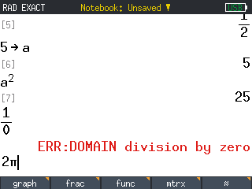

```
1/3+1/6
▶ 1/2
√(8)
▶ 2*√(2)
```

#### A first tour

- Arithmetic: `2+3*4` <kbd>enter</kbd>. Start a line with an operator to continue from the last answer (Ans).
- Store a value: `5` <kbd>→</kbd> <kbd>alpha</kbd> `A` <kbd>enter</kbd> gives `a:=5`. Use the name in later lines.
- Symbolic math: press <kbd>CAS</kbd>, choose `factor(` and type `x^2-1`: the result is `(x-1)*(x+1)`. <kbd>x</kbd> types `x`.
- Decimals: put a decimal point in a number, press <kbd>F5</kbd> (≈) instead of <kbd>enter</kbd>, use `approx(`, or set RESULT to APPROX in [settings](#mode).
- Graph: press <kbd>F1</kbd> (graph) on the home screen, type `sin(x)` next to Y1, then <kbd>F5</kbd> (graph): the graph is a cell of the notebook; <kbd>enter</kbd> on it opens the full graph, where <kbd>F4</kbd> (trace) follows the curve. `sin(x-t)` moves: <kbd>F5</kbd> (play) on the selected cell.
- Apps: <kbd>apps</kbd> lists statistics, matrices, solvers, finance, base-n, units and more ([Apps](#apps)).
- Every command: <kbd>shift</kbd> <kbd>apps</kbd> opens the [catalog](#catalog); <kbd>shift</kbd> <kbd>menu</kbd> on an entry explains it.
- The soft keys <kbd>F1</kbd> .. <kbd>F5</kbd> under the screen do what their labels at the bottom of the screen say ([Soft keys](#softkeys)); <kbd>menu</kbd> lists them.
- Undo, copy and paste: <kbd>menu</kbd> <kbd>F1</kbd> undoes, <kbd>menu</kbd> <kbd>F3</kbd> copies, <kbd>menu</kbd> <kbd>F4</kbd> pastes ([Edit keys: undo, copy, paste](#edit-bar)).
- Find anything: <kbd>shift</kbd> <kbd>apps</kbd> and type a word (`det`, `undo`, `rpn`, `degree`): commands, apps and help pages.
- Settings (<kbd>shift</kbd> <kbd>home</kbd>): ANGLE switches to degrees, ENTRY to [RPN](#rpn); <kbd>◀</kbd> <kbd>▶</kbd> change a setting at once.

#### Your work is kept

Variables, functions, the home history, Y= functions, the window and all settings are saved when the calculator switches off (<kbd>shift</kbd> <kbd>on</kbd>, or automatically after 5 minutes) and come back when you switch it on again, also after a battery change or a firmware update. See [Memory and saved session](#mem).

<a id="screen-layout"></a>

#### The screen

The display has three parts.

- The status bar at the top: the angle mode (DEG or RAD), EXACT or APPROX, the number format when it is not the default (FIX2, SCI3, ENG, ...), the name of the current screen in the middle, a badge while <kbd>shift</kbd> (SHIFT) or <kbd>alpha</kbd> (a, A, a-LK, A-LK for letter lock) is pending, OVR in overwrite mode, and the battery gauge (USB when powered over USB) at the right.
- The body: the screen itself, for example the history and the entry line of the home screen, a graph or a list editor.
- The soft-key bar at the bottom: the labels of <kbd>F1</kbd> .. <kbd>F5</kbd> ([Soft keys](#softkeys)). After <kbd>shift</kbd> it shows the second row of labels. The label of the screen you are on is highlighted.

##### Moving between screens

- <kbd>home</kbd> returns to the calculator (the home screen, or the RPN stack in RPN mode) from anywhere.
- <kbd>apps</kbd> lists the applications ([Apps at a glance](#apps-overview)); a number key or <kbd>▲</kbd> <kbd>▼</kbd> <kbd>enter</kbd> opens one.
- <kbd>menu</kbd> opens the options of the current screen: every soft key with its name, and the edit keys ([Edit keys: undo, copy, paste](#edit-bar)).
- <kbd>shift</kbd> <kbd>menu</kbd> opens help for the current screen, or for the highlighted menu entry.
- <kbd>clear</kbd> first clears what you are typing, then leaves the screen.
- Menus and messages appear over the screen; <kbd>clear</kbd> closes them and you are back where you were.

##### Messages

Errors and confirmations appear in a box over the screen; any key or a tap closes it. Error messages are listed in [Error messages](#errors).

<a id="apps-overview"></a>

#### Apps at a glance

<kbd>apps</kbd> opens the list of applications. Each one is described in its own chapter of help.

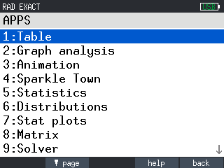

- Graphs are not in the list: <kbd>F1</kbd> (graph) on the home screen opens the graph editor, 2D (functions, parametric, polar and sequence graphs and implicit relations) or 3D (surfaces, parametric surfaces and space curves), and graphing adds a graph cell to the notebook ([Graph cells](#graph-cells), [Graphing](#graphing), [GRAPH](#graph), [3D graphing](#graph3d)).
- Table, Graph analysis: tables of values, zeros, extrema and integrals ([TABLE](#table), [CALC: graph analysis](#graph-calc)).
- Statistics, Distributions, Stat plots: lists, 1-Var and 2-Var statistics, regressions, tests, intervals, probability distributions and plots ([Statistics app](#stat), [Distributions](#stat-distr), [Stat plots](#stat-plots)).
- Matrix: the matrices \[A\] to \[J\] ([MATRIX menu](#matrix-menu)).
- Solver: equations, polynomials and linear systems ([Solver](#solver)).
- Finance: time value of money, amortization, cash flows, interest conversion and days between dates ([Finance](#finance)).
- Base-n: binary, octal and hexadecimal numbers ([Base-n](#basen)).
- Units & constants: units, conversions and physical constants ([Units](#units), [Physical constants](#constants)); measurements with uncertainty use ± ([Measurements with uncertainty](#uncertainty)).
- Spreadsheet: a grid of cells with formulas, linked to statistics lists ([Spreadsheet](#sheet)).
- microSD tools: screenshots, session backup and restore ([microSD tools](#sdtools)).
- Geometry: dynamic constructions with live measurements ([Geometry](#geometry)).
- Python: a Python console with the CAS as a library ([Python](#python), [Python: the calc library](#python-calc)).
- Notebook: pages of text, math, Python and graph cells, kept in the calculator or on the card and opened by Jupyter on a computer ([Notebook](#notebook)).
- Settings, Memory, Help: the MODE settings ([Settings](#mode)), the saved session ([Memory and saved session](#mem)) and this help ([Using help](#help)).

The home screen itself ([Home screen](#home-screen)) evaluates expressions with the computer algebra system; <kbd>CAS</kbd>, <kbd>math</kbd> and <kbd>shift</kbd> <kbd>apps</kbd> (the [catalog](#catalog)) insert its commands. With ENTRY set to RPN in [settings](#mode) the home screen becomes an RPN stack ([RPN mode](#rpn)).

<a id="ch-entering-and-editing"></a>

### Entering and editing

<a id="editing"></a>

#### Editing the entry line

The entry line works with whole tokens: `sin(` is one token and <kbd>⌫</kbd> removes it at once.

- <kbd>◀</kbd> <kbd>▶</kbd> move the cursor, <kbd>shift</kbd> <kbd>◀</kbd> / <kbd>shift</kbd> <kbd>▶</kbd> jump to the start / end.
- <kbd>⌫</kbd> deletes the token before the cursor (at the start of the line: the one under it).
- <kbd>shift</kbd> <kbd>⌫</kbd> switches between insert (default) and overwrite; OVR in the status bar.
- <kbd>clear</kbd> clears the line.
- <kbd>menu</kbd> <kbd>F1</kbd> undoes, <kbd>menu</kbd> <kbd>F2</kbd> redoes, <kbd>menu</kbd> <kbd>F3</kbd> / <kbd>menu</kbd> <kbd>F4</kbd> copy and paste: see [Edit keys: undo, copy, paste](#edit-bar).
- <kbd>→</kbd> stores: `expression→name` becomes `name:=expression`. <kbd>shift</kbd> <kbd>→</kbd> types `:=` directly.
- Menus ([CAS](#menu-cas), [math](#menu-math), [catalog](#catalog), [vars](#vars)) insert at the cursor; templates put the cursor where the argument goes, e.g. `solve(|,x)`.
- `°` (<kbd>shift</kbd> <kbd>,</kbd>, angle menu) marks degrees and `ʳ` radians, whatever the angle mode: `sin(30°)` is 1/2 in both modes.
- Relations for equations and tests are on <kbd>shift</kbd> <kbd>4</kbd> <kbd>5</kbd> <kbd>6</kbd> (`<` `=` `>`) and <kbd>shift</kbd> <kbd>1</kbd> <kbd>2</kbd> <kbd>3</kbd> (`≤` `≠` `≥`).
- `x(x+1)` with a one-letter name multiplies; longer names followed by `(` are function calls.
- Built-in names work in any case, so capitals typed with <kbd>alpha</kbd> <kbd>alpha</kbd> or on a computer keyboard are fine: `COS(x)`, `Sin(x)`, `LN(2)`, `SQRT(2)`, `NCR(5,2)` and the constants `PI`, `Pi`, `INF`, `ANS`. A function or variable you define with such a name (`COS(x):=...`, `PI:=3`) takes precedence. `e` and `i` are the only spellings of Euler's number and the imaginary unit: `E` and `I` are ordinary variables, like every other name, since variables are case-sensitive (`X` and `x` differ).

<a id="edit-bar"></a>

#### Edit keys: undo, copy, paste

<kbd>menu</kbd> opens the options of the current screen. While that menu is open, the soft keys are the edit keys, so <kbd>menu</kbd> works like <kbd>shift</kbd>: press it, then the soft key.


- <kbd>menu</kbd> <kbd>F1</kbd> undo, <kbd>menu</kbd> <kbd>F2</kbd> redo ([Undo and redo](#undo)).
- <kbd>menu</kbd> <kbd>F3</kbd> copy, <kbd>menu</kbd> <kbd>F4</kbd> paste ([Copy and paste](#clipboard)).
- <kbd>menu</kbd> <kbd>F5</kbd> searches the home history ([History search](#history-search)).
- <kbd>menu</kbd> <kbd>shift</kbd> <kbd>F1</kbd> cut (copy the line, then clear it); <kbd>menu</kbd> <kbd>shift</kbd> <kbd>F2</kbd> lists older clips; <kbd>menu</kbd> <kbd>shift</kbd> <kbd>F4</kbd> help.

They work on every screen with an entry line: home, Y=, window, table setup, the solver and finance forms, the list editor, the matrix editor, base-n, RPN. The menu lists these actions first, with the keys that do them now (undo F1, ...), then the screen's own soft keys and Help; <kbd>enter</kbd> or a digit chooses an entry, <kbd>menu</kbd> <kbd>menu</kbd> or <kbd>clear</kbd> closes the menu without doing anything.

When an action changes nothing you can see, the status bar says so until the next key: "copied", "nothing to undo", "clipboard is empty: copy first".

<a id="undo"></a>

#### Undo and redo

<kbd>menu</kbd> <kbd>F1</kbd> undoes the last change of the line you are editing; press it again for earlier changes. <kbd>menu</kbd> <kbd>F2</kbd> redoes what was undone. Typing a new change forgets the redo steps of that line.

- One step is one key: a key that types a word (`sin(`), a template, a menu or catalog insertion, a paste or <kbd>clear</kbd> is undone at once.
- Letters, digits and the decimal point typed in a row are one step, so `123+45` is undone as `45`, `+`, `123`.
- <kbd>enter</kbd> on the home screen clears the line: undo brings the expression back.
- <kbd>clear</kbd> on an empty home line clears the history; <kbd>menu</kbd> <kbd>F1</kbd> right after it brings the history back (the status bar says so). <kbd>shift</kbd> <kbd>clear</kbd> (clear all) asks first instead.
- Every line has its own steps (each Y= function, each form field, each matrix or list cell): moving to another cell starts over, so undo never brings back another cell's text. The oldest steps are dropped when the memory for them is full; they are not kept when the calculator is switched off.

See [Edit keys: undo, copy, paste](#edit-bar).

<a id="clipboard"></a>

#### Copy and paste

<kbd>menu</kbd> <kbd>F3</kbd> copies, <kbd>menu</kbd> <kbd>F4</kbd> pastes at the cursor. What is copied depends on the screen:

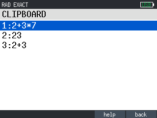

- Home: the line; with a history entry selected (<kbd>▲</kbd>) that input or result.
- RPN: the level selected in the interactive stack (<kbd>▲</kbd>), else the command line, else level 1.
- Matrix editor: the selected cell; on the size line the whole matrix as `[[1,2],[3,4]]`. Pasting such a matrix on the size line resizes the matrix and fills it.
- List editor: the selected value; on the list name the whole list `{1,2,3}`. Paste it on the list name and press <kbd>enter</kbd> to fill a list.
- Spreadsheet: the selected cell's value as shown (while a cell is edited: its line). Pasting opens the cell's entry line; <kbd>enter</kbd> stores it.
- Geometry: the value of the measurement whose list row is under the cursor or that is highlighted, else of the newest measurement.
- Solver and finance forms: the selected field. Y= and other screens: the line.

The clipboard keeps the last 8 texts. <kbd>menu</kbd> <kbd>shift</kbd> <kbd>F2</kbd> (clips) lists them: <kbd>enter</kbd> pastes the highlighted one. The clipboard is kept when the calculator is switched off. <kbd>menu</kbd> <kbd>shift</kbd> <kbd>F1</kbd> (cut) copies the line and clears it. Pasting on the home screen in Textbook mode builds fractions, roots and powers as templates.

See [Edit keys: undo, copy, paste](#edit-bar), [History search](#history-search).

<a id="history-search"></a>

#### History search

<kbd>menu</kbd> <kbd>F5</kbd> lists the home screen's history, newest first: each row is an input and its result. Type to filter: keys type as in the entry line (digits, operators, `sin(`; letters with <kbd>alpha</kbd>); the best matches come first. <kbd>⌫</kbd> erases the last key, <kbd>shift</kbd> <kbd>⌫</kbd> the whole filter.

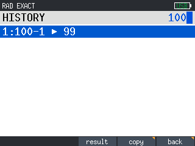

- <kbd>enter</kbd> inserts the input where you were editing.
- <kbd>F3</kbd> (result) inserts the result instead.
- <kbd>F4</kbd> (copy) copies the input to the [Copy and paste](#clipboard), <kbd>shift</kbd> <kbd>F4</kbd> the result.
- <kbd>clear</kbd> or <kbd>F5</kbd> (back) closes the list.

It works from any entry line, for example to reuse a home result in Y= or a form. <kbd>shift</kbd> <kbd>enter</kbd> on the home screen still recalls inputs one by one.

<a id="help"></a>

### Using help

Help pages explain screens, menus and every command.

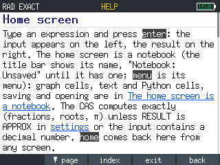

- <kbd>shift</kbd> <kbd>menu</kbd> (help) opens the page for the current screen, or for the highlighted entry when a menu or the catalog is open.
- <kbd>▲</kbd> <kbd>▼</kbd> scroll one line, <kbd>+</kbd> and <kbd>−</kbd> (or <kbd>F2</kbd> <kbd>F1</kbd>) scroll a page.
- <kbd>◀</kbd> <kbd>▶</kbd> highlight the previous / next link, <kbd>enter</kbd> opens it.
- <kbd>⌫</kbd> or <kbd>F5</kbd> (back) goes back to the previous page; <kbd>clear</kbd> or <kbd>F4</kbd> (exit) closes help.
- <kbd>F3</kbd> (index) or <kbd>shift</kbd> <kbd>menu</kbd> inside help opens the [help index](#contents).
- Touch: drag to scroll, tap a link to open it.

Command pages show the syntax, a description, examples (the line after ▶ is the result) and related commands.

<a id="ch-power-memory-and-touch"></a>

### Power, memory and touch

<a id="power"></a>

#### Power and battery

- <kbd>on</kbd> switches the calculator on. <kbd>shift</kbd> <kbd>on</kbd> switches it off.
- After 5 minutes without a key press or touch it switches itself off (not while a computer uses its USB connection, see [Connecting to a computer](#usb)).
- Switching off saves your session (see [Memory and saved session](#mem)); switching on restores it, so you continue where you stopped.
- The battery symbol in the status bar shows the charge of the 4 AAA cells (USB when powered by USB). It turns red when the cells are low (below 1.0 V per cell); replace them soon. Below 0.9 V per cell the calculator saves the session and switches off.
- The calculator runs from USB-C power too; unplugging USB with cells fitted does not interrupt it.
- <kbd>shift</kbd> <kbd>▲</kbd> / <kbd>shift</kbd> <kbd>▼</kbd> change the brightness; LIGHT in [settings](#mode) sets it too. A darker screen makes the cells last longer.

<a id="mem"></a>

#### Memory and saved session

apps \> Memory:

- About: why the calculator last started or restarted (for example "Last reset: watchdog" after a hang), safe mode, firmware version and build tier, memory use, the size of the saved session, whether the full manual is installed, and how the flash chip, the microSD card, the watchdog and the other parts answered at start-up. At the end, "Last events": the last 16 important events, newest first, each with the start it happened in and the time since that start, for example "boot 12 +3.4 s: qspi: write 003f00+4 failed (-2): reset and retry" (a flash write that needed a second try), "start: watchdog (the firmware hung)", "safe mode: crash loop", "session: save failed" or "battery: empty". An event that repeats shows how many times ("(3 times)"). The list is kept when the calculator restarts, switches off or gets new batteries; "none" if nothing happened. The same list is in INFO.TXT on the CALC drive ([Connecting to a computer](#usb)).
- Save session now: write the session to flash immediately.
- Clear CAS variables: delete all stored variables and functions.
- Clear home history.
- Reset settings: every MODE setting back to its default (variables, history, lists and the RPN stack are kept).
- Reset all: everything back to factory state, including the saved session.
- Install content: install the full manual (and other content modules) from the folder `CALC/MODULES` on the microSD card ([Installing the manual](#install-content)).
- Modules: the installed modules with their versions, each followed by the versions of it on the microSD card; verify, go back to the previous version or remove one, or pick any version on the card to install it.
- Remove content: remove every installed module (help then shows only the essential pages; your saved work is not touched).
- Clear event log: forget the "Last events" of About (after asking).

The items that delete something ask first (No is highlighted). <kbd>shift</kbd> <kbd>clear</kbd> (clear all), on any screen, clears the CAS variables and functions together with the home entry line and history, after asking (on the RPN screen it clears the stack instead).

The session (settings, home history and entry line, Y= functions and colours, WINDOW and TBLSET, CAS variables, functions, assumptions and Ans, and the state of apps) is saved in the calculator's flash memory when it switches off and one minute after the last key press. It is restored when the calculator starts, also after a battery change or a firmware update. A power loss while saving keeps the previous copy.

<a id="touch"></a>

#### Touch gestures

The touch screen is optional: everything also works with the keys. A tap also ends a one-shot <kbd>shift</kbd> or <kbd>alpha</kbd>.

- Soft keys: tap a label in the bar at the bottom of the screen to press that key (after <kbd>shift</kbd>: its second function).
- Scrolling: on every screen and menu that scrolls, drag to scroll; the content follows your finger (drag up to see what is below, left to see the columns on the right), and the selection moves along when it would leave the screen. A drag never chooses or runs anything.
- Menus: tap an entry to choose it; drag up or down to scroll.
- Home screen: tap a history entry to select it, tap it again to paste it into the entry line; tap the entry line to move the cursor; tap empty space to deselect; drag down to look back through the history (any key returns to the entry line).
- Y=: tap the colour swatch to change the colour, the `=` to switch the function on or off, the expression to edit it.
- Graph: drag to pan, pinch with two fingers to zoom, tap to trace the nearest function at that x.
- Swipe (a quick, straight flick): in help, swipe right to go back and left for the next page; in Math Quest, swipe between rooms, worlds and book or shop pages, and flick celebrations away. A slow drag still scrolls.
- Table: tap a cell to select it, drag to scroll.
- Settings: tap an option to select it.
- WINDOW, TBLSET and the forms of the statistics, solver and finance apps: tap a field to edit it.
- List editor, spreadsheet and matrix grids: tap a cell to select it; drag in any direction to scroll.
- Help: drag to scroll, tap a link.
- Messages: tap to close.

<a id="errors"></a>

#### Error messages

Errors appear in red in the history. The entry is kept, press <kbd>shift</kbd> <kbd>enter</kbd> (entry) to recall and fix it.

- ERR:SYNTAX: the input cannot be read (missing parenthesis, two operators in a row, ...).
- ERR:DOMAIN: a value outside the domain, e.g. division by zero or `ln(0)`.
- ERR:UNDEFINED: an unknown name or function.
- ERR:MEMORY: the computation ran out of memory or was nested too deeply.
- ERR:BREAK: stopped with <kbd>on</kbd>.
- ERR:UNSUPPORTED: valid input that the CAS cannot handle yet.
- ERR:NONREAL ANS: a complex result while COMPLEX is REAL in [settings](#mode-complex).

<a id="install-content"></a>

### Installing the manual

The full manual is a separate module, stored in the calculator's 16 MB flash memory chip next to the firmware. The firmware works without it: until it is installed, help shows only a few essential pages (this one, the [index](#contents), [Keyboard](#keys), [Getting started](#getting-started), [Using help](#help), [Memory and saved session](#mem), [Power and battery](#power), [Error messages](#errors) and [Safe mode](#safe-mode)), and every other page says "Manual not installed".

#### From a microSD card

- Copy the folder `MODULES` of the firmware release (the module files and `INDEX.TXT`) into the folder `CALC` on a FAT-formatted microSD card. Each file name carries its version: `MANUA010.MOD` is the manual 0.1.0, `MANUA020.MOD` the manual 0.2.0, so several versions sit side by side; copying a newer release adds its files next to the older ones.
- Insert the card, then <kbd>apps</kbd> Memory, Install content. For every module on the card the calculator takes the newest version that suits its firmware, writes it (a few seconds, with a progress bar) and verifies it.
- When the calculator starts without a working manual and finds a usable manual module on the card, it offers to install it.

#### Managing modules

<kbd>apps</kbd> Memory, Modules lists every module with its installed version and state, and right under it every version of it on the microSD card with what installing that version would do: new, upgrade, downgrade, reinstall, or incompatible (made for another firmware). Choose a card version to install exactly that one (an older one too). Choose the module itself to verify it, to go back to the version installed before it (Revert), or to remove it. The last row reads the card again after you changed it.

#### Without a card

- With a computer and a USB cable: drag the module file onto the calculator's CALC drive ([Connecting to a computer](#usb)).
- From a computer's console: `calcctl.py --upload-module MANUA010.MOD` sends a module over the USB connection (or the debug cable).
- With a debug probe: OpenOCD writes the release's `calc_qspi.bin` (all modules) to the flash chip directly.

#### Good to know

- Installing one module never touches the others, and a power cut while installing is harmless: the version that was in use stays in use, and the new one counts only once it has been written and checked completely. Install again.
- A module states which firmware versions it works with. After a firmware update the installed modules keep working unless the update changed what they rely on; then help says the module is for an incompatible firmware: install the modules of the new release.
- Memory, About shows which modules are installed and how the flash chip and the microSD card answered.
- Memory, Remove content removes every module (your saved work is not touched).
- Besides the manual there are modules of program code, such as Animation: see [Code modules](#code-modules).

<a id="code-modules"></a>

#### Code modules

Some features are modules of program code that live in the 16 MB flash chip next to the firmware, like the [manual](#install-content): the calculator runs them directly from there. They are Animation ([Animation: graphs that move](#animation)), Geometry ([Geometry](#geometry); installed at the factory), Python ([Python](#python); installed at the factory, copied into the SDRAM when it starts) and the advanced CAS. Install them the same way as the manual (Memory, Install content or Memory, Modules, from the `MODULES` folder of the release on a microSD card, or by dropping the file on the CALC drive of a computer, [Connecting to a computer](#usb)); the advanced firmware has them installed already.

Without the module its feature says how to install it; a module made for another firmware, or a damaged one, is not run; in safe mode no module runs. Memory, About lists the installed modules.

<a id="safe-mode"></a>

#### Safe mode

Safe mode starts the calculator without the installed modules and without your saved session, so that a damaged module or saved session cannot stop it from starting. Your saved session is not deleted: it comes back at the next normal start.

- Hold <kbd>clear</kbd>, press <kbd>on</kbd>, and keep both held together (at least half a second) until the home screen appears with SAFE MODE in the status bar. Pressing <kbd>on</kbd> alone, or <kbd>clear</kbd> after the calculator has started, never starts safe mode.
- The calculator also starts in safe mode by itself after three starts in a row that did not finish: a crash during start-up, or a hang, which the watchdog ends after about 2 seconds by restarting the calculator.
- In safe mode help shows only the essential pages; calculations, graphing and the apps work as usual. Nothing is saved when you switch off.
- To leave safe mode, switch off (<kbd>shift</kbd> <kbd>on</kbd>) and on again.
- Memory, About shows why safe mode is on, and why the calculator last restarted (for example "Last reset: watchdog"); its "Last events" list keeps the crashes, watchdog resets and safe-mode starts of earlier starts too.

<a id="usb"></a>

### Connecting to a computer

Connect the calculator's USB-C port to a computer with a USB cable. The calculator keeps working as usual, runs from the computer's power, and does not switch itself off while the computer uses the connection. A USB charger only powers it: nothing else changes.

#### The CALC drive

The computer shows a drive named CALC. Its files are made by the calculator when you connect it:

- `README.TXT`: what the drive is for.
- `INFO.TXT`: the firmware version, the battery, the free space for modules, the installed modules with their versions, and the last events (as Memory, About lists them).
- `MODULES.TXT`: the installed modules in detail.
- `RESULT.TXT`: what happened to the last module file you dropped on the drive.
- `SCREEN.BMP`: a picture of the calculator's screen as it is when the computer reads it.
- `NOTEBOOK.HTML`: the open notebook (the [home screen's](#home-notebook)) as one page that any phone, tablet or computer shows, also without a network: text cells, calculations with their results as the calculator draws them, graph cells as pictures, Python cells with their output. Copy it anywhere to keep or send it. It follows the notebook, unsaved too: after a change, once the calculator has been left alone for about 10 seconds (and the computer is not reading the drive), the drive refreshes itself with the new page (at most every 30 seconds; at once when another notebook is opened, created or saved under a name). While the browser page ([Use the calculator from a computer's browser](#browser)) follows the notebook the drive waits, then catches up when the page has gone. A refresh makes the drive leave and come back for a moment, as after a module install.
- `NOTEBOOKS`: the notebooks kept in the calculator, as Jupyter files `NAME.ipynb` ([Notebook: files, card and computer](#notebook-files)). Drop a `.ipynb` file on the drive to import it.
- `CALCULATOR.HTML`: the calculator's open notebook in the computer's browser, to read, edit and run there, the cells running on the calculator ([Use the calculator from a computer's browser](#browser)).

These files are read-only. Nothing else you put on the drive is kept when the calculator is switched off or disconnected.

#### Installing modules by drag and drop

Drag a module file (a `.MOD` file from the `MODULES` folder of a firmware release, such as `GEOME010.MOD`) onto the CALC drive.

- When the copy is finished, the calculator checks the whole file first: that it is a module, complete and undamaged, and made for this firmware. Only then does it write it, with the progress bar of [Installing the manual](#install-content), keeping the version it replaces (Memory, Modules can go back to it).
- A short message says what happened: "Installed Geometry 0.1.0", or why not (for example "damaged file": copy it again; "for another firmware": use the modules of this firmware's release). `RESULT.TXT` keeps the details.
- Then the drive refreshes itself so the computer sees the new files: the module file disappears from it, `MODULES.TXT` and `RESULT.TXT` are new. The computer may say the drive was not ejected properly; that is expected, nothing is lost.
- A module that is in use is installed when you leave it: for example, a new Geometry module waits until you leave the Geometry app ("Leave Geometry to install it").
- Files that are not modules are ignored.

#### The microSD card on the computer

APPS, microSD tools, Connect card to computer turns the card in the slot into a second drive of the computer, so you can copy files to and from it (for example the `MODULES` folder of a release, or screenshots). Meanwhile a full screen says "Connected to computer", and the calculator does not use the card itself.

- When you are done, eject the drive on the computer, then press EXIT (<kbd>F5</kbd>, or <kbd>clear</kbd>). If the computer has not ejected it yet, the calculator asks first: taking the card back before the computer has finished writing can damage its files.
- Without a computer connected, or without a card in the slot, the calculator says so.

#### If the computer does not see the calculator

<kbd>apps</kbd> Memory, USB status shows, four times a second, what the calculator sees of the connection: whether the cable brings power (VBUS), the state of the connection (powered, configured by the computer, suspended), the last error, and counts of what has happened. Try another cable (some cables only charge) or another port.

#### For developers

The USB connection also carries the calculator's console (a serial port; `tools/calcctl.py` finds it by itself) and can restart the calculator for a firmware update over USB (`calcctl.py flash`, no button needed). See the firmware's README.

<a id="browser"></a>

### Use the calculator from a computer's browser

The CALC drive ([Connecting to a computer](#usb)) holds `CALCULATOR.HTML`: a page, like Jupyter, that shows the calculator's notebook, the one on its home screen ([The home screen is a notebook](#home-notebook)), on the computer's screen and edits it there. The calculator and the page are two views of one notebook: what you change on one shows on the other. Open the page in Chrome or Edge on the computer the calculator is connected to; nothing has to be installed and the page uses no network.

#### Connecting

- Connect the calculator with a USB cable and open `CALCULATOR.HTML` from the CALC drive in Chrome or Edge (or copy it to the computer first and open the copy).
- Click Connect at the top right and choose the calculator. The dot turns green and shows the firmware version. Next time the page connects by itself.
- The page shows the notebook of the calculator's home screen at once, named or not ("Unsaved"). The calculator stays where it is: connecting does not change its screen.
- When the calculator leaves the USB connection for a moment (it refreshes the drive after a module was installed), the page waits, reconnects on its own and reads the notebook again.
- Not connected, the page shows the notebook as it last saw it, read-only. Safari and Firefox cannot talk to the calculator: they show "Open this file in Chrome or Edge to connect to the calculator", but still open notebook files to read them.

#### One notebook, two views

- Both always have the same notebook: the home screen's. Opening, creating or switching a notebook on either side switches the other (<kbd>menu</kbd> Open or New on the calculator; Notebooks or New in the page). Notebooks in the page lists the calculator's notebooks: open, rename, delete. Typing a name for an unsaved notebook in the page saves it under that name, as <kbd>menu</kbd> Save does.
- Calculations, text and Python cells and graph cells made on the calculator's home screen appear in the page as they are made; cells added, changed or run in the page appear on the home screen. You may use other apps on the calculator meanwhile: the page keeps working on the notebook.
- A cell being edited on one side cannot be edited on the other: the page says "editing on the calculator" (and shows the typing as it goes), the calculator says "being edited in the browser". The cell is free again when the editing ends, or 30 seconds after the page went quiet.
- Running a cell, from either side, runs it once on the calculator: Python in its Python, Math with its CAS. The results show on both, the calculator in textbook form and its plot picture, the page typeset and as a graph you can move and zoom (the calculator computes the values).
- A graph cell is drawn in the page with its functions in its window and in their colours (the calculator computes the values). Change it there too: its functions (one a line in the cell), the range under it, or drag and zoom the graph: the calculator's cell gets the new window when you let go. While the calculator's graph app is open on the cell it is read-only in the page. A cell without a function shows no graph on either side until you type one.
- 3D graph: z = f(x,y) and its x, y and z ranges; it is a 3D graph cell on the calculator too (<kbd>enter</kbd> there opens the 3D graph). The page draws the surface from values the calculator computes (a 40 × 40 grid): drag to turn it, wheel or pinch to zoom, double-click to go back to the cell's view (turning it here does not turn the calculator's). Parametric surfaces and curves show the calculator's picture.
- Animated graph: a function that uses `t` (`sin(x-t)`, `sin(x-t)*cos(y)` in a 3D graph) makes the cell animated, here and on the calculator. The page plays it at once from frames the calculator computes (one batch): play / pause, the slider moves t by hand, the menu at its right sets the speed. Play, pause and speed are the page's own (the calculator plays its cell only when you press <kbd>F5</kbd> there). The row under the cell has t's range, the seconds a sweep and loop, bounce or once: those belong to the cell and change on both sides. Turning and zooming a 3D one works while it plays. Parametric 3D graphs of t show the calculator's picture.
- While the page follows the notebook the calculator does not refresh its drive (that would drop the connection); `NOTEBOOK.HTML` catches up when the page has gone.

#### Cells

- Python: runs in the calculator's Python ([Python](#python), with the [Python: the calc library](#python-calc) library). Variables stay until Restart. The value of the last line is shown as the result, typeset when it is a CAS expression; `calc.plot(f, a, b)` draws its graph under the cell.
- Math: one line of CAS input, such as `solve(x^2-2=0,x)` or `f(x):=x^3`; Enter runs it. It shares the CAS variables and settings of the calculator.
- Graph: functions of `x`, one a line (Enter starts a new line), and the x and y range under the cell; the graph shows as soon as there is a function. Drag the graph to move it, pinch or (after clicking it) use the wheel to zoom, double-click to go back: the calculator computes the new range and its cell follows.
- Text: notes in Markdown, with math between dollar signs such as `$x^2$`.

#### Earlier results

- The numbers In \[n\] and Out\[n\] are the calculator's: one count for both, the \[n\] by each result on its home screen. `Out[n]` is the result of cell \[n\] and `Ans` the latest result, in Math cells (`Out[2]*3`, `Ans+1`; `out[n]` and `ans` work too) and in Python cells (`Out` maps the numbers to the values) alike ([The home screen is a notebook](#home-notebook), [Python](#python)).
- Hover over a cell's input or result: "insert text" puts that input or result, "insert Out\[n\]" the reference to the result, where you are typing (at the cursor), or into a new cell at the end when no cell is being edited.
- Alt-Up and Alt-Down while typing in a cell bring back the inputs of the cells above of the same kind, nearest first, in place of the text (Alt-Down past the nearest gives back what you had typed), like <kbd>shift</kbd> <kbd>enter</kbd> on the calculator.

#### Keys

As in Jupyter: in a cell you type (edit mode, green bar); Esc leaves the cell (command mode, blue bar) and Enter goes back in.

- Shift-Enter runs the cell and goes to the next one; Ctrl-Enter runs it and stays; Alt-Enter runs it and inserts a cell below.
- In command mode: A and B insert a cell above or below, D D deletes it (Z brings it back), X C V cut, copy and paste, Y T G M make it a Python, Math, Graph or Text cell, Shift-G a 3D graph, arrows or K and J move between cells, Shift-K and Shift-J move the cell.
- I I (or the Interrupt button) stops a running cell with `KeyboardInterrupt`, as <kbd>on</kbd> does on the calculator; 0 0 (or Restart) starts Python afresh.
- H shows all keys; Ctrl-S (Cmd-S on macOS) saves a copy on the computer.

#### Saving and files

- The calculator keeps the notebook: it saves it when it is switched off (also when the battery runs low), when you open another notebook, before it exports it, and two minutes after the last change. Until then a dot after the name (on the page) and a star before the name in the title bar (on the calculator) show there are unsaved changes. An unsaved notebook is kept by the calculator like its calculations always were.
- Open takes a notebook file (`.ipynb`) from the computer, or drop it on the page: it goes into the calculator, under the file's name (a notebook of that name is replaced, its previous version kept), and opens on both.
- Save writes the calculator's notebook to a file on the computer, Download saves a copy: Jupyter opens it, with the outputs and the plots as pictures.

#### If something does not work

- The calculator is not offered: try another cable (some only charge); close other programs that use its serial port.
- `CALCULATOR.HTML` is missing from the drive: install the notebook page module (`WEBUI010.MOD` from the `MODULES` folder of the release) by dropping it on the CALC drive ([Code modules](#code-modules)).
- The page says the calculator has no Notebook: install the Python module the same way.

<a id="part-keyboard"></a>

## Keyboard

<a id="keys"></a>

### Keyboard

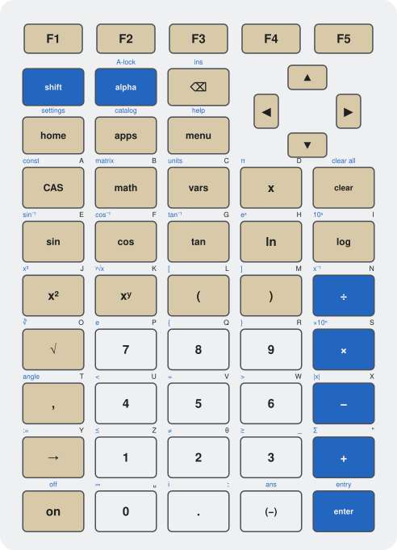

Every key has up to three functions: the one on the key, a <kbd>shift</kbd> function (printed above the key on the left, blue) and an <kbd>alpha</kbd> letter (above the key on the right, white). Press <kbd>shift</kbd> or <kbd>alpha</kbd> first, then the key. <kbd>alpha</kbd> twice gives a capital letter; <kbd>shift</kbd> <kbd>alpha</kbd> locks letters until <kbd>alpha</kbd> or <kbd>clear</kbd>.

The top row <kbd>F1</kbd> .. <kbd>F5</kbd> are soft keys: their labels are at the bottom of the screen and change with the screen ([Soft keys](#softkeys)). Tapping a label works too. <kbd>shift</kbd> <kbd>F1</kbd> .. <kbd>F5</kbd> are the screen's second soft keys (shown while <kbd>shift</kbd> is pending), <kbd>menu</kbd> lists them all.

#### The keys

```
key    does       SHIFT        ALPHA
F1
F2
F3
F4
F5
shift
alpha             A-lock
⌫                 ins
home   home       settings
apps   apps       catalog
menu   menu       help
▲                 backlight brighter
◀                 start of the line
▶                 end of the line
▼                 backlight dimmer
CAS    cas        const        A
math   math       matrix       B
vars   vars       units        C
x      x          π            D
clear             clear all
sin    sin(       sin⁻¹        E
cos    cos(       cos⁻¹        F
tan    tan(       tan⁻¹        G
ln     ln(        eˣ           H
log    log(       10ˣ          I
x²     ²          x³           J
xʸ     ^          ʸ√x          K
(      (          [            L
)      )          ]            M
÷      /          x⁻¹          N
√      √(         ∛            O
7      7          e            P
8      8          {            Q
9      9          }            R
×      *          ×10ⁿ         S
,      ,          angle        T
4      4          <            U
5      5          =            V
6      6          >            W
−      -          |x|          X
→      →          :=           Y
1      1          ≤            Z
2      2          ≠            θ
3      3          ≥            _ (units)
+      +          Σ            "
on                off
0      0          ∞            space
.      .          i            :
(−)    ⁻          ans
enter             entry
```

#### Global keys

- <kbd>home</kbd>: the calculator (home or RPN) screen from anywhere; <kbd>shift</kbd> <kbd>home</kbd>: settings
- <kbd>apps</kbd>: all apps; <kbd>shift</kbd> <kbd>apps</kbd>: the catalog of every command
- <kbd>menu</kbd>: options of the current screen; <kbd>shift</kbd> <kbd>menu</kbd>: help for it (or for the highlighted menu item)
- <kbd>CAS</kbd>, <kbd>math</kbd>, <kbd>vars</kbd>: menus that insert commands; <kbd>shift</kbd> <kbd>CAS</kbd> constants, <kbd>shift</kbd> <kbd>math</kbd> matrices, <kbd>shift</kbd> <kbd>vars</kbd> units
- <kbd>⌫</kbd> deletes the character before the cursor; <kbd>shift</kbd> <kbd>⌫</kbd> switches insert / overwrite
- <kbd>clear</kbd> clears the line, then leaves the screen; <kbd>shift</kbd> <kbd>clear</kbd> also clears the history
- <kbd>shift</kbd> <kbd>▲</kbd> / <kbd>▼</kbd>: backlight; <kbd>shift</kbd> <kbd>◀</kbd> / <kbd>▶</kbd>: start / end of the line
- <kbd>shift</kbd> <kbd>on</kbd>: off. <kbd>on</kbd> stops a long computation.

See also [Soft keys](#softkeys), [Home screen](#home-screen), [Help index](#contents).

<a id="softkeys"></a>

### Soft keys

The top row of keys, <kbd>F1</kbd> .. <kbd>F5</kbd>, has no fixed job: the bar at the bottom of the screen shows what each key does on the current screen. After <kbd>shift</kbd> the bar shows the second row of labels (in amber), for <kbd>shift</kbd> <kbd>F1</kbd> .. <kbd>shift</kbd> <kbd>F5</kbd>; a small amber corner on a label means that key has such a second function. A highlighted label is the screen you are on. Tap a label to press its key. <kbd>menu</kbd> lists every soft key of the screen (on screens with an entry line after the [edit keys](#edit-bar)), and <kbd>shift</kbd> <kbd>menu</kbd> opens help.

The same places on every screen: on lists, menus and help <kbd>F1</kbd> <kbd>F2</kbd> page, <kbd>F4</kbd> is help where there is room, and <kbd>F5</kbd> goes back (back, done, ok). <kbd>shift</kbd> <kbd>menu</kbd> is help everywhere, <kbd>home</kbd> goes to the home screen and <kbd>clear</kbd> leaves the current menu or screen.

#### Home screen

- <kbd>F1</kbd> graph (the graph editor: [2D functions](#yeq), or [3D](#graph3d-eq) with its switch), <kbd>F2</kbd> frac, <kbd>F3</kbd> func, <kbd>F4</kbd> mtrx ([templates](#textbook-templates)), <kbd>F5</kbd> ≈ evaluates the line as a decimal.
- <kbd>shift</kbd>: table, solve, simplify (the last result, the selected one or the line), rewrite (menu: alternate forms, factor, expand, ≈ / exact, partfrac, trig forms, collect; see [Simplify and rewrite results](#result-actions)), graph.
- With a calculation selected (<kbd>▲</kbd>): <kbd>F1</kbd> input, <kbd>F2</kbd> result, <kbd>F3</kbd> Out\[n\] (put on the entry line), <kbd>F4</kbd> edit, <kbd>F5</kbd> ≈; with a Python cell selected: <kbd>F1</kbd> edit, <kbd>F2</kbd> result, <kbd>F3</kbd> Out\[n\] ([The home screen is a notebook](#home-notebook)); with an animated graph cell selected: <kbd>F5</kbd> play (pause while it plays; [Graph cells](#graph-cells)).

#### Graph screens (Y=, window, graph, table, table setup, sliders)

- <kbd>F1</kbd> y=, <kbd>F2</kbd> window, <kbd>F3</kbd> zoom, <kbd>F4</kbd> trace, <kbd>F5</kbd> graph (on GRAPH itself: back, to the notebook; <kbd>shift</kbd> <kbd>F5</kbd> there is anim, the [ANIMATION](#animation) menu, pause while playing).
- <kbd>shift</kbd>: plots ([stat plots](#stat-plots)), tblset, format (the settings screen at GRID and AXES), calc ([graph analysis](#graph-calc)), table.
- On Y= <kbd>F1</kbd> is 3D (the 3D entries: the 2D/3D switch of the graph editor), and <kbd>menu</kbd> lists the options of the highlighted entry and the graph modes instead ([Y= functions](#yeq)).

#### 3D graphing

- Graph: <kbd>F1</kbd> z=, <kbd>F2</kbd> window, <kbd>F3</kbd> view, <kbd>F4</kbd> trace (next while tracing), <kbd>F5</kbd> back (to the notebook); <kbd>shift</kbd>: reset, style, color, zfit, anim ([Animation: graphs that move](#animation); pause while playing). See [3D graphing](#graph3d).
- Entries (z=): the same keys, but <kbd>F1</kbd> is 2D (back to the 2D functions); <kbd>shift</kbd>: type, on/off, color.

#### Alternate forms (forms)

- <kbd>F1</kbd> <kbd>F2</kbd> page, <kbd>F3</kbd> use (take the chosen form), <kbd>F4</kbd> help, <kbd>F5</kbd> back; <kbd>shift</kbd> <kbd>F3</kbd> copy. See [Alternate forms: equivalent ways to write a result](#forms-browser).

#### RPN

- <kbd>F1</kbd> .. <kbd>F5</kbd>: swap, drop, roll, pick, undo; <kbd>shift</kbd>: dup, over, rot, simplify (level 1), rewrite (the [REWRITE](#result-actions) menu for level 1). LASTARG is <kbd>shift</kbd> <kbd>(−)</kbd>, the STACK menu <kbd>,</kbd>.
- With a level selected (<kbd>▲</kbd>): echo, pick, roll, rolld, dropn; <kbd>shift</kbd> <kbd>F1</kbd> edit. See [RPN mode](#rpn).

#### Apps

- List editor: stat, calc, tests, plots, graph; <kbd>shift</kbd>: sortA, sortD, clrlist, csv, distr.
- Statistics forms: <kbd>F5</kbd> calc (or draw, sort, export, zoomstat), <kbd>F4</kbd> draw on the tests, graph on the plot settings; results: <kbd>F1</kbd> draw (tests), <kbd>F2</kbd> plot (regressions), <kbd>F5</kbd> back.
- Spreadsheet: $, :, fill↓, copy, paste; <kbd>shift</kbd>: link, sheet, plot, stat, graph. See [Spreadsheet](#sheet).
- Matrix editor: names, math, edit, <kbd>F5</kbd> →home (the matrix name on the home screen).
- Solver: equation, poly, linear (switch solver), <kbd>F5</kbd> solve.
- Finance: tvm, amort, cashflow, interest, <kbd>F5</kbd> solve; <kbd>shift</kbd> <kbd>F1</kbd> days.
- Base-n: hex, dec, oct, bin (input base), <kbd>F5</kbd> bits (word size).
- Geometry: move, points, draw, constr, measure (tools); <kbd>shift</kbd>: undo, delete, view, file, hide ([Geometry](#geometry)).
- Python: run, tab, chars, break, clear; <kbd>shift</kbd>: dedent, calc, vars, help ([Python](#python)).
- Notebook: the list: open, new, rename, delete, more; a page: run, edit, +cell, cell, file, <kbd>shift</kbd>: run all, +above; editing: run, tab, chars, cancel, done, <kbd>shift</kbd>: dedent, calc. ([Notebook](#notebook)).
- Math Quest (candy buttons with icons): map: home, book, arcade, players, grown-up (its gate); a round: trick, power (when one is held), back; parent screen: skills, facts, time, setup, done ([Math Quest: math games for grades 3 to 5](#mathquest)).
- Settings: about, help, done. Help: page up, page down, index, exit, back.
- Menus: page up, page down, help, back. Messages: ok.
- The <kbd>menu</kbd> menu on a screen with an entry line: undo, redo, copy, paste, history; <kbd>shift</kbd>: cut, clips, help, back ([Edit keys: undo, copy, paste](#edit-bar)).
- Catalog: page up, page down, categ, help, back. History search: page up, page down, result, copy, back; <kbd>shift</kbd> <kbd>F4</kbd> copy res.

Apps written later declare their own soft keys (app/EXTENDING.md).

<a id="part-apps-and-screens"></a>

## Apps and screens

<a id="home-screen"></a>

### Home screen

Type an expression and press <kbd>enter</kbd>: the input appears on the left, the result on the right. The home screen is a notebook (the title bar shows its name, "Notebook: Unsaved" until it has one; <kbd>menu</kbd> is its menu): graph cells, text and Python cells, saving and opening are in [The home screen is a notebook](#home-notebook). The CAS computes exactly (fractions, roots, π) unless RESULT is APPROX in [settings](#mode) or the input contains a decimal number. <kbd>home</kbd> comes back here from any screen.

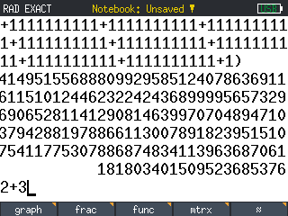

- <kbd>enter</kbd> on an empty line repeats the last entry; <kbd>F5</kbd> (≈) evaluates the line as a decimal. On an empty line (or with a history entry selected) <kbd>F5</kbd> switches the last result (the selected one) between decimal and exact: `approx(Ans)`, `exact(Ans)`. Back from a decimal that ≈ made, it gives the exact value again (`ln(9)`, ≈, ≈: `2·ln(3)`), not a fraction close to the decimal.
- Results are simplified as they are shown (SIMPLIFY AUTO in [settings](#mode-simplify)): `cos(x)^2+sin(x)^2` gives 1. <kbd>shift</kbd> <kbd>F3</kbd> (simplify) simplifies further, <kbd>shift</kbd> <kbd>F4</kbd> (rewrite) offers factor, expand, partfrac, trig forms and more: see [Simplify and rewrite results](#result-actions).
- A line that starts with an operator (`+`, `*`, `^`, `²`, ...) continues from the last result: `*2` means `Ans*2`.
- <kbd>shift</kbd> <kbd>(−)</kbd> inserts `Ans`, the last result.
- <kbd>shift</kbd> <kbd>enter</kbd> (entry) recalls earlier inputs, newest first; press it again for older ones.
- <kbd>▲</kbd> selects a history entry (input or result), <kbd>▲</kbd> <kbd>▼</kbd> move the selection, <kbd>enter</kbd> pastes it into the entry line, <kbd>clear</kbd> deselects. While one is selected the soft keys paste its input, its result or `Out[n]` (<kbd>shift</kbd> <kbd>enter</kbd>: its result); `Out[n]` is the result marked \[n\] and `Ans` the latest one ([The home screen is a notebook](#home-notebook)).
- <kbd>menu</kbd> opens the [The notebook menu](#notebook-menu) (save, open, new, text and Python cells, run all, edit in place).
- <kbd>clear</kbd> clears the entry line; on an empty line it clears the history (<kbd>menu</kbd> <kbd>F1</kbd> right after brings it back). <kbd>shift</kbd> <kbd>clear</kbd> (clear all) asks, then deletes the variables and functions, the entry line and the history; settings, Y=, lists and apps are kept ([Memory and saved session](#mem): Reset all).
- `expr→name` (<kbd>→</kbd>) stores a value; `f(x):=x^2` (<kbd>shift</kbd> <kbd>→</kbd> types `:=`) defines a function. Use [vars](#vars) to insert stored names.
- `Y1(2)` evaluates the Y= function Y1 at 2 (vars, Y-VARS).
- Soft keys: <kbd>F1</kbd> graph (the graph editor: 2D functions, or 3D with its switch; graphing them adds a [graph cell](#graph-cells) here), <kbd>F2</kbd> frac, <kbd>F3</kbd> func and <kbd>F4</kbd> mtrx ([templates](#textbook-templates)), <kbd>F5</kbd> ≈; <kbd>shift</kbd> <kbd>F1</kbd> .. <kbd>F5</kbd>: table, solve, simplify, rewrite ([Simplify and rewrite results](#result-actions)), graph (adds a [graph cell](#graph-cells)).
- Built-in function and command names work in any case: `COS(x)`, `Sin(x)`, `LN(2)`, `SQRT(2)`, `PI` (see [Editing the entry line](#editing)). Variables are case-sensitive: `X` and `x` are different.

Results follow the number format of [settings](#mode-format) (FIX, SCI, ENG) and the [COMPLEX](#mode-complex) setting. See also [Editing the entry line](#editing) and [Error messages](#errors).

<a id="home-notebook"></a>

#### The home screen is a notebook

Everything on the [Home screen](#home-screen) is a notebook: each calculation is a math cell (its input on the left, the result on the right), graphing from here puts the graph into the notebook as a graph cell ([Graph cells](#graph-cells)), and <kbd>menu</kbd> adds text and Python cells. The title bar says which notebook it is: "Notebook: Unsaved" until it has a name, "Notebook: Lab 1" once saved, with a star ("Notebook: \*Lab 1") while it has changes not yet stored; the ▼ after it says that <kbd>menu</kbd> (or a tap on the title) opens the notebook menu. Without a name the notebook is kept like the history always was (it survives switching off, a reboot and a firmware update); <kbd>menu</kbd> Save gives it a name and stores it with the other notebooks, which Jupyter on a computer can read ([Notebook: files, card and computer](#notebook-files)).

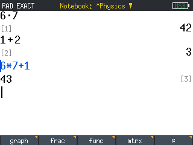

- Typing and <kbd>enter</kbd> work as they always did: results, `Ans`, <kbd>shift</kbd> <kbd>enter</kbd> (entry), the CAS and MATH menus, <kbd>shift</kbd> <kbd>F3</kbd> simplify and <kbd>shift</kbd> <kbd>F4</kbd> rewrite.
- <kbd>▲</kbd> selects an earlier cell (an input or a result), <kbd>enter</kbd> copies it down to the entry line (calculator style). To change the cell itself and compute it again use <kbd>menu</kbd> Edit in place.
- On a selected Python cell <kbd>enter</kbd> opens it in the editor of several lines ([Notebook](#notebook)); <kbd>F5</kbd> done comes back here. On a text cell of one line <kbd>enter</kbd> edits it on the entry line.
- On a selected graph cell <kbd>enter</kbd> opens the graph app on it ([Graph cells](#graph-cells)).
- <kbd>clear</kbd> on an empty line starts a new unsaved notebook (<kbd>menu</kbd> <kbd>F1</kbd> right after brings the cells back). A notebook with a name is never cleared this way: use <kbd>menu</kbd> New.
- <kbd>menu</kbd> is the notebook menu: [The notebook menu](#notebook-menu).
- Connected to a computer, the CALC drive has `NOTEBOOK.HTML`: this notebook as a page any phone or computer shows ([Connecting to a computer](#usb)), and `CALCULATOR.HTML` shows and edits it live ([Use the calculator from a computer's browser](#browser)).
- The 2D (Textbook) view draws the notebook as soon as it has a cell other than a calculation; drag to scroll it.

##### Earlier results: Ans and Out\[n\]

Every result has a number, the small grey \[n\] at its left: the cell's execution count, the same number the browser page shows as In \[n\] and Out\[n\] ([Use the calculator from a computer's browser](#browser)). Numbers go up by one with every calculation and every cell that runs, here or in the browser; a cell computed again gets a new number.

- `Ans` is the latest result of the notebook (the ANS key types it; an operator first, as in `+2`, uses it). A Python cell's value counts too; errors and cells without a value do not.
- `Out[n]` is the result of cell \[n\]: `Out[3]*2`, `solve(Out[5]=0,x)`. `out[n]` works too. A number that has no result says so: `ERR:UNDEFINED Out[7]: no such result`.
- Both work in calculations and in Python cells ([Python](#python)), and after the notebook is switched off or opened again: the results are kept with it.
- On a selected calculation the soft keys put it on the entry line at the cursor: <kbd>F1</kbd> input (the same as <kbd>enter</kbd> on the input), <kbd>F2</kbd> result, <kbd>F3</kbd> Out\[n\] (the key shows the cell's number), <kbd>F4</kbd> edit (edit in place), <kbd>F5</kbd> ≈ as before. On a selected Python cell: <kbd>F1</kbd> edit, <kbd>F2</kbd> result, <kbd>F3</kbd> Out\[n\]. <kbd>shift</kbd> <kbd>enter</kbd> on a selected cell puts its result on the entry line.

<a id="notebook-menu"></a>

#### The notebook menu

<kbd>menu</kbd> on the home screen (or a tap on the title bar's "Notebook: ..." ▼) opens the NOTEBOOK menu (its title is the notebook's name, with a star while it has changes not yet stored). Choose with <kbd>▲</kbd> <kbd>▼</kbd> and <kbd>enter</kbd>, a digit, or a tap. The soft keys keep the edit actions: <kbd>F1</kbd> undo, <kbd>F2</kbd> redo, <kbd>F3</kbd> copy, <kbd>F4</kbd> paste, <kbd>F5</kbd> history.

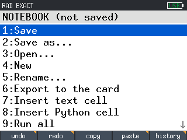

- 1 Save: stores the notebook now; a notebook without a name asks for one first.
- 2 Save as: stores it under another name (the one before stays as it was).
- 3 Open: the list of stored notebooks ([Notebook](#notebook)); the one you open is shown here. Calculations without a name are stored first as "Notebook 1" (2, 3, ...), never lost.
- 4 New: an empty notebook without a name (a named one is stored first; unsaved calculations are cleared after you say yes).
- 5 Rename: a new name for the open notebook.
- 6 Export to the card: a copy as a Jupyter file in `CALC/NOTEBOOKS` on the microSD card. Stored notebooks are also in the NOTEBOOKS folder of the CALC drive when the calculator is connected to a computer ([Connecting to a computer](#usb)).
- 7 Insert text cell: the entry line becomes a text line (marked "text"); <kbd>enter</kbd> adds it as a text cell. Text cells use Markdown ([Notebook: the cells](#notebook-cells)).
- 8 Insert Python cell: the entry line becomes a line of Python (marked "python"); <kbd>enter</kbd> adds the cell and runs it (<kbd>enter</kbd> on it later edits it with several lines). Needs the Python module ([Python](#python)).
- 9 Run all: computes every calculation again, in order (after changing a value, the cells below follow), and runs the Python cells.
- 0 Edit in place: the selected cell (or the last one) goes to the entry line, marked "edit"; <kbd>enter</kbd> puts it back changed and computes it; <kbd>clear</kbd> on the empty line gives up. On a graph cell it opens the graph app, on a Python cell the editor of several lines.
- Re-run: computes the selected cell again. Delete cell: removes the selected cell (or the last one). Insert 3D graph: a [3D graph cell](#graph-cells) of the 3D graph's surfaces.

Saving, opening, renaming, exporting and Python cells need the Python module; without it the menu says so and everything else works. A notebook with a name is stored when the calculator is switched off, when the battery runs low, two minutes after the last change, when you open another one and before an export.

<a id="graph-cells"></a>

#### Graph cells

Graphing that starts on the [Home screen](#home-screen) ends in its notebook: the graph is a graph cell, a plot right there among the calculations, with its own copy of the functions, the window and the style (later changes of Y= do not change it). Add as many as you like and scroll through them with the notebook.

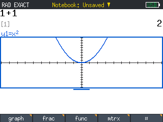 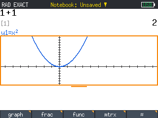 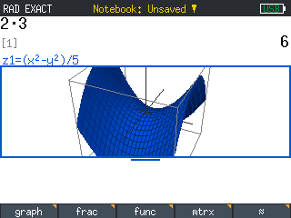

A line above the plot says what it graphs: "y1=x²  y2=sin(x)", each function in the colour of its curve (a function switched off in grey), cut with three dots when the line is full (a 3D cell: "z1=..."). A graph cell without a function (one made in the browser page and not filled yet) shows just "graph: enter a function", no plot. The picture is drawn again when something it depends on changes: its functions and window, the MODE settings (degrees or radians) and the variables its functions use (y1=a·x after a:=3).

- <kbd>F1</kbd> (graph) opens the graph editor, 2D first: the functions y1 to y6 ([Y=](#yeq), with its modes). The switch at its top right, "2D 3D", changes to the 3D entries z1 to z6 ([3D entries (z=)](#graph3d-eq)) and back: tap "3D" (or "2D"), or press <kbd>F1</kbd> (it reads 3D in the 2D editor, 2D in the 3D one). Type or change the functions, then <kbd>F5</kbd> (graph) adds a 2D or 3D graph cell of them and comes back with it selected. A ZOOM (<kbd>F3</kbd>), the WINDOW's <kbd>F5</kbd> and the TABLE's <kbd>F5</kbd> do the same. <kbd>home</kbd> without graphing adds nothing.
- <kbd>shift</kbd> <kbd>F5</kbd> (plot) adds a graph cell of the Y= functions at once (<kbd>F1</kbd> graph opens the editor first). If Y= is empty, Y= opens for the new cell: type the function, <kbd>F5</kbd> or <kbd>home</kbd> comes back with the plot. (The graph and the 3D graph are not in <kbd>apps</kbd>: this key and the graph cells open them.)
- <kbd>F4</kbd> (trace) or <kbd>shift</kbd> <kbd>F4</kbd> (calc) on Y= make the cell and open the graph app on it for tracing, zeros and the other CALC operations.
- <kbd>▲</kbd> <kbd>▼</kbd> select a graph cell like any cell (a blue frame).
- <kbd>◀</kbd> <kbd>▶</kbd> move the plot sideways; <kbd>+</kbd> and <kbd>−</kbd> zoom in and out about the middle. After one of these the frame turns orange and all four arrows move the plot; <kbd>clear</kbd> goes back to selecting cells.
- Touch: drag the selected cell to move the plot (it follows the finger and is drawn again when you lift it), pinch any graph cell to zoom it, drag the short bar at the bottom of the selected cell to make it taller or shorter.
- <kbd>enter</kbd> (or a tap on the selected cell) opens the full graph app on this cell: trace, zeros and the other CALC operations, the Y= functions, the window; there <kbd>F1</kbd> (y=) and <kbd>F5</kbd> (graph) stay in the app. <kbd>home</kbd> comes back and the cell keeps what was changed there (its functions, window and style).
- <kbd>menu</kbd> Delete cell removes it.

Graphs started elsewhere (a stat plot, another app) open the graph app as before.

##### 3D graph cells

<kbd>F1</kbd> (graph), then 3D (<kbd>F1</kbd> or a tap on "3D"), the surfaces and <kbd>F5</kbd> (graph) adds a 3D graph cell (so does <kbd>menu</kbd> Insert 3D graph): the surfaces and curves of the [3D graph](#graph3d) with its window and view, kept in the cell. With <kbd>menu</kbd> Insert 3D graph and no surface yet, the 3D editor opens for the new cell; <kbd>F5</kbd> (graph) or <kbd>home</kbd> comes back with the picture.

- Selected: <kbd>◀</kbd> <kbd>▶</kbd> turn it about the vertical axis (15°), <kbd>▲</kbd> <kbd>▼</kbd> tilt it (10°) once it is active (orange), <kbd>+</kbd> <kbd>−</kbd> zoom; drag to turn it, pinch to zoom, the bottom edge changes its height.
- <kbd>enter</kbd> opens the 3D graph on the cell (trace, window, view, the entries); <kbd>home</kbd> writes the view and entries back.

##### Animated graph cells

A graph cell whose functions use `t` moves: y1=sin(x−t), z1=sin(√(x²+y²)−t). Its caption ends with "anim", and it shows the picture at the start of t's range until you play it (the calculator never plays a cell by itself: that would use the battery). Each cell keeps its own settings: t from 0 to 2π, 4 seconds a sweep, loop (or bounce, or once).

- Select the cell: <kbd>F5</kbd> (play) plays it; the caption shows ▶ and the value of t. Any key or a touch pauses it (<kbd>F5</kbd> then reads play again).
- Paused, <kbd>◀</kbd> <kbd>▶</kbd> step t back and forward (a fiftieth of its range; in loop mode round from one end to the other). After <kbd>+</kbd> or <kbd>−</kbd> the arrows move the plot as on any cell; <kbd>clear</kbd> goes back to stepping.
- <kbd>enter</kbd> opens the full graph on the cell with its animation ready: its t slider at the cell's value, and <kbd>shift</kbd> <kbd>F5</kbd> (anim) plays it with the cell's settings ([Animation: graphs that move](#animation)); the settings form (anim, Settings) changes them, and <kbd>home</kbd> brings them back to the cell.
- Playing needs the Animation module ([Code modules](#code-modules)). Without it the cell shows its first picture and says so ("still frame: animation needs the Animation module"), and <kbd>F5</kbd> (play) says how to get the module.
- In the browser page an animated cell plays by itself, with play / pause, a slider for t and the speed; its t range, seconds and mode can be changed there too ([Use the calculator from a computer's browser](#browser)). In a Jupyter file it is a graph cell with one picture and its settings; `NOTEBOOK.HTML` shows that picture and "animated (t from a to b)".

Graph cells draw functions y = f(x) (FUNC mode); in the other graph modes (the Y= header: PAR, POL, SEQ, IMPL, DE) graphing opens the graph app. In a notebook stored as a Jupyter file a graph cell is a `calc.plot(...)` cell with the calculator's picture of it (PNG) and its functions and window in the cell's metadata ([Notebook: files, card and computer](#notebook-files)). The browser page ([Use the calculator from a computer's browser](#browser)) shows every graph cell, drawn from values the calculator computes, and changes them too: their functions, their window, moving and zooming; a 3D graph made there is a 3D graph cell here. While the graph app is open on a cell, the page cannot change that cell, and a cell being changed in the page does not open here ("This cell is being edited in the browser").

<a id="result-actions"></a>

#### Simplify and rewrite results

One key rewrites a result, so you do not have to type `simplify(...)`. On the home screen:

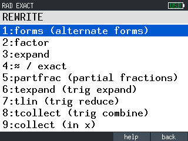

- <kbd>shift</kbd> <kbd>F3</kbd> (simplify) applies [simplify](#simplify).
- <kbd>shift</kbd> <kbd>F4</kbd> (rewrite) opens the REWRITE menu; <kbd>1</kbd> .. <kbd>9</kbd> or <kbd>enter</kbd> choose: 1 forms (the [alternate forms](#forms-browser) of the result: pick one from a list), 2 [factor](#factor), 3 [expand](#expand), 4 ≈ / exact ([approx](#approx) or [exact](#exact)), 5 [partfrac](#partfrac) (partial fractions), 6 [texpand](#texpand) (trig expand), 7 [tlin](#tlin) (trig reduce: powers to multiple angles), 8 [tcollect](#tcollect) (trig combine), 9 [collect](#collect) in x; for a result with trig functions or exponentials also <kbd>0</kbd> exp→trig ([exp2trig](#exp2trig), Euler's formula) and trig→exp ([trig2exp](#trig2exp), the last item: <kbd>▲</kbd> <kbd>enter</kbd>).
- For a matrix the menu is: 1 simplify, 2 x⁻¹ ([inv](#inv)), 3 [det](#det), 4 [transpose](#transpose), 5 ≈ / exact, 6 factor, 7 expand.
- For a value with a unit (`3_m`): 1 simplify, 2 convert to: the entry line becomes `convert(Ans,)` with the cursor in the hole and the [UNITS](#units) menu opens; choose the unit (or type it) and press <kbd>enter</kbd>. 3 [usimplify](#usimplify) (to SI units), 4 ≈ / exact, 5 factor, 6 expand.
- <kbd>F5</kbd> (≈) on an empty line switches the last result between decimal and exact.

The command acts on, in this order: the history entry selected with <kbd>▲</kbd> (its input or its result), the entry line being typed, or the last result. The result is a new history entry whose input shows what was done, for example `simplify(Ans)` or `factor(x^2-1)`, so the history reads like what you would have typed. Both Classic and Textbook display work the same way.

<kbd>shift</kbd> <kbd>F3</kbd> is simplify; the menu's first item lists all the [alternate forms](#forms-browser) instead.

In [RPN](#rpn) <kbd>shift</kbd> <kbd>F4</kbd> (simplify) and <kbd>shift</kbd> <kbd>F5</kbd> (rewrite) act on level 1 (a line being typed is pushed first; undo brings the old level back). For collect, a name in level 1 is the variable; for convert to, level 1 is the unit and level 2 the value (`3_m` <kbd>enter</kbd> `_ft` <kbd>enter</kbd>, then <kbd>shift</kbd> <kbd>F5</kbd> <kbd>2</kbd>).

Results are also simplified automatically as they are shown, with a quicker pass that keeps the forms you ask for: see [Automatic simplification](#mode-simplify).

<a id="forms-browser"></a>

#### Alternate forms: equivalent ways to write a result

<kbd>shift</kbd> <kbd>F4</kbd> (rewrite) <kbd>1</kbd> (forms) lists different ways to write the result, the line being typed or the selected history entry: factored and expanded, over one denominator or as partial fractions, trig and log rewritings. In [RPN](#rpn) <kbd>shift</kbd> <kbd>F5</kbd> <kbd>1</kbd> does the same for level 1. The list comes from [forms](#forms): every form has been checked to be equal to the original.

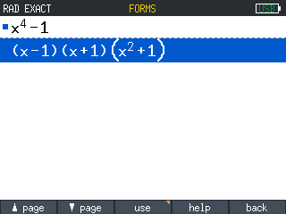

- The simplest forms come first and have a blue square at the left: they are "equally simple" (within 20 % of the smallest). A dashed line separates them from the longer forms.
- A form that is equal only on part of the domain says where in small print below it: `if x≠1` (a cancelled factor: the original is undefined at 1), `if x>0`, `if x real`.
- <kbd>▲</kbd> <kbd>▼</kbd> choose a form, <kbd>F1</kbd> <kbd>F2</kbd> page, drag the list to scroll. Forms are shown in textbook (2D) form; in Classic display, or when a form is too wide, as text.
- <kbd>enter</kbd> or <kbd>F3</kbd> (use), or a tap on the chosen form, takes it: on the home screen it becomes a new result whose input reads `forms(Ans)` (or `forms(` the line `)`), so Ans is the chosen form; in RPN it replaces level 1 (<kbd>F5</kbd> undo brings the old value back).
- <kbd>menu</kbd> <kbd>F3</kbd> or <kbd>shift</kbd> <kbd>F3</kbd> copies the chosen form to the [Copy and paste](#clipboard).
- <kbd>clear</kbd> or <kbd>F5</kbd> (back) returns without a change; <kbd>F4</kbd> is this help.

The search takes up to about a second; a longer expression may show fewer forms. simplify itself is <kbd>shift</kbd> <kbd>F3</kbd> ([Simplify and rewrite results](#result-actions)).

<a id="apps"></a>

#### Apps

<kbd>apps</kbd> lists the applications: Table, Graph analysis, Statistics, Distributions, Stat plots, Matrix, Solver, Finance, Base-n, Units & constants, Settings, Memory ([Memory and saved session](#mem)) and Help (this manual). Choose with <kbd>▲</kbd> <kbd>▼</kbd> <kbd>enter</kbd> or a number key. Each app labels the soft keys <kbd>F1</kbd> .. <kbd>F5</kbd> at the bottom of its screens ([Soft keys](#softkeys)). Graphing is not in the list: <kbd>F1</kbd> (graph) on the home screen opens the graph editor (2D or 3D), and <kbd>enter</kbd> on a [graph cell](#graph-cells) opens the full graph or 3D graph on it.

<a id="menu-cas"></a>

#### CAS menu

<kbd>CAS</kbd> lists the most used symbolic commands. Each inserts a template with the cursor where the expression goes:

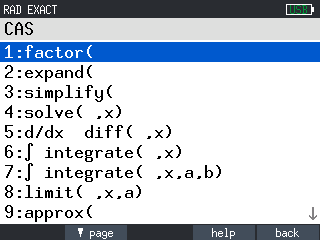

- [factor](#factor), [expand](#expand), [simplify](#simplify)
- [solve](#solve) `solve( ,x)`: solve an equation for x
- [diff](#diff) `diff( ,x)`: derivative with respect to x
- [integrate](#integrate) `integrate( ,x)` and `integrate( ,x,a,b)`: antiderivative, definite integral
- [limit](#limit) `limit( ,x,a)`
- [approx](#approx): decimal value
- [∇](#nabla) `∇( )`, `∇·[ ]`, `∇×[ ]`, `∇²( )`: gradient, divergence, curl, Laplacian in x, y, z

All other commands are in the [catalog](#catalog). <kbd>shift</kbd> <kbd>menu</kbd> on an entry shows its help page.

<a id="menu-math"></a>

#### MATH menu

<kbd>math</kbd>: [abs](#abs), [round](#round), [floor](#floor), [ceil](#ceil), `³` (cube), cube root and ˣ√ (see [Roots](#nth-roots)), [min](#min), [max](#max), [mod](#mod) and `!` ([factorial](#factorial)). Choose with <kbd>▲</kbd> <kbd>▼</kbd> <kbd>enter</kbd> or the number key.

<a id="nth-roots"></a>

#### Roots

- `√(x)` (<kbd>√</kbd>) is the square root, see [sqrt](#sqrt).
- The cube root (<kbd>shift</kbd> <kbd>√</kbd>, also in the math menu) inserts `( )^(1/3)`: type the number inside the parentheses.
- ʸ√x (<kbd>shift</kbd> <kbd>xʸ</kbd>, ˣ√ in the math menu) works after the radicand: type `16`, press <kbd>shift</kbd> <kbd>xʸ</kbd> and type `4`; the line reads `16^(1/4)`, the 4th root of 16.
- Odd roots of negative numbers depend on the [COMPLEX](#mode-complex) setting. REAL: the real root, `(-8)^(1/3)` is -2, `(-1)^(2/3)` is 1 and `(-8)^(-1/3)` is -1/2. a+bi and r∠θ: the principal complex root, `(-8)^(1/3)` is `2*(-1)^(1/3)` (1+1.732i). Even roots of negative numbers are not real (ERR:NONREAL ANS in REAL). Graphs always use the real root.

<a id="powers"></a>

#### Powers

`x²` (<kbd>x²</kbd>), `³` (<kbd>shift</kbd> <kbd>x²</kbd>), `⁻¹` (<kbd>shift</kbd> <kbd>÷</kbd>) and `^` (<kbd>xʸ</kbd>) raise to a power. `10^(` and `e^(` are on <kbd>shift</kbd> <kbd>log</kbd> and <kbd>shift</kbd> <kbd>ln</kbd>. See [exp](#exp), [sqrt](#sqrt).

<a id="menu-test"></a>

#### Relations

The relations are <kbd>shift</kbd> keys: `<` `=` `>` on <kbd>shift</kbd> <kbd>4</kbd> <kbd>5</kbd> <kbd>6</kbd> and `≤` `≠` `≥` on <kbd>shift</kbd> <kbd>1</kbd> <kbd>2</kbd> <kbd>3</kbd>. With numbers they evaluate to `true` or `false`; with unknowns they build equations and inequalities for [solve](#solve), e.g. `solve(x^2≤4,x)`.

<a id="menu-angle"></a>

#### Angle menu

<kbd>shift</kbd> <kbd>,</kbd>: `°` marks an angle in degrees and `ʳ` in radians, independent of the [ANGLE mode](#mode-angle): `sin(90°)` is 1 in RADIAN mode, `cos(πʳ)` is -1 in DEGREE mode.

<a id="catalog"></a>

#### Catalog

<kbd>shift</kbd> <kbd>apps</kbd> lists every command and function alphabetically. Type to search: letters filter the list as you type (ALPHA is switched on automatically) and the best matches come first, also by the command's description (`deriv` finds diff). Help pages whose title matches are listed too, marked ?: `undo`, `rpn` or `degree` find the page that explains it (<kbd>enter</kbd> opens it). An empty search says so; <kbd>⌫</kbd> brings matches back. <kbd>⌫</kbd> erases a letter, <kbd>shift</kbd> <kbd>⌫</kbd> the whole search. <kbd>◀</kbd> <kbd>▶</kbd> step through the categories (algebra, calculus, trigonometry, matrices, statistics, probability, number theory, units, finance, ...); <kbd>F3</kbd> (categ) lists them. <kbd>enter</kbd> inserts the highlighted entry (an entry marked ▶ opens its app); <kbd>shift</kbd> <kbd>menu</kbd> shows its help page; <kbd>clear</kbd> closes the catalog. The commands are also grouped in the [help index](#contents).

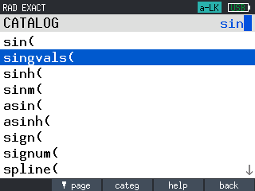 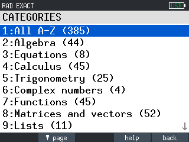

<a id="vars"></a>

#### Vars menu

<kbd>vars</kbd> inserts names into the entry line:

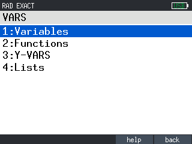

- Variables: the variables you stored (`a:=5`, `5→a`).
- Functions: the functions you defined (`f(x):=x^2`); inserts `f(`.
- Y-VARS: Y1..Y6 from [Y=](#yeq); inserts `Y1(` so that `Y1(2)` evaluates the function at 2.

Apps add their own categories. Empty categories are hidden. Delete names with [purge](#purge) or apps \> Memory ([Memory and saved session](#mem)).

<a id="textbook"></a>

### Textbook math

With the [DISPLAY](#mode-display) setting TEXTBOOK (the default) the home screen shows math the way it is written in a textbook: fractions stacked, roots with a bar, exponents raised, `|x|`, logarithms with a lowered base, d/dx, integrals and sums with their limits, matrices in brackets, 1.5×10 with a raised -7 for `1.5ᴇ-7`, and repeating decimals with a bar over the period.

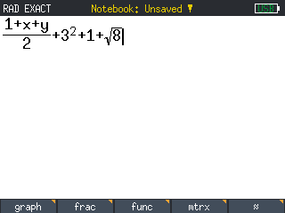 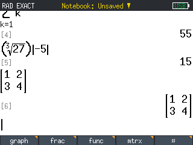

#### Entering math

- <kbd>xʸ</kbd> opens an exponent box: `2` <kbd>xʸ</kbd> `3` shows 2 with a raised 3. <kbd>▶</kbd> leaves the box. While you are typing an exponent, <kbd>+</kbd> <kbd>−</kbd> <kbd>×</kbd> <kbd>÷</kbd> <kbd>,</kbd> and <kbd>)</kbd> leave it first, so `2^3+1` means (2^3)+1 exactly as in Classic. Use parentheses for a sum in an exponent: `2^(3+1)`.
- <kbd>√</kbd> opens a square-root box (<kbd>shift</kbd> <kbd>√</kbd>: a cube root), <kbd>shift</kbd> <kbd>log</kbd> gives 10 with an exponent box, <kbd>shift</kbd> <kbd>ln</kbd> gives e with an exponent box, <kbd>shift</kbd> <kbd>−</kbd> an \|x\| box and <kbd>shift</kbd> <kbd>+</kbd> a Σ sum.
- On the home screen the soft keys <kbd>F2</kbd> (frac) open the FRAC menu (fraction n/d), <kbd>F3</kbd> (func) the FUNC menu (Σ, Π, d/dx, ∫, log base, √, n-th root, \|x\|) and <kbd>F4</kbd> (mtrx) the MTRX menu (matrices and vectors up to 3×3). See [Template menus](#textbook-templates).
- <kbd>◀</kbd> <kbd>▶</kbd> move through the boxes in order; <kbd>▲</kbd> <kbd>▼</kbd> move between the numerator and the denominator, the limits of ∫, Σ and Π, the index of a root and the rows of a matrix. Elsewhere <kbd>▲</kbd> selects history entries as usual.
- <kbd>⌫</kbd> on the edge of a box (the marker before the cursor): an empty box disappears, a filled one turns into ordinary text (a fraction becomes `(1)/(x+1)`-style text you can edit).
- <kbd>)</kbd> at the end of a √ box steps out of it, so `√(2)` typed the Classic way gives the same result.
- <kbd>shift</kbd> <kbd>enter</kbd> (entry) and pasting a history entry (<kbd>▲</kbd> <kbd>enter</kbd>) bring it back with its boxes.
- Touch: tap the entry line to put the cursor at the nearest box position.

#### The history

Inputs are on the left, results on the right, both in 2D. A line wider than the screen continues on the next line, broken before a + − or =, after a comma, then before a × or ÷, or inside a long number; a piece that cannot be broken (a wide matrix or list) shows ▶ at the edge: select it with <kbd>▲</kbd> and scroll it with <kbd>◀</kbd> <kbd>▶</kbd>. A result too tall for the screen, and errors, are shown as text.

In a product of names the letters stand a little apart: x·y·z shows as `x y z`, while `xyz` written together is one variable called xyz (names can have several letters). Type the multiplications (`x*y*z`) when you mean a product. Pasting a result (<kbd>enter</kbd> on it) inserts its linear form.

Everything still works in the linear syntax: the history keeps the text that can be typed in Classic mode (`(1+x)/2`, `√(8)`, `log(8,2)`, `diff(x^3,x)`, `[[1,2],[3,4]]`), which is also what `state last_input` reports.

See also [live preview](#mode-preview), [repeating decimals](#mode-repeat), [dark theme](#mode-theme) and [large font](#mode-font).

<a id="textbook-templates"></a>

#### Template menus

On the home screen in Textbook mode these menus insert boxes; in Classic mode and in other editors they insert the linear form with the cursor in the first gap.

##### FRAC (<kbd>F2</kbd> on the home screen)

- n/d: a fraction, cursor in the numerator (<kbd>▼</kbd> goes to the denominator).
- x^y: an exponent box (like <kbd>xʸ</kbd>).
- \|x\|: absolute value.

##### FUNC (<kbd>F3</kbd> on the home screen)

- Σ summation and Π product: variable, start (below), end (above), then the term; `sum(k^2,k,1,10)` is 385.
- d/dx: the variable, then the expression; `diff(x^3,x)` is `3*x^2`.
- ∫ definite integral: lower limit, upper limit, integrand, variable; `integrate(x^2,x,0,1)` is 1/3.
- ∫ antiderivative: integrand and variable.
- logBASE: the base (lowered), then the argument; `log(8,2)` is 3.
- √ square root and ⁿ√ n-th root (index, then radicand: `8^(1/3)` is 2).
- \|x\|: absolute value.

##### MTRX (<kbd>F4</kbd> on the home screen)

2×2, 3×3, 2×3 and 3×2 matrices, 2×1 and 3×1 column vectors, 1×2 and 1×3 row vectors. <kbd>▶</kbd> moves from cell to cell (row by row), <kbd>▲</kbd> <kbd>▼</kbd> between rows. The result is the matrix `[[1,2],[3,4]]`.

<a id="mode"></a>

### Settings

<kbd>shift</kbd> <kbd>home</kbd> (also <kbd>shift</kbd> <kbd>F3</kbd> format on the graph screens, or apps \> Settings) lists the settings. <kbd>▲</kbd> <kbd>▼</kbd> choose a row, <kbd>◀</kbd> <kbd>▶</kbd> change its option at once (or tap an option). The rows scroll when there are more than fit on the screen. <kbd>shift</kbd> <kbd>menu</kbd> or <kbd>F4</kbd> (help) explains the highlighted row, <kbd>F1</kbd> (about) shows the firmware version, <kbd>F5</kbd> (done) or <kbd>clear</kbd> returns to the home screen. Settings are kept when the calculator is off.

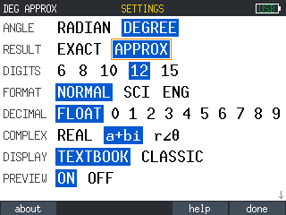

- [ANGLE](#mode-angle): RADIAN or DEGREE.
- [RESULT](#mode-result): EXACT or APPROX.
- [DIGITS](#mode-digits): significant digits of approximate results.
- [FORMAT](#mode-format) and DECIMAL: NORMAL, SCI or ENG notation, FLOAT or a fixed number of decimals.
- [COMPLEX](#mode-complex): REAL, a+bi or r∠θ.
- [DISPLAY](#mode-display) TEXTBOOK/CLASSIC, [PREVIEW](#mode-preview), [REPEAT](#mode-repeat) 0.(3), [THEME](#mode-theme) LIGHT/DARK, [FONT](#mode-font) NORMAL/LARGE.
- ENTRY: ALGEBRAIC or [RPN](#rpn); [SIMPLIFY](#mode-simplify): AUTO (results simplified as they are shown) or OFF.
- [GRID and AXES](#mode-graph) of the graph.
- [LIGHT](#mode-light): screen brightness.
- [ON USB](#mode-usb): stay on with the screen dark, or sleep, when idle on USB power.

<a id="mode-angle"></a>

#### Angle mode: degrees or radians

RADIAN or DEGREE. In DEGREE mode the trigonometric functions take degrees and the inverse functions return degrees: `sin(30)` is 1/2. The status bar shows RAD or DEG.

Independently of the mode, `°` and `ʳ` from the angle menu (<kbd>shift</kbd> <kbd>,</kbd>) mark an angle as degrees or radians: `sin(30°)` is 1/2 in both modes. See [Angle menu](#menu-angle).

<a id="mode-result"></a>

#### Exact or approximate results

EXACT keeps fractions, roots and π exact: `1/3` stays `1/3`, `√(8)` becomes `2*√(2)`. APPROX gives decimal results with DIGITS significant digits: `1/3` becomes `0.333333333333`.

In EXACT mode a decimal point in the input makes that part approximate (`1/3.0`), and [approx](#approx) gives a decimal value of one expression. [exact](#exact) converts decimals back to fractions.

<a id="mode-simplify"></a>

#### Automatic simplification

AUTO (the default) simplifies every result of the home screen and of RPN as it is shown, with a quick pass: the Pythagorean identities (`cos(x)^2+sin(x)^2` is 1, `sec(x)^2-tan(x)^2` is 1), like terms across products (`x*(x+1)-x^2` is x), common factors of fractions (`(x^2-1)/(x-1)` is x+1) sums of fractions (`1/(x-1)-1/(x+1)` is `2/(x^2-1)`) and Euler's formula when exponentials and trig functions of one argument meet (`(e^(i*x)+e^(-i*x))/2` is cos(x), `e^(i*x)-(cos(x)+i*sin(x))` is 0, `(e^x+e^-x)/2` is cosh(x)); a lone `e^(i*x)` or `cos(x)+i*sin(x)` keeps its form. It never changes a form you asked for: results of [factor](#factor), [expand](#expand), [partfrac](#partfrac), [texpand](#texpand), [collect](#collect), [approx](#approx) and the other rewriting commands stay as they are, and a factored expression you type, such as `(x-1)*(x+1)`, is kept. Decimals, units and uncertainties are left alone.

OFF shows results as the CAS computes them. Either way <kbd>shift</kbd> <kbd>F3</kbd> applies the full [simplify](#simplify) and <kbd>shift</kbd> <kbd>F4</kbd> the other [rewritings](#result-actions). The pass is the command [autosimplify](#autosimplify); graphs, tables, the solvers and the other apps never use it.

<a id="mode-digits"></a>

#### Significant digits

DIGITS (6, 8, 10, 12 or 15) sets how many significant digits approximate results show in FORMAT NORMAL with DECIMAL FLOAT. `approx(pi,30)` computes more digits for one value (see [approx](#approx)).

<a id="mode-format"></a>

#### Number format

FORMAT and DECIMAL control how decimal (approximate) numbers in results are shown. Exact results (integers, fractions, roots) are not changed.

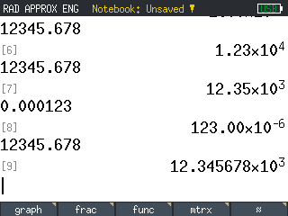

- NORMAL FLOAT: up to DIGITS significant digits; very large or small numbers in scientific notation (`1.5ᴇ-7`).
- NORMAL with DECIMAL 0..9: that many decimals (FIX), e.g. FIX 2 shows `3.14`; numbers that do not fit switch to scientific notation.
- SCI: always scientific notation, `1.2345ᴇ3`; with DECIMAL n, n decimals in the mantissa.
- ENG: engineering notation, the exponent is a multiple of 3: `12.345ᴇ3`.

`ᴇ` means "times ten to the power" (<kbd>shift</kbd> <kbd>×</kbd> types it). The status bar shows FIX2, SCI, ENG3 etc. when a format other than NORMAL FLOAT is active. Numbers are rounded for display only; Ans and stored values keep full precision.

<a id="mode-complex"></a>

#### Complex mode

How results with the imaginary unit i are shown:

- REAL: a calculation whose input has no `i` but whose result is complex is an error (ERR:NONREAL ANS), e.g. `√(-4)`. Entering `i` (<kbd>shift</kbd> <kbd>.</kbd>) still works. A power of a negative number with an exponent p/q, q odd, is the real root: `(-8)^(1/3)` is -2, `(-1)^(2/3)` is 1, `integrate(x^(-1/3),x,-1,8)` is 9/2 (see [Roots](#nth-roots)).
- a+bi (default): rectangular form, `√(-4)` gives `2*i`. Powers use the principal branch: `(-8)^(1/3)` is `2*(-1)^(1/3)`, i.e. 1+√(3)i.
- r∠θ: polar form, modulus ∠ argument; the argument follows the ANGLE mode: `1+i` gives `√(2)∠π/4`, `(-8)^(1/3)` gives `2∠π/3`.

See [i](#i), [abs](#abs), [arg](#arg), [re](#re), [im](#im), [conj](#conj).

<a id="mode-graph"></a>

#### Grid and axes

GRID ON draws a dotted grid at the Xscl/Yscl tick marks of the graph, AXES OFF hides the axes. See [GRAPH](#graph) and [WINDOW](#window).

<a id="mode-light"></a>

#### Screen brightness

LIGHT sets the backlight to 20 to 100 %. <kbd>shift</kbd> <kbd>▲</kbd> and <kbd>shift</kbd> <kbd>▼</kbd> change it in 10 % steps from any screen. A lower setting saves battery. See [Power and battery](#power).

<a id="mode-usb"></a>

#### Idle on USB power

ON USB decides what happens after five minutes without a key or touch while the calculator is powered over USB (a computer or a charger):

- STAY ON (the default): only the screen goes dark. The calculator keeps running, so the computer link, the browser page, the CALC drive and a running program carry on. Any key or touch lights the screen again; that key or touch does nothing else.
- SLEEP: the calculator switches itself off as on batteries (not while a computer is using the USB link).

On batteries the calculator always switches off after five minutes, whatever this setting says.

<a id="mode-display"></a>

#### Display: Textbook or Classic

TEXTBOOK shows inputs and results in textbook form and makes <kbd>xʸ</kbd>, √ and the template menus insert boxes (see [Textbook math](#textbook)). CLASSIC shows everything as one line of text, as typed: `(x+1)/2`, `x^2`, `√(8)`. Switching to CLASSIC turns the boxes of the entry line into that text. The setting is kept when the calculator is off.

<a id="mode-preview"></a>

#### Live preview

With PREVIEW ON the home screen shows the result of the entry line, dimmed, under it while you type (after a short pause). Unclosed parentheses are closed for the preview: `2*(3+4` shows 14.

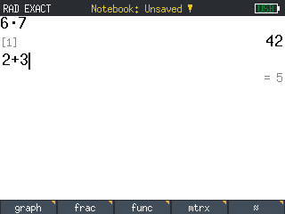

The preview never changes anything: Ans and the history stay as they are, and it is not shown for assignments (`a:=5`, <kbd>→</kbd>) or commands that change settings or take long ([solve](#solve), [integrate](#integrate), [limit](#limit), series, random numbers). A slow calculation is abandoned after a fraction of a second, and as soon as you press a key, so typing never waits. Errors show no preview. <kbd>enter</kbd> evaluates as usual.

<a id="mode-repeat"></a>

#### Repeating decimals

REPEAT 0.(3) (the default) does two things:

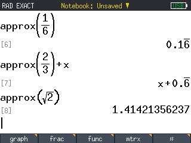

- Input: a decimal with its period in parentheses is the exact fraction. `0.(3)` is 1/3, `1.2(34)` is 611/495, `0.(9)` is 1.
- Display: a decimal result that is a fraction with a period of up to 16 digits is shown with its period: approx(1/7) shows `0.(142857)` (with a bar over 142857 in Textbook mode), 1/6 in APPROX mode shows `0.1(6)`. Ans and the stored value keep all digits; numbers that are not short fractions (`√(2)`) are shown as usual.

Only in FORMAT NORMAL with DECIMAL FLOAT; FIX, SCI and ENG show the rounded decimal. REPEAT OFF shows all decimals. See [Number format](#mode-format).

<a id="mode-theme"></a>

#### Theme: light or dark

THEME DARK shows every screen with light text on a dark background (graphs, menus, help and the settings screen too); the colours of functions and links are lightened to stay readable, selections stay blue. LIGHT is the default. A dark screen is easier on the eyes at night and uses the backlight less for the same readability at a lower LIGHT setting. The theme is kept when the calculator is off.

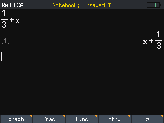 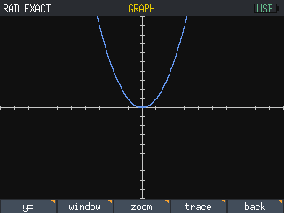

<a id="mode-font"></a>

#### Font size

FONT LARGE uses a bigger font (14×28 pixels instead of 10×20) on the home screen and in the menus, for easier reading: 22 characters per line and 7 lines. 2D math scales with it. The other screens keep the normal font so that their layout fits. NORMAL is the default.

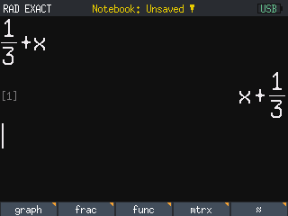

<a id="rpn"></a>

### RPN mode

RPN (reverse Polish notation) works like classic RPN calculators: you put values on a stack first and then apply operators and functions to them. Switch it on in [settings](#mode) (<kbd>shift</kbd> <kbd>home</kbd>) with ENTRY: RPN (ALGEBRAIC is the default). The choice and the stack are kept when the calculator switches off.

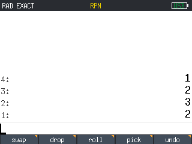 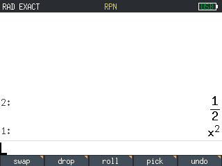

```
2 {enter} 3 {÷}
▶ 1: 2/3
x {enter} 2 {xʸ}
▶ 1: x^2
```

#### The screen

The stack fills the screen from the bottom: level 1 is the newest value, just above the command line; higher levels are above it. Values are exact CAS values and are shown with the number format of the settings. Long values wrap onto several lines.

Each level holds the value itself, not only the text you see, so RPN gives the same results as the home screen:

- A value with an uncertainty (`2±0.1`, [Measurements with uncertainty](#uncertainty)) stays the same measurement wherever it moves: `x` <kbd>enter</kbd> <kbd>−</kbd> gives `0±0` like `x-x`, and `x` <kbd>enter</kbd> <kbd>×</kbd> has the uncertainty of x·x. Stored with <kbd>→</kbd> into a variable, it stays linked to the level it came from.
- Numbers keep all their digits when the display rounds them (FORMAT, DECIMAL), and exact values (`1/3`, `√2`) stay exact.
- Copies of a level (DUP, OVER, PICK, LASTARG, UNDO) are the same value. A value you type again, echo, paste or edit is a new one (editing a level without changing it keeps its value).

Up to 1024 different values can be on the stack (copies share theirs); more gives "Stack full".

#### Entering values

- Type a value and press <kbd>enter</kbd> to push it. <kbd>enter</kbd> on an empty line duplicates level 1 (DUP).
- An operator key pushes a number you are typing first: `2` <kbd>enter</kbd> `3` <kbd>+</kbd> gives 5.
- A whole expression works too: `x^2+1` <kbd>enter</kbd> pushes x^2+1 (once the line holds a name or an operator, operator keys type into it). Start with `(` to type numeric algebra such as `(2+3)*4`.
- Several values and commands separated by spaces (<kbd>alpha</kbd> <kbd>0</kbd>) run left to right: `2 3 + 4 *` gives 20. Command names such as `swap`, `drop`, `factor` or `diff` work as words.
- <kbd>(−)</kbd> changes the sign of the number being typed (after ᴇ: of the exponent); on an empty line it negates level 1.
- `expression→name` stores like on the home screen and pushes the value.

#### Operators and functions

On an empty line (or after a number being typed) these keys take their arguments from the stack and push the result:

- <kbd>+</kbd> <kbd>−</kbd> <kbd>×</kbd> <kbd>÷</kbd> <kbd>xʸ</kbd>: level 2 op level 1, e.g. 2: 8  1: 3  <kbd>−</kbd> gives 5.
- <kbd>x²</kbd>, <kbd>shift</kbd> <kbd>÷</kbd> (x⁻¹), <kbd>sin</kbd> <kbd>cos</kbd> <kbd>tan</kbd> <kbd>log</kbd> <kbd>ln</kbd>, <kbd>√</kbd>, <kbd>shift</kbd> <kbd>log</kbd> 10^x, <kbd>shift</kbd> <kbd>ln</kbd> e^x and the inverse trig functions apply to level 1.
- Commands from the [CAS](#menu-cas), [MATH](#menu-math) and [TEST](#menu-test) menus, the [CATALOG](#catalog) and functions from [VARS](#vars) apply directly to the stack when the line is empty. Names and values from VARS go into the command line.

#### Commands with several arguments

Arguments are taken in stack order: the last argument is in level 1, the first one in the highest level used, as usual in RPN. `mod`, `min`, `max`, `gcd`, `lcm`, `nCr`, `nPr` and similar take two levels; other functions take level 1.

Commands with a variable take it from the stack when that level holds a name, else they use x:

- `solve`, `diff`, `integrate( ,x)`: 2: x^2-2  1: x, or just 1: x^2-2 (variable x).
- `integrate( ,x,a,b)`: 4: expr  3: var  2: a  1: b, or 3: expr  2: a  1: b with x.
- `limit( ,x,a)`: 3: expr  2: var  1: a, or 2: expr  1: a with x.
- TEST `=`: 2: x^2  1: 2 gives x^2=2, ready for `solve`.

#### Stack keys

- <kbd>enter</kbd> on an empty line: DUP. <kbd>⌫</kbd>: DROP level 1. <kbd>)</kbd>: SWAP levels 1 and 2.
- <kbd>clear</kbd>: clear the command line; on an empty line clear the whole stack (undoable). <kbd>shift</kbd> <kbd>clear</kbd> always clears the stack.
- <kbd>shift</kbd> <kbd>enter</kbd> or <kbd>F5</kbd> (undo): UNDO the last stack operation; press it again to redo.
- <kbd>shift</kbd> <kbd>(−)</kbd>: LASTARG, push the arguments of the last command again.
- Soft keys: <kbd>F1</kbd> .. <kbd>F5</kbd> swap, drop, roll, pick, undo; <kbd>shift</kbd> <kbd>F1</kbd> .. <kbd>F3</kbd> dup, over, rot.
- <kbd>shift</kbd> <kbd>F4</kbd> (simplify) simplifies level 1; <kbd>shift</kbd> <kbd>F5</kbd> (rewrite) opens the [REWRITE](#result-actions) menu ([alternate forms](#forms-browser), factor, expand, ≈ / exact, partfrac, trig forms, collect) for level 1. A line being typed is pushed first; <kbd>F5</kbd> (undo) brings the old value back.
- <kbd>,</kbd> on an empty line: the [STACK menu](#rpn-stack) with every stack command.
- <kbd>menu</kbd> <kbd>F3</kbd> copies level 1 (or the selected level of the interactive stack, or the command line being typed); <kbd>menu</kbd> <kbd>F4</kbd> pastes into the command line. See [Copy and paste](#clipboard).
- <kbd>▼</kbd> on an empty line: edit level 1 in the command line; <kbd>enter</kbd> replaces it, <kbd>clear</kbd> cancels.
- <kbd>→</kbd>: with a name on the command line, stores level 1 into that variable (`5` <kbd>enter</kbd>, <kbd>alpha</kbd> `A` <kbd>→</kbd>). With an empty line it stores level 2 into the name in level 1.

#### Interactive stack

<kbd>▲</kbd> on an empty line selects level 1; <kbd>▲</kbd> <kbd>▼</kbd> move the selection up and down the stack (it scrolls). The soft keys act on the selected level n (the digit keys 1 to 6 too):

- <kbd>F1</kbd> (echo), <kbd>1</kbd> or <kbd>enter</kbd>: copy the value into the command line.
- <kbd>F2</kbd> (pick) or <kbd>2</kbd>: copy level n to level 1. <kbd>F3</kbd> (roll) or <kbd>3</kbd>: move level n to level 1. <kbd>F4</kbd> (rolld) or <kbd>4</kbd>: move level 1 to level n.
- <kbd>F5</kbd> (dropn) or <kbd>5</kbd>: drop levels 1 to n. <kbd>shift</kbd> <kbd>F1</kbd> (edit) or <kbd>6</kbd>: edit level n in place.
- <kbd>⌫</kbd> drops only the selected level. <kbd>clear</kbd> or <kbd>▼</kbd> below level 1 leaves; any other key leaves and does its job.

#### Touch

Tap a level to select it, tap it again to copy it into the command line. Drag up and down to scroll through the stack. In the interactive stack, tap the soft keys.

#### Settings

ANGLE, RESULT (exact or approximate), [SIMPLIFY](#mode-simplify), DIGITS, FORMAT and COMPLEX of the [settings](#mode) apply as on the home screen; changing FORMAT re-displays the whole stack. Up to 32 KB of stack levels are saved when the calculator switches off, with their full values (uncertainties stay linked to each other and to your variables); if the stack is bigger the oldest levels are dropped.

See also [RPN stack commands](#rpn-stack) and [Home screen](#home-screen).

<a id="rpn-stack"></a>

#### RPN stack commands

The STACK menu (<kbd>,</kbd> on an empty command line in [RPN mode](#rpn)) runs these commands. They can also be typed as words on the command line (`swap`, `rolld`, ...). Commands marked (n) take the count n from level 1 first.

- DUP: copy level 1. DUP2: copy levels 1 and 2. DUPN (n): copy levels 1 to n.
- DROP: remove level 1. DROP2: remove levels 1 and 2. DROPN (n): remove levels 1 to n.
- SWAP: exchange levels 1 and 2. OVER: copy level 2 to level 1.
- ROT: move level 3 to level 1. ROLL (n): move level n to level 1. ROLLD (n): move level 1 to level n.
- PICK (n): copy level n to level 1.
- DEPTH: push the number of levels.
- CLEAR: remove all levels.
- LASTARG: push the arguments of the last command again.
- UNDO: undo the last stack operation (once more: redo).
- →NUM: approximate level 1 (`approx`).

Example: 3: a  2: b  1: c, then `2` ROLLD gives 3: a  2: c  1: b.

<a id="graphing"></a>

### Graphing

The graphing screens work together: [Y=](#yeq) holds what is drawn, [WINDOW](#window) the visible range, [GRAPH](#graph) draws it, [TABLE](#table) lists values. Graphing started on the home screen (<kbd>F1</kbd> graph, the graph editor: 2D, or 3D with its switch; then <kbd>F5</kbd> graph) puts the graph into the home notebook as a [graph cell](#graph-cells); <kbd>enter</kbd> on the cell opens the full graph screen on it (trace, CALC, zoom), and <kbd>home</kbd> writes it back into the cell.

- [Graph modes](#graph-modes): functions, parametric and polar curves, sequences, implicit relations, slope fields of differential equations
- [Line styles](#graph-styles): thick, thin, dotted lines, shading above or below
- [CALC: graph analysis](#graph-calc): zeros, minimum, maximum, intersections, derivatives, integrals
- [Sliders](#graph-sliders): change a parameter such as `a` in `a*x^2` and watch the graph move
- [Animation: graphs that move](#animation): play a slider over time (`sin(x-t)`), comet drawings, animated GIFs
- [Labels and snapping](#graph-touch): labels, snapping to special points, table at the cursor
- [TRACE](#graph-trace), [ZOOM](#zoom), [Grid and axes](#mode-graph)

<a id="yeq"></a>

#### Y= functions

Up to six functions Y1 to Y6 of x, drawn by [GRAPH](#graph) and listed by [TABLE](#table). Open it with <kbd>F1</kbd> (graph) on the home screen or <kbd>F1</kbd> (y=) on any graph screen. In the other [Graph modes](#graph-modes) Y= holds parametric curves, polar curves, sequences, relations or differential equations (slope fields). It is the 2D side of the graph editor: the switch at the top right, "2D 3D", opens the 3D entries ([3D entries (z=)](#graph3d-eq)); tap "3D" or press <kbd>F1</kbd> (3D).

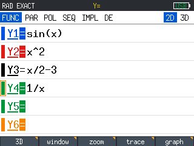

- Type the expression after `=`; <kbd>x</kbd> types x (t, θ or n in the PAR, POL and SEQ modes). <kbd>▲</kbd> <kbd>▼</kbd> move between functions, <kbd>clear</kbd> clears one.
- <kbd>◀</kbd> at the start of an expression moves to the `=`: <kbd>enter</kbd> switches the function on or off (a highlighted `=` is on). <kbd>◀</kbd> once more moves to the colour swatch: <kbd>enter</kbd> changes the colour (8 colours). <kbd>◀</kbd> again moves to the [line style](#graph-styles).
- The header line at the top shows the [graph mode](#graph-modes) (FUNC, PAR, POL, SEQ, IMPL, DE). <kbd>▲</kbd> on the first entry moves there: choose a mode with <kbd>◀</kbd> <kbd>▶</kbd> <kbd>enter</kbd> (or tap it); the focus then goes to the mode's first entry. Typing on the header also goes to the first entry.
- <kbd>menu</kbd>: the options of the highlighted entry (on/off, next colour, next line style, clear) and the graph modes; in DE mode also removing the solution curves added on the graph.
- Soft keys: <kbd>F1</kbd> 3D (the 3D entries) <kbd>F2</kbd> window <kbd>F3</kbd> zoom <kbd>F4</kbd> trace <kbd>F5</kbd> graph, and with <kbd>shift</kbd>: plots, tblset, format, calc, table ([Soft keys](#softkeys)).
- Single letters such as `a` become [sliders](#graph-sliders) on the graph.
- Menus (CAS, math, catalog, vars) insert into the expression.
- On the home screen, `Y1(2)` evaluates Y1 at x=2 (vars, Y-VARS).
- Touch: tap the swatch, the name (style), the `=` or the expression; tap the header to change the mode; drag to scroll.

<a id="window"></a>

#### WINDOW

<kbd>F2</kbd> (window) on a graph screen. The visible part of the plane for [GRAPH](#graph): Xmin, Xmax, Xscl (distance between tick marks), Ymin, Ymax, Yscl. The [Graph modes](#graph-modes) add their ranges first: Tmin, Tmax, Tstep (PAR), θmin, θmax, θstep (POL), nMin, nMax, PlotStart, PlotStep (SEQ). The list scrolls.

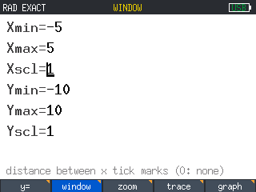

<kbd>▲</kbd> <kbd>▼</kbd> or <kbd>enter</kbd> move between fields; the line at the bottom says what the selected field means. Typing replaces the value; fields accept expressions such as `2π` or `-π/2`. Invalid input or a range with min ≥ max is refused with a message that names the problem (`ERR: Xmin must be less than Xmax`) and the old value stays. <kbd>clear</kbd> empties a field and a second <kbd>clear</kbd> brings its value back. [ZOOM](#zoom) sets the window too.

<a id="graph"></a>

#### GRAPH

<kbd>F5</kbd> (graph) draws the entries that are switched on in [Y=](#yeq), each in its colour and [style](#graph-styles), over the [WINDOW](#window), with axes and tick marks (grid optional, see [Grid and axes](#mode-graph)). See [Graphing](#graphing) for all graphing features. With nothing to draw the graph says so at the top left (`y= (F1): enter a function`); an entry with an error shows its message there in red.

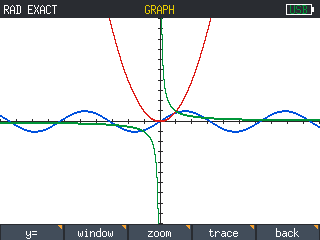

- The arrow keys move a free cursor; its coordinates are shown at the bottom.
- <kbd>F4</kbd> (trace) moves the cursor along a function, see [TRACE](#graph-trace); with nothing to trace the bottom line says so.
- <kbd>F3</kbd> (zoom) zooms, see [ZOOM](#zoom).
- <kbd>shift</kbd> <kbd>F4</kbd> (calc) analyses the graph, see [CALC: graph analysis](#graph-calc).
- Sliders for parameters: <kbd>+</kbd> <kbd>−</kbd> <kbd>,</kbd> <kbd>enter</kbd>, see [Sliders](#graph-sliders).
- <kbd>clear</kbd> clears a result or label, leaves TRACE, then returns to the home screen.
- Touch: drag to pan, pinch to zoom, tap to trace and label, long press to snap to special points, see [Labels and snapping](#graph-touch).

<a id="graph-trace"></a>

#### TRACE

<kbd>F4</kbd> (trace) puts the cursor on a function of the graph and shows x and y.

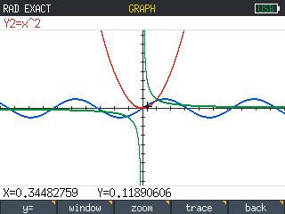

- <kbd>◀</kbd> <kbd>▶</kbd> move by one pixel in x; at the edge the window pans. In PAR, POL and SEQ mode they step t, θ or n.
- <kbd>▲</kbd> <kbd>▼</kbd> switch to the previous / next function (then to the statistics plots, if any).
- Typing a number moves the cursor to that x; <kbd>enter</kbd> confirms.
- <kbd>enter</kbd> centres the window on the cursor.
- Touch: tap the graph to trace the nearest function at that x; tap the coordinates for the [TABLE](#table) there.

<a id="zoom"></a>

#### ZOOM

<kbd>F3</kbd> (zoom) on a graph screen changes the [WINDOW](#window):

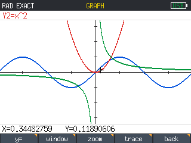

- Zoom In / Zoom Out: factor 2 about the cursor (or the centre).
- ZStandard: x and y from -10 to 10.
- ZDecimal: steps of 0.1 per pixel, centred on 0.
- ZSquare: equal scales on both axes (circles look round).
- ZTrig: x from -2π to 2π in steps of π/2, y from -4 to 4.
- ZoomFit: y range fitted to the functions over the current x range (PAR, POL, SEQ, statistics plots: both ranges).
- ZoomStat: both ranges fitted to the data of the stat plots that are on ([Stat plots](#stat-plots)).

On a touch screen a pinch zooms too.

<a id="graph-modes"></a>

#### Graph modes

The graph mode decides what Y= holds and how GRAPH draws it. Choose it in the header line at the top of Y= (tap it, or <kbd>▲</kbd> on the first entry, <kbd>◀</kbd> <kbd>▶</kbd> to a mode, <kbd>enter</kbd>), with <kbd>menu</kbd> on Y=, or in [settings](#mode) (row GRAPH). Each mode has its own six entries, colours and styles; the [WINDOW](#window) shows the ranges of the mode.

- FUNC: functions Y1 to Y6 of x, see [Y= functions](#yeq).
- PAR: curves X1T, Y1T of t, see [Parametric curves](#graph-par).
- POL: polar curves r1 to r6 of θ, see [Polar curves](#graph-pol).
- SEQ: sequences u1 to u6 of n, see [Sequences](#graph-seq).
- IMPL: equations and inequalities in x and y, see [Implicit relations](#graph-impl).
- DE: slope fields and solution curves of y' = f(x, y), see [Slope fields](#graph-de).

<kbd>x</kbd> types the variable of the mode: x, t, θ or n. Everything is saved when the calculator is switched off.

<a id="graph-par"></a>

#### Parametric curves

In PAR mode each entry is a pair X1T(t), Y1T(t); the curve is drawn for t from Tmin to Tmax in steps of Tstep ([WINDOW](#window), defaults 0, 2π, π/24). Both expressions are needed.

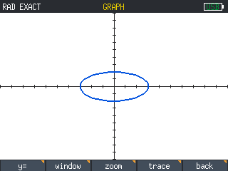

```
X1T=3cos(t)
Y1T=2sin(t)
```

draws an ellipse. <kbd>F4</kbd> (trace) steps t by Tstep and shows T, X and Y; [TABLE](#table) lists T with X1T and Y1T. [CALC](#graph-calc) offers value, dy/dx (dy/dt divided by dx/dt) and arc length between two values of t.

<a id="graph-pol"></a>

#### Polar curves

In POL mode each entry is r1(θ) to r6(θ), drawn as x = r·cos θ, y = r·sin θ for θ from θmin to θmax in steps of θstep ([WINDOW](#window)). In DEGREE mode θ is in degrees: set θmax to 360.

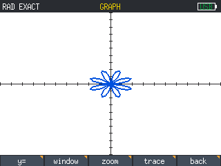

```
r1=2sin(4θ)
```

draws an eight-petal rose. <kbd>F4</kbd> (trace) shows θ, R, X and Y; CALC offers value, dy/dx and arc length.

<a id="graph-seq"></a>

#### Sequences

In SEQ mode each entry has two lines: u1(n) = the formula, and u1(nMin) = the initial value(s). A formula may use the previous terms `u1(n-1)` and `u1(n-2)` of any sequence u1 to u6 (type `u` with <kbd>alpha</kbd> <kbd>4</kbd>); it then needs one or two initial values, for n = nMin and nMin+1, separated by a comma.

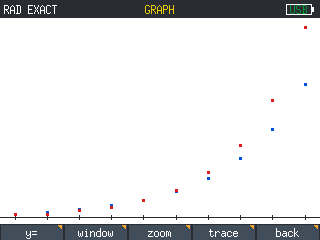 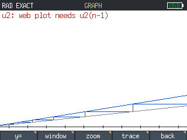

```
u1(n)=1.5u1(n-1)          u1(nMin)=1
u2(n)=u2(n-1)+u2(n-2)     u2(nMin)=1,1
```

A formula without previous terms (`n^2`) needs no initial value. [WINDOW](#window): nMin (first n), nMax (last n), PlotStart and PlotStep (which terms are drawn), plus the X and Y range.

The header line of Y= chooses the plot:

- TIME: the points (n, u(n)), dotted by default (line style connects them).
- WEB: the cobweb of a sequence that uses only its own u(n-1): the curve y = f(x), the line y = x and the steps of the iteration starting at u(nMin). ZoomFit makes a square window around the values.

<kbd>F4</kbd> (trace) steps n by 1. TABLE lists n and the sequences.

<a id="graph-impl"></a>

#### Implicit relations

In IMPL mode each entry is a relation in x and y: an equation such as `x^2+y^2=16` or an inequality `y<sin(x)`, `x*y≥2` (`<` `=` `>` are <kbd>shift</kbd> <kbd>4</kbd> <kbd>5</kbd> <kbd>6</kbd>, `≤` `≥` <kbd>shift</kbd> <kbd>1</kbd> <kbd>3</kbd>). An expression without a relation means expression = 0.

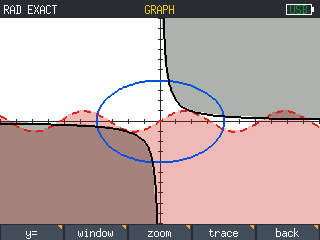

- Equations are drawn as curves found by marching squares on a 2-pixel grid (the left side minus the right side changes sign there; jumps across poles are skipped).
- Inequalities shade the region where they hold in a light tint of the entry's colour and draw the boundary: dashed for \< and \>, solid for ≤ and ≥. All shading is drawn before the curves, so curves stay visible.
- The free cursor (arrow keys) shows X, Y and F, the left side minus the right side of the first relation.

There is no TRACE or TABLE for relations. Free single letters other than x and y become [sliders](#graph-sliders).

<a id="graph-de"></a>

#### Slope fields

In DE mode each entry is a first-order differential equation y1' = f(x, y), on two lines: y1' holds f(x, y) and IC1 the initial points of the solution curves, as points `(x0,y0)` separated by commas (up to four; a single number y0 means the point (0, y0)). Type y with <kbd>alpha</kbd> <kbd>→</kbd>; <kbd>x</kbd> types x.

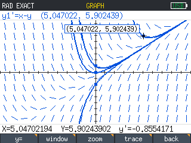 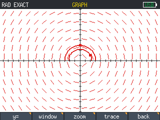

```
y1'=x-y          IC1=(0,1),(0,-2)
y2'=-x/y         IC2=(0,3)
```

GRAPH draws the slope field: on a grid of short segments, each with the slope f(x, y) at its centre, in the entry's colour (an undefined slope leaves its segment out, an infinite one is vertical). The grid follows the screen, so it keeps its density when you zoom or pan. Through every initial point a solution curve is drawn forward and backward with the Runge-Kutta method (RK4, steps of about two pixels, smaller where the curve bends). A curve ends at the edge of the window, where the slope is undefined, at a vertical tangent (y' = -x/y at y = 0) or where the solution blows up (y' = y^2 + x^2).

Add curves on the graph:

- Move the free cursor with the arrow keys (the bottom line shows X, Y and the slope y'), then <kbd>enter</kbd>: a solution curve through that point.
- Long press on the graph: a curve through the pressed point.
- <kbd>⌫</kbd> while tracing a curve added this way removes it; <kbd>menu</kbd> on [Y=](#yeq) removes all of them. Up to eight are kept, the oldest goes first, and they are saved with the session.

<kbd>F4</kbd> (trace) follows a solution curve: <kbd>◀</kbd> <kbd>▶</kbd> step x by a pixel, <kbd>▲</kbd> <kbd>▼</kbd> switch curves, a typed number moves to that x; the bottom line shows X, Y and y'. Past the end of a solution Y is undefined. A tap near a curve traces it. There is no CALC or TABLE in DE mode. Free single letters other than x and y become [sliders](#graph-sliders) (<kbd>enter</kbd> on the free cursor adds a curve instead of opening the slider settings).

<a id="graph-styles"></a>

#### Line styles

Each entry has a line style, shown as a small mark under its name in [Y=](#yeq). Move <kbd>◀</kbd> past the colour swatch to the style (or tap the name) and press <kbd>enter</kbd> to cycle:

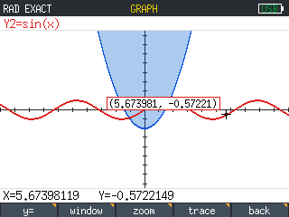 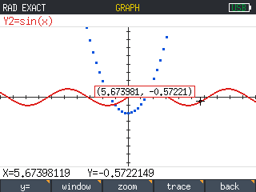

- line (default): 2 pixels
- thick: 4 pixels
- thin: 1 pixel
- dotted: a dot every 4 pixels (sequences: the points only)
- above: shade the region above the function (FUNC only)
- below: shade the region below the function (FUNC only)

Shading uses a light tint of the function's colour, so overlapping regions stay distinguishable and the curves are drawn on top.

<a id="graph-calc"></a>

#### CALC: graph analysis

<kbd>shift</kbd> <kbd>F4</kbd> (calc) on a graph screen opens the analysis menu over the graph (also apps \> Graph analysis). The result is shown at the bottom, the point is marked and labelled, and the main value is stored in `ans`.

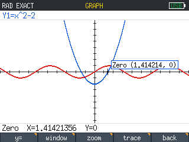 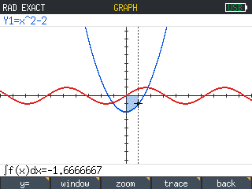

- value: type x (or t, θ, n) and <kbd>enter</kbd>: the value of the traced curve; <kbd>▲</kbd> <kbd>▼</kbd> show the other curves at the same x. ans = y.
- zero: Left bound?, Right bound?, Guess?: a root between the bounds nearest the guess (Brent's method; touching zeros such as x² at 0 are found too). ans = x.
- minimum, maximum: Left bound?, Right bound?, Guess?: the extremum between the bounds (sampling, then Brent's parabolic search). ans = x.
- intersect: First curve?, Second curve? (<kbd>▲</kbd> <kbd>▼</kbd> choose, <kbd>enter</kbd>), Guess?: the intersection nearest the guess. With exactly two functions switched on there is nothing to choose: it asks for the guess at once. ans = x.
- dy/dx: the slope at the point (Richardson-extrapolated central differences). ans = slope.
- ∫f(x)dx: Lower limit?, Upper limit?: the integral (adaptive Gauss-Kronrod 7-15); the area is shaded until <kbd>clear</kbd>. ans = integral.
- inflection: Left bound?, Right bound?, Guess?: where the second derivative changes sign. ans = x.
- arc length: From?, To?: the length of the curve between two x (PAR, POL: two values of t or θ).
- table at cursor: [TABLE](#table) centred on the traced value.

At each prompt (top left; the keys that answer it are shown at the top right) move the cursor with <kbd>◀</kbd> <kbd>▶</kbd>, or type a number (it replaces the cursor position), then <kbd>enter</kbd>. A tap on the graph moves there and confirms. <kbd>clear</kbd> cancels. When nothing is found the bottom line says what to try (`No zero between the bounds: widen them`). PAR and POL offer value, dy/dx, arc length and table; SEQ value and table.

<a id="graph-sliders"></a>

#### Sliders

A single letter in a Y= expression that is not the variable of the mode (x, t, θ, n; x and y in IMPL and DE) is a parameter: GRAPH shows a slider for it above the coordinates, for example `a` and `b` in

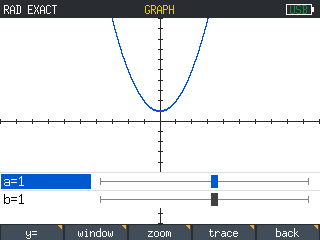

```
Y1=a*x^2+b
```

- Drag the knob (or tap the track) to change the value; the graph is re-drawn while you drag. The parameters are inputs of the compiled functions, so nothing is recompiled.
- <kbd>+</kbd> <kbd>−</kbd> step the highlighted slider, <kbd>,</kbd> highlights the next one, <kbd>enter</kbd> (without TRACE) opens its settings.
- Tap a slider's name, or <kbd>enter</kbd>: value, min, max and step (defaults 1, -10, 10, 0.1). <kbd>F5</kbd> (graph) returns.
- When you let go, the value is stored in the CAS variable (`a:=1.5`), so the home screen and Y1( ) agree. A variable that is already defined starts at its value, and storing a new value on the home screen moves the slider.
- Up to eight parameters; three sliders are visible at a time (the highlighted one and its neighbours).

Slider settings and values are saved with the session.

<a id="graph-touch"></a>

#### Labels and snapping

Touch gestures on [GRAPH](#graph):

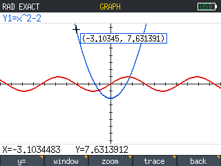 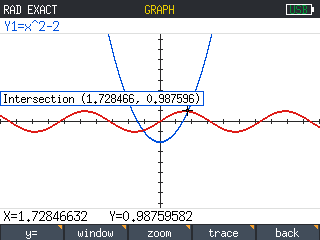

- Tap near a curve: TRACE on the nearest curve at that x, with a label showing the coordinates.
- Long press (hold still for more than 0.6 s): snap to the nearest special point within about 14 pixels: a zero, minimum, maximum, intersection of two functions or the y-intercept, labelled with its name. Elsewhere it behaves like a tap. In DE mode it adds a solution curve through the point ([Slope fields](#graph-de)).
- Tap the coordinates at the bottom while tracing: [TABLE](#table) centred on the traced value.
- Drag to pan, pinch to zoom; on a slider, drag its knob.

During a [CALC](#graph-calc) prompt a tap moves the cursor there and confirms the step.

<a id="table"></a>

#### TABLE

<kbd>shift</kbd> <kbd>F5</kbd> (table) on a graph screen, or <kbd>shift</kbd> <kbd>F1</kbd> on the home screen, shows x and the switched-on Y functions in columns, starting at TblStart with step ΔTbl ([TBLSET](#tblset)). In the other [Graph modes](#graph-modes): T with X1T and Y1T, θ with r1.., n with u1... From the graph, CALC table at cursor (or a tap on the trace coordinates) centres the table on the traced value.

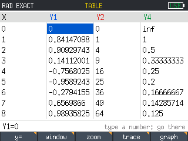

- <kbd>▲</kbd> <kbd>▼</kbd> move through the rows; the table scrolls past its ends.
- <kbd>◀</kbd> <kbd>▶</kbd> move between columns; more than three functions scroll horizontally.
- The selected cell is shown with full precision at the bottom.
- Typing a number (digits, <kbd>.</kbd>, <kbd>(−)</kbd>, π) goes to that x: it is shown at the bottom (`go to X=2.5`), <kbd>enter</kbd> makes it the first row, <kbd>clear</kbd> cancels. Expressions such as `2π` work.
- Touch: tap a cell, drag to scroll.

<a id="tblset"></a>

#### TBLSET

<kbd>shift</kbd> <kbd>F2</kbd> (tblset) on a graph screen: TblStart is the first x value of the [TABLE](#table) and ΔTbl the step between rows (not zero; a negative step counts down). Fields accept expressions; the line at the bottom explains the selected field.

<a id="graph3d"></a>

### 3D graphing

Draws surfaces z = f(x,y), parametric surfaces x(u,v), y(u,v), z(u,v) and space curves x(t), y(t), z(t), up to six at once in different colours, inside a labelled box. Open it from the home screen with <kbd>F1</kbd> (graph) and the editor's 2D/3D switch (3D): type the entries and <kbd>F5</kbd> (graph) adds a 3D [graph cell](#graph-cells) to the notebook; <kbd>enter</kbd> on the cell opens this screen on it.

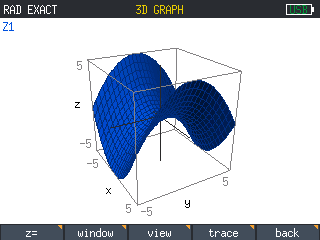 

#### Soft keys

- <kbd>F1</kbd> z= ([entries](#graph3d-eq)), <kbd>F2</kbd> window ([3D window](#graph3d-window)), <kbd>F3</kbd> view ([VIEW menu](#graph3d-view)), <kbd>F4</kbd> trace, <kbd>F5</kbd> graph. In the entries <kbd>F1</kbd> reads 2D: the 2D/3D switch of the graph editor.
- <kbd>shift</kbd>: reset (standard view), style (shaded or wireframe), color (entry colours or colour by height), zfit (z range from the surfaces).

#### Turning and zooming

- <kbd>◀</kbd> <kbd>▶</kbd> turn the box about the z axis by 15°, <kbd>▲</kbd> <kbd>▼</kbd> tilt it by 15° (from below to the top view).
- <kbd>+</kbd> and <kbd>−</kbd> zoom the view in and out.
- Drag on the screen to turn the box, pinch to zoom. While the finger moves the picture is drawn from a coarser grid; it is redrawn in full when you lift it.

#### Trace

<kbd>F4</kbd> puts a cursor on the first surface. <kbd>◀</kbd> <kbd>▶</kbd> move it along x (or u, t), <kbd>▲</kbd> <kbd>▼</kbd> along y (or v); the band at the bottom shows its coordinates (x, y, z). <kbd>F4</kbd> (next) goes to the next surface, <kbd>clear</kbd> ends the trace. Tapping the screen traces the nearest grid point.

#### Contours

The VIEW menu's Contours draws level curves (lines of equal height) on the surfaces z = f(x,y); Contour map shows them flat, as on a map, seen from above. See [3D contours and the contour map](#graph3d-contours).

#### What you see

- The box is the 3D window. The ends of three of its edges show the window's ranges, and the edge names x, y, z.
- The axes go through the origin when it is inside the box.
- Shaded surfaces are lit from the upper left; the underside is darker. Grid lines are drawn on the surface. Surfaces are cut off at the faces of the box.
- Top left: the drawn entries in their colours, or an error message.

The surfaces are computed once (when you enter the screen or change an entry or the window); turning, zooming and tracing reuse the computed grid. See also [Graphing](#graphing).

<a id="graph3d-eq"></a>

#### 3D entries (z=)

The 3D side of the graph editor (<kbd>F1</kbd> graph on the home screen, then 3D). The switch at its top right, "2D 3D", goes back to the 2D functions ([Y=](#yeq)): tap "2D", or press <kbd>F1</kbd> (2D). Six entries Z1 .. Z6. Each is one of:


- z1(x,y) = an expression in x and y (a surface over the x-y window).
- x2(u,v), y2(u,v), z2(u,v): a parametric surface, u and v over their ranges in the [3D window](#graph3d-window).
- x3(t), y3(t), z3(t): a space curve, t over its range.

<kbd>shift</kbd> <kbd>F1</kbd> (type) changes the kind of the highlighted entry, <kbd>shift</kbd> <kbd>F2</kbd> (on/off) switches it on or off, <kbd>shift</kbd> <kbd>F3</kbd> (color) changes its colour. The <kbd>x</kbd> key types x, u or t (the entry's first parameter); type v and y with <kbd>alpha</kbd>.

<kbd>▲</kbd> <kbd>▼</kbd> or <kbd>enter</kbd> move between lines. <kbd>◀</kbd> at the start of a first line moves to the = sign (<kbd>enter</kbd> switches the entry on or off) and then to the colour bar (<kbd>enter</kbd> changes the colour). <kbd>clear</kbd> empties the line. Tap the colour bar, the name (kind) or the = sign to change them.

Examples:

- `x^2-y^2` (a saddle), `sin(x)*cos(y)`, `e^(-(x^2+y^2)/4)*4`
- Sphere: `3*cos(u)*sin(v)`, `3*sin(u)*sin(v)`, `3*cos(v)` with v from 0 to π.
- Torus: `(3+cos(v))*cos(u)`, `(3+cos(v))*sin(u)`, `sin(v)`.
- Helix: `3*cos(t)`, `3*sin(t)`, `t/2`.

<a id="graph3d-window"></a>

#### 3D window

- xmin .. zmax: the box. The surface z = f(x,y) is computed over xmin..xmax and ymin..ymax; everything is cut off at the box faces.
- umin .. vmax: the parameter ranges of parametric surfaces; tmin, tmax: of space curves.
- grid: grid cells per side of every surface (4 to 64). More cells look smoother and take longer.
- tsteps: line segments of every space curve (8 to 1000).
- levels: the number of [contour](#graph3d-contours) levels (1 to 30), evenly spaced between zmin and zmax.

Fields accept expressions such as `2π`. <kbd>▲</kbd> <kbd>▼</kbd> or <kbd>enter</kbd> accept a field and move to the next; an invalid value is refused with a message that names the problem (`ERR: grid must be 4 to 64`). <kbd>shift</kbd> <kbd>F4</kbd> (zfit) on the graph sets zmin and zmax from the surfaces.

<a id="graph3d-view"></a>

#### 3D VIEW menu

<kbd>F3</kbd> (view) on the 3D screens:

 

- Standard view: azimuth -60°, elevation 25°, zoom 1 (also <kbd>shift</kbd> <kbd>F1</kbd> on the graph).
- Top view (x-y plane from above), Front view (x-z), Side view (y-z).
- Contour map: the level curves of the surfaces z = f(x,y) flat in the x-y plane, with a key of the levels ([3D contours and the contour map](#graph3d-contours)). Turning the view, or one of the views above, goes back to 3D.
- Contours: on or off: level curves on the surfaces z = f(x,y) in the 3D view, instead of their grid lines.
- Wireframe: the grid lines only, without hidden lines removed (fast). Shaded: lit, filled surfaces with hidden parts removed (a z-buffer) and the grid lines on top.
- Colour by height: blue (low) through green and yellow to red (high), instead of the entries' colours.
- Axes, Box and labels: show or hide them.
- Zoom in, Zoom out, Zoom fit z (zmin and zmax from the surfaces).

<a id="graph3d-contours"></a>

#### 3D contours and the contour map

Level curves, or contours, join the points of a surface z = f(x,y) at the same height, like the lines of a hiking map. The [3D window](#graph3d-window)'s levels (9 at first) sets how many: they divide the range zmin to zmax into equal bands, so with z from -5 to 5 and 9 levels they are at z = -4, -3, ..., 4. <kbd>shift</kbd> <kbd>F4</kbd> (zfit) first fits zmin and zmax to the surfaces, and the levels with them.

 

##### On the surface

<kbd>F3</kbd> (view) then Contours turns them on or off. The surfaces z = f(x,y) are drawn with their level curves instead of the grid lines: dark lines over a shaded surface (hidden where the surface is in front), lines in the entry's colour, or in the height colours, in the wireframe style. Turning, zooming and tracing work as usual.

##### Contour map

<kbd>F3</kbd> (view) then Contour map shows the surfaces z = f(x,y) from straight above and flat: x to the right, y up, the window's x and y ranges at the corners of the frame. Shaded, the bands between the levels are filled in the height colours (blue low, red high) and the curves drawn over them; wireframe, only the curves are drawn, in the entry's colour or (Colour by height) in the colour of their level. The key at the right lists the level values next to their colours.

- <kbd>+</kbd> <kbd>−</kbd> and a pinch zoom; <kbd>F4</kbd> traces the surfaces z = f(x,y) as in 3D.
- An arrow or a drag turns back to the 3D view (at the angles it had), as do the 3D views of the VIEW menu and <kbd>shift</kbd> <kbd>F1</kbd> (reset).

Parametric surfaces and space curves have no contours: they keep their grid lines in 3D and are left out of the map (their names are dimmed). A [3D graph cell](#graph-cells) keeps the contours and the map of the 3D graph it was made from.

Try `x^2+y^2` (circles), `(x^2-y^2)/5` (hyperbolas around a saddle), `sin(x)*cos(y)` (hills and hollows) or, with every range -1 to 1, `sqrt(1-x^2-y^2)` (circles closer together towards the rim).

<a id="ch-animation"></a>

### Animation

<a id="animation"></a>

#### Animation: graphs that move

The Animation module plays a variable of a graph over time: a travelling wave `sin(x-t)`, a curve drawn like a comet, sequence terms appearing one by one, a rippling 3D surface. It is a module ([Code modules](#code-modules)): if it is not installed, <kbd>shift</kbd> <kbd>F5</kbd> (anim) says how to install it, and everything else works as before.

##### Playing

- On GRAPH and 3D GRAPH, <kbd>shift</kbd> <kbd>F5</kbd> is anim: it opens the ANIMATION menu; <kbd>1</kbd> plays. While playing it reads pause (<kbd>F5</kbd> there is back, to the notebook).
- Any key or a touch pauses (that key does nothing else); leaving the graph and switching off pause too. After 2 minutes without a key it pauses by itself, to save the batteries.
- The value is shown at the top right (▶ t=1.25 while playing, two bars when paused). After a pause the value stays where it stopped and is stored in the variable (`t:=1.25`), like a slider.
- Stop (back to the start) in the menu ends the animation: a comet shows the whole curves again.

##### What is animated

- 2D, every mode: the highlighted [slider](#graph-sliders), i.e. a free letter of the entries. `Y1=sin(x-t)` gives a slider t; the wave travels. With several sliders <kbd>,</kbd> chooses which one plays. In PAR mode t is the curve's own variable, so use another letter: `X1T=cos(t)+a`.
- 2D PAR, POL and SEQ: Comet in the menu switches the comet drawing on: the curves are drawn progressively along t, θ or n with a dot at the head; sequences show their terms one by one (TIME) or the cobweb growing (WEB). See [Comet drawing](#animation-comet).
- IMPL relations: a free letter such as r in `x^2+y^2=r^2` is a slider like in the other modes.
- 3D: the free letter of the entries, t if there is one: `z=sin(√(x^2+y^2)-t)` ripples. Parametric surfaces may use it too; space curves already use t, so they use another letter. See [Animated 3D graphs](#animation-3d).
- TRACE and CALC follow while playing: the trace cursor stays at its x (or t, θ, n) on the moving curve, and a CALC result (zero, minimum, intersection, integral, ...) is computed again for every frame.
- Graph cells of the home notebook whose functions use t: select one and press <kbd>F5</kbd> (play), right there in the notebook; each cell keeps its own t range, seconds and mode. See [Graph cells](#graph-cells) (Animated graph cells).

##### Settings

Settings in the menu (for a 2D slider: <kbd>enter</kbd> on the graph, the slider's own form) has, besides value, min, max and step:

- start, end: the range played (default: the slider's min and max; 3D: 0 to 2π).
- seconds: time from start to end (default 4).
- mode: 0 loop (start again), 1 bounce (back and forth), 2 once (stop at the end). Mode in the menu cycles through them.

The settings are kept per letter and saved with the session.

##### Recording and speed

Record GIF to microSD writes one cycle as an animated GIF ([Recording an animated GIF](#animation-gif)). Up to 25 frames per second are drawn; `state anim_fps` on the console shows the rate.

<a id="animation-comet"></a>

#### Comet drawing

In PAR, POL and SEQ mode, Comet in the ANIMATION menu (<kbd>shift</kbd> <kbd>F5</kbd> on GRAPH) draws the curves progressively: the parameter (t from Tmin, θ from θmin, n from nMin) grows to its maximum over the animation's seconds, and a dot marks the head of each curve.

```
X1T=3sin(2t)
Y1T=3cos(3t)
```

draws a Lissajous figure line by line. For sequences the terms appear one after the other (TIME plot), or the cobweb grows step by step (WEB plot). Loop starts again from the beginning, bounce erases backwards, once stops with the whole curve. Comet is a setting of the 2D graph: switch it off in the same menu to animate sliders again.

<a id="animation-3d"></a>

#### Animated 3D graphs

In the 3D graph a single letter that is not the entry's own variable (x and y for z=, u and v for surfaces, t for curves) and not e or i is the animated variable; t is preferred. Like a slider it starts at the value stored in it (`t:=1`), else at the animation's start (0), so `z=sin(√(x^2+y^2)-t)` is drawn at once; after a pause its value is stored in it.

Every frame evaluates the surfaces again for the new value. When a frame takes longer than about 80 ms, the next ones use a coarser grid (as when you turn the box with a finger), and the grid grows back when frames are fast; a paused or recorded frame is always drawn at the full grid of the 3D window. Rotating and zooming work while paused.

```
z=2sin(√(x^2+y^2)-t)                 ripples
x(u,v)=cos(u)(2+cos(v+t)) ...        a surface that turns
```

<a id="animation-gif"></a>

#### Recording an animated GIF

Record GIF to microSD in the ANIMATION menu plays one cycle (loop: start to end; bounce: there and back; once: to the end) at 10 frames per second, at most 120 frames, and writes it as `/CALC/ANIM001.GIF` (the next free number) on the microSD card. The graph area is recorded, without the play bar; a key press ends the recording early (the file is still complete).

Only the changed part of each frame is stored, so a 2D animation of 40 frames takes 20 to 100 KB. Card errors are reported as for screenshots ([microSD tools](#sdtools)).

<a id="ch-math-quest"></a>

### Math Quest

<a id="mathquest"></a>

#### Math Quest: math games for grades 3 to 5

Math games for grades 3, 4 and 5, a module ([Code modules](#code-modules)) outside the release: install MATHQnnn.MOD from the card (Memory \> Modules). In APPS it is called Sparkle Town: children see a game, grown-ups the learning behind it.

 

- Tap a player, pick a buddy, type a name: the first adventure starts at once. The map is Sparkle Town, a street to walk along with a pet that follows: tap a building to go in (or the arrow keys and ENTER), drag to look along the street; the town grows as she plays. Worlds are story chapters that open one after another; the Arcade (the funfair) has speed games and three keypad action games.
- Every answer is a game action: pop the right bubble, catch the right star, dash through the right gate, frost a pie, build a rug, turn the clock's hands, drop coins in the till, aim with a protractor, hop along a number line. Typing the answer works too, and now and then the answer is made: type it and blow its bubble. Kart Race is a real race to the podium. <kbd>F1</kbd> (trick) shows the guide's trick, <kbd>F2</kbd> uses a power-up.
- Each order starts as a little scene: the friend acts out the story on a stage (a tap skips it). The friends remember what she did and talk about it in town; each has a little story told a step a play day, ending in a party, a toy wedding or a trip, and two stories open new games (Cake Kitchen, Pet Shop). Treasure Heist hides clues round a cave and locks the treasure with a combination.
- The Sparkle Kitchen (first on the street) is a cake counter: a friend orders a fraction of a cake (1/2, 3/4, 2/3 ... at her level), the oven bakes it cut in equal pieces with sparkles earned by playing, two pieces the same merge (two quarters make a half) and the plate she gives is her answer; spare pieces go to the cafe. Now and then a round has a twist (night mode, giant bubbles, gravity flip, mirror world) and some play days bring a surprise (a visitor, lantern night, bubble day, a parade).
- A wrong answer is a moment in the story and gets one more try, then the game shows why and a similar order follows; nothing is ever lost.
- The Arcade has speed games, keypad action games and the toy box: Bongo Beats (drums on the beat), a kaleidoscope, magic squares, number magic and more.
- Coins earned by playing buy furniture, pets, windows and outfits; five rooms to decorate by dragging, squishies to collect. Swipe between rooms, worlds and pages.
- Grown-ups: <kbd>F5</kbd> shows a problem past the curriculum (a percent, a negative number, a power, a square root, an equation with a letter); type its answer for standards, the fact grid, review statistics, time and sessions, the daily limit, the free-fun share, theme packs (/CALC/THEMES/\*.THM) and the play log (saved to the card as /CALC/MQLOGnnn.CSV).

<a id="ch-statistics"></a>

### Statistics

<a id="stat"></a>

#### Statistics app

<kbd>apps</kbd> \> Statistics opens the STAT menu, <kbd>apps</kbd> \> Distributions the [DISTR](#stat-distr) menu and <kbd>apps</kbd> \> Stat plots (also <kbd>shift</kbd> <kbd>F1</kbd> on the graph screens) the [STAT PLOTS](#stat-plots). In the list editor the soft keys reach all of them: stat, calc, tests, plots, graph; <kbd>shift</kbd>: sortA, sortD, clrlist, csv, distr.


- Edit lists...: the [list editor](#stat-edit) (L1..L6 and named lists)
- CALC: [1-Var and 2-Var statistics](#stat-calc), [regressions](#stat-regression)
- TESTS: [hypothesis tests](#stat-tests) and [confidence intervals](#stat-intervals)
- SortA, SortD, ClrList, SetUpEditor: see [List editor](#stat-edit)
- Stat plots, CSV on microSD: [Stat plots](#stat-plots), [CSV files on the microSD card](#stat-csv)

A typical session: enter data in the list editor, <kbd>F2</kbd> calc \> 1-Var Stats, <kbd>F5</kbd> (calc). For a fit, calc \> LinReg(ax+b), <kbd>F5</kbd>, then <kbd>F2</kbd> (plot) on the result shows the points and the fitted line on the graph.

Lists are also CAS variables: see [Lists](#stat-lists). Results of the last computation are in <kbd>vars</kbd> \> Statistics ([Results](#stat-results)). The distribution functions are listed in [Distribution functions](#stat-cmds).

<a id="stat-lists"></a>

#### Lists

The lists L1 to L6 always exist; RESID receives the residuals of the last regression; up to 13 more named lists (1 to 7 letters and digits, e.g. `DATA`) can be created in the [list editor](#stat-edit) or by a CSV import. A list holds up to 999 numbers and is saved when the calculator is switched off.

On the home screen a list name is a CAS variable:

```
mean(L1)
L1*2→L3
{1,2,3}→L2
sort(L2)→L2
normalcdf(L1,L1+1)
```

Storing into a list name (`→` or `:=`) updates the list editor. Lists can be inserted from <kbd>vars</kbd> \> Lists.

<a id="stat-edit"></a>

#### List editor

STAT \> Edit lists... shows the lists in columns; the line at the bottom edits the highlighted cell.


- Arrows move; typing a number or expression and <kbd>enter</kbd> stores it and moves down; below the last element adds one. When nothing is selected for display, the bottom line says in grey what the highlighted place takes.
- <kbd>⌫</kbd> deletes the element, <kbd>shift</kbd> <kbd>⌫</kbd> (ins) inserts a 0.
- On a list name (top row), <kbd>enter</kbd> shows the whole list `{1,2,3}`. Type an expression such as `L1*2` and <kbd>enter</kbd> to fill the list once, or the expression in quotes, `"L1*2"`, to attach a column formula: the list then recomputes whenever another list changes (a `*` after the name marks it). <kbd>clear</kbd> <kbd>enter</kbd> on the name clears the list. <kbd>⌫</kbd> on a name removes the column from the editor (the list is kept).
- The column `+ new` after the last list takes the name of a new named list.
- SortA / SortD sort the highlighted list (from elsewhere: a form, with lists to carry along). ClrList empties the highlighted list after a No/Yes question (from elsewhere: a form naming the lists); SetUpEditor restores the columns L1..L6.

<a id="stat-calc"></a>

#### 1-Var and 2-Var statistics

STAT \> CALC \> 1-Var Stats asks for a list and an optional frequency list (`1` = none) and shows xbar (mean), Σx, Σx², Sx (sample standard deviation), sigmax (population standard deviation), n, minX, Q1, Med, Q3, maxX and the mode (the value with the largest frequency; `-` when all values are equally frequent). Each result line says in grey what the value is.


Quartiles are the medians of the lower and upper halves (the usual calculator convention).

2-Var Stats takes an X and a Y list and adds ybar, Σy, Σy², Sy, sigmay, Σxy, minY, maxY.

<a id="stat-regression"></a>

#### Regressions

STAT \> CALC: LinReg(ax+b), LinReg(a+bx), QuadReg, CubicReg, QuartReg, LnReg (a+b ln x), ExpReg (a\*b^x), PwrReg (a\*x^b), Logistic (c/(1+a\*e^(-bx))), SinReg (a\*sin(bx+c)+d) and Med-Med.


The form takes the X and Y lists, a frequency list (`1` = none) and RegEQ-\>, a Y= function to receive the equation (for graphing it with a [scatter plot](#stat-plots)). The result shows the coefficients, r² or R² and r where defined; the residuals y - f(x) are stored in RESID and the equation is in <kbd>vars</kbd> \> Statistics \> RegEQ.

<kbd>F2</kbd> (plot) on the result graphs the fit in one step: the equation goes to the RegEQ function, or, when none was chosen, to the first empty Y= function (a function in use is never overwritten); a stat plot shows Xlist against Ylist as a scatter plot (the plot already doing so, else the first plot that is off, else Plot1); ZoomStat fits the window.

LnReg, ExpReg and PwrReg fit a line to the logarithms (the usual calculator convention); Logistic and SinReg are nonlinear least squares fits.

<a id="stat-tests"></a>

#### Hypothesis tests

STAT \> TESTS: Z-Test, T-Test, 2-SampZTest, 2-SampTTest, 1-PropZTest, 2-PropZTest, chi² GOF-Test, chi²-Test, 2-SampFTest, LinRegTTest, ANOVA.

 

- Input: Data takes lists, Stats takes xbar, Sx and n. Ha: is the alternative hypothesis, written out (`mu≠mu0`, `mu<mu0`, `mu>mu0`; `p`, `sd`, `slope` for proportions, standard deviations and the slope), chosen with <kbd>◀</kbd> <kbd>▶</kbd>. <kbd>F5</kbd> (calc) computes and <kbd>F4</kbd> (draw) draws from anywhere in the form. Empty fields show `(enter a value)`; the line at the bottom says what the highlighted field takes, or what is wrong.
- Calculate shows the statistic, p and df, with the hypothesis tested at the top right (`Ha: mu>5`); Draw shades the p-value region ([Results](#stat-results)).
- 2-SampTTest: Pooled Yes assumes equal variances; No uses Welch's df.
- chi² GOF-Test: observed and expected lists and df; the contributions go to the list CNTRB.
- chi²-Test: Observed is a matrix such as `[[10,20],[30,40]]` or the name of a CAS variable holding one; the expected counts are stored in the CAS variable `chi2exp`.
- LinRegTTest tests the slope of LinReg(ax+b) and shows a, b, s, r², r.
- ANOVA: Lists names the groups, e.g. `L1,L2,L3`.

<a id="stat-intervals"></a>

#### Confidence intervals

STAT \> TESTS: ZInterval, TInterval, 2-SampZInt, 2-SampTInt, 1-PropZInt, 2-PropZInt. Inputs as for the [tests](#stat-tests); C-Level is the confidence level, `0.95` or `95`. The result shows lower, upper, the margin of error ME and the sample statistics.

<a id="stat-results"></a>

#### Results

Results are listed one per line (<kbd>▲</kbd> <kbd>▼</kbd> scroll), each with its meaning in grey (mean, sample std. dev., p-value, ...). The top right shows the alternative hypothesis of a test, the confidence level of an interval or the Y= function that got a regression equation.

- <kbd>F1</kbd> (draw) or <kbd>enter</kbd>, for a test: the distribution with the p-value region shaded.
- <kbd>F2</kbd> (plot), for a regression: the data and the fitted curve on the graph ([Regressions](#stat-regression)).
- <kbd>clear</kbd> or <kbd>F5</kbd> (back): back to the form.

<kbd>vars</kbd> \> Statistics lists the values of the last result (xbar, Sx, p, z, a, b, r², ...) and RegEQ, the last regression equation; choosing one inserts it at the cursor.

<a id="stat-distr"></a>

#### Distributions

<kbd>apps</kbd> \> Distributions (DISTR; <kbd>shift</kbd> <kbd>F5</kbd> in the list editor) inserts the [distribution functions](#stat-cmds): normalpdf, normalcdf, invNorm, invT, tpdf, tcdf, chi2pdf, chi2cdf, Fpdf, Fcdf, binompdf, binomcdf, poissonpdf, poissoncdf, geometpdf, geometcdf, invChi2, invF. The menu shows the order of the arguments (in square brackets: optional, e.g. `normalcdf(lo,hi[,mu,sd])`) and inserts the name with its parentheses, the cursor inside. They work on the home screen in exact and approximate mode, in Y= functions (graph `normalpdf(x)`), in lists and in forms.

 

For a normal probability such as P(-1 ≤ X ≤ 1): DISTR \> normalcdf, type `-1,1` (for a mean of 100 and a standard deviation of 15: `85,115,100,15`), <kbd>enter</kbd>; or DRAW \> ShadeNorm to see the area too.

DRAW \> ShadeNorm, Shade\_t, Shadechi², ShadeF draw the density with the area between lower and upper shaded and print the area. Use `-1E99` / `1E99` (or `-inf` / `inf`) for unbounded tails.

Relative accuracy: about 1E-12.

<a id="stat-plots"></a>

#### Stat plots

<kbd>shift</kbd> <kbd>F1</kbd> (plots) on a graph screen or <kbd>F4</kbd> (plots) in the list editor lists Plot1..Plot3, PlotsOff, PlotsOn and ZoomStat. A plot has:

  

- Type: Scat (scatter), Line (xyLine), Hist (histogram, bar width Xscl), MBox (modified box plot, outliers marked), Box, NPrb (normal probability plot); on the Type row the bottom line says what the chosen type draws
- Xlist, Ylist (scatter and line), Freq (histogram and box plots, `1` = none)
- Mark: box, + or dot (types that draw points); Color 1..8, shown as the Y= colours

Rows a type does not use are hidden. Plots are drawn on the [GRAPH](#graph); ZoomStat (<kbd>F5</kbd>) fits the window to their data, <kbd>F4</kbd> (graph) shows the graph as it is. New plots are red, green and magenta, so they stand out from a regression line in Y1 (blue).

<a id="stat-csv"></a>

#### CSV files on the microSD card

STAT \> CSV on microSD:


- Export lists...: the lists named in Lists (e.g. `L1,L2,DATA`) go to File (8.3 name, e.g. `LISTS.CSV`) in the card's root folder, one column per list, the names in the first row.
- Export all lists: every non-empty list to `ALL.CSV`.
- Import CSV...: choose a .CSV file in the root folder. A first row with text names the columns: L1..L6, RESID or a valid list name (created if needed); other columns go to L1, L2, ... in order. Commas, semicolons or tabs separate the values (with semicolons or tabs a decimal comma is accepted). The list editor then opens on the first imported list.
- Card info: file system, size and free space.

FAT16 and FAT32 cards (up to 32 GB) are supported. A file replaces its old version only when completely written: removing the card during a write keeps the old file. Card errors say what to do (insert a card, format it as FAT32, use an 8.3 name such as `DATA.CSV`).

<a id="ch-matrices"></a>

### Matrices

<a id="matrix-menu"></a>

#### MATRIX menu

<kbd>shift</kbd> <kbd>math</kbd> (matrix) opens the matrix menu; it is also in [apps](#apps) as Matrix. In the matrix editor the soft keys <kbd>F1</kbd> <kbd>F2</kbd> <kbd>F3</kbd> open NAMES, MATH and EDIT, and <kbd>F5</kbd> (→home) goes to the home screen with the matrix name typed, ready for `[A]⁻¹` (<kbd>shift</kbd> <kbd>÷</kbd>), `det([A])` ...


- NAMES: inserts a matrix name `[A]` ... `[J]` (with its size when it is defined).
- MATH: matrix commands, the common ones first: [det](#det), [inv](#inv), [transpose](#transpose), [rref](#rref), [identity](#identity), [dim](#dim), [augment](#augment), [rank](#rank), [trace](#trace), [eigenvals](#eigenvals), [eigenvects](#eigenvects), [ref](#ref), [norm](#norm), [cond](#cond), [lu](#lu), [qr](#qr), [cholesky](#cholesky), [Fill](#fill), [randM](#randMat), [rowSwap](#rowSwap), [row+](#rowAdd), [\*row](#mRow), [\*row+](#mRowAdd), [cumSum](#cumSum). The labels show the order of the arguments (`mRow( k,M,i)`).
- EDIT: opens the [matrix editor](#matrix-edit) for `[A]` ... `[J]` or for a CAS variable that holds a matrix.

`[A]` ... `[J]` are the CAS variables `matA` ... `matJ`, so they work in every CAS command, are listed under <kbd>vars</kbd> \> Matrix, and are saved with the session. Store a matrix with <kbd>→</kbd>:

```
[[1,2],[3,4]]→[A]
[A]^2
▶ [[7,10],[15,22]]
det([A])
▶ -2
```

Results stay exact (fractions, roots, symbols); a decimal entry makes the computation approximate.

<a id="matrix-edit"></a>

#### Matrix editor

The first line shows the name and the size `rows×columns`. Below are the cells; the bottom line shows the selected cell in full.


- Size: the editor opens on the size line (<kbd>▲</kbd> from the first row goes back to it); type the number of rows, <kbd>enter</kbd> (or <kbd>▶</kbd>), the number of columns, <kbd>enter</kbd> (or <kbd>▼</kbd>). A number that could still get a second digit (1 or 2) is applied by the next key, so typing 12 does not first cut the matrix to 1 row; <kbd>clear</kbd> drops it. Existing entries are kept, new ones are 0. Up to 20×20.
- Cells: the arrow keys move; type to replace a cell or press <kbd>enter</kbd> to edit it; <kbd>enter</kbd> stores it and moves to the next cell. Entries can be expressions (`1/3`, `√(2)`, `a+b`), they are evaluated by the CAS.
- <kbd>clear</kbd> cancels an edit; <kbd>clear</kbd> again (or <kbd>home</kbd>) leaves the editor.
- <kbd>F5</kbd> (→home) leaves it with the name (`[A]`) typed at the cursor of the home screen: <kbd>F5</kbd> <kbd>shift</kbd> <kbd>÷</kbd> <kbd>enter</kbd> inverts the matrix.
- A matrix that does not exist yet starts as a 3×3 zero matrix.

<a id="solver"></a>

### Solver

<kbd>apps</kbd> \> Solver offers three numeric solvers (they work in decimals; for exact answers use [solve](#solve), [roots](#roots) and [linsolve](#linsolve)):


- Equation solver (below).
- [Polynomial roots](#polyroot).
- [Linear system](#linsys).

#### Equation solver

Type an equation such as `x^2+y=7` on the `eq:` line and press <kbd>enter</kbd>: every variable of the equation gets a line. Fill in the known values, move to the unknown and press <kbd>F5</kbd> (solve; also <kbd>alpha</kbd> <kbd>enter</kbd>) to solve for it. An expression without `=` is solved for `expression=0`. The footer says what the selected line is for.

- With only one variable, <kbd>F5</kbd> also solves from the `eq:` line: `x^3-2x=1` <kbd>enter</kbd> <kbd>F5</kbd>.
- The current value of the unknown is the starting guess: the solver returns the solution nearest to it.
- `bound lo` and `bound hi` limit the search (default -1E99 to 1E99).
- `root1`, `root2`, ... list every solution found by scanning the bounds (sign changes), so equations with several solutions show all of them. <kbd>F5</kbd> on a root line makes it the value of the unknown; changing the guess and solving again also picks another one.
- The footer shows `left-right`, the difference of the two sides at the solution (0 when exact).
- If no root is found, try another guess or wider bounds.
- The variables of the CAS are not changed; units and constants (`_m`, `_c`) are not variables.
- The equation, the values and the bounds are kept when the calculator is switched off.

<a id="polyroot"></a>

#### Polynomial roots

<kbd>apps</kbd> \> Solver \> Polynomial roots (<kbd>F2</kbd> poly in the solvers). Enter the degree (1 to 10) and the coefficients from the highest power down to the constant term; the footer shows the polynomial they make (`p(x)=x^3-2x-1`). The roots appear below, complex ones as `a+bi`. They are recomputed after every change (Aberth iteration in double precision).


Example: degree 3 with coefficients 1, 0, 0, -8 gives `-1-1.732050808i`, `-1+1.732050808i` and `2`.

<a id="linsys"></a>

#### Linear system

<kbd>apps</kbd> \> Solver \> Linear system (<kbd>F3</kbd> linear in the solvers) solves `A x = b` for up to 6 equations and 6 unknowns. The grid is the augmented matrix: one row per equation, the coefficients of x1, x2, ... and the right-hand side in the last column (the column names are shown above the cells). <kbd>▲</kbd> from the first row reaches the size line (rows = equations, columns = unknowns + 1; the size is also shown in words, e.g. 3 equations, 3 unknowns): type the number of rows, <kbd>▶</kbd>, the number of columns, as in the [matrix editor](#matrix-edit).

 

Press <kbd>F5</kbd> (solve) to solve. The result is either the unique solution, "no solution" for an inconsistent system, or a family of solutions with parameters `t1`, `t2`, ...:

```
x+2y+3z=6, 2x+4y+6z=12
▶ x1=6-2t1-3t2, x2=t1, x3=t2
```

<kbd>clear</kbd> returns to the coefficients. For exact or symbolic systems use [linsolve](#linsolve) or [rref](#rref).

<a id="finance"></a>

### Finance

<kbd>apps</kbd> \> Finance, with the usual time-value-of-money conventions. The soft keys switch between the screens: <kbd>F1</kbd> tvm, <kbd>F2</kbd> amort, <kbd>F3</kbd> cashflow, <kbd>F4</kbd> interest, <kbd>shift</kbd> <kbd>F1</kbd> days; <kbd>F5</kbd> solves.

- [TVM Solver](#tvm): loans, savings, annuities.
- [Amortization](#amortization): balance, principal and interest of payments.
- [Cash flows](#cashflow): net present value and internal rate of return.
- [Interest conversion](#interest-conv): nominal and effective rates.
- [Days between dates](#dbd).

Money you receive is positive, money you pay is negative (a loan: PV positive, PMT negative). All values are kept when the calculator is switched off.

<a id="tvm"></a>

#### TVM Solver

The time-value-of-money variables:


- N: number of payments. I%: annual interest rate in percent. PV: present value. PMT: payment per period. FV: future value.
- P/Y: payments per year; C/Y: compounding periods per year (setting P/Y also sets C/Y, the usual convention).
- PMT: END or BEGIN: payments at the end or beginning of each period (<kbd>◀</kbd> <kbd>▶</kbd> or <kbd>enter</kbd> switch).

Enter the known values, highlight the unknown and press <kbd>F5</kbd> (solve; also <kbd>alpha</kbd> <kbd>enter</kbd>). The footer explains the highlighted field and its sign. The equation is

```
0 = PV + (1+i*k)*PMT*(1-(1+i)^-N)/i + FV*(1+i)^-N
i = (1+I%/(100*C/Y))^(C/Y/P/Y) - 1
```

with k = 1 for BEGIN, 0 for END. Example: N=360, I%=6, PV=200000, FV=0, P/Y=12; solving PMT gives -1199.10105.

<a id="amortization"></a>

#### Amortization

Uses the TVM Solver values (PV, I%, PMT, P/Y, C/Y, END/BEGIN). Enter the first and last payment numbers `Pmt1` and `Pmt2`:


- bal: the balance after payment Pmt2.
- ΣPrn: the principal paid by payments Pmt1 to Pmt2.
- ΣInt: the interest paid by payments Pmt1 to Pmt2.
- Below, under the header `interest princ. balance`: one line per payment with its interest, principal and the balance after it.

In FIX mode the payment and each interest amount are rounded to the displayed decimals (as bal(, ΣPrn(, ΣInt( do on other calculators with the current rounding); in FLOAT mode nothing is rounded.

<a id="cashflow"></a>

#### Cash flows

Enter the discount rate I% (per period, in percent), the number of cash flows, the initial cash flow CF0 (usually negative, an investment) and CF1, CF2, ... (one per period, up to 12).

- NPV: net present value CF0 + CF1/(1+i) + CF2/(1+i)^2 + ...
- IRR: internal rate of return in percent, the rate where NPV = 0 ("no sign change" if there is none).

Example: I%=10, CF0=-1000, CF1=500, CF2=400, CF3=300 gives NPV=10.51840721 and IRR=10.65168124.

<a id="interest-conv"></a>

#### Interest conversion

Nominal (Nom%) and effective (Eff%) annual rates for C/Y compounding periods per year. Editing one updates the other:

```
Eff = 100*((1+Nom/(100*C/Y))^C/Y - 1)
```

Example: Nom%=6 with C/Y=12 gives Eff%=6.167781186.

<a id="dbd"></a>

#### Days between dates

Enter two dates as numbers YYYYMMDD (for example 20240315 for March 15, 2024); `days` is the number of days from date1 to date2 (negative if date2 is earlier). Gregorian calendar, leap years included: from 20240101 to 20241231 is 365 days.

<a id="basen"></a>

### Base-n

<kbd>apps</kbd> \> Base-n is a programmer's calculator: type an integer expression and press <kbd>enter</kbd>; the result is shown in HEX, DEC, OCT and BIN, wrapped to the word size.


- An entry that starts with an operator (`+`, `-`, `*`, `/`, `^`, or `and`, `or` from BITS) starts with Ans, the last result: `ff` <kbd>enter</kbd> then `and 0f` <kbd>enter</kbd>. `Ans` here is the app's own last result.
- <kbd>▲</kbd> <kbd>▼</kbd>, the soft keys <kbd>F1</kbd> .. <kbd>F4</kbd> (hex, dec, oct, bin) or a tap on a row choose the input base (highlighted): plain numbers you type are read in that base, e.g. `ff and f0` in HEX. Literals with a prefix always work: `0x1F`, `0b101`, `0o17`. Hex digits A-F are <kbd>alpha</kbd> <kbd>CAS</kbd>, <kbd>math</kbd>, <kbd>vars</kbd>, <kbd>x</kbd>, <kbd>sin</kbd>, <kbd>cos</kbd>.
- <kbd>F5</kbd> (bits) opens the BITS menu: `and`, `or`, [xor](#bitxor), `not`, [shl](#shl), [shr](#shr), [rotl](#rotl), [rotr](#rotr), the word size (8, 16, 32, 64 bits) and signed/unsigned.
- Results are integers: divisions are truncated toward minus infinity (floor), and everything wraps around like a register of the chosen width (two's complement when signed).
- <kbd>clear</kbd> clears the entry; on an empty entry it leaves the app. The settings and the last result are kept when the calculator is switched off.

On the home screen the same works with the CAS: `0x1F` is 31, `5 and 3` is 1 (with two integers `and`, `or`, `not` are bitwise), [hex](#hex), [bin](#bin), [oct](#oct) show integers in a base and [wordsize](#wordsize) sets the width used by the bit commands.

<a id="ch-units-and-constants"></a>

### Units and constants

<a id="units"></a>

#### Units

A quantity is a number times units written with an underscore: `9.8_m/s^2`, `3_s`, `5_kg*m^2/s^2`. After the first `_` the units are joined by `*`, `/` and integer powers `^2`, `^-1` without spaces. The UNITS menu (<kbd>shift</kbd> <kbd>vars</kbd>, also in [apps](#apps); <kbd>shift</kbd> <kbd>CAS</kbd> opens the physical constants) inserts them by category; <kbd>alpha</kbd> <kbd>3</kbd> types `_`. Its first item types `±` for a value with an uncertainty ([Measurements with uncertainty](#uncertainty)), the second starts [convert](#convert) (<kbd>shift</kbd> <kbd>vars</kbd> <kbd>2</kbd>): `convert(60_mph,_m/s)` is `26.8224_m/s`. After the categories come the other unit commands and [nominal](#nominal), [uncert](#uncert), [ucov](#ucov).


```
9.8_m/s^2*3_s
▶ 29.4_m/s
convert(5_ft,_m)
▶ 1.524_m
2_m+30_cm
▶ 2.3_m
```

- Arithmetic works on quantities as on numbers; equal units combine (`2_m+3_m` is `5_m`).
- Sums of different units of the same kind are converted to SI base units; units of different kinds give `ERR:DOMAIN incompatible units` (`1_m+2_s`).
- Products that mix units of one kind are converted to SI (`5_km*2_m` is `10000_m^2`, `5_m/(2_ft)` is a plain number).
- [convert](#convert) converts to chosen units, [usimplify](#usimplify) to SI with a derived unit (N, J, W, Pa, V, ...), `convert(q,"US")` to feet, pounds and seconds.
- Functions such as sin, exp and ln need dimensionless arguments: `sin(30_deg)` is 1/2, `ln(2_m/(1_m))` is `ln(2)`, `sin(1_m)` is an error.
- SI prefixes: Y Z E P T G M k h da d c m u (micro) n p f a, e.g. `_km`, `_uF`, `_MeV`, `_kWh`.
- Temperatures: [convert](#convert) treats a lone temperature as absolute (`convert(20_degC,_degF)` is `68_degF`), [deltaconvert](#deltaconvert) as a difference (10 degC = 18 degF). Adding different temperature units is refused.
- Conversion factors are exact (the inch is 0.0254 m, the pound 0.45359237 kg); a converted value whose decimal expansion does not end is shown as a decimal.

##### Units by category

- Length: m, in, ft, yd, mi, nmi, au, ly, pc, Ang. Area: ha, acre. Volume: L (l), gal, qt, pt, cup, floz, tbsp, tsp (US).
- Time: s, min, h (hr), d, wk, yr. Speed: mph, kph, knot. Frequency: Hz, rpm, Bq, Ci.
- Mass: g, t, lb, oz, ton, slug, ct, u, Da. Force: N, dyn, lbf, kgf. Energy: J, cal, eV, Wh, Btu, erg. Power: W, hp.
- Pressure: Pa, bar, atm, psi, mmHg, Torr, inHg. Temperature: K, degC, degF, degR.
- Electric: A, C, Ah, V, ohm, S, F, H, Wb, T, gauss. Angle: rad, deg, arcmin, arcsec, rev, sr. Other: mol, cd, lm, lx, Gy, Sv.

See also [Physical constants](#constants).

<a id="constants"></a>

#### Physical constants

The Constants entry of the UNITS menu inserts physical constants (CODATA 2022 values; the ones fixed by the SI are exact). In EXACT mode they stay symbolic, in APPROX mode, with decimals or inside [approx](#approx) they are replaced by value and SI units:

```
approx(_me*_c^2)
▶ 8.18710578797ᴇ-14_kg*m^2/s^2
convert(_me*_c^2,_MeV)
▶ 0.510998950692_MeV
```

- `_c` speed of light, `_hP` Planck constant, `_hbar` h/2π, `_qe` elementary charge, `_kB` Boltzmann, `_NA` Avogadro, `_R` molar gas constant, `_Fc` Faraday.
- `_G` gravitation, `_g0` standard gravity 9.80665 m/s², `_eps0`, `_mu0` vacuum permittivity and permeability, `_ke` Coulomb constant, `_Z0` vacuum impedance.
- `_me`, `_mp`, `_mn` electron, proton, neutron mass, `_mu` atomic mass constant, `_a0` Bohr radius, `_Rinf` Rydberg constant, `_alpha` fine-structure constant, `_muB`, `_muN` Bohr and nuclear magneton, `_Phi0` flux quantum, `_sigma` Stefan-Boltzmann, `_Vm` molar volume of an ideal gas at 0 °C and 1 atm.

<a id="uncertainty"></a>

#### Measurements with uncertainty

Type a value, then `±` and its uncertainty: `9.81±0.02`. The `±` is the first item of the UNITS menu (<kbd>shift</kbd> <kbd>vars</kbd> <kbd>1</kbd>; [nominal](#nominal), [uncert](#uncert) and [ucov](#ucov) are at its end) and in the catalog (<kbd>shift</kbd> <kbd>apps</kbd>, type `pm`); `pm(9.81,0.02)` is the same. Every calculation then carries the uncertainty along:

 

```
x:=9.81±0.02
▶ 9.81±0.02
x*x
▶ 96.2±0.4
x-x
▶ 0.0±0
(2.0±0.1)_m/(0.50±0.02)_s
▶ (4.0±0.3)_m/s
```

##### How it works

- Each `±` creates an independent error source. A result is linearised in its sources (first-order propagation: the uncertainty of f(x) is \|f'(x)\|·s) and the sources combine as a root sum of squares.
- The same quantity used twice is the same source, so correlations are exact: `x-x` is `0±0`, `x*x` has twice the relative uncertainty of `x`, and `x+y` with independent `y` adds in quadrature.
- Variables, `ans`, lists, functions (`sin`, `sqrt`, `exp`, ...), units and the [spreadsheet](#sheet) all keep the sources. Saved sessions keep them too.
- The uncertainty is shown with one significant figure (two when it starts with 1) and the value is rounded to the same decimal place. The MODE number format does not change these two numbers.
- Re-typing a printed result makes a new, independent measurement. So does the [RPN](#rpn) stack, which keeps values as printed.
- [Statistics lists](#stat) hold plain numbers: a value with an uncertainty stored into a list (from the list editor, with →, or from a linked spreadsheet column) keeps only its value.
- Exact inputs stay exact: [nominal](#nominal) and [uncert](#uncert) give the value and the uncertainty as expressions.

##### Commands

- [pm](#pm): a value with an uncertainty
- [nominal](#nominal): the value without the uncertainty
- [uncert](#uncert): the uncertainty (standard deviation)
- [ucov](#ucov): covariance of two results

<a id="logic-ops"></a>

### Logical operators

`not p`, `p and q`, `p or q`, `p xor q`, `p implies q`, `p iff q`; `true` and `false` (also 1 and 0) are the constants. `not` binds tightest, then `and`, then `or` and `xor`, then `implies` and `iff` (right to left: `p implies q implies r` is `p implies (q implies r)`). `p xor q` is the same as `xor(p, q)`, and similarly `implies(p, q)` and `iff(p, q)`; with integers `and`, `or`, `not` and `xor` work bitwise ([xor](#xor)).

Any other part of an expression is a variable of the logic commands: a name (`p`), or a relation (`x>1`). Names come first in alphabetical order, then relations in order of appearance. See [truthtable](#truthtable), [boolsimplify](#boolsimplify), [dnf](#dnf), [cnf](#cnf), [satisfiable](#satisfiable).

<a id="sheet"></a>

### Spreadsheet

APPS \> Spreadsheet: a grid of columns A to Z and rows 1 to 999. The line at the top shows the selected cell's entry and its value.

  

#### Entering

- Move with the arrows (or tap a cell). Type to start a new entry, or press <kbd>enter</kbd> to edit the cell's entry. <kbd>enter</kbd> stores it and moves down; <kbd>▲</kbd> <kbd>▼</kbd> store it and move. <kbd>clear</kbd> empties the line, then cancels. <kbd>⌫</kbd> clears the selected cell.
- Every cell is an expression (a leading `=` is optional): `3.5`, `1/3`, `2.0_m`, `9.81±0.02`, `=A1*2`, `=sum(A1:A10)`. Text in double quotes, `"mass"`, is a label.
- MATH, CAS, VARS, UNITS and the catalog insert into the entry line.
- Values are shown with the MODE number format; exact results stay exact.

#### References

- `A1` refers to a cell (lowercase `a1` too); an empty cell counts as 0.
- `A1:B3` is the list of the non-empty cells of a rectangle, row by row (labels are skipped): `sum(A1:A10)`, `mean(B1:B20)`, `max(A1:C3)`, `stddev(...)`.
- `$A$1` is absolute, `$A1` and `A$1` fix the column or the row: fill and paste move only the relative parts.
- Changing a cell recalculates every cell that depends on it, in dependency order. A cell that refers to itself, directly or through others, shows `ERR:CYCLE`; cells that use an error show `ERR:REF`.
- Uncertainties keep their correlation between cells: with `A1` = `9.81±0.02`, `=A1-A1` is `0±0` (see [Measurements with uncertainty](#uncertainty)).
- Names of one letter followed by digits are cells in formulas, so a statistics list such as L1 is the cell L1 there.

#### Soft keys

- <kbd>F1</kbd> `$` and <kbd>F2</kbd> `:` type the absolute marker and the range colon.
- <kbd>F3</kbd> fill↓ asks for the last row and copies the cell down, moving relative references. It proposes the last row of the data in the column to the left (or right), so filling a formula along a column of data is <kbd>F3</kbd> <kbd>enter</kbd>. The entry line confirms what was filled.
- <kbd>F4</kbd> copy and <kbd>F5</kbd> paste copy one cell's entry, moving relative references by the distance. <kbd>menu</kbd> <kbd>F3</kbd> and <kbd>menu</kbd> <kbd>F4</kbd> ([Copy and paste](#clipboard)) copy the cell's value instead, to paste it into another app.
- <kbd>shift</kbd> <kbd>F1</kbd> link: the selected column feeds a statistics list (its numeric cells, in row order; labels and empty cells are skipped). The list follows every recalculation, so it can be used by STAT CALC, tests and stat plots. The column header shows `A>L1`.
- <kbd>shift</kbd> <kbd>F2</kbd> sheet: export the values (`/SHEET.CSV`) or the entries (`/SHEETF.CSV`, which imports back with its formulas) to the microSD card, import a CSV file (cleared sheet, from A1; numbers stay numbers, `=...` are formulas, other text becomes labels), copy a list into the column, clear the sheet.
- <kbd>shift</kbd> <kbd>F3</kbd> plot graphs linked columns in one step: the selected column against the nearest linked column on its left (or, with none there, the nearest on its right) as a scatter plot, or a histogram when it is the only linked column. A stat plot is taken (the one already showing those lists, else the first that is off, else Plot1) and ZoomStat fits the window. A column without a link is refused with a hint.
- <kbd>shift</kbd> <kbd>F4</kbd> stat opens the list editor, <kbd>shift</kbd> <kbd>F5</kbd> graph the graph screen (stat plots).

The sheet (entries, links, selection) is saved with the session; the values are recalculated when it is used again.

<a id="sdtools"></a>

### microSD tools

APPS \> microSD tools works with the card in the slot (FAT16 or FAT32). Files go to the folder `/CALC`.


- Screenshot (PNG): saves the screen the menu was opened from as `/CALC/SHOT001.PNG`, `SHOT002.PNG`, ... (320 x 240, colour). From any screen, <kbd>alpha</kbd> then <kbd>menu</kbd> takes a screenshot directly.
- Backup session: writes everything that survives power-off (settings, history, CAS variables and functions, Y= functions, lists, matrices, the spreadsheet, apps) to `/CALC/BACKUP.SES`. An existing backup is replaced only when the new file is complete.
- Restore session: choose a `.SES` file in `/CALC` and confirm (No is the first choice: a restore replaces everything). Its length and checksum are verified first; then the calculator restarts with that session, exactly as after switching it off and on. A damaged file changes nothing.
- Card info: file system, size and free space.
- Connect card to computer: the card becomes a drive of the computer connected by USB until you press EXIT ([Connecting to a computer](#usb)).

The card is switched off after every operation, so it can be removed whenever no operation is running. Card errors say what to do (insert a card, format it as FAT32, free some space).

<a id="geometry"></a>

### Geometry

<kbd>apps</kbd> \> Geometry is dynamic geometry: build points, lines, circles and polygons from each other, then drag a point and everything built from it follows, measurements included.

 

- The red cross is the cursor: move it with <kbd>▲</kbd> <kbd>▼</kbd> <kbd>◀</kbd> <kbd>▶</kbd>, press <kbd>enter</kbd> to use the current tool there. A tap does the same at the tapped spot.
- The bar at the top names the tool and what it needs next; tools with several steps add the step and what is picked so far (`Angle: vertex (step 2/3, picked B)`). What the tool would take is drawn in orange, and its value (coordinates, equation, length) is shown at the bottom left; the cursor position is at the bottom right.
- Soft keys: <kbd>F1</kbd> move, <kbd>F2</kbd> points, <kbd>F3</kbd> draw, <kbd>F4</kbd> constr, <kbd>F5</kbd> measure (the tool menus, see [Geometry: construction tools](#geometry-tools), [Geometry: transformations and loci](#geometry-transform), [Geometry: measurements](#geometry-measure)); <kbd>shift</kbd>: undo, delete, view, file, hide.
- Moving: with the move tool press <kbd>enter</kbd> on a free point (blue) or a point on a path, move it with the arrows and press <kbd>enter</kbd> again to drop it. With touch, drag any blue point in any tool; drag elsewhere to pan, pinch to zoom. `+` and `−` zoom about the cursor.
- Every step can be undone (<kbd>shift</kbd> <kbd>F1</kbd>); a whole drag is one step. <kbd>⌫</kbd> deletes the object under the cursor and everything built from it.
- <kbd>clear</kbd> closes the number prompt, drops a half-made selection, goes back to the move tool, and finally leaves the app. The construction, view and options are kept when the calculator is switched off.

#### View menu (<kbd>shift</kbd> <kbd>F3</kbd>)

- Axes, grid and snap to grid (on at first): with snap, free points land on the grid lines.
- Y= graphs: draws the enabled functions of [Y=](#yeq). Points can be put on a graph and graphs can be intersected with lines, circles and each other.
- Show on GRAPH: draws the construction on the [GRAPH](#graph) screen too (trace visits its points).
- Zoom in, zoom out, standard view (origin in the middle, 20 pixels per unit), show hidden objects.

#### Names and values

Points are named A, B, C ..., other figures a, b, c ..., measurements m1, m2 .... Images of transformations get a prime: A'. An object whose construction has no solution (parallel lines do not meet, a tangent from inside a circle) is undefined and disappears until it has a solution again.

See [Geometry: files](#geometry-files) for saving constructions on the microSD card.

<a id="geometry-tools"></a>

#### Geometry: construction tools

Steps that need a point take an existing point, or make one: at the intersection of two curves under the cursor, on a line, circle, polygon or graph under the cursor (the point then stays on it), else a free point.


##### <kbd>F2</kbd> points

- Point: a free point, a point on an object or an intersection, as above.
- Point on object: a point that can only move along the chosen path.
- Intersection: two curves; the intersection nearest the cursor, or all of them if none is near.
- Midpoint: a segment, or two points.

##### <kbd>F3</kbd> draw

- Line, segment, ray: two points (a ray starts at the first).
- Polygon: the vertices in order, then the first vertex again (up to 12).
- Regular polygon: two vertices, then the number of sides (3 to 12); the polygon lies to the left of the first edge.
- Circle: centre and a point on it; circle through three points.

##### <kbd>F4</kbd> constr

- Perpendicular line, parallel line: a line, then the point it passes through.
- Perpendicular bisector: a segment or two points. Angle bisector: point, vertex, point.
- Tangents: a point, then a circle: the two tangents from the point (one if it lies on the circle).
- Transformations and loci: see [Geometry: transformations and loci](#geometry-transform).

<a id="geometry-transform"></a>

#### Geometry: transformations and loci

In <kbd>F4</kbd> constr. The image of an object depends on the object and on the transformation's parts, so it moves with both. A polygon's image is the polygon of its vertices' images.

 

- Reflect: the object, then a mirror line (or a point: point reflection).
- Rotate: the object, the centre, then the angle in degrees (counterclockwise; any expression such as `360/7`).
- Translate: the object, then the start and end of the translation vector.
- Dilate: the object, the centre, then the factor (negative factors go through the centre).
- Locus: a point, then a point on a path that it depends on. The curve the first point traces while the second runs along its path is drawn in magenta and follows later changes (e.g. the midpoint of a fixed point and a point on a circle traces a circle).

<a id="geometry-measure"></a>

#### Geometry: measurements

<kbd>F5</kbd> measure. Measurements are listed at the top left and update while points are dragged.


- Length / distance: a segment (its length), circle (circumference), polygon (perimeter), or two points (their distance).
- Angle: point, vertex, point: 0 to 180 degrees.
- Area: a polygon or a circle.
- Slope: a line, segment or ray (undefined when vertical).
- Equation: a line (`y = mx + b`, or `x = c` when vertical) or a circle (`(x - h)² + (y - k)² = r²`).
- Coordinates: a point.

To remove a measurement, use the delete tool (<kbd>shift</kbd> <kbd>F2</kbd>) and tap it in the list (or put the cursor on its row and press <kbd>enter</kbd>).

<kbd>menu</kbd> <kbd>F3</kbd> copies a measurement's value (the one whose row is under the cursor, else the newest) to paste it elsewhere, for example into the [spreadsheet](#sheet); see [Copy and paste](#clipboard).

<a id="geometry-files"></a>

#### Geometry: files

<kbd>shift</kbd> <kbd>F4</kbd> file:


- New construction: deletes everything (undo brings it back).
- Save to microSD: type a name (letters and digits, up to 8; <kbd>alpha</kbd> for letters) and press <kbd>enter</kbd>. The file is /CALC/GEO/NAME.GEO.
- Open from microSD: lists the saved constructions; choosing one replaces the current construction and view.

The current construction is also saved with the session, so it survives switching off without a card.

<a id="python"></a>

### Python

<kbd>apps</kbd> \> Python is a Python console (MicroPython 1.29) with the calculator's computer algebra system as the library `calc` ([Python: the calc library](#python-calc)). Type a line and press <kbd>enter</kbd>: the result is shown under it, as at the Python prompt `>>>`.

  

- A line ending in `:` (`for`, `if`, `def`, `while`, `class`) starts a block: the next line is indented by itself (four spaces more), `...` is shown instead of `>>>`, and an empty line runs the block. <kbd>F1</kbd> run runs the block at once (the line too); a block run this way may hold several statements, and the value of the last one is shown.
- <kbd>F2</kbd> tab indents the line by four spaces, <kbd>shift</kbd> <kbd>F1</kbd> removes four. <kbd>F3</kbd> chars offers what the keyboard lacks (`'` `#` `%` `!` `&` `|` `;` `\` and words such as `def`, `range(`, `print(`): arrows and <kbd>enter</kbd> insert one, <kbd>clear</kbd> closes it. Letters, space (`0`), `:` (`.`), `"` (`+`) and `_` (`3`) are on <kbd>alpha</kbd>; `=` `<` `>` on <kbd>shift</kbd> `5` `4` `6`, `[` `]` on <kbd>shift</kbd> `(` `)`, `{` `}` on <kbd>shift</kbd> `8` `9`.
- <kbd>F4</kbd> break forgets the block being typed, <kbd>F5</kbd> clear clears the output. <kbd>▲</kbd> and <kbd>▼</kbd> recall earlier lines. <kbd>clear</kbd> clears the line, then the block, then leaves; the interpreter keeps its variables until the calculator is switched off.
- <kbd>on</kbd> stops a running program with `KeyboardInterrupt`, also inside `time.sleep` and a long CAS computation. While a program runs its output appears as it is printed.
- Errors print the traceback in red, as Python does: `ZeroDivisionError: divide by zero`. Very deep recursion raises `RuntimeError: maximum recursion depth exceeded`.
- The calculator's keys type their own text, which is turned into Python before the line runs: `√(` is `sqrt(`, `π` is `pi`, `x²` is `**2`, `^` is `**`, `(−)` is `-`, `≤ ≥ ≠` are `<= >= !=`, `→` is `=`. In Python `log` is the natural logarithm and `log10` the common one; <kbd>ln</kbd> types `ln(`, which is not defined.
- The CAS and MATH menus and the catalog insert into the line; touch: drag the output to scroll it.

The console starts with `from math import *`, `from calc import *` and the symbols `x`, `y`, `z`, `t`, so `sqrt(2)`, `solve(x^2-2,x)` and `integrate(sin(x),x)` work at once; the modules `math`, `cmath`, `random`, `time`, `re`, `json`, `heapq`, `collections`, `struct`, `array` and `io` can be imported. There are no files yet (`open` raises an error) and `input()` is not available.

`  `` >>> for k in range(1, 4): ...     print(k, k**2) ... 1 1 2 4 3 9 >>> solve(x^2-2, x) [-sqrt(2), sqrt(2)] ``  `

#### Python cells of a notebook: Ans and Out

In a Python cell of the home notebook ([The home screen is a notebook](#home-notebook)) or of the browser page, `Ans` is the notebook's latest result and `Out` holds every result by its number: `Out[3]` is the result of the cell marked \[3\] (In \[3\] in the browser). The result of a calculation (a math cell) is a `calc.Expr`; a Python cell's is the value itself. `Out` works like a dictionary that cannot be changed: `3 in Out`, `Out.get(3)`, `len(Out)`, `Out.keys()`, `Out.items()`; a number without a result raises `KeyError: Out[7]: no such result`. `Ans` is `None` while there is no result.

After the notebook is opened again (or the calculator restarted) Python starts afresh: results of calculations, `calc.Expr` values and plain values (numbers, strings, lists, tuples, dictionaries, `True`, `False`, `None`) come back from the stored text; any other value (an object of a class, a function) is only there for cells run since Python started, and `Out[n]` of one says to run that cell again.

Python is a module of program code ([Code modules](#code-modules)): without it APPS \> Python says how to install it. The firmware has a 2 MB Python heap; `import gc; gc.mem_free()` shows what is left.

<a id="python-calc"></a>

#### Python: the calc library

The `calc` library gives Python the calculator's computer algebra system ([Python](#python)). Its values are CAS expressions, `calc.Expr`, shown in the CAS's linear form:


`  `` >>> from calc import x, y >>> (x + 1)**2 (x+1)^2 >>> expand((x + 1)**2) x^2+2*x+1 ``  `

- Symbols: `calc.sym('a')`, `calc.syms('a b c')`, or `from calc import x, y, t` (any single letter, a letter with digits, or a Greek letter's name such as `theta`; `calc.pi` is π).
- Arithmetic: `+ - * / **` between expressions and Python numbers make new expressions, simplified by the CAS. Python integers of any size and fractions (`numerator` / `denominator`) are exact: `Expr(1)/3` is `1/3`; floats stay decimal. `==` is true when the difference simplifies to 0; `<` and the like compare the numeric values.
- Back to Python: `float(e)`, `int(e)`, `complex(e)` when the value is a number; `approx(e)` is a float or a complex number when it can be one, `approx(e, 30)` an expression with 30 digits. A result that is a list (`solve`) can be indexed and iterated.
- `calc.eval('...')` evaluates any CAS input, as on the home screen (the home screen's `ans` is not changed).
- `solve(eq, x)` gives a Python list of solutions; `eq(a, b)` is the equation a = b (`solve(eq(x^2, 4), x)` is `[-2, 2]`).
- `integrate(f, x)`, `integrate(f, x, a, b)`, `diff(f, x)`, `diff(f, x, n)`, `limit(f, x, a)`, `limit(f, x, a, 1)` (from the right), `factor`, `expand`, `simplify`, `exact` (decimals to fractions), `subs(e, x, value)`; the same as methods: `e.expand()`, `e.subs(x, 2)`.
- `sin`, `cos`, `tan`, `asin`, `acos`, `atan`, `sinh`, `cosh`, `tanh`, `exp`, `log`, `sqrt`: exact for an expression (`sin(calc.pi/6)` is `1/2`), math's floats for a number (`sin(0.5)`).
- `latex(e)` and `e.latex()`: the expression as LaTeX (`\frac{\sqrt{x}}{2}`).
- `plot(e, xmin, xmax)`: graphs an expression in `x` on the [GRAPH](#graph) screen (FUNC mode, in a free Y= function, the y range fitted) and shows it when the line has run. A Python function cannot be graphed yet: write it as an expression.
- Errors of the CAS raise `calc.CASError` (`calc.eval('1/0')`: division by zero); <kbd>on</kbd> interrupts a CAS computation with `KeyboardInterrupt`.

`from calc import *` brings everything above except `eval` (Python's own stays).

<a id="notebook"></a>

### Notebook

The calculator keeps notebooks: columns of cells with text, math, Python and graphs, saved as you work and readable by Jupyter on a computer ([Notebook: files, card and computer](#notebook-files)). The open notebook is always the one on the [home screen](#home-notebook): that is where its cells are shown, added and run. A computer's browser can show and edit the same notebook at the same time ([Use the calculator from a computer's browser](#browser)). Two screens help: the list of notebooks and the editor of a cell. They are part of the Python module ([Python](#python)).

 

#### The list of notebooks

<kbd>menu</kbd> 3 Open on the home screen, or <kbd>apps</kbd> \> Notebook, lists the notebooks: those kept in the calculator, then those in the `CALC/NOTEBOOKS` folder of a microSD card (marked "card"), then the example notebooks (marked "example", below).

- <kbd>▲</kbd> <kbd>▼</kbd> choose one, <kbd>enter</kbd> or <kbd>F1</kbd> open opens it: the home screen shows it. <kbd>F2</kbd> new asks for a name (letters, digits, spaces; up to 35 characters) and starts an empty notebook on the home screen. <kbd>F3</kbd> rename, <kbd>F4</kbd> delete (it asks first). <kbd>F5</kbd> more: copy to the card or back to the calculator, and go back to the previous version.
- Touch: tap a notebook to choose it, tap it again (or tap twice) to open it, drag to scroll.
- <kbd>clear</kbd> goes back to the home screen.

Calculations without a name are stored first as "Notebook 1" (2, 3, ...) when you open another notebook: they are never lost.

#### Example notebooks

Worked examples come with the Python module: Conservative field and potential, Diagonalize a matrix, Fit and plot data, Fourier and Laplace pairs, Linear program, Verify an ODE solution. Each opens with its results and graphs; change a cell, run it (<kbd>enter</kbd>) or run all (<kbd>menu</kbd> 9 Run all), and the notebook is saved in the calculator under its name, where it then replaces the example in the list. Delete that copy to get the original back. Examples cannot be renamed or deleted; <kbd>F5</kbd> more copies one to the card. Their cells store variables (`mat`, `xs`, `odesol`, ...) like any calculation. Formula sheets: [Refresher](#refresher).

#### Editing a cell

<kbd>enter</kbd> on a Python cell of the home screen (or on a text cell of several lines) opens it here: the notebook's cells are shown with this one's lines in place, and the line being edited is also at the bottom, in the entry line, where the CAS and MATH menus, the catalog and copy and paste work as on the home screen.

- <kbd>enter</kbd> starts a new line (in Python indented like the one above, four spaces more after `:`), <kbd>▲</kbd> <kbd>▼</kbd> go to the line above or below, <kbd>⌫</kbd> at the start of a line joins it to the one above.
- <kbd>F1</kbd> run keeps the changes, runs the cell and goes back to the home screen; <kbd>F5</kbd> done keeps the changes, <kbd>F4</kbd> cancel forgets them. <kbd>F2</kbd> tab types four spaces, <kbd>shift</kbd> <kbd>F1</kbd> removes four, <kbd>shift</kbd> <kbd>F2</kbd> types `calc.`. <kbd>F3</kbd> chars offers characters the keyboard lacks (`#` `*` `_` `$` `'`, the backquote and Python words).
- <kbd>clear</kbd> clears the line; on an empty line it removes the line; on the only, empty line it ends editing.
- A tap on another cell ends editing.
- A line longer than about 230 characters cannot be edited on the calculator (a long text line is split at a space).
- <kbd>on</kbd> stops a cell that runs: Python with `KeyboardInterrupt`, the CAS too.

There is no Save to remember: a notebook with a name is saved when the calculator is switched off (also when the battery runs low), when you open another notebook, and two minutes after the last change; until then the home screen's title shows a star before its name. The calculator keeps the previous version of a notebook while there is room; <kbd>F5</kbd> more, Previous version in the list brings it back.

While the browser page edits a cell ([Use the calculator from a computer's browser](#browser)) the calculator says "This cell is being edited in the browser" and does not edit it until the page is done with it.

See [Notebook: the cells](#notebook-cells) for what each kind of cell does.

<a id="notebook-cells"></a>

#### Notebook: the cells

A notebook ([Notebook](#notebook)) has four kinds of cells. On the home screen a calculation is a math cell, <kbd>menu</kbd> adds text and Python cells, and graphing adds graph cells ([Graph cells](#graph-cells)); the browser page ([Use the calculator from a computer's browser](#browser)) can add and change cells of every kind.

 

##### Text

Text in Markdown, shown formatted: `# Heading`, `## Heading`, paragraphs (lines next to each other join), `**bold**`, `*italic*`, code between backquotes, lists (`- item`, `1. item`), `> quote`, code blocks between lines of three backquotes, and math between `$` signs, shown in textbook form when it can be: `$x^2+1$` in a line, `$$\frac{-b+\sqrt{b^2-4ac}}{2a}$$` on a line of its own. Inside `$` the calculator's own form works (`x^2/2`, `√(x)`) and the common LaTeX commands (`\frac`, `\sqrt`, `^{}`, `\cdot`, `\pi`, `\le`).

##### Math

One line of CAS input, as on the home screen ([Home screen](#home-screen)), with the same settings and variables (`a:=3` in a math cell is `a` on the home screen too; `ans` is not changed). The result is shown in textbook form, an error in red: `1/0` gives "CASError: division by zero".

##### Python

Python code, run by the module's interpreter: every Python cell of the open notebook shares its variables, as in Jupyter. What the cell prints is shown under it, then the value of its last line when that is an expression (an expression of the `calc` library in textbook form, [Python: the calc library](#python-calc)). An error shows its last line in red (the browser page shows the whole traceback). `calc.plot(e, xmin, xmax)` in a cell draws the plot under it instead of opening the graph screen. Opening a notebook restarts Python (the browser page's Restart does it at any time): run the cells again to get their variables back.

##### Graph

On the home screen a graph cell keeps its functions, window and style, made by graphing from the home screen ([Graph cells](#graph-cells)); <kbd>enter</kbd> on it opens the graph app. A graph cell typed in the browser page is a function of `x` and, if you like, its range: `sin(x)` (from −10 to 10) or `x^2-1, -3, 3`; running it draws the plot under it, the y range fitted to the values.

`  `` M  integrate(x^2,x)                          x³/3 Py for k in range(3): print(k)               0 1 2 G  sin(x), -5, 5                             (the plot) ``  `

<a id="notebook-files"></a>

#### Notebook: files, card and computer

Notebooks are Jupyter notebooks (`.ipynb`, nbformat 4.5): a computer opens them in Jupyter or VS Code.


##### Where they are kept

- In the calculator: a part of the 16 MB flash chip (4 MB) holds the notebooks, each up to 256 KB, with the previous version of each kept while there is room. They need no card. A power cut while a notebook is saved keeps the version before.
- On a microSD card: in the folder `CALC/NOTEBOOKS`, one `.ipynb` file each. A notebook opened from the card is saved there. <kbd>F5</kbd> more in the list copies a notebook between the card and the calculator.

##### On a computer by USB

Connect the calculator ([Connecting to a computer](#usb)): the CALC drive has a folder `NOTEBOOKS` with every notebook kept in the calculator as `NAME.ipynb`. Copy them to the computer as usual.

- To bring a notebook to the calculator, drop its `.ipynb` file on the CALC drive (or into `NOTEBOOKS`). When the copy is done the calculator reads it, keeps it under the file's name and says "Imported NAME"; `RESULT.TXT` says what happened. A notebook of the same name is replaced; its previous version is kept (<kbd>F5</kbd> more, Previous version). The drive then refreshes itself.
- A notebook is not imported while the list of notebooks or the cell editor is open: leave it first ("Leave Notebook to import it").
- The `NOTEBOOKS` folder shows the notebooks as they were when the drive was last refreshed: it refreshes after a notebook is saved (while the browser page follows a notebook, when the page has gone).
- The browser page ([Use the calculator from a computer's browser](#browser)) opens and saves notebook files on the computer directly.

##### In Jupyter

Text cells are Markdown cells; Python cells are code cells. A math cell becomes a code cell `calc.eval(r"...")` and a graph cell `calc.plot(r"...", xmin, xmax)`, both after `import calc`, so they run again on a computer that has a `calc` library; the calculator also stores the line as typed and reads it back from there. Outputs are kept as Jupyter shows them: printed text, the value (with its LaTeX), errors with their traceback, and plots as PNG pictures. An animated graph cell (its functions use t) keeps one picture and, in its metadata, its animation: t from, to, seconds and mode.

Notebooks made on a computer can be imported: all their cells are kept (unknown kinds as text); pictures other than the calculator's plots are left out, and the cell says so. A file that is not a notebook, or a notebook of an old format (nbformat 3), is refused with the reason.

<a id="part-refresher"></a>

## Refresher

<a id="refresher"></a>

### Refresher

Formula sheets for a quick reminder: definitions, the facts that go with them, the conventions this calculator uses where systems differ, and short examples you can type (the line after ▶ is the result).

- [Calculus refresher](#ref-calculus): derivatives, integrals, techniques
- [Series refresher](#ref-series): Taylor series, convergence tests
- [Vector calculus refresher](#ref-vector): grad, div, curl; integral theorems
- [Linear algebra refresher](#ref-linalg): rank, eigenvalues, decompositions
- [ODE refresher](#ref-ode): ODE types, methods, what dsolve does
- [Transforms refresher](#ref-transforms): Laplace, Fourier, z, DFT
- [Probability and statistics refresher](#ref-prob): distributions, intervals, tests
- [Complex numbers refresher](#ref-complex): complex numbers and branches
- [Number theory refresher](#ref-numtheory): divisibility and congruences
- [Boolean algebra refresher](#ref-boolean): Boolean algebra laws
- [Optimization refresher](#ref-optim): extrema, Lagrange, linear programs

#### Conventions of this calculator

- `ln` is the natural log; `log(x)` is base 10, `log(x,b)` base b.
- Angles are radians unless ANGLE is set to degrees ([Angle mode: degrees or radians](#mode-angle)).
- Indefinite integrals have no +C; dsolve names its constants c1, c2, ...; solve writes integer families with n\_1, n\_2, ... (any integer).
- Complex functions use principal branches; odd roots of negative numbers follow COMPLEX in [Settings](#mode): REAL gives `(-8)^(1/3)` = -2, the complex settings the principal root (see [Complex numbers refresher](#ref-complex)).
- Vectors are lists `[1,2,3]`, matrices lists of rows; logic results are 1/0 in truth tables, `true`/`false` elsewhere.
- Commands marked "advanced CAS module" in their help need that module (standard and advanced tiers).
- Notebook examples: <kbd>menu</kbd> Open on the home screen lists worked notebooks (Diagonalize a matrix, ...); see [Notebook](#notebook).

<a id="ref-calculus"></a>

### Calculus refresher

#### Derivatives

```
(fg)' = f'g + fg'
(f/g)' = (f'g − fg')/g²
(f∘g)' = f'(g(x))·g'(x)
(f⁻¹)'(y) = 1/f'(f⁻¹(y))
(aˣ)' = aˣ·ln a      (ln|x|)' = 1/x
(tan x)' = 1 + tan² x = sec² x
(asin x)' = 1/√(1 − x²)
(atan x)' = 1/(1 + x²)
(sinh x)' = cosh x   (cosh x)' = sinh x
```

- Implicit F(x,y) = 0: dy/dx = −F\_x/F\_y ([implicitdiff](#implicitdiff)).
- Mixed partials commute when continuous: f\_xy = f\_yx.
- Chain rule in several variables: d/dt f(r(t)) = ∇f·r'(t).
- Limits 0/0 or ∞/∞: lim f/g = lim f'/g' (L'Hopital).

```
diff(x^x,x)
▶ (ln(x)+1)*x^x
limit((1-cos(x))/x^2,x,0)
▶ 1/2
```

#### Antiderivatives (no +C shown)

```
∫ xⁿ dx = xⁿ⁺¹/(n+1)   (n ≠ −1)
∫ dx/x = ln|x|
∫ dx/(a² + x²) = atan(x/a)/a
∫ dx/√(a² − x²) = asin(x/a)
∫ sec x dx = ln|sec x + tan x|
∫ ln x dx = x ln x − x
∫ sin² x dx = x/2 − sin(2x)/4
∫ exp(−x²) dx over ℝ = √π
```

#### Techniques

- Parts: ∫ u dv = uv − ∫ v du (u: log, inverse trig, algebraic, trig, exp: in that order of preference).
- Substitution: ∫ f(g(x)) g'(x) dx = ∫ f(u) du.
- Trig substitution: √(a²−x²): x = a sin θ; √(a²+x²): x = a tan θ; √(x²−a²): x = a sec θ.
- t = tan(x/2): sin x = 2t/(1+t²), cos x = (1−t²)/(1+t²), dx = 2 dt/(1+t²).
- Rational functions: partial fractions ([partfrac](#partfrac)).
- FTC: d/dx ∫ f(t) dt from a to x = f(x). Differentiation under the integral: d/dx ∫ f(x,t) dt (a to b) = ∫ ∂f/∂x dt.
- Change of variables: dx dy = \|∂(x,y)/∂(u,v)\| du dv ([jacobian](#jacobian)); polar r dr dθ; spherical ρ² sin φ dρ dθ dφ.
- Pitfall: the calculator writes ∫ dx/x as ln(x) (valid for x \> 0; ln\|x\| on both sides).

```
integrate(x*ln(x),x)
▶ ln(x)*x^2/2-x^2/4
integrate(1/(x^2-1),x)
▶ ln(x-1)/2-ln(x+1)/2
integrate(exp(-x^2),x,-inf,inf)
▶ sqrt(pi)
diff(integrate(exp(t^2),t,0,x),x)
▶ exp(x^2)
```

See [diff](#diff), [integrate](#integrate), [limit](#limit), [nint](#nint), [Series refresher](#ref-series).

<a id="ref-series"></a>

### Series refresher

#### Maclaurin series

```
exp x = 1 + x + x²/2! + x³/3! + …  (all x)
sin x = x − x³/3! + x⁵/5! − …      (all x)
cos x = 1 − x²/2! + x⁴/4! − …      (all x)
1/(1−x) = 1 + x + x² + x³ + …   (|x| < 1)
ln(1+x) = x − x²/2 + x³/3 − … (−1<x≤1)
atan x = x − x³/3 + x⁵/5 − …    (|x| ≤ 1)
(1+x)^a = Σ C(a,k) x^k          (|x| < 1)
tan x = x + x³/3 + 2x⁵/15 + …   (|x| < π/2)
sinh x = x + x³/3! + x⁵/5! + …   (all x)
cosh x = 1 + x²/2! + x⁴/4! + …   (all x)
```

- Taylor: f(x) = Σ f⁽ⁿ⁾(a) (x−a)ⁿ/n!; remainder f⁽ⁿ⁺¹⁾(c) (x−a)ⁿ⁺¹/(n+1)! for some c between a and x.
- Power series Σ c\_n (x−a)ⁿ: radius R = 1/limsup \|c\_n\|^(1/n); differentiate and integrate term by term inside.

```
series(tan(x),x,0,6)
▶ x+1/3*x^3+2/15*x^5+O(x^6)
series(sqrt(1+x),x,0,4)
▶ 1+1/2*x-1/8*x^2+1/16*x^3+O(x^4)
```

#### Convergence of Σ a\_n

- Terms: a\_n not → 0 ⇒ divergent (the converse fails: Σ 1/n diverges).
- Geometric Σ rⁿ: converges ⇔ \|r\| \< 1, sum 1/(1−r) from n = 0.
- p-series Σ 1/n^p: converges ⇔ p \> 1.
- Ratio: L = lim \|a\_(n+1)/a\_n\|; root: L = lim \|a\_n\|^(1/n). L \< 1 converges absolutely, L \> 1 diverges, L = 1 no information.
- Comparison and limit comparison with a known series; integral test for positive decreasing terms.
- Alternating Σ (−1)ⁿ b\_n with b\_n ↓ 0 converges; the error is at most the first term left out.
- Absolute convergence ⇒ convergence; a conditionally convergent series can be rearranged to any sum.

```
limit(((n+1)^2/2^(n+1))/(n^2/2^n),n,inf)
▶ 1/2
sum((-1)^(k+1)/k,k,1,inf)
▶ ln(2)
sum(x^k/k!,k,0,inf)
▶ exp(x)
```

[series](#series) shows the order term O(xⁿ) (its value is the polynomial); n counts the terms of degree below n. See [sum](#sum), [taylor](#taylor), [pade](#pade).

<a id="ref-vector"></a>

### Vector calculus refresher

F = (P, Q, R) a field, f a function; Cartesian coordinates. ∇f = grad(f), ∇·F = divergence(F), ∇×F = curl(F), ∇²f = laplacian(f), each with the list of variables.

```
∇f  = (f_x, f_y, f_z)
∇·F = P_x + Q_y + R_z
∇×F = (R_y − Q_z, P_z − R_x, Q_x − P_y)
∇²f = f_xx + f_yy + f_zz
```

- ∇f points uphill, \|∇f\| is the steepest slope, ∇f is normal to the level set; D\_u f = ∇f·u for a unit vector u.
- Plane field (P, Q): scalar curl Q\_x − P\_y.

#### Identities

```
∇×(∇f) = 0          ∇·(∇×F) = 0
∇·(fF) = ∇f·F + f ∇·F
∇×(fF) = ∇f×F + f ∇×F
∇·(F×G) = G·(∇×F) − F·(∇×G)
∇×(∇×F) = ∇(∇·F) − ∇²F
curl(grad(x^2*y*z,[x,y,z]),[x,y,z])
▶ [0,0,0]
divergence(curl([x*y,y*z,z*x],[x,y,z]),[x,y,z])
▶ 0
```

#### Integral theorems

- Gradient theorem: ∫ ∇f·dr along C = f(end) − f(start). On a simply connected region: F conservative ⇔ ∇×F = 0 ⇔ F = ∇f ([potential](#potential)).
- Green (C the boundary of D, counter-clockwise): ∮ P dx + Q dy = ∫∫ (Q\_x − P\_y) dA; area = ½ ∮ (x dy − y dx).
- Stokes (boundary of S oriented by the right-hand rule with the normal n): ∮ F·dr = ∫∫ (∇×F)·n dS.
- Divergence (n the outward normal of the closed surface ∂V): ∫∫ F·n dS = ∫∫∫ ∇·F dV.

#### Conventions here

- [lineint](#lineint) of a list F: ∫ F(r(t))·r'(t) dt; of a scalar f: ∫ f \|r'(t)\| dt (arc length).
- [flux](#flux) uses the normal r\_u × r\_v (swap u and v to reverse it); a plane curve gives the outward flux of a counter-clockwise curve. [surfint](#surfint): ∫∫ f \|r\_u × r\_v\| du dv, u inner.
- Spherical coordinates \[r,t,p\]: t from the z axis, p the azimuth.

```
lineint([-y,x],[x,y],[cos(t),sin(t)],t,0,2*pi)
▶ 2*pi
flux([x,y,z],[x,y,z],[sin(u)*cos(v),sin(u)*sin(v),cos(u)],u,0,pi,v,0,2*pi)
▶ 4*pi
```

Green: the scalar curl of (−y, x) is 2 and the unit disk has area π, so 2π. Divergence theorem: ∇·(x,y,z) = 3 times the volume 4π/3 of the ball is 4π.

<a id="ref-linalg"></a>

### Linear algebra refresher

A is m×n. Vectors are lists, matrices lists of rows; `A*v` multiplies, `transpose(A)` is A^T.

- Rank-nullity: rank A + dim ker A = n. Ax = b is solvable ⇔ rank A = rank \[A \| b\]; then x = particular + ker A.
- det(AB) = det A det B, det A^T = det A, det A⁻¹ = 1/det A; A invertible ⇔ det A ≠ 0 ⇔ ker A = 0.
- Eigen: Av = λv, roots of det(λI − A) ([charpoly](#charpoly)); det A = product of the λ, trace A = sum of the λ (with multiplicity).
- Diagonalizable ⇔ n independent eigenvectors ⇔ the minimal polynomial has simple roots; then A = P D P⁻¹, eigenvectors as the columns of P. Otherwise [jordan](#jordan).
- Cayley-Hamilton: p(A) = 0 for p = charpoly(A).
- Symmetric real A: real λ, orthonormal eigenvectors, A = Q D Q^T. Positive definite ⇔ all λ \> 0 ⇔ [cholesky](#cholesky) exists.
- Orthogonal Q: Q^T Q = I, \|det Q\| = 1, preserves lengths.

```
eigenvects([[2,1],[1,2]])
▶ [[1,[[-1,1]]],[3,[[1,1]]]]
ker([[1,2,3],[2,4,6]])
▶ [[-2,1,0],[-3,0,1]]
```

Rank 1 + nullity 2 = 3 columns.

#### Decompositions

```
lu(A)       [L,U,P]   P·A = L·U
qr(A)       [Q,R]     A = Q·R
cholesky(A) L         A = L·L^T
svd(A)      [U,S,V]   A = U·S·V^T
jordan(A)   J         A = P·J·P⁻¹ (J only)
pinv(A)     A⁺ = V·S⁺·U^T
```

- SVD: σ = √(eigenvalues of A^T A), largest first; ‖A‖₂ = σ₁, cond A = σ₁/σ\_min, rank = number of σ \> 0; keeping the k largest gives the best rank-k approximation.
- svd returns V, not V^T, in the thin form (k = min(m, n)), in decimals.
- Least squares min ‖Ax − b‖: x = A⁺b; with independent columns also x = (A^T A)⁻¹ A^T b (normal equations).

```
pinv([[1,0],[1,1],[1,2]])*[1,2,4]
▶ [5/6,3/2]
singvals([[3,0],[0,4]])
▶ [4,3]
```

The first result is the least-squares line y = 5/6 + 3x/2 through (0,1), (1,2), (2,4). See [svd](#svd), [pinv](#pinv), [rank](#rank), [eigenvals](#eigenvals), [expm](#expm).

<a id="ref-ode"></a>

### ODE refresher

#### First order y' = f(x,y)

- Separable y' = g(x) h(y): ∫ dy/h(y) = ∫ g(x) dx.
- Linear y' + p y = q: μ = exp(∫p dx), y = (∫ μ q dx + C)/μ.
- Exact M dx + N dy = 0 with M\_y = N\_x: F(x,y) = C where ∇F = (M, N) ([potential](#potential)).
- Bernoulli y' + p y = q yⁿ: v = y^(1−n) is linear.
- Homogeneous y' = f(y/x): v = y/x is separable.
- Riccati y' = a y² + b y + c: y = −u'/(a u) gives a linear 2nd-order equation for u.
- Existence and uniqueness: f and ∂f/∂y continuous near (x₀, y₀) ⇒ exactly one solution near x₀. Only f continuous: a solution exists, maybe not unique (y' = 3 y^(2/3), y(0) = 0 has y = 0 and y = x³). Solutions can blow up in finite x.

```
dsolve([y'=y^2,y(0)=1],y,x)
▶ -1/(x-1)
```

#### Linear, order n

- Constant coefficients: roots r of the characteristic polynomial; a root of multiplicity m gives exp(rx), x exp(rx), ..., x^(m−1) exp(rx); α ± iβ gives exp(αx) cos βx, exp(αx) sin βx.
- General = homogeneous + particular. Particular: undetermined coefficients (multiply by x^s when the forcing solves the homogeneous equation: resonance) or variation of parameters: y\_p = −y₁ ∫ y₂ g/W dx + y₂ ∫ y₁ g/W dx.
- Wronskian W = det of the derivatives ([wronskian](#wronskian)): W ≠ 0 ⇔ independent solutions; Abel: W = C exp(−∫ p dx) for y'' + p y' + q y = 0.
- Euler equation x² y'' + a x y' + b y = 0: try y = x^r.
- Laplace: L(y') = sY − y(0), L(y'') = s²Y − s y(0) − y'(0) ([Transforms refresher](#ref-transforms)).
- Systems x' = A x: x(t) = exp(At) x(0) ([expm](#expm)).
- Series: about an ordinary point, a power series; about a regular singular point, x^r times a series (Frobenius), with a log when the indicial roots differ by an integer. Bessel x²y'' + xy' + (x² − ν²) y = 0: J\_ν, Y\_ν.

```
dsolve(y''-3*y'+2*y=0)
▶ c1*exp(x)+c2*exp(2*x)
dsolve(y''+y=sin(x))
▶ c1*cos(x)-cos(x)*x/2+c2*sin(x)
dsolve(x^2*y''-2*x*y'+2*y=0,y,x)
▶ c2*x^2+c1*x
```

#### What dsolve solves

Separable, linear first order, Bernoulli and homogeneous equations; linear equations with constant coefficients of any order; Euler equations; Riccati and Bessel equations and series solutions (advanced CAS module); linear constant-coefficient systems. Conditions go in a list with the equation. Numeric: [odesolve](#odesolve); recurrences: [rsolve](#rsolve); PDEs: [pdesolve](#pdesolve). See [dsolve](#dsolve).

<a id="ref-transforms"></a>

### Transforms refresher

#### Laplace: F(s) = ∫ f(t) exp(−st) dt, t from 0 to ∞

```
f(t)               F(s)
1, tⁿ              1/s, n!/sⁿ⁺¹
exp(at)            1/(s − a)
sin ωt, cos ωt     ω/(s²+ω²), s/(s²+ω²)
exp(at) f(t)       F(s − a)
t f(t)             −F'(s)
f'(t)              sF − f(0)
f''(t)             s²F − s f(0) − f'(0)
∫ f, 0 to t        F(s)/s
u(t−a) f(t−a)      exp(−as) F(s)
δ(t − a)           exp(−as)
(f*g)(t)           F(s) G(s)
```

- f(0⁺) = lim sF(s) as s → ∞; f(∞) = lim sF(s) as s → 0 when the poles of sF are in Re s \< 0.
- u is `heaviside`, δ is `dirac`; the default variables are t and s.

```
laplace(exp(a*t)*sin(b*t))
▶ b/(b^2+(s-a)^2)
ilaplace(1/(s^2+2*s+5))
▶ exp(-t)*sin(2*t)/2
```

#### Fourier: unitary, angular frequency

```
F(ω) = (1/√(2π)) ∫ f(x) exp(−iωx) dx
f(x) = (1/√(2π)) ∫ F(ω) exp(iωx) dω
```

- f(x−a) → exp(−iaω) F;  exp(iax) f → F(ω−a);  f(ax) → F(ω/a)/\|a\|;  f' → iω F;  x f → i F'.
- Convolution: f\*g → √(2π) F G. Parseval: ∫ \|f\|² dx = ∫ \|F\|² dω.
- exp(−x²/2) is its own transform. Ordinary frequency (exp(−2πikx), no factor) is √(2π) F(2πk).

```
fourier(exp(-x^2/2),x,w)
▶ exp(-w^2/2)
fourier(heaviside(x+1)-heaviside(x-1),x,w)
▶ sqrt(2)*sin(w)/(sqrt(pi)*w)
```

#### z-transform (one-sided): X(z) = Σ x(n) z⁻ⁿ, n ≥ 0

```
δ(n), 1             1, z/(z − 1)
aⁿ, n aⁿ            z/(z − a), az/(z − a)²
x(n − k), x(n<0)=0  z^(−k) X(z)
x(n + 1)            z X(z) − z x(0)
convolution         X(z) Y(z)
```

- Final value: x(∞) = lim (z − 1) X(z) as z → 1 (when it exists).

```
ztrans(n*3^n,n,z)
▶ 3*z/(z-3)^2
```

#### DFT (fft): X\_k = Σ x\_j exp(−2πijk/N)

j, k = 0 … N−1, no factor; [ifft](#ifft) divides by N. X\_k for k \> N/2 are the negative frequencies; real x gives X\_(N−k) = conj X\_k.

```
fft([0,1,0,-1])
▶ [0.0,-2.0*i,0.0,2.0*i]
```

See [laplace](#laplace), [fourier](#fourier), [ztrans](#ztrans), [fft](#fft).

<a id="ref-prob"></a>

### Probability and statistics refresher

#### Distributions

- Binomial(n, p): P(k) = C(n,k) p^k (1−p)^(n−k); mean np, variance np(1−p). `binompdf(n,p,k)`, `binomcdf(n,p,k)` = P(X ≤ k).
- Poisson(λ): P(k) = exp(−λ) λ^k/k!; mean λ, variance λ. `poissonpdf(λ,k)`.
- Geometric(p), trials to the first success k = 1, 2, …: P(k) = (1−p)^(k−1) p; mean 1/p, variance (1−p)/p². `geometpdf(p,k)`.
- Uniform(a, b): density 1/(b−a); mean (a+b)/2, variance (b−a)²/12.
- Exponential(λ): density λ exp(−λx), x ≥ 0; mean 1/λ, variance 1/λ²; memoryless.
- Normal(μ, σ): density exp(−(x−μ)²/(2σ²))/(σ√(2π)); `normalpdf(x,μ,σ)`, `normalcdf(a,b,μ,σ)` = P(a \< X \< b), `invNorm(area,μ,σ)` (left area).
- χ² with k degrees of freedom: mean k, variance 2k; t with ν: mean 0, variance ν/(ν−2) (ν \> 2); F(d₁, d₂). Their cdf commands take an interval: `tcdf(a,b,ν)`.
- 68-95-99.7: P(\|Z\| \< 1, 2, 3).

```
normalcdf(-1,1)
▶ 0.682689492137
invNorm(0.975)
▶ 1.95996398454
binompdf(10,0.5,5)
▶ 0.24609375
```

#### Rules

- E(aX + b) = a E(X) + b; Var(aX + b) = a² Var X; Var X = E(X²) − E(X)².
- Independent X, Y: Var(X + Y) = Var X + Var Y. Always: E(X + Y) = E X + E Y.
- Bayes: P(A\|B) = P(B\|A) P(A)/P(B).
- Central limit: the mean of n independent samples is about Normal(μ, σ/√n).

#### Intervals and tests

- z interval: m ± z·σ/√n, z = invNorm(1 − α/2); t interval: m ± t·s/√n, t = invT(1 − α/2, n−1).
- One-sample t: t = (m − μ₀)/(s/√n), n−1 degrees of freedom; two-sided p = 2 P(T \> \|t\|).
- Proportion P of n: z = (P − p₀)/√(p₀(1−p₀)/n).
- χ² goodness of fit: Σ (O − E)²/E, k−1 degrees of freedom; independence in an r×c table: (r−1)(c−1).
- The Statistics app runs these ([Hypothesis tests](#stat-tests), [Confidence intervals](#stat-intervals)).

#### Sample or population

`variance` and `stddev` divide by n (population); `variancep` and `stddevp` divide by n−1 (sample). The Statistics app shows both, Sx (n−1) and σx (n).

```
stddevp([1,2,3,4,5])
▶ sqrt(10)/2
```

<a id="ref-complex"></a>

### Complex numbers refresher

```
z = x + iy = r exp(iθ) = r(cos θ + i sin θ)
|z| = √(x² + y²)    z·conj(z) = |z|²
exp(iθ) = cos θ + i sin θ
(r exp(iθ))ⁿ = rⁿ exp(inθ)
```

- n-th roots of w = r exp(iθ): r^(1/n) exp(i(θ + 2πk)/n), k = 0 … n−1.
- Principal branches here: arg z in (−π, π\]; ln z = ln\|z\| + i arg z; z^w = exp(w ln z); √z has Re ≥ 0. With COMPLEX set to a+bi or r∠θ, `(-8)^(1/3)` is the principal root 2·(−1)^(1/3) = 1 + i√3; REAL gives the real root −2 ([Roots](#nth-roots)); graphs use the real root.
- ln(zw) ≠ ln z + ln w and (z^a)^b ≠ z^(ab) in general (branches).
- Analytic f = u + iv: u\_x = v\_y, u\_y = −v\_x (Cauchy-Riemann); u and v are harmonic.
- Residue theorem: ∮ f dz = 2πi Σ residues inside (counter-clockwise). Simple pole: Res = lim (z−a) f(z); for g/h with h(a) = 0, h'(a) ≠ 0: g(a)/h'(a).
- exp(qπi) for a rational q with denominator 1, 2, 3, 4 or 6 is evaluated (exp(iπ) = −1); other exponents stay as written: [exp2trig](#exp2trig) gives cos + i sin.

```
exp(i*pi)
▶ -1
exp(i*pi/3)
▶ sqrt(3)*i/2+1/2
ln(-1)
▶ i*pi
arg(1+i)
▶ pi/4
csolve(z^4=1,z)
▶ [-1,1,i,-i]
exp2trig(exp(i*x))
▶ cos(x)+i*sin(x)
residue(1/(z^2+1),z,i)
▶ -i/2
```

COMPLEX in [Settings](#mode) sets how results are shown (a+bi or polar); [csolve](#csolve) finds complex roots, [solve](#solve) only real ones. See [re](#re), [im](#im), [conj](#conj), [abs](#abs), [arg](#arg).

<a id="ref-numtheory"></a>

### Number theory refresher

- Division: a = q b + r with 0 ≤ r \< \|b\| ([iquo](#iquo), [irem](#irem), [mod](#mod)).
- gcd(a,b) = gcd(b, a mod b); gcd·lcm = \|ab\|.
- Bezout: a u + b v = gcd(a,b); [iegcd](#iegcd) returns \[u, v, gcd\].
- a has an inverse mod n ⇔ gcd(a, n) = 1 ([invmod](#invmod)).
- Fermat: a^(p−1) ≡ 1 (mod p) for a prime p not dividing a.
- Euler: a^φ(n) ≡ 1 (mod n) when gcd(a,n) = 1; φ(n) = n Π (1 − 1/p) over the primes p \| n ([euler](#euler)).
- Wilson: (p−1)! ≡ −1 (mod p) ⇔ p prime.
- Chinese remainders: x ≡ a\_i (mod m\_i), m\_i pairwise coprime, has one solution mod Π m\_i ([ichinrem](#ichinrem) returns \[x, Π m\_i\]).
- Every n \> 1 is a product of primes in one way; the number of divisors of Π p^e is Π (e+1).
- Linear congruence a x ≡ b (mod n): solvable ⇔ gcd(a,n) \| b, with gcd(a,n) solutions mod n ([msolve](#msolve)).

```
iegcd(240,46)
▶ [-9,47,2]
invmod(3,7)
▶ 5
powmod(2,100,7)
▶ 2
euler(36)
▶ 12
ichinrem([2,3],[3,5])
▶ [8,15]
```

240·(−9) + 46·47 = 2; 2¹⁰⁰ = 2·(2³)³³ ≡ 2 (mod 7). See [ifactor](#ifactor), [isprime](#isprime), [divisors](#divisors), [powmod](#powmod).

<a id="ref-boolean"></a>

### Boolean algebra refresher

∧ and, ∨ or, ¬ not, ⊕ xor, ⇒ implies, ⇔ iff; on the calculator type the words ([Logical operators](#logic-ops)). 1 and 0 stand for true and false.

```
p ∧ 1 = p          p ∨ 0 = p
p ∧ 0 = 0          p ∨ 1 = 1
p ∧ p = p          p ∨ p = p
p ∧ ¬p = 0         p ∨ ¬p = 1
¬¬p = p
p ∧ (p ∨ q) = p    p ∨ (p ∧ q) = p
p ∧ (q ∨ r) = (p ∧ q) ∨ (p ∧ r)
p ∨ (q ∧ r) = (p ∨ q) ∧ (p ∨ r)
¬(p ∧ q) = ¬p ∨ ¬q
¬(p ∨ q) = ¬p ∧ ¬q
p ⇒ q = ¬p ∨ q = ¬q ⇒ ¬p
p ⇔ q = (p ⇒ q) ∧ (q ⇒ p)
p ⊕ q = (p ∧ ¬q) ∨ (¬p ∧ q) = ¬(p ⇔ q)
(p∧q) ∨ (¬p∧r) ∨ (q∧r) = (p∧q) ∨ (¬p∧r)
```

- The lines are absorption, distributivity, De Morgan, contraposition and (last) consensus.
- DNF: an or of and-terms (sum of minterms); CNF: an and of or-clauses. Every formula has both; minimal forms are what a Karnaugh map gives ([dnf](#dnf), [cnf](#cnf)).
- Tautology: true for every row (boolsimplify gives `true`); satisfiable: true for some row ([satisfiable](#satisfiable)).
- and, or, not are complete; so is nand alone.

```
truthtable(p implies q)
▶ [[p,q,implies(p,q)],[0,0,1],[0,1,1],[1,0,0],[1,1,1]]
boolsimplify(not (p and q))
▶ not(p) or not(q)
boolsimplify((p and q) or (not p and r) or (q and r))
▶ (p and q) or (not(p) and r)
satisfiable(p xor q)
▶ [p=false,q=true]
```

Truth tables list 1/0, the first variable changing slowest; satisfiable answers with `true`/`false`.

<a id="ref-optim"></a>

### Optimization refresher

- One variable: f'(c) = 0 and f''(c) \> 0 ⇒ local minimum (\< 0: maximum); also check the ends and where f' does not exist.
- Several variables: ∇f = 0; the Hessian ([hessian](#hessian)) positive definite ⇒ local minimum, negative definite ⇒ maximum, indefinite ⇒ saddle. In 2D: D = f\_xx f\_yy − f\_xy²; D \> 0 and f\_xx \> 0: minimum; D \< 0: saddle.
- Convex f on a convex set: every local minimum is global.
- Equality constraints g = 0: ∇f = λ ∇g (Lagrange multipliers).
- Inequalities g\_i ≤ 0 (KKT): ∇f + Σ μ\_i ∇g\_i = 0, μ\_i ≥ 0, μ\_i g\_i = 0; sufficient for a convex problem.

```
minimize(x^2+y^2,[x+2*y=5],[x,y])
▶ [5,[x=1,y=2]]
maximize(x*y,[x+y=10],[x,y])
▶ [25,[x=5,y=5]]
```

#### Linear programs

min c·x subject to A x ≤ b, x ≥ 0: if an optimum exists, one is at a vertex of the feasible polyhedron. Dual: max −b·y subject to A^T y ≥ −c, y ≥ 0; equal optima (strong duality); complementary slackness: y\_i (b − A x)\_i = 0.

- [linprog](#linprog) minimizes; in the list form a variable is free unless `x>=0` is in the list; in the matrix form `linprog(c,A,b)` x ≥ 0 is implied.
- Results: `[value, point]`; unbounded `[-inf,[]]`; infeasible `[inf,[]]` (the least value of an empty set). [maximize](#maximize) swaps the signs.

```
linprog([1,1],[[-1,-2],[-3,-1]],[-4,-6])
▶ [14/5,[8/5,6/5]]
```

That is min x + y with x + 2y ≥ 4, 3x + y ≥ 6, x, y ≥ 0. [minimize](#minimize) without constraints compares the critical values with the limits at ±∞ and gives the infimum (maybe −∞).

<a id="part-command-reference"></a>

## Command reference

Every command of the computer algebra system, grouped as in the [catalog](#catalog) (<kbd>shift</kbd> <kbd>apps</kbd>). Each entry shows the syntax, a description and examples; the line after ▶ is the result.

<a id="cat-algebra"></a>

### Algebra

Polynomials, factoring, simplification and rewriting. See also [Algebra](#cas-algebra).

<a id="apart"></a>

#### apart

Same as partfrac.

**Syntax**

```
apart(expr)
apart(expr, x)
```

Same as [partfrac](#partfrac): partial fraction decomposition of a rational function.

**Example**

```
apart((2*x+1)/(x^2+x))
▶ 1/(x+1)+1/x
```

See also: [partfrac](#partfrac). Group: [Algebra](#cas-algebra).

<a id="approx"></a>

#### approx

Numeric value of an expression.

**Syntax**

```
approx(expr)
approx(expr, n)
```

Evaluates `expr` numerically. With `n`, uses `n` significant digits (up to 5000, arbitrary precision for constants); otherwise the current display digits setting. Symbols without a value stay symbolic. [evalf](#evalf) and [float](#float) are the same command.

**Examples**

```
approx(pi)
▶ 3.14159265359
approx(sqrt(2),30)
▶ 1.41421356237309504880168872421
```

See also: [evalf](#evalf), [float](#float), [exact](#exact), [Settings](#mode). Group: [Algebra](#cas-algebra).

<a id="autosimplify"></a>

#### autosimplify

Quick simplification that keeps the form.

**Syntax**

```
autosimplify(expr)
```

The quick pass that SIMPLIFY AUTO ([Automatic simplification](#mode-simplify)) applies to every result on the home screen: the Pythagorean identities (sin² + cos² = 1, sec² − tan² = 1), the rational normal form when it is clearly simpler (like terms across products, common factors of a fraction, a sum of fractions over one denominator), Euler's formula when exponentials and trig functions of the same argument meet (`e^(i*x)` with `e^(-i*x)` or with sin/cos of x, `e^x` with `e^-x` or sinh/cosh of x: [exp2trig](#exp2trig) or [trig2exp](#trig2exp), taken only when the result is smaller, so `e^(i*x)-(cos(x)+i*sin(x))` is 0 and `(e^x+e^-x)/2` is cosh(x); not in DEGREE mode for sin/cos), and nothing else. A lone `e^(i*x)` or `cos(x)+i*sin(x)` stays as written. A factored or expanded polynomial, angle multiples such as `2*sin(x)*cos(x)`, decimals, units and uncertainties are kept as they are. Lists, matrices and equations are simplified element by element. [simplify](#simplify) tries much more (factoring, trig and log rules, radicals).

**Examples**

```
autosimplify(cos(x)^2+sin(x)^2)
▶ 1
autosimplify((x^2-1)/(x-1))
▶ x+1
autosimplify(x*(x+1)-x^2)
▶ x
autosimplify((x-1)*(x+1))
▶ (x-1)*(x+1)
autosimplify((e^(i*x)+e^(-i*x))/2)
▶ cos(x)
autosimplify(e^(i*x))
▶ exp(i*x)
```

See also: [simplify](#simplify), [normal](#normal), [trigsimp](#trigsimp), [exp2trig](#exp2trig), [Automatic simplification](#mode-simplify). Group: [Algebra](#cas-algebra).

<a id="cfactor"></a>

#### cfactor

Factor over the complex numbers.

**Syntax**

```
cfactor(expr)
```

Like [factor](#factor), but quadratic factors are further split into linear factors, which may have complex or irrational coefficients. Irreducible factors of degree 3 or more are kept.

**Examples**

```
cfactor(x^2+1)
▶ (x-i)*(x+i)
cfactor(x^4-1)
▶ (x-1)*(x+1)*(x-i)*(x+i)
```

See also: [factor](#factor), [csolve](#csolve). Group: [Algebra](#cas-algebra).

<a id="coeff"></a>

#### coeff

Coefficient of a power of x.

**Syntax**

```
coeff(p, n)
coeff(p, x, n)
```

Returns the coefficient of `x^n` in polynomial `p`. Without `x`, the main variable is used. Other variables are treated as constants.

**Examples**

```
coeff(3*x^2+5*x+7,2)
▶ 3
coeff(a*x^2+b*x*y,y,1)
▶ b*x
```

See also: [coeffs](#coeffs), [lcoeff](#lcoeff), [degree](#degree). Group: [Algebra](#cas-algebra).

<a id="coeffs"></a>

#### coeffs

List of coefficients.

**Syntax**

```
coeffs(p)
coeffs(p, x)
```

Returns the list of all coefficients of `p` in `x`, from the highest power down to the constant term (including zeros).

**Examples**

```
coeffs(3*x^2+5*x+7)
▶ [3,5,7]
coeffs(x^3-1)
▶ [1,0,0,-1]
```

See also: [coeff](#coeff), [proot](#proot), [lcoeff](#lcoeff). Group: [Algebra](#cas-algebra).

<a id="collect"></a>

#### collect

Group terms by powers of a variable.

**Syntax**

```
collect(expr)
collect(expr, x)
```

Rewrites a polynomial as a sum of powers of `x` whose coefficients are collected together. Without `x`, the main variable of the expression is used.

**Examples**

```
collect(a*x+b*x+c,x)
▶ (a+b)*x+c
collect(x*y+x+y^2*x)
▶ (y^2+y+1)*x
```

See also: [expand](#expand), [coeffs](#coeffs). Group: [Algebra](#cas-algebra).

<a id="content"></a>

#### content

GCD of the coefficients.

**Syntax**

```
content(p)
content(p, x)
```

Returns the greatest common divisor of the coefficients of `p` in `x`. `p` equals `content(p)*primpart(p)`.

**Example**

```
content(6*x^2+4*x)
▶ 2
```

See also: [primpart](#primpart), [gcd](#gcd). Group: [Algebra](#cas-algebra).

<a id="degree"></a>

#### degree

Degree of a polynomial.

**Syntax**

```
degree(p)
degree(p, x)
```

Returns the degree of polynomial `p` in `x` (default: the main variable). Gives an error if `p` is not a polynomial in `x`.

**Examples**

```
degree(x^3+2*x)
▶ 3
degree(x^2*y^3,y)
▶ 3
```

See also: [coeff](#coeff), [lcoeff](#lcoeff), [coeffs](#coeffs). Group: [Algebra](#cas-algebra).

<a id="denom"></a>

#### denom

Denominator of a fraction.

**Syntax**

```
denom(expr)
```

Returns the denominator of a number or of the rational form of an expression.

**Examples**

```
denom(3/4)
▶ 4
denom((x+1)/(x-1))
▶ x-1
```

See also: [numer](#numer), [normal](#normal). Group: [Algebra](#cas-algebra).

<a id="discriminant"></a>

#### discriminant

Discriminant of a polynomial.

**Syntax**

```
discriminant(p)
discriminant(p, x)
```

Returns the discriminant of `p` in `x`. It is zero exactly when `p` has a repeated root.

**Examples**

```
discriminant(a*x^2+b*x+c,x)
▶ b^2-4*a*c
discriminant(x^2-5*x+6)
▶ 1
```

See also: [resultant](#resultant), [solve](#solve). Group: [Algebra](#cas-algebra).

<a id="divide"></a>

#### divide

Quotient and remainder as a list.

**Syntax**

```
divide(p, q)
divide(p, q, x)
```

Returns `[quotient, remainder]` of the division of `p` by `q`, so that `p = quotient*q + remainder`.

**Examples**

```
divide(x^3+2,x+1)
▶ [x^2-x+1,1]
divide(17,5)
▶ [3,2]
```

See also: [quo](#quo), [rem](#rem). Group: [Algebra](#cas-algebra).

<a id="egcd"></a>

#### egcd

Extended gcd of polynomials.

**Syntax**

```
egcd(p, q)
egcd(p, q, x)
```

Returns `[u, v, d]` with `u*p + v*q = d`, where `d` is the monic gcd of the polynomials `p` and `q` in `x` (default: the main variable). For two integers it is [iegcd](#iegcd).

**Examples**

```
egcd(x^2-1,x+3)
▶ [1/8,-x/8+3/8,1]
egcd(12,18)
▶ [-1,1,6]
```

See also: [gcd](#gcd), [iegcd](#iegcd). Group: [Algebra](#cas-algebra).

<a id="evalf"></a>

#### evalf

Same as approx.

**Syntax**

```
evalf(expr)
evalf(expr, n)
```

Same as [approx](#approx): numeric evaluation, optionally with `n` significant digits.

**Examples**

```
evalf(e)
▶ 2.71828182846
evalf(pi,20)
▶ 3.1415926535897932385
```

See also: [approx](#approx), [float](#float). Group: [Algebra](#cas-algebra).

<a id="exact"></a>

#### exact

Convert decimals to exact fractions.

**Syntax**

```
exact(expr)
```

Replaces each decimal number in `expr` by a nearby fraction, turning an approximate result into an exact one.

**Examples**

```
exact(0.25)
▶ 1/4
exact(1.5*x)
▶ 3*x/2
```

See also: [approx](#approx), [evalf](#evalf). Group: [Algebra](#cas-algebra).

<a id="expand"></a>

#### expand

Multiply out products and powers.

**Syntax**

```
expand(expr)
```

Distributes products over sums and expands integer powers of sums, in any number of variables. Fractions are expanded term by term in the numerator. Use [texpand](#texpand) to expand trig functions of sums.

**Examples**

```
expand((x+1)^3)
▶ x^3+3*x^2+3*x+1
expand((a+b)*(a-b))
▶ a^2-b^2
```

See also: [factor](#factor), [collect](#collect), [texpand](#texpand), [powexpand](#powexpand). Group: [Algebra](#cas-algebra).

<a id="expexpand"></a>

#### expexpand

Expand exponentials.

**Syntax**

```
expexpand(expr)
```

Expands like [expand](#expand) and then splits exponentials of sums, `exp(a+b) = exp(a)*exp(b)`. The split product is kept as it is; a later calculation with it merges the exponentials again.

**Examples**

```
expexpand((exp(x)+1)^2)
▶ 2*exp(x)+exp(2*x)+1
expexpand(exp(x+y))
▶ exp(x)*exp(y)
```

See also: [powexpand](#powexpand), [expand](#expand). Group: [Algebra](#cas-algebra).

<a id="factor"></a>

#### factor

Factor a polynomial over the rationals.

**Syntax**

```
factor(expr)
```

Factors a polynomial (in any number of variables) into irreducible factors with rational coefficients. A rational function is factored in numerator and denominator. Use [cfactor](#cfactor) to split quadratic factors over the complex numbers and [ifactor](#ifactor) for integers.

**Examples**

```
factor(x^2-1)
▶ (x-1)*(x+1)
factor(x^4+4)
▶ (x^2-2*x+2)*(x^2+2*x+2)
factor(x^2*y-y^3)
▶ y*(x+y)*(x-y)
```

See also: [expand](#expand), [cfactor](#cfactor), [sqrfree](#sqrfree), [factors](#factors), [ifactor](#ifactor). Group: [Algebra](#cas-algebra).

<a id="factors"></a>

#### factors

List of factors with multiplicities.

**Syntax**

```
factors(expr)
```

Returns the irreducible factors of a polynomial as a list of `[factor, multiplicity]` pairs. A constant content factor is not included.

**Examples**

```
factors(x^3-x)
▶ [[x,1],[x-1,1],[x+1,1]]
factors(x^2-2*x+1)
▶ [[x-1,2]]
```

See also: [factor](#factor), [roots](#roots). Group: [Algebra](#cas-algebra).

<a id="float"></a>

#### float

Same as approx.

**Syntax**

```
float(expr)
float(expr, n)
```

Same as [approx](#approx): numeric evaluation, optionally with `n` significant digits.

**Example**

```
float(2/3)
▶ 0.666666666667
```

See also: [approx](#approx), [evalf](#evalf). Group: [Algebra](#cas-algebra).

<a id="forms"></a>

#### forms

Alternate forms of an expression.

**Syntax**

```
forms(expr), forms(expr, 1)
```

Lists different ways to write `expr`, the simplest first, like the "alternate forms" of a computer algebra website. It applies the rewriting commands ([simplify](#simplify), [normal](#normal), [factor](#factor), [expand](#expand), [partfrac](#partfrac) and [collect](#collect) in each variable, [texpand](#texpand), [tlin](#tlin), [trigsimp](#trigsimp), [trig2exp](#trig2exp), [exp2trig](#exp2trig), [lnexpand](#lnexpand), [lncollect](#lncollect), [expexpand](#expexpand), rationalising a denominator) to `expr` and once more to each result, drops repeats, and checks every candidate numerically against `expr` at random real and complex points, so a wrong rewriting never shows up. The forms are sorted by size; those within 20 % of the smallest ("equally simple") come first. The input itself is always one of them, so an expression that is already as simple as it gets returns just itself.

`forms(expr, 1)` gives a row per form: \[form, size, equally simple (1 or 0), condition\]. The condition says where a form equals `expr` only on part of the domain: `"x≠1"` when a common factor was cancelled (the original is undefined there), `"x>0"` when it holds only for positive values (logarithm rules), `"x real"` when it fails for complex values. An empty condition means equal wherever both are defined.

The search has a time limit (about a second on the calculator; `forms(expr, d, n)` sets the work budget n, 800 by default) and a memory limit; when one runs out you get the forms found so far. On the home screen and in RPN the [forms browser](#forms-browser) (<kbd>shift</kbd> <kbd>F4</kbd> <kbd>1</kbd>) shows the list in textbook form and lets you pick one.

**Examples**

```
forms(x^2-2*x+1)
▶ [(x-1)^2,x^2-2*x+1]
forms((x+2)*(x-3))
▶ [(x-3)*(x+2),x^2-x-6]
forms(1/(x-1)-1/(x+1))
▶ [2/(x^2-1),2/((x-1)*(x+1)),1/(x-1)-1/(x+1)]
forms((x^2-1)/(x-1),1)
▶ [[x+1,3,1,"x≠1"],[(x^2-1)/(x-1),11,0,""],[x^2/(x-1)-1/(x-1),17,0,""]]
forms(ln(x*y),1)
▶ [[ln(x*y),6,1,""],[ln(x)+ln(y),9,0,"x>0, y>0"]]
```

See also: [simplify](#simplify), [factor](#factor), [expand](#expand), [partfrac](#partfrac), [Alternate forms: equivalent ways to write a result](#forms-browser). Group: [Algebra](#cas-algebra).

<a id="gcd"></a>

#### gcd

Greatest common divisor.

**Syntax**

```
gcd(a, b, ...)
gcd(list)
```

Greatest common divisor of integers or polynomials (in any number of variables). Accepts two or more arguments, or a single list.

**Examples**

```
gcd(12,18)
▶ 6
gcd(x^2-1,x^2+2*x+1)
▶ x+1
gcd(12,18,8)
▶ 2
```

See also: [lcm](#lcm), [iegcd](#iegcd), [content](#content). Group: [Algebra](#cas-algebra).

<a id="horner"></a>

#### horner

Evaluate a polynomial at a point.

**Syntax**

```
horner(p, a)
horner(p, a, x)
```

Evaluates the polynomial `p` at `x = a` (default variable: the main variable of `p`).

**Example**

```
horner(x^3+2*x+1,2)
▶ 13
```

See also: [subst](#subst). Group: [Algebra](#cas-algebra).

<a id="lagrange"></a>

#### lagrange

Interpolating polynomial through points.

**Syntax**

```
lagrange(xlist, ylist)
lagrange(xlist, ylist, x)
```

Returns the polynomial of lowest degree that takes the values `ylist` at the points `xlist`, as an expanded polynomial in `x` (default `x`).

**Examples**

```
lagrange([1,2,3],[1,4,9])
▶ x^2
lagrange([0,1],[1,3],t)
▶ 2*t+1
```

See also: [seq](#seq). Group: [Algebra](#cas-algebra).

<a id="lcm"></a>

#### lcm

Least common multiple.

**Syntax**

```
lcm(a, b, ...)
lcm(list)
```

Least common multiple of integers or polynomials. Accepts two or more arguments, or a single list.

**Examples**

```
lcm(4,6)
▶ 12
lcm(x^2-1,x+1)
▶ x^2-1
```

See also: [gcd](#gcd). Group: [Algebra](#cas-algebra).

<a id="lcoeff"></a>

#### lcoeff

Leading coefficient.

**Syntax**

```
lcoeff(p)
lcoeff(p, x)
```

Returns the coefficient of the highest power of `x` in `p`.

**Examples**

```
lcoeff(3*x^2+5*x+7)
▶ 3
lcoeff(a*x^2+b,x)
▶ a
```

See also: [coeff](#coeff), [degree](#degree). Group: [Algebra](#cas-algebra).

<a id="lncollect"></a>

#### lncollect

Combine sums of logarithms.

**Syntax**

```
lncollect(expr)
```

Combines sums and multiples of logarithms into a single logarithm, the inverse of [lnexpand](#lnexpand).

**Example**

```
lncollect(ln(x)+ln(y))
▶ ln(x*y)
```

See also: [lnexpand](#lnexpand). Group: [Algebra](#cas-algebra).

<a id="lnexpand"></a>

#### lnexpand

Expand logarithms of products.

**Syntax**

```
lnexpand(expr)
```

Splits logarithms of products, quotients and powers into sums of logarithms: `ln(a*b)` becomes `ln(a)+ln(b)` and `ln(a^n)` becomes `n*ln(a)`. The rules assume positive arguments.

**Example**

```
lnexpand(ln(x^2*y))
▶ 2*ln(x)+ln(y)
```

See also: [lncollect](#lncollect). Group: [Algebra](#cas-algebra).

<a id="normal"></a>

#### normal

Rational normal form.

**Syntax**

```
normal(expr)
```

Combines everything over a common denominator and cancels the greatest common divisor of numerator and denominator. [ratsimp](#ratsimp) and [together](#together) are the same command.

**Examples**

```
normal(1/x+1/(x+1))
▶ (2*x+1)/(x^2+x)
normal(x/(x^2-x))
▶ 1/(x-1)
```

See also: [ratsimp](#ratsimp), [together](#together), [simplify](#simplify), [partfrac](#partfrac). Group: [Algebra](#cas-algebra).

<a id="numer"></a>

#### numer

Numerator of a fraction.

**Syntax**

```
numer(expr)
```

Returns the numerator of a number or of the rational form of an expression.

**Examples**

```
numer(3/4)
▶ 3
numer((x+1)/(x-1))
▶ x+1
```

See also: [denom](#denom), [normal](#normal). Group: [Algebra](#cas-algebra).

<a id="partfrac"></a>

#### partfrac

Partial fraction decomposition.

**Refresher**

P/Q with deg P \< deg Q and Q factored: a linear factor (x − a)^m gives A₁/(x − a) + … + A\_m/(x − a)^m, an irreducible quadratic (Bx + C)/(x² + px + q) per power. A₁ for a simple root: P(a)/Q'(a) (cover-up). Used for integrals and inverse Laplace transforms.

```
partfrac(1/(x^2*(x+1)))
▶ 1/(x+1)-1/x+1/x^2
```

**Syntax**

```
partfrac(expr)
partfrac(expr, x)
```

Splits a rational function of `x` into a polynomial part plus a sum of simple fractions, using factors over the rationals. Without `x`, the main variable is used. [apart](#apart) is the same command.

**Examples**

```
partfrac(1/(x^2-1))
▶ 1/(2*(x-1))-1/(2*(x+1))
partfrac((x^3+1)/(x^2+x-2))
▶ x+2/(3*(x-1))+7/(3*(x+2))-1
```

See also: [apart](#apart), [together](#together), [propfrac](#propfrac). Group: [Algebra](#cas-algebra).

<a id="powexpand"></a>

#### powexpand

Expand powers.

**Syntax**

```
powexpand(expr)
```

Same as [expand](#expand): splits powers of products and powers with sums in the exponent, and multiplies out.

**Examples**

```
powexpand(2^(x+1))
▶ 2*2^x
powexpand((x*y)^3)
▶ x^3*y^3
```

See also: [expand](#expand), [expexpand](#expexpand). Group: [Algebra](#cas-algebra).

<a id="primpart"></a>

#### primpart

Primitive part of a polynomial.

**Syntax**

```
primpart(p)
primpart(p, x)
```

Divides `p` by its [content](#content), leaving a polynomial whose coefficients have no common factor.

**Example**

```
primpart(6*x^2+4*x)
▶ 3*x^2+2*x
```

See also: [content](#content). Group: [Algebra](#cas-algebra).

<a id="propfrac"></a>

#### propfrac

Proper fraction form.

**Syntax**

```
propfrac(a/b)
propfrac(p/q, x)
```

Writes a fraction as an integer plus a proper fraction, or a rational function as a polynomial plus a fraction whose numerator has lower degree than the denominator.

**Examples**

```
propfrac(17/5)
▶ 2/5+3
propfrac((x^2+1)/(x-1))
▶ x+2/(x-1)+1
```

See also: [partfrac](#partfrac), [quo](#quo). Group: [Algebra](#cas-algebra).

<a id="quo"></a>

#### quo

Quotient of polynomial division.

**Syntax**

```
quo(p, q)
quo(p, q, x)
```

Returns the quotient of the Euclidean division of polynomial `p` by `q` in the variable `x` (default: the main variable). For two integers it returns the floor of `p/q`, so `quo(-17,5)` is -4; see [iquo](#iquo) for truncated division.

**Examples**

```
quo(x^3+1,x+1)
▶ x^2-x+1
quo(17,5)
▶ 3
quo(-17,5)
▶ -4
```

See also: [rem](#rem), [divide](#divide), [iquo](#iquo), [propfrac](#propfrac). Group: [Algebra](#cas-algebra).

<a id="randpoly"></a>

#### randpoly

Random polynomial.

**Syntax**

```
randpoly(x, n)
randpoly(n)
```

A polynomial of degree `n` (default 5) in `x` with random integer coefficients between -99 and 99.

**Example**

```
degree(randpoly(x,4),x)
▶ 4
```

See also: [randMat](#randMat). Group: [Algebra](#cas-algebra).

<a id="ratsimp"></a>

#### ratsimp

Same as normal.

**Syntax**

```
ratsimp(expr)
```

Same as [normal](#normal): puts a rational expression over a common denominator and cancels common factors.

**Example**

```
ratsimp((x^2-1)/(x+1))
▶ x-1
```

See also: [normal](#normal), [together](#together). Group: [Algebra](#cas-algebra).

<a id="rem"></a>

#### rem

Remainder of polynomial division.

**Syntax**

```
rem(p, q)
rem(p, q, x)
```

Returns the remainder of the Euclidean division of polynomial `p` by `q` in `x` (default: the main variable). Its degree is lower than the degree of `q`. For integers the remainder has the sign of `q`, like [mod](#mod).

**Examples**

```
rem(x^3+2,x+1)
▶ 1
rem(17,5)
▶ 2
rem(-17,5)
▶ 3
rem(17,-5)
▶ -3
```

See also: [quo](#quo), [divide](#divide), [irem](#irem), [mod](#mod). Group: [Algebra](#cas-algebra).

<a id="resultant"></a>

#### resultant

Resultant of two polynomials.

**Syntax**

```
resultant(p, q)
resultant(p, q, x)
```

Computes the resultant of `p` and `q` with respect to `x`. It is zero exactly when `p` and `q` have a common root; with other variables present it eliminates `x`.

**Examples**

```
resultant(x^2-2,x-1)
▶ -1
resultant(x^2+y,x-y,x)
▶ y^2+y
```

See also: [discriminant](#discriminant), [gbasis](#gbasis). Group: [Algebra](#cas-algebra).

<a id="simplify"></a>

#### simplify

Simplify an expression.

**Syntax**

```
simplify(expr)
```

Tries several rewriting strategies (rational normal form, trig identities, logarithm and exponential rules, radical merging) and returns the simplest result found. If nothing simpler is found, the expression is returned as it is. For a predictable rewrite use a specific command such as [normal](#normal), [expand](#expand) or [trigsimp](#trigsimp).

**Examples**

```
simplify(sin(x)^2+cos(x)^2)
▶ 1
simplify((x^2-1)/(x-1))
▶ x+1
simplify(exp(2*ln(x)))
▶ x^2
```

See also: [normal](#normal), [trigsimp](#trigsimp), [expand](#expand), [factor](#factor). Group: [Algebra](#cas-algebra).

<a id="sqrfree"></a>

#### sqrfree

Square-free factorization.

**Syntax**

```
sqrfree(expr)
```

Writes a polynomial as a product of powers of square-free factors that are pairwise coprime. Cheaper than [factor](#factor); the factors need not be irreducible.

**Example**

```
sqrfree(x^3-x^2-x+1)
▶ (x-1)^2*(x+1)
```

See also: [factor](#factor), [factors](#factors). Group: [Algebra](#cas-algebra).

<a id="subs"></a>

#### subs

Same as subst.

**Syntax**

```
subs(expr, x=a)
subs(expr, [x=a, y=b])
```

Same as [subst](#subst): replaces variables by values.

**Example**

```
subs(x+y,[x=1,y=2])
▶ 3
```

See also: [subst](#subst). Group: [Algebra](#cas-algebra).

<a id="subst"></a>

#### subst

Substitute a value for a variable.

**Syntax**

```
subst(expr, x=a)
subst(expr, x, a)
subst(expr, [x=a, y=b])
```

Replaces every occurrence of `x` in `expr` by `a` and simplifies the result. A list of equations substitutes several variables at once (simultaneously). [subs](#subs) is the same command.

**Examples**

```
subst(x^2+1,x=2)
▶ 5
subst(x^2+y,x,3)
▶ y+9
subst(x+y,[x=1,y=2])
▶ 3
```

See also: [subs](#subs), [horner](#horner), [when](#when). Group: [Algebra](#cas-algebra).

<a id="together"></a>

#### together

Combine fractions over a common denominator.

**Syntax**

```
together(expr)
```

Same as [normal](#normal): adds fractions over a common denominator and cancels common factors. The inverse operation is [partfrac](#partfrac).

**Example**

```
together(1/a+1/b)
▶ (a+b)/(a*b)
```

See also: [normal](#normal), [partfrac](#partfrac). Group: [Algebra](#cas-algebra).

<a id="cat-solve"></a>

### Equations

Solving equations and systems. See [Equations and solving](#cas-solve).

<a id="csolve"></a>

#### csolve

Solve equations over the complex numbers.

**Syntax**

```
csolve(eq, x)
csolve([eq1, eq2], [x, y])
```

Like [solve](#solve), but also returns non-real complex solutions.

**Examples**

```
csolve(x^2+1=0,x)
▶ [i,-i]
csolve(x^3=1,x)
▶ [1,-sqrt(3)*i/2-1/2,sqrt(3)*i/2-1/2]
```

See also: [solve](#solve), [cfactor](#cfactor), [proot](#proot). Group: [Equations and solving](#cas-solve).

<a id="fsolve"></a>

#### fsolve

Numeric solution of an equation.

**Refresher**

Newton's method x ← x − f(x)/f'(x) from the guess (quadratic convergence near a simple root; it may jump to another root or fail at f' = 0). Systems: x ← x − J⁻¹ F(x) with the [jacobian](#jacobian).

```
fsolve(cos(x)=x,x)
▶ [0.739085133215]
```

**Syntax**

```
fsolve(eq, x)
fsolve(eq, x, guess)
fsolve(eq, x=guess)
fsolve([eqs], [vars], [guesses])
```

Finds decimal solutions of an equation. Without a starting value, real roots are searched for and returned as a list; with a starting value `guess`, Newton's method returns the root closest to it. For systems (up to 10 unknowns) give a list of starting values. [nsolve](#nsolve) is the same command.

**Examples**

```
fsolve(cos(x)=x,x)
▶ [0.739085133215]
fsolve(x^3-2*x-5,x,2)
▶ 2.09455148154
fsolve([x^2+y^2=4,x=y],[x,y],[1,1])
▶ [x=1.41421356237,y=1.41421356237]
```

See also: [nsolve](#nsolve), [solve](#solve), [proot](#proot). Group: [Equations and solving](#cas-solve).

<a id="gbasis"></a>

#### gbasis

Groebner basis of polynomials.

**Syntax**

```
gbasis([p1, p2, ...], [x, y, ...])
gbasis(polys, vars, order)
```

Returns the reduced Groebner basis of the ideal generated by the polynomials. The default monomial order is lexicographic (`plex`); give `tdeg` for graded reverse lexicographic order. With lex order the basis is triangular, which helps to solve polynomial systems.

**Examples**

```
gbasis([x^2+y,x*y-1],[x,y])
▶ [y^3+1,x+y^2]
gbasis([x+y-1,x-y],[x,y])
▶ [y-1/2,x-1/2]
```

See also: [solve](#solve), [resultant](#resultant). Group: [Equations and solving](#cas-solve).

<a id="linsolve"></a>

#### linsolve

Solve a system of linear equations.

**Syntax**

```
linsolve([eq1, eq2, ...], [x, y, ...])
```

Solves a linear system exactly by Gauss-Jordan elimination and returns the list `[x=..., y=...]`. Coefficients may be symbolic. Gives an error if the equations are not linear.

**Examples**

```
linsolve([x+y=3,x-y=1],[x,y])
▶ [x=2,y=1]
linsolve([2*x+y=1,x+2*y=2],[x,y])
▶ [x=0,y=1]
```

See also: [solve](#solve), [rref](#rref), [inv](#inv). Group: [Equations and solving](#cas-solve).

<a id="nsolve"></a>

#### nsolve

Same as fsolve.

**Syntax**

```
nsolve(eq, x)
nsolve(eq, x, guess)
```

Same as [fsolve](#fsolve): numeric solution of an equation or system.

**Example**

```
nsolve(exp(x)=3,x)
▶ [1.09861228867]
```

See also: [fsolve](#fsolve). Group: [Equations and solving](#cas-solve).

<a id="proot"></a>

#### proot

Numeric roots of a polynomial.

**Syntax**

```
proot(p)
proot(coefflist)
```

Returns decimal approximations of all complex roots of a polynomial, given as an expression or as a list of coefficients from the highest power down.

**Examples**

```
proot(x^2-2)
▶ [-1.41421356237,1.41421356237]
proot([1,0,-2])
▶ [-1.41421356237,1.41421356237]
proot(x^3-1)
▶ [1.0,-0.5-0.866025403784*i,0.866025403784*i-0.5]
```

See also: [roots](#roots), [coeffs](#coeffs), [fsolve](#fsolve). Group: [Equations and solving](#cas-solve).

<a id="roots"></a>

#### roots

Roots of a polynomial with multiplicities.

**Syntax**

```
roots(p)
roots(p, x)
```

Returns the roots of polynomial `p` in `x` as a list of `[root, multiplicity]` pairs.

**Examples**

```
roots(x^2-3*x+2)
▶ [[1,1],[2,1]]
roots(x^3-x^2)
▶ [[1,1],[0,2]]
```

See also: [proot](#proot), [solve](#solve), [factors](#factors). Group: [Equations and solving](#cas-solve).

<a id="solve"></a>

#### solve

Solve equations exactly.

**Refresher**

Real solutions of f(x) = 0 (or of a system). Polynomials: formulas up to degree 4 (exact here up to 3 and special forms); from degree 5 there is no general formula, so decimals.

- Periodic equations give every solution: n\_1 stands for any integer (tan x = 1: π/4 + nπ).
- [csolve](#csolve) for complex solutions, [fsolve](#fsolve) for a numeric root near a guess, `solve(eq,x,a,b)` for the solutions in \[a, b\].
- A system returns a list of solutions, each a list `[x=…, y=…]`; `[]` means no real solution was found.

```
solve(tan(x)=1,x)
▶ [n_1*pi+pi/4]
```

**Syntax**

```
solve(eq, x)
solve([eq1, eq2], [x, y])
solve(ineq, x)
solve(eq, x, a, b)
```

Returns the list of real solutions of an equation for `x`. An expression without `=` is treated as `expr=0`. Without `x`, the main variable is used. An empty list means no real solution was found.

- Polynomials: exact up to degree 3 and for special forms such as `x^4=2`, otherwise decimal approximations.
- Trig equations give all solutions as families such as `pi/6+2*pi*n_1`, where `n_1` stands for any integer (it is marked as an integer, as with [assume](#assume); if the name is taken, `n_2` and so on are used). Families that overlap are merged: `cos(x)=0` gives `pi/2+pi*n_1`. Substituting a family into the equation simplifies, for example `subst(sin(x),x,2*n_1*pi+pi/6)` gives `1/2`.
- `solve(eq, x, a, b)` lists the solutions between `a` and `b` (inclusive) as numbers in increasing order, at most 100 of them; `a` and `b` may be `-inf` and `inf` when there are finitely many solutions.
- Without the advanced CAS module, trig equations give the principal solutions in one period and the interval form is not available.
- Inequalities give conditions such as `-2<x and x<2`.
- Systems: give lists of equations and unknowns; each solution is a list of `var=value`.
- For complex solutions use [csolve](#csolve); for a numeric root of any equation use [fsolve](#fsolve).

**Examples**

```
solve(x^2-4=0,x)
▶ [-2,2]
solve(sin(x)=1/2,x)
▶ [2*n_1*pi+pi/6,2*n_1*pi+5*pi/6]
solve(cos(x)=0,x)
▶ [n_1*pi+pi/2]
solve(sin(x)=1/2,x,0,10)
▶ [pi/6,5*pi/6,13*pi/6,17*pi/6]
solve(x^2<4,x)
▶ [-2<x and x<2]
solve([x+y=3,x-y=1],[x,y])
▶ [[x=2,y=1]]
```

See also: [csolve](#csolve), [fsolve](#fsolve), [linsolve](#linsolve), [roots](#roots). Group: [Equations and solving](#cas-solve).

<a id="cat-calculus"></a>

### Calculus

Derivatives, integrals, limits, series and sums. See [Calculus](#cas-calculus).

<a id="curl"></a>

#### curl

Curl of a vector field.

**Refresher**

∇×F = (R\_y − Q\_z, P\_z − R\_x, Q\_x − P\_y): twice the local angular velocity of the flow; a plane field gives the scalar Q\_x − P\_y.

- Stokes: ∮ F·dr around ∂S = ∫∫ (∇×F)·n dS, the boundary counter-clockwise seen from the side n points to (right-hand rule); Green's theorem is the plane case.
- On a simply connected region ∇×F = 0 ⇔ F = ∇f ([potential](#potential)).

```
curl([-y,x,0],[x,y,z])
▶ [0,0,2]
```

**Syntax**

```
curl([f1, f2, f3], [x, y, z])
curl([f1, f2], [x, y])
curl(F, vars, coords)
```

Returns the curl (rotation) of a vector field with three components in three variables. A plane field gives the scalar curl dF2/dx - dF1/dy. With `coords` (see [grad](#grad)) the components are along that system's unit vectors.

**Examples**

```
curl([y,-x,0],[x,y,z])
▶ [0,0,-2]
curl([-y,x],[x,y])
▶ 2
curl([0,0,r^2],[r,t,z],cylindrical)
▶ [0,-2*r,0]
```

See also: [divergence](#divergence), [grad](#grad), [cross](#cross), [vpotential](#vpotential). Group: [Calculus](#cas-calculus).

<a id="desolve"></a>

#### desolve

Same as dsolve.

**Syntax**

```
desolve(eq, y, x)
```

Same as [dsolve](#dsolve): solves an ordinary differential equation.

**Example**

```
desolve(y'=x,y,x)
▶ x^2/2+c1
```

See also: [dsolve](#dsolve). Group: [Calculus](#cas-calculus).

<a id="diff"></a>

#### diff

Derivative of an expression.

**Refresher**

f'(a) = lim (f(a+h) − f(a))/h as h → 0; the slope of the tangent, the best linear approximation f(a+h) ≈ f(a) + f'(a) h.

- Product, quotient and chain rules and a table: [Calculus refresher](#ref-calculus).
- `diff(f,x,n)` is the n-th derivative; `diff(f,x,y)` the mixed partial ∂²f/∂x∂y (equal to ∂²f/∂y∂x for smooth f).

```
diff(exp(x)*cos(x),x)
▶ cos(x)*exp(x)-exp(x)*sin(x)
```

**Syntax**

```
diff(expr, x)
diff(expr, x, n)
diff(expr, x, y, ...)
diff(expr, [x, y])
```

Differentiates `expr` with respect to `x`. With an integer `n`, returns the n-th derivative. Several variables give a mixed partial derivative; a list of variables gives the list of partial derivatives (the gradient).

- `d/dx(expr)` is another way to write `diff(expr,x)`.
- For a function defined with `f(x):=...`, `f'(a)` and `f''(a)` give derivatives at a point.

**Examples**

```
diff(x^3,x)
▶ 3*x^2
diff(x*sin(x),x)
▶ cos(x)*x+sin(x)
diff(x^5,x,3)
▶ 60*x^2
```

See also: [integrate](#integrate), [nderiv](#nderiv), [grad](#grad), [implicitdiff](#implicitdiff), [tangent](#tangent). Group: [Calculus](#cas-calculus).

<a id="divergence"></a>

#### divergence

Divergence of a vector field.

**Refresher**

∇·F = ∂P/∂x + ∂Q/∂y + ∂R/∂z for F = (P, Q, R): the net outflow per unit volume (source density).

- Divergence theorem: the outward flux through a closed surface ∂V is ∫∫∫ ∇·F dV; in the plane ∮ F·n ds = ∫∫ ∇·F dA.
- ∇·(∇×A) = 0; on simple regions ∇·F = 0 ⇔ F = ∇×A ([vpotential](#vpotential)).

```
divergence([x,y,z],[x,y,z])
▶ 3
```

So the flux of (x, y, z) out of the unit sphere is 3 · 4π/3 = 4π (see [flux](#flux)).

**Syntax**

```
divergence([f1, f2, ...], [x, y, ...])
divergence(F, vars, coords)
```

Returns the sum of the partial derivatives of each component with respect to the corresponding variable. Both lists must have the same length. With `coords` (polar, cylindrical, spherical; see [grad](#grad)) the components are along that system's unit vectors and the scale factors are applied.

**Examples**

```
divergence([x,y,z],[x,y,z])
▶ 3
divergence([x^2,x*y],[x,y])
▶ 3*x
divergence([r^2,0,0],[r,t,p],spherical)
▶ 4*r
```

See also: [curl](#curl), [grad](#grad), [flux](#flux). Group: [Calculus](#cas-calculus).

<a id="dsolve"></a>

#### dsolve

Solve an ordinary differential equation.

**Refresher**

An ODE of order n has an n-parameter general solution (constants c1 … cn here). y' = f(x,y), y(x₀) = y₀ has exactly one local solution when f and ∂f/∂y are continuous near (x₀, y₀).

- Linear: y = c1 y₁ + … + cn yn + y\_p, where y₁ … yn are independent (Wronskian ≠ 0, [wronskian](#wronskian)) and y\_p is any particular solution.
- Types, methods and what is solved here: [ODE refresher](#ref-ode).
- Write y', y'' (not dy/dx); the unknown is y and the variable x unless you give others.

```
dsolve(y''+y'-2*y=exp(x))
▶ c1*exp(-2*x)+c2*exp(x)+exp(x)*(3*x-1)/9
```

exp(x) solves the homogeneous equation (root 1), so the particular solution needs x exp(x): resonance.

**Syntax**

```
dsolve(eq)
dsolve(eq, y, x)
dsolve([eq, y(a)=b, ...], y, x)
dsolve(eq, y, x, x0, n)
dsolve([eq1, eq2, ..., u(a)=b, ...], [u, v, ...], t)
```

Finds the general solution `y` of a differential equation in `x`, written with `y'`, `y''`, ... Free constants are named `c1`, `c2`, ... Default unknown is `y`, default variable `x`. The general solution of a linear equation is written as c1 times one solution plus c2 times another, and so on, plus a particular solution.

- Supported: first order separable, linear and Bernoulli equations; linear equations with constant coefficients of any order.
- Initial conditions such as `y(0)=1` and `y'(0)=0` go in a list together with the equation and fix the constants.
- Systems: a list of first-order equations `u'=...` and a list of unknowns, linear with constant coefficients (a forcing term in t is allowed). The solution is [expm](#expm)(A t) times the constants, plus a particular solution; it is returned as `[u=..., v=...]`.
- With the advanced CAS module also Riccati equations y' = a(x) y^2 + b(x) y + c(x) (through a rational particular solution, or the linear second-order equation for u with y = -u'/(a u)) and Bessel's equation x^2 y'' + x y' + (b x^2 - nu^2) y = 0 (`besselj`, `bessely`, or `besseli`, `besselk`).
- `dsolve(eq, y, x, x0, n)` gives a power series solution of a linear equation about x = x0 with the terms below (x-x0)^n: at an ordinary point every coefficient follows from the first ones (`c1` = y(x0), `c2` = y'(x0), ...); at a regular singular point of a second-order equation Frobenius' method gives (x-x0)^r times a series, with a logarithm in the second solution when the roots of the indicial equation differ by an integer. Conditions at x0 can be added as above.
- For a numeric solution use [odesolve](#odesolve).

**Examples**

```
dsolve(y'=y)
▶ c1*exp(x)
dsolve(y''+y=0,y,x)
▶ c1*cos(x)+c2*sin(x)
dsolve([y'=2*y,y(0)=3],y,x)
▶ 3*exp(2*x)
dsolve([u'=v,v'=-u,u(0)=1,v(0)=0],[u,v],t)
▶ [u=cos(t),v=-sin(t)]
dsolve(y'+2*y=exp(x),y,x)
▶ c1*exp(-2*x)+exp(x)/3
dsolve(y'=y^2-x^2+1,y,x)
▶ x+exp(x^2)/(c1-erfi(x)*sqrt(pi)/2)
dsolve(x^2*y''+x*y'+(4*x^2-1)*y=0,y,x)
▶ besselj(1,2*x)*c1+bessely(1,2*x)*c2
dsolve(y''+x*y=0,y,x,0,8)
▶ c1*(x^6/180-x^3/6+1)+c2*(x^7/504-x^4/12+x)
dsolve([y''+x*y=0,y(0)=1,y'(0)=0],y,x,0,8)
▶ x^6/180-x^3/6+1
```

See also: [desolve](#desolve), [odesolve](#odesolve), [laplace](#laplace), [expm](#expm), [rsolve](#rsolve), [wronskian](#wronskian). Group: [Calculus](#cas-calculus).

<a id="flux"></a>

#### flux

Flux of a vector field through a surface or curve.

**Refresher**

Φ = ∫∫ F·n dS = ∫∫ F(r)·(r\_u × r\_v) du dv. The orientation is n = r\_u × r\_v as parametrised (swap u and v to flip it); for the sphere with u from the z axis and v the azimuth it points outward.

- Closed surface: Φ = ∫∫∫ ∇·F dV (divergence theorem). Plane curve: the outward flux ∮ (P dy − Q dx) of a counter-clockwise curve.

```
flux([0,0,z],[x,y,z],[sin(u)*cos(v),sin(u)*sin(v),cos(u)],u,0,pi,v,0,2*pi)
▶ 4*pi/3
```

∇·(0, 0, z) = 1, so the flux is the volume of the unit ball.

**Syntax**

```
flux(F, [x, y, z], surface, u, u0, u1, v, v0, v1)
flux(F, [x, y], curve, t, a, b)
```

Integrates F . (r\_u x r\_v) du dv over the parametrised surface (u inner, as in [surfint](#surfint)); the orientation is that of r\_u x r\_v. For a plane curve it is the outward flux F . (y', -x') dt of a counter-clockwise curve.

**Examples**

```
flux([x,y,z],[x,y,z],[sin(u)*cos(v),sin(u)*sin(v),cos(u)],u,0,pi,v,0,2*pi)
▶ 4*pi
flux([x,y],[x,y],[cos(t),sin(t)],t,0,2*pi)
▶ 2*pi
```

See also: [surfint](#surfint), [divergence](#divergence), [lineint](#lineint). Group: [Calculus](#cas-calculus).

<a id="fourier"></a>

#### fourier

Fourier transform.

**Refresher**

This calculator: F(ω) = (1/√(2π)) ∫ f(x) exp(−iωx) dx over ℝ (unitary, angular frequency); the inverse has exp(+iωx) and the same factor.

- f' → iωF; x f → iF'; f(x − a) → exp(−iaω) F; convolution f\*g → √(2π) F G; Parseval ∫ \|f\|² dx = ∫ \|F\|² dω.
- Other conventions: without the factor (common in engineering) the transform is √(2π) F(ω); with exp(−2πikx) it is √(2π) F(2πk).
- Table: [Transforms refresher](#ref-transforms).

```
fourier(exp(-x^2/2),x,w)
▶ exp(-w^2/2)
```

**Syntax**

```
fourier(f, x, w)
```

The unitary transform with angular frequency: F(w) = 1/sqrt(2 pi) times the integral of f(x) exp(-i w x) dx over the real line; [ifourier](#ifourier) inverts it. Rules, applied with linearity:

- constants give `dirac(w)`, `dirac(x-a)` gives exp(-i a w)/sqrt(2 pi);
- shift and scaling: g(a x+b) gives exp(i w b/a) G(w/a)/\|a\| (for arguments of abs, sign, heaviside);
- modulation: exp(i k x), cos(k x), sin(k x) times g shift G by k; x^n g gives i^n times the n-th derivative of G;
- `heaviside(x)`, `sign(x)` as distributions; `heaviside(x)` times a decaying g by the Laplace transform at s = i w;
- Gaussians P(x) exp(-a x^2+b x+c) with a \> 0;
- rational functions with poles off the real axis by residues (results with abs(w) or sign(w));
- functions decaying at both ends (exp(-a abs(x)) ...) as two one-sided Laplace transforms;
- a parameter of unknown sign that decides whether the transform exists: the result with its condition, `when(a>0, F, undef)` (after `assume(a>0)` just F).

Other conventions: SymPy's fourier\_transform(f, x, k) (exponent -2 pi i x k) equals sqrt(2 pi) F(2 pi k). Needs the advanced CAS module.

**Examples**

```
fourier(exp(-x^2),x,w)
▶ sqrt(2)*exp(-w^2/4)/2
fourier(exp(-abs(x)),x,w)
▶ sqrt(2)/(sqrt(pi)*w^2+sqrt(pi))
fourier(1/(1+x^2),x,w)
▶ sqrt(2)*exp(-abs(w))*sqrt(pi)/2
fourier(heaviside(x+1)-heaviside(x-1),x,w)
▶ sqrt(2)*sin(w)/(sqrt(pi)*w)
fourier(cos(3*x),x,w)
▶ sqrt(2)*dirac(w-3)*sqrt(pi)/2+sqrt(2)*dirac(w+3)*sqrt(pi)/2
fourier(exp(-a*abs(x)),x,w)
▶ when(a>0,a*sqrt(2)/(sqrt(pi)*(a^2+w^2)),undef)
```

See also: [ifourier](#ifourier), [laplace](#laplace), [ztrans](#ztrans). Group: [Calculus](#cas-calculus).

<a id="fourier_an"></a>

#### fourier\_an

Fourier cosine coefficient.

**Refresher**

Fourier series of period T = 2L: f(x) ~ a₀ + Σ (a\_n cos(nπx/L) + b\_n sin(nπx/L)), with a₀ the mean value (this command for n = 0) and a\_n, b\_n = (1/L) ∫ f cos, f sin over one period. Even f: only cosines; odd f: only sines. At a jump the series converges to the midpoint (Gibbs overshoot about 9 % nearby). Parseval: (1/L)∫ f² = 2a₀² + Σ (a\_n² + b\_n²).

```
fourier_an(abs(x),x,2*pi,n,-pi)
▶ 2*((-1)^n-1)/(n^2*pi)
```

**Syntax**

```
fourier_an(f, x, T, n, a)
fourier_an(f, x, T, n)
```

The n-th cosine coefficient of `f` with period `T` over `[a, a+T]` (default a = 0): `2/T*integrate(f*cos(2*pi*n*x/T),x,a,a+T)`; for n = 0 the mean value `1/T*integrate(f,x,a,a+T)`. A symbolic `n` is treated as an integer.

**Examples**

```
fourier_an(x^2,x,2*pi,0,-pi)
▶ pi^2/3
fourier_an(x^2,x,2*pi,n,-pi)
▶ 4*(-1)^n/n^2
```

See also: [fourier\_bn](#fourier_bn), [integrate](#integrate). Group: [Calculus](#cas-calculus).

<a id="fourier_bn"></a>

#### fourier\_bn

Fourier sine coefficient.

**Syntax**

```
fourier_bn(f, x, T, n, a)
fourier_bn(f, x, T, n)
```

The n-th sine coefficient `2/T*integrate(f*sin(2*pi*n*x/T),x,a,a+T)`; a symbolic `n` is treated as an integer.

**Example**

```
fourier_bn(x,x,2*pi,n,-pi)
▶ -2*(-1)^n/n
```

See also: [fourier\_an](#fourier_an). Group: [Calculus](#cas-calculus).

<a id="grad"></a>

#### grad

Gradient vector.

**Refresher**

∇f = (∂f/∂x, ∂f/∂y, ∂f/∂z): the direction of fastest increase, \|∇f\| the rate; ∇f is normal to the level set f = c.

- Directional derivative D\_u f = ∇f·u (\|u\| = 1); tangent plane of f = c at p: ∇f(p)·(x − p) = 0.
- ∇×∇f = 0: gradient fields are conservative; [potential](#potential) goes back from F to f.
- Spherical \[r,t,p\] here: t the angle from the z axis, p the azimuth.

```
grad(x^2+y^2+z^2,[x,y,z])
▶ [2*x,2*y,2*z]
```

**Syntax**

```
grad(expr, [x, y, ...])
grad(expr, vars, coords)
```

Returns the list of partial derivatives of `expr` with respect to each variable.

`coords` is `cartesian`, `polar` (\[r,t\]), `cylindrical` (\[r,t,z\]) or `spherical` (\[r,t,p\], t the angle from the z axis, p the azimuth); the result has the components along the unit vectors of that system. The coordinate forms of grad, divergence, curl and laplacian are in the advanced CAS module.

**Examples**

```
grad(x^2+y^2,[x,y])
▶ [2*x,2*y]
grad(x*y*z,[x,y,z])
▶ [y*z,x*z,x*y]
grad(r^2*cos(t),[r,t],polar)
▶ [2*cos(t)*r,-r*sin(t)]
```

See also: [hessian](#hessian), [jacobian](#jacobian), [diff](#diff), [divergence](#divergence), [laplacian](#laplacian), [potential](#potential). Group: [Calculus](#cas-calculus).

<a id="gridval"></a>

#### gridval

Interpolate a grid of values.

**Syntax**

```
gridval(M, [a,b], [c,d], x, y)
```

Bilinear interpolation in the matrix M, whose columns are equally spaced points from a to b and whose rows are equally spaced points from c to d (as [pdenum](#pdenum) returns them). Outside the rectangle the value is undef. Graphs compile it into a fast table lookup, so `gridval(U,[0,1],[0,0.1],x,y)` can be drawn in the 3D graph and animated.

**Example**

```
gridval([[1,2],[3,4]],[0,1],[0,1],0.5,0.5)
▶ 2.5
```

See also: [pdenum](#pdenum). Group: [Calculus](#cas-calculus).

<a id="hessian"></a>

#### hessian

Matrix of second derivatives.

**Refresher**

H\_ij = ∂²f/∂x\_i∂x\_j, symmetric for smooth f; f(p + h) ≈ f(p) + ∇f·h + ½ h·H h.

- At a critical point (∇f = 0): H positive definite ⇒ minimum, negative definite ⇒ maximum, eigenvalues of both signs ⇒ saddle ([eigenvals](#eigenvals)).

```
eigenvals(hessian(x^2+3*x*y+y^2,[x,y]))
▶ [-1,5]
```

Eigenvalues −1 and 5: the origin is a saddle.

**Syntax**

```
hessian(expr, [x, y, ...])
```

Returns the Hessian matrix of `expr`: entry (i,j) is the second partial derivative with respect to the i-th and j-th variables.

**Examples**

```
hessian(x^3,[x])
▶ [[6*x]]
hessian(x^2*y^3,[x,y])
▶ [[2*y^3,6*x*y^2],[6*x*y^2,6*x^2*y]]
```

See also: [grad](#grad), [jacobian](#jacobian). Group: [Calculus](#cas-calculus).

<a id="ifourier"></a>

#### ifourier

Inverse Fourier transform.

**Refresher**

f(x) = (1/√(2π)) ∫ F(ω) exp(iωx) dω, so ifourier(fourier(f)) = f; at a jump the inverse integral gives the mean of the two sides. A wide Gaussian in ω is a narrow one in x (uncertainty: the widths multiply to at least ½).

```
ifourier(exp(-2*w^2),w,x)
▶ exp(-x^2/8)/2
```

**Syntax**

```
ifourier(F, w, x)
```

f(x) = 1/sqrt(2 pi) times the integral of F(w) exp(i w x) dw, the inverse of [fourier](#fourier) (computed as fourier(F, w, -x)). Needs the advanced CAS module.

**Examples**

```
ifourier(exp(-w^2/2),w,x)
▶ exp(-x^2/2)
ifourier(sqrt(2/pi)/(1+w^2),w,x)
▶ exp(-abs(x))
```

See also: [fourier](#fourier). Group: [Calculus](#cas-calculus).

<a id="ilaplace"></a>

#### ilaplace

Inverse Laplace transform.

**Refresher**

f(t) with laplace(f) = F: for rational F by partial fractions (the residues of F(s) exp(st) at the poles). Complete the square for complex poles: 1/((s + a)² + b²) → exp(−at) sin(bt)/b. Poles in Re s \< 0 ⇒ f → 0.

```
ilaplace(1/(s^2+2*s+5))
▶ exp(-t)*sin(2*t)/2
```

**Syntax**

```
ilaplace(expr)
ilaplace(expr, s, t)
```

Returns the function of `t` whose Laplace transform is `expr` (a function of `s`). Rational functions are handled by partial fractions. Default variables are `s` and `t`.

**Examples**

```
ilaplace(1/(s-2),s,t)
▶ exp(2*t)
ilaplace(1/s^2)
▶ t
```

See also: [laplace](#laplace). Group: [Calculus](#cas-calculus).

<a id="implicitdiff"></a>

#### implicitdiff

Derivative of an implicit function.

**Refresher**

F(x, y) = 0 defines y(x) near a point where F\_y ≠ 0 (implicit function theorem), with dy/dx = −F\_x/F\_y.

```
implicitdiff(x^3+y^3=6*x*y,y,x)
▶ (-x^2+2*y)/(-2*x+y^2)
```

**Syntax**

```
implicitdiff(eq, y, x)
```

Returns `dy/dx` for `y` defined implicitly by the equation `eq` in `x` and `y`, computed as `-F_x/F_y`.

**Example**

```
implicitdiff(x^2+y^2=1,y,x)
▶ -x/y
```

See also: [diff](#diff). Group: [Calculus](#cas-calculus).

<a id="int"></a>

#### int

Same as integrate.

**Syntax**

```
int(expr, x)
int(expr, x, a, b)
```

Same as [integrate](#integrate): indefinite or definite integral.

**Examples**

```
int(cos(x),x)
▶ sin(x)
int(x,x,0,1)
▶ 1/2
```

See also: [integrate](#integrate), [nint](#nint). Group: [Calculus](#cas-calculus).

<a id="integrate"></a>

#### integrate

Indefinite or definite integral.

**Refresher**

∫ f dx = F + C with F' = f; ∫ f dx from a to b = F(b) − F(a) (fundamental theorem).

- The constant C is not shown. ∫ dx/x appears as ln(x); on x \< 0 read ln\|x\|.
- A pole inside \[a, b\] makes the integral divergent (an error); an improper integral with inf converges or not.
- No closed form: returned unevaluated; use [nint](#nint) for a number.
- Techniques (parts, substitution, partial fractions) and a table: [Calculus refresher](#ref-calculus).

```
integrate(x*exp(-x),x,0,inf)
▶ 1
```

**Syntax**

```
integrate(expr, x)
integrate(expr, x, a, b)
```

With two arguments, returns an antiderivative of `expr` with respect to `x` (no constant of integration is added). With limits `a` and `b`, returns the definite integral.

- Limits may be `inf` or `-inf` (improper integrals).
- If no closed form is found, the integral is returned unevaluated, for example `integrate(exp(x^3),x)`.
- A definite integral over an interval containing a pole gives an error (divergent). For a numeric value use [nint](#nint) or [approx](#approx).
- `integrate(expr, x, b)` integrates from 0 to `b`.
- Rational functions: denominators whose roots are found exactly (such as x^3+2) give ln and atan terms over the reals.
- With the advanced CAS module (standard and advanced tiers) more integrals have a closed form: radicals of one or two linear factors such as `(a+b*x)^(1/3)/(c+d*x)^(1/3)` or `sqrt(c-c/(a*x))`, exponentials of `atanh`, `atan`, `asinh`, `acosh`, powers of `asin(c*x)` and the other inverse functions times algebraic factors, denominators like `a+b*x^3` or `a+b*x^2+c*x^4` with symbolic coefficients, and results with `Ei`, `Si`, `Ci`, `erf` and `erfi` (`exp(a+b*x)/x^2`, `sin(b*x)/(c+d*x)`, `x^2*exp(-b*x^2)`, `x^3/ln(x)`). Each such result is checked by differentiation at sample points before it is returned.
- `piecewise(x<a, f, g)`, `heaviside`, `sign` and `abs` of a linear argument give a continuous antiderivative written with `heaviside`, e.g. `integrate(piecewise(x<0,-x,x),x)` is `heaviside(x)*x^2-x^2/2`.
- Elliptic integrals (advanced CAS module): a rational function times square roots whose product is a cubic or quartic polynomial, such as `1/sqrt(1-x^4)`, `sqrt(1+x^3)` or `sqrt(a+b*x^2)/sqrt(c+d*x^2)`, and the same with `cos`, `sin` or `cosh` in place of x (`1/sqrt(1+cos(x)^2)`, `sqrt(a+b*sec(x))`), give `elliptic_f`, `elliptic_e` and `elliptic_pi` in Legendre's form. Powers `sin(x)^p*cos(x)^q` with p or q not an integer give `hyp2f1`.

**Examples**

```
integrate(x^2,x)
▶ x^3/3
integrate(x*exp(x),x)
▶ exp(x)*(x-1)
integrate(exp(-x),x,0,inf)
▶ 1
integrate(1/sqrt(1-x^4),x)
▶ elliptic_f(asin(x),-1)
integrate(x^2/sqrt(1-x^4),x)
▶ elliptic_e(asin(x),-1)-elliptic_f(asin(x),-1)
integrate(1/sqrt(1+x^4),x)
▶ elliptic_f(2*atan(x),1/2)/2
```

See also: [int](#int), [nint](#nint), [diff](#diff), [sum](#sum). Group: [Calculus](#cas-calculus).

<a id="iztrans"></a>

#### iztrans

Inverse z-transform.

**Refresher**

x(n) from X(z): partial fractions of X(z)/z, then z/(z − p) → pⁿ. All poles inside the unit circle ⇒ x(n) → 0 (a stable system).

```
iztrans(z/(z-1/2),z,n)
▶ (1/2)^n
```

**Syntax**

```
iztrans(F, z, n)
```

The sequence f(n), n \>= 0, whose [ztrans](#ztrans) is the rational function F(z) (degree of the numerator at most that of the denominator). Partial fractions of F(z)/z with the poles found exactly: z/(z-p)^j gives binomial(n,j-1) p^(n-j+1); a pole at 0 gives the unit impulse `piecewise(n=k,1,0)`; a pair of complex poles r exp(+-i t) of a real F gives r^n times cos(n t) and sin(n t). Needs the advanced CAS module.

**Examples**

```
iztrans(z/(z-2),z,n)
▶ 2^n
iztrans(z^2/((z-1)*(z-1/2)),z,n)
▶ 2-(1/2)^n
iztrans(z/(z^2+1),z,n)
▶ sin(n*pi/2)
iztrans(1/(z-1),z,n)
▶ 1-piecewise(n=0,1,0)
```

See also: [ztrans](#ztrans). Group: [Calculus](#cas-calculus).

<a id="jacobian"></a>

#### jacobian

Jacobian matrix.

**Refresher**

J\_ij = ∂f\_i/∂x\_j; f(p + h) ≈ f(p) + J h. Change of variables: dx dy = \|det J\| du dv (polar r, spherical ρ² sin φ). det J ≠ 0 ⇒ a local inverse with Jacobian J⁻¹; chain rule J(f∘g) = J(f)·J(g).

```
simplify(det(jacobian([r*cos(t),r*sin(t)],[r,t])))
▶ r
```

**Syntax**

```
jacobian([f1, f2, ...], [x, y, ...])
```

Returns the matrix of partial derivatives: row i holds the derivatives of the i-th function with respect to each variable.

**Example**

```
jacobian([x*y,x+y],[x,y])
▶ [[y,x],[1,1]]
```

See also: [grad](#grad), [hessian](#hessian). Group: [Calculus](#cas-calculus).

<a id="laplace"></a>

#### laplace

Laplace transform.

**Refresher**

F(s) = ∫ f(t) exp(−st) dt, t from 0 to ∞ (for Re s large enough).

- Linear; f' → sF − f(0); f'' → s²F − s f(0) − f'(0); exp(at) f → F(s − a); heaviside(t−a) f(t−a) → exp(−as) F; t f → −F'; convolution ∫ f(τ) g(t−τ) dτ → F G.
- Linear ODEs with constant coefficients: transform, solve for Y(s), invert ([ilaplace](#ilaplace)). Table: [Transforms refresher](#ref-transforms).

```
laplace(t^3)
▶ 6/s^4
laplace(heaviside(t-1))
▶ exp(-s)/s
```

**Syntax**

```
laplace(expr)
laplace(expr, t, s)
```

Returns the Laplace transform of `expr`, a function of `t`, as a function of `s`. The default variables are `t` and `s`.

**Examples**

```
laplace(exp(2*t))
▶ 1/(s-2)
laplace(sin(t),t,s)
▶ 1/(s^2+1)
```

See also: [ilaplace](#ilaplace), [dsolve](#dsolve). Group: [Calculus](#cas-calculus).

<a id="laplacian"></a>

#### laplacian

Laplacian of a function or vector field.

**Refresher**

∇²f = ∇·∇f = f\_xx + f\_yy + f\_zz. Harmonic: ∇²f = 0 (mean-value property; maximum on the boundary).

- Polar: f\_rr + f\_r/r + f\_θθ/r². Radial in ℝ³: (r² f\_r)\_r/r², so 1/r is harmonic away from 0; in the plane ln r.
- Heat u\_t = k∇²u, wave u\_tt = c²∇²u, Poisson ∇²u = ρ ([pdesolve](#pdesolve)).

```
laplacian(1/sqrt(x^2+y^2+z^2),[x,y,z])
▶ 0
```

**Syntax**

```
laplacian(expr, vars [, coords])
```

Returns div grad of `expr`. For a vector field (a list) it is the vector Laplacian: component by component in Cartesian coordinates, grad div F - curl curl F in cylindrical and spherical ones. `coords` as for [grad](#grad).

**Examples**

```
laplacian(x^2*y+z^3,[x,y,z])
▶ 2*y+6*z
laplacian(1/r,[r,t,p],spherical)
▶ 0
laplacian(ln(r),[r,t],polar)
▶ 0
```

See also: [grad](#grad), [divergence](#divergence), [pdesolve](#pdesolve). Group: [Calculus](#cas-calculus).

<a id="limit"></a>

#### limit

Limit of an expression.

**Refresher**

lim f(x) = L as x → a: \|f(x) − L\| \< ε whenever 0 \< \|x − a\| \< δ.

- Two-sided unless dir = 1 (right) or −1 (left); `undef` when the sides differ.
- 0/0 and ∞/∞: lim f/g = lim f'/g'. Standard: sin x/x → 1, (1 + 1/n)ⁿ → e, x ln x → 0 as x → 0⁺.

```
limit(x*ln(x),x,0,1)
▶ 0
```

**Syntax**

```
limit(expr, x, a)
limit(expr, x, a, dir)
limit(expr, x=a)
```

Returns the limit of `expr` as `x` tends to `a`.

- `a` may be `inf` or `-inf`.
- `dir` = 1 gives the limit from the right, -1 from the left; without it the limit is two-sided and `undef` is returned if the one-sided limits differ.
- Results can be `inf`, `-inf` or `undef`. An error is given if the limit could not be determined.
- At `inf`, factorials and gamma functions are handled by Stirling's formula, and a difference of exponentials in a numerator by taking one of them out (advanced CAS module): `limit(n!^(1/n)/n,n,inf)` is `exp(-1)`.

**Examples**

```
limit(sin(x)/x,x,0)
▶ 1
limit((1+1/n)^n,n,inf)
▶ e
limit(1/x,x,0,1)
▶ inf
```

See also: [series](#series), [diff](#diff). Group: [Calculus](#cas-calculus).

<a id="lineint"></a>

#### lineint

Line integral along a parametrised curve.

**Refresher**

Work ∫ F·dr = ∫ F(r(t))·r'(t) dt (circulation when closed); scalar ∫ f ds = ∫ f(r(t)) \|r'(t)\| dt (f = 1: arc length).

- Reversing the curve flips the sign of ∫ F·dr, not of ∫ f ds.
- F = ∇f: the value is f(end) − f(start). Closed curves: Green / Stokes ([Vector calculus refresher](#ref-vector)).

```
lineint([y,x],[x,y],[t,t^2],t,0,1)
▶ 1
```

(y, x) = ∇(xy), so the work from (0,0) to (1,1) is 1 on any path.

**Syntax**

```
lineint(F, vars, curve, t, a, b)
```

`curve` lists the coordinates of the curve as functions of `t`, for `t` from `a` to `b`. For a vector field F (a list) returns the work integral of F . dr; for a scalar f the integral of f with respect to arc length, f \|r'(t)\| dt.

**Examples**

```
lineint([-y,x],[x,y],[cos(t),sin(t)],t,0,2*pi)
▶ 2*pi
lineint(x*y,[x,y,z],[cos(t),sin(t),t],t,0,pi/2)
▶ sqrt(2)/2
```

See also: [surfint](#surfint), [flux](#flux), [potential](#potential). Group: [Calculus](#cas-calculus).

<a id="maximize"></a>

#### maximize

Greatest value over the reals.

**Refresher**

max f = −min(−f): the same conditions with the inequalities reversed (Hessian negative definite at a maximum). See [minimize](#minimize) and [Optimization refresher](#ref-optim).

```
maximize(x*exp(-x),x)
▶ exp(-1)
```

**Syntax**

```
maximize(expr, x)
maximize(expr, constraints, vars)
```

The greatest value (the supremum) of `expr` over all real `x`; see [minimize](#minimize), also for `maximize(expr, constraints, vars)`. Needs the advanced CAS module.

**Examples**

```
maximize(2*x-x^2,x)
▶ 1
maximize(3*x+2*y,[x+y<=4,x+3*y<=6,x>=0,y>=0],[x,y])
▶ [12,[x=4,y=0]]
```

See also: [minimize](#minimize). Group: [Calculus](#cas-calculus).

<a id="minimize"></a>

#### minimize

Least value over the reals.

**Refresher**

Necessary conditions: f'(x) = 0 (one variable), ∇f = 0 (several); with constraints g = 0: ∇f = λ ∇g (Lagrange); with g ≤ 0: KKT (multipliers μ ≥ 0, μ g = 0). Sufficient: second derivative or Hessian positive (definite); for a convex problem any local minimum is global.

- Here: over all reals the infimum (maybe −inf); linear objective and constraints: a linear program ([linprog](#linprog)); equality constraints: Lagrange, the least critical value (boundedness not checked). More: [Optimization refresher](#ref-optim).

```
minimize(x^2+y^2,[x+2*y=5],[x,y])
▶ [5,[x=1,y=2]]
```

**Syntax**

```
minimize(expr, x)
minimize(expr, constraints, vars)
```

The least value (the infimum) of `expr` over all real `x` where it is real, from the values at the real critical points (where diff(expr,x) = 0), the limits at -inf and inf and the one-sided limits at the ends of the domain set by `ln` and roots (x\*ln(x) needs x \> 0). Unevaluated when the critical points cannot be found. Needs the advanced CAS module.

With a list of constraints and a list of variables the result is `[value, [x=..., ...]]`:

- a linear `expr` with linear constraints (\<=, \>=, =; \< and \> count as \<= and \>=) is a linear program, solved exactly as in [linprog](#linprog); a variable can be negative unless a constraint `x>=0` says otherwise; an unbounded problem gives `[-inf,[]]` and an empty feasible set `[inf,[]]` (the least value of an empty set; for maximize the signs swap);
- otherwise the constraints must be equations (or the list empty): Lagrange multipliers, the real solutions of grad(expr) = l1 grad(g1) + ... with all g = 0 found by [solve](#solve), and the least value of `expr` among them (a critical value: the problem is not checked to be bounded).

**Examples**

```
minimize(x^4-x+1,x)
▶ 1-3*2^(1/3)/8
minimize(x^3,x)
▶ -inf
minimize(x*ln(x),x)
▶ -1/e
minimize(x+y,[x>=1,y>=2],[x,y])
▶ [3,[x=1,y=2]]
minimize(x+y,[x^2+y^2=1],[x,y])
▶ [-sqrt(2),[x=-sqrt(2)/2,y=-sqrt(2)/2]]
```

See also: [maximize](#maximize), [linprog](#linprog), [solve](#solve), [diff](#diff). Group: [Calculus](#cas-calculus).

<a id="nabla"></a>

#### nabla

∇ (del): gradient, divergence, curl, Laplacian.

**Syntax**

```
∇f   ∇·F   ∇×F   ∇²f
nabla f   nabla.F   nabla×F   nabla^2 f
∇_[r,t]f   ∇(f, vars, coords)
```

The del operator in textbook notation. <kbd>CAS</kbd> has the four forms as templates (∇f, ∇·F, ∇×F, ∇²f); the CATALOG entry inserts ∇ alone.

- `∇f` is [grad](#grad) `grad(f)`, `∇·F` is [divergence](#divergence), `∇×F` is [curl](#curl) and `∇²f` is [laplacian](#laplacian). `∇^2 f` and `∇.F` work too, and the word `nabla` can stand for ∇ (`nabla.F`, `nabla^2 f`).
- ∇ applies to the next factor, like `sin x`: `∇f*g` is (∇f)\*g and `∇x^2` is ∇(x^2). Put sums in parentheses: `∇(x^2+y^2)`.
- The variables are x, y, z: a vector field with 2 or 3 components uses \[x,y\] or \[x,y,z\]; for a scalar, \[x,y,z\] if z occurs, else \[x,y\] if y occurs, else \[x\]. So `∇(x*y)` is \[y,x\] but `∇(x*z)` is \[z,0,x\].
- Other variables: `∇_[r,t]f`, `∇_[r,t]·F` (or `∇·_[r,t]F`); after the `]` only · × ² work, not `.`. For polar, cylindrical or spherical coordinates put everything in parentheses, `∇(f,[r,t],polar)`, or use the commands.
- · and × multiply everywhere else (`2×3`); only right after ∇ do they mean divergence and curl.
- In a function definition the variables are found when it is called: after `g(x,y):=∇(x*y)`, `g(1,2)` differentiates the number 2. Name them there: `grad(x*y,[x,y])`.

∇² needs the advanced CAS module, like [laplacian](#laplacian).

**Examples**

```
∇(x^2*y)
▶ [2*x*y,x^2]
∇·[x*y,y*z,z*x]
▶ x+y+z
∇×[y,-x,0]
▶ [0,0,-2]
∇²(x^2*y+z^3)
▶ 2*y+6*z
∇_[r,t](r^2*t)
▶ [2*r*t,r^2]
∇·∇(x^2+y^2)
▶ 4
```

See also: [grad](#grad), [divergence](#divergence), [curl](#curl), [laplacian](#laplacian). Group: [Calculus](#cas-calculus).

<a id="nderiv"></a>

#### nderiv

Numeric derivative at a point.

**Syntax**

```
nderiv(expr, x, a)
```

Estimates the derivative of `expr` with respect to `x` at the numeric point `a` with a central difference quotient. The result is a decimal and may differ from the exact value in the last digits.

**Examples**

```
nderiv(sin(x),x,0)
▶ 0.999999999983
nderiv(x^2,x,3)
▶ 5.99999999997
```

See also: [diff](#diff). Group: [Calculus](#cas-calculus).

<a id="nint"></a>

#### nint

Numeric definite integral.

**Syntax**

```
nint(expr, x, a, b)
```

Computes the definite integral of `expr` from `a` to `b` numerically by adaptive quadrature. Use it when [integrate](#integrate) finds no closed form.

**Example**

```
nint(exp(-x^2),x,0,1)
▶ 0.746824132812
```

See also: [integrate](#integrate), [nderiv](#nderiv). Group: [Calculus](#cas-calculus).

<a id="odesolve"></a>

#### odesolve

Numeric solution of y'=f(x,y).

**Refresher**

Initial value problem y' = f(x,y), y(x₀) = y₀ solved numerically (adaptive Runge-Kutta: the step shrinks where the solution changes fast). Stiff problems need tiny steps; a solution that blows up before x1 cannot be continued.

```
odesolve(-2*x*y,[x,y],[0,1],1)
▶ 0.367879441171
```

The exact value is exp(−1).

**Syntax**

```
odesolve(f, [x, y], [x0, y0], x1)
```

Solves the initial value problem `y' = f(x,y)`, `y(x0) = y0` numerically with an adaptive Runge-Kutta method and returns the value `y(x1)`.

**Examples**

```
odesolve(y,[x,y],[0,1],1)
▶ 2.71828182846
odesolve(x+y,[x,y],[0,0],1)
▶ 0.718281828458
```

See also: [dsolve](#dsolve), [fsolve](#fsolve). Group: [Calculus](#cas-calculus).

<a id="pade"></a>

#### pade

Pade approximant.

**Syntax**

```
pade(f, x, m, n)
```

Returns the rational function `P/Q` with numerator degree at most `m` and denominator degree at most `n`, `Q(0)=1`, whose Taylor series at `x=0` agrees with that of `f` up to `x^(m+n)`. Gives an error when the linear system for the denominator is singular.

**Example**

```
pade(exp(x),x,2,2)
▶ (x^2/12+x/2+1)/(x^2/12-x/2+1)
```

See also: [series](#series), [taylor](#taylor). Group: [Calculus](#cas-calculus).

<a id="pdenum"></a>

#### pdenum

Numeric solution of a PDE on a grid.

**Syntax**

```
pdenum(eq, u(x,t), [conditions], [x,a,b,nx], [t,t0,t1,nt] [, method])
```

Finite differences on nx steps in x and nt steps in t. Returns the matrix of values: row j is the time t0 + j (t1-t0)/nt, column i the point a + i (b-a)/nx.

- Heat equation u\_t = k u\_xx: explicit scheme (stable when k dt/dx^2 \<= 1/2, an error otherwise) or Crank-Nicolson (method `cn`, always stable); without a method the explicit scheme is used when it is stable.
- Wave equation u\_tt = c^2 u\_xx: leapfrog scheme, stable when c dt/dx \<= 1.
- Conditions: u or u\_x at x = a and x = b (any expression in t), u(x,t0) and for the wave equation u\_t(x,t0).
- Laplace and Poisson equation u\_xx + u\_yy = rho(x,y) on \[a,b\] x \[c,d\] (give \[y,c,d,ny\] instead of the time range) with u on the four sides: successive over-relaxation.
- At most 250000 grid points; the memory needed is checked first.

To see the result, store it (`U:=pdenum(...)`) and graph [gridval](#gridval)(U, \[a,b\], \[t0,t1\], x, y) in the 3D graph, or `gridval(U,[a,b],[t0,t1],x,t)` on a function graph and play the slider t with the animation.

**Example**

```
dim(pdenum(u_t(x,t)=u_xx(x,t),u(x,t),[u(0,t)=0,u(1,t)=0,u(x,0)=sin(pi*x)],[x,0,1,10],[t,0,0.1,50]))
▶ [51,11]
```

See also: [gridval](#gridval), [pdesolve](#pdesolve), [odesolve](#odesolve). Group: [Calculus](#cas-calculus).

<a id="pdesolve"></a>

#### pdesolve

Solve a partial differential equation.

**Syntax**

```
pdesolve(eq, u(x,t))
pdesolve(eq, u(x,t), [conditions] [, n])
```

Solves a linear PDE for the unknown function `u(x,t)`. Write partial derivatives as `u_x(x,t)`, `u_xx(x,t)`, `u_t(x,t)`, `u_tt(x,t)` (or `diff(u(x,t),x)`, `diff(u(x,t),x,2)`). Conditions give u or a first derivative on a line: `u(0,t)=0`, `u_x(L,t)=0`, `u(x,0)=f(x)`, `u_t(x,0)=g(x)`.

- First order, a u\_x + b u\_t + c u = f: by characteristics. Without a condition the answer has an arbitrary function F; a condition such as `u(x,0)=g(x)` fixes it.
- Heat equation u\_t = k u\_xx and wave equation u\_tt = c^2 u\_xx on an interval: separation of variables, with u or u\_x given at each end (constant values). The answer is a Fourier series: finite when the initial data is a sum of the modes, otherwise a sum to infinity; with a last argument `n` the first n terms.
- Laplace's equation u\_xx + u\_yy = 0 on a rectangle with u given on the four sides.
- On the whole line (only initial conditions): d'Alembert's formula for the wave equation, the heat kernel for the heat equation.
- Anything else, or an integral that cannot be done exactly, stays unevaluated; use [pdenum](#pdenum) for a numeric solution.

**Examples**

```
pdesolve(u_t(x,t)+2*u_x(x,t)=0,u(x,t),u(x,0)=sin(x))
▶ sin(x-2*t)
pdesolve(x*u_x(x,y)+y*u_y(x,y)=u(x,y),u(x,y))
▶ F(y/x)*x
pdesolve(u_t(x,t)=u_xx(x,t),u(x,t),[u(0,t)=0,u(pi,t)=0,u(x,0)=sin(x)+3*sin(2*x)])
▶ exp(-t)*sin(x)+3*exp(-4*t)*sin(2*x)
pdesolve(u_t(x,t)=u_xx(x,t),u(x,t),[u(0,t)=0,u(1,t)=0,u(x,0)=1],3)
▶ 4*exp(-pi^2*t)*sin(pi*x)/pi+4*exp(-9*pi^2*t)*sin(3*pi*x)/(3*pi)
pdesolve(u_tt(x,t)=c^2*u_xx(x,t),u(x,t),[u(x,0)=exp(-x^2),u_t(x,0)=0])
▶ exp(-(x+c*t)^2)/2+exp(-(x-c*t)^2)/2
pdesolve(u_xx(x,y)+u_yy(x,y)=0,u(x,y),[u(0,y)=0,u(1,y)=0,u(x,0)=0,u(x,1)=sin(pi*x)])
▶ sin(pi*x)*sinh(pi*y)/sinh(pi)
```

See also: [pdenum](#pdenum), [dsolve](#dsolve), [laplacian](#laplacian). Group: [Calculus](#cas-calculus).

<a id="potential"></a>

#### potential

Scalar potential of a conservative field.

**Refresher**

f with ∇f = F. On a simply connected domain F has one ⇔ ∇×F = 0 (plane: Q\_x = P\_y). Then ∫ F·dr from A to B = f(B) − f(A): path independent, 0 around closed curves.

- Exact ODE M dx + N dy = 0: f = potential(\[M,N\],\[x,y\]) and f = C is the solution.
- Pitfall: around a hole curl 0 is not enough: (−y, x)/(x² + y²) has curl 0 but circulation 2π about the origin.

```
potential([y,x],[x,y])
▶ x*y
```

**Syntax**

```
potential(F, vars [, coords])
```

Returns f with grad f = F (no constant added). The field must be conservative: its curl is checked first, and a field whose curl is not 0 is an error. If an integral cannot be done exactly the call is returned unevaluated.

**Examples**

```
potential([2*x*y,x^2+1,6*z^2],[x,y,z])
▶ x^2*y+y+2*z^3
potential([1/r,0],[r,t],polar)
▶ ln(r)
```

See also: [grad](#grad), [vpotential](#vpotential), [lineint](#lineint). Group: [Calculus](#cas-calculus).

<a id="product"></a>

#### product

Product of a sequence of terms.

**Refresher**

Π\_k f(k) from a to b. Telescoping: Π (1 + 1/k) = n + 1; Π k = n!; linear factors give gamma: Π (k + q), k = 1..n = gamma(n + q + 1)/gamma(q + 1).

```
product(k/(k+1),k,1,n)
▶ 1/(n+1)
```

**Syntax**

```
product(expr, k, a, b)
product(list)
```

Multiplies the values of `expr` for `k` from `a` to `b`. Symbolic bounds are supported for rational terms; with the advanced CAS module any rational term whose factors are linear, through the gamma function (p k + q gives p^n gamma(b + 1 + q/p)/gamma(a + q/p)). With a list, returns the product of its elements.

**Examples**

```
product(k,k,1,5)
▶ 120
product(1+1/k,k,1,n)
▶ n+1
product((2*k-1)/(2*k),k,1,n)
▶ gamma(n+1/2)/(gamma(n+1)*sqrt(pi))
```

See also: [sum](#sum), [factorial](#factorial), [gamma](#gamma). Group: [Calculus](#cas-calculus).

<a id="residue"></a>

#### residue

Residue at a pole.

**Refresher**

Res(f, a) = the coefficient of 1/(z − a) in the Laurent series. Simple pole: lim (z − a) f(z); f = g/h with h(a) = 0, h'(a) ≠ 0: g(a)/h'(a); pole of order m: the (m−1)-th derivative of (z − a)^m f over (m−1)!.

- Residue theorem: ∮ f dz = 2πi Σ residues inside the curve (counter-clockwise).

```
residue(1/(z*(z-1)),z,1)
▶ 1
```

**Syntax**

```
residue(expr, z, a)
```

The coefficient of 1/(z-a) in the Laurent series of `expr` at `a`, for a pole of order up to 12 (0 where `expr` is finite). Essential singularities stay unevaluated. Needs the advanced CAS module.

**Examples**

```
residue(1/(z^2+1),z,i)
▶ -i/2
residue(exp(z)/z^3,z,0)
▶ 1/2
```

See also: [series](#series), [limit](#limit). Group: [Calculus](#cas-calculus).

<a id="rsolve"></a>

#### rsolve

Solve a linear recurrence.

**Refresher**

Linear recurrence with constant coefficients: try rⁿ; the characteristic roots r give c1 r₁ⁿ + c2 r₂ⁿ + …, a double root n rⁿ, plus a particular solution for the right side (as for ODEs). The z-transform turns the recurrence into algebra ([ztrans](#ztrans)).

```
rsolve(f(n)=f(n-1)+f(n-2),f(n),[f(0)=0,f(1)=1])
▶ sqrt(5)*(sqrt(5)/2+1/2)^n/5-sqrt(5)*(1/2-sqrt(5)/2)^n/5
```

**Syntax**

```
rsolve(eq, f(n))
rsolve(eq, f(n), [f(0)=a, f(1)=b, ...])
```

Solves a linear recurrence with constant coefficients for f(n), of order up to 8. The right side may be a polynomial in n times b^n. Without conditions the free constants are `c1`, `c2`, ... Recurrences with coefficients depending on n are returned unevaluated.

**Examples**

```
rsolve(f(n)=5*f(n-1)-6*f(n-2),f(n),[f(0)=0,f(1)=1])
▶ 3^n-2^n
rsolve(f(n+1)=2*f(n)+1,f(n),[f(0)=0])
▶ 2^n-1
rsolve(f(n+1)=3*f(n),f(n))
▶ 3^n*c1
```

See also: [dsolve](#dsolve), [sum](#sum). Group: [Calculus](#cas-calculus).

<a id="series"></a>

#### series

Series expansion around a point.

**Refresher**

f(x) = Σ f⁽ⁿ⁾(a) (x − a)ⁿ/n!; the order term O((x − a)ⁿ) says what is left out.

- The last argument n is the order: the terms of degree below n (not the number of nonzero terms).
- Poles give Laurent series (negative powers). Common series and convergence tests: [Series refresher](#ref-series).

```
series(exp(x)*sin(x),x,0,5)
▶ x+x^2+1/3*x^3+O(x^5)
```

**Syntax**

```
series(expr, x)
series(expr, x, a, n)
series(expr, x=a, n)
```

Expands `expr` as a power series in `x` around `a` (default 0) and returns the terms of degree less than `n` (default 6). The result is shown in ascending powers of `x-a` (of `1/x` at `inf`) with the order term `O((x-a)^n)`; the value itself (`ans`, a variable it is stored in, a graph) is the polynomial without the order term.

- Laurent series (negative powers) and fractional powers are supported.
- [taylor](#taylor) is the same command.

**Examples**

```
series(sin(x),x,0,5)
▶ x-1/6*x^3+O(x^5)
series(exp(x),x,0,3)
▶ 1+x+1/2*x^2+O(x^3)
series(1/x+x,x,0,3)
▶ 1/x+x+O(x^3)
```

See also: [taylor](#taylor), [limit](#limit). Group: [Calculus](#cas-calculus).

<a id="sum"></a>

#### sum

Sum of a sequence of terms.

**Refresher**

Σ\_k f(k) from a to b. Closed forms to recognize:

```
Σ k = n(n+1)/2   Σ k² = n(n+1)(2n+1)/6
Σ k³ = (n(n+1)/2)²
Σ r^k, k=0..n = (r^(n+1) − 1)/(r − 1)
Σ C(n,k) x^k = (1 + x)ⁿ   Σ 1/k² = π²/6
```

- Hypergeometric terms (t(k+1)/t(k) rational in k): Gosper's algorithm decides whether Σ t(k) up to n has a hypergeometric closed form; Zeilberger's algorithm finds a recurrence in n for Σ over k = 0..n (advanced CAS module).
- Convergence tests: [Series refresher](#ref-series).

```
sum(k^2,k,1,n)
▶ n*(n+1)*(2*n+1)/6
```

**Syntax**

```
sum(expr, k, a, b)
sum(list)
```

Adds the values of `expr` for `k` from `a` to `b`. The bounds may be symbolic or `inf`, in which case a closed form is looked for; if none is found the sum is returned unevaluated. With a list, returns the sum of its elements.

Closed forms: polynomials times powers r^k, binomial sums, rational terms (telescoping, zeta values), sums of sin and cos of a k + b; with the advanced CAS module also binomial(n,k) R(k) with R rational and lower bounds other than 0, and hypergeometric terms (products of powers, factorials and binomials): Gosper's algorithm for sums with a symbolic upper bound, and Zeilberger's algorithm for sums over k = 0..n, which finds a recurrence in n and solves it. A closed form for a symbolic bound found by the module is checked against the explicit sum for small bounds.

**Examples**

```
sum(k,k,1,n)
▶ n*(n+1)/2
sum(1/k^2,k,1,inf)
▶ pi^2/6
sum([1,2,3])
▶ 6
sum(sin((2*k-1)*x),k,1,n)
▶ sin(n*x)^2/sin(x)
sum(binomial(n,k)/(k+1),k,0,n)
▶ (2^(n+1)-1)/(n+1)
sum(k*k!,k,0,n)
▶ (n+1)!-1
sum(binomial(n,k)^2,k,0,n)
▶ binomial(2*n,n)
sum(binomial(n,k)*binomial(m,n-k),k,0,n)
▶ binomial(m+n,m)
```

See also: [product](#product), [seq](#seq). Group: [Calculus](#cas-calculus).

<a id="surfint"></a>

#### surfint

Surface integral over a parametrised surface.

**Refresher**

∫∫ f dS = ∫∫ f(r(u,v)) \|r\_u × r\_v\| du dv; f = 1 gives the area. Sphere of radius R (u from the z axis): \|r\_u × r\_v\| = R² sin u. A graph z = g(x,y): dS = √(1 + g\_x² + g\_y²) dx dy.

```
surfint(x^2+y^2,[x,y,z],[sin(u)*cos(v),sin(u)*sin(v),cos(u)],u,0,pi,v,0,2*pi)
▶ 8*pi/3
```

**Syntax**

```
surfint(f, [x, y, z], surface, u, u0, u1, v, v0, v1)
```

Integrates the scalar f over the surface r(u,v) = `surface` with the area element \|r\_u x r\_v\| du dv. The integral over u is the inner one, so u0 and u1 may depend on v.

**Examples**

```
surfint(1,[x,y,z],[R*sin(u)*cos(v),R*sin(u)*sin(v),R*cos(u)],u,0,pi,v,0,2*pi)
▶ 4*R^2*pi
surfint(1,[x,y,z],[u,v,1-u-v],u,0,1-v,v,0,1)
▶ sqrt(3)/2
```

See also: [flux](#flux), [lineint](#lineint). Group: [Calculus](#cas-calculus).

<a id="tangent"></a>

#### tangent

Tangent line at a point.

**Syntax**

```
tangent(expr, x, a)
tangent(expr, x=a)
```

Returns the equation of the tangent line `f(a)+f'(a)*(x-a)` of the graph of `expr` at `x = a`, expanded.

**Examples**

```
tangent(x^2,x,1)
▶ 2*x-1
tangent(sin(x),x=0)
▶ x
```

See also: [diff](#diff), [series](#series). Group: [Calculus](#cas-calculus).

<a id="taylor"></a>

#### taylor

Same as series.

**Refresher**

Taylor polynomial f(a) + f'(a)(x − a) + … + f⁽ⁿ⁻¹⁾(a)(x − a)ⁿ⁻¹/(n − 1)!; the remainder is f⁽ⁿ⁾(c)(x − a)ⁿ/n! for some c between a and x. Series of common functions: [Series refresher](#ref-series).

```
taylor(ln(x),x,1,4)
▶ x-1-1/2*(x-1)^2+1/3*(x-1)^3+O((x-1)^4)
```

**Syntax**

```
taylor(expr, x, a, n)
taylor(expr, x=a, n)
```

Same as [series](#series): Taylor polynomial of `expr` in `x` around `a` with the terms of degree less than `n` (defaults: `a`=0, `n`=6).

**Examples**

```
taylor(cos(x),x,0,4)
▶ 1-1/2*x^2+O(x^4)
taylor(ln(x),x,1,3)
▶ x-1-1/2*(x-1)^2+O((x-1)^3)
```

See also: [series](#series). Group: [Calculus](#cas-calculus).

<a id="vpotential"></a>

#### vpotential

Vector potential of a solenoidal field.

**Refresher**

A with ∇×A = F; exists on ℝ³ (or a star-shaped region) ⇔ ∇·F = 0. A is unique up to a gradient ∇g (gauge).

```
vpotential([0,0,2],[x,y,z])
▶ [0,2*x,0]
```

**Syntax**

```
vpotential(F, [x, y, z])
```

Returns A with curl A = F, in the gauge where the z component of A is 0. F must have divergence 0 (checked). Any other potential differs from this one by a gradient.

**Example**

```
vpotential([0,0,1],[x,y,z])
▶ [0,x,0]
```

See also: [curl](#curl), [potential](#potential). Group: [Calculus](#cas-calculus).

<a id="wronskian"></a>

#### wronskian

Wronskian of a list of functions.

**Refresher**

W(f₁, …, f\_n) = det\[f\_j⁽ⁱ⁻¹⁾\], i, j = 1 … n: the derivatives 0 … n−1 of the functions as rows.

- W not identically 0 ⇒ the functions are independent. For n solutions of one linear ODE y⁽ⁿ⁾ + p₁ y⁽ⁿ⁻¹⁾ + … = 0, W is either never 0 or always 0 (Abel: W = C exp(−∫ p₁ dx)).
- Variation of parameters divides by W ([ODE refresher](#ref-ode)).
- W ≡ 0 does not prove dependence for arbitrary functions: x² and x\|x\|.

```
wronskian([exp(x),exp(2*x)],x)
▶ exp(3*x)
```

**Syntax**

```
wronskian([f1, f2, ..., fn], x)
```

The determinant of the n x n matrix whose row k holds the k-th derivatives of f1 ... fn (k = 0 ... n-1), simplified. Solutions of a linear differential equation of order n are independent exactly when their Wronskian is not identically 0. Needs the advanced CAS module.

**Examples**

```
wronskian([sin(x),cos(x)],x)
▶ -1
wronskian([exp(x),x*exp(x),x^2*exp(x)],x)
▶ 2*exp(3*x)
```

See also: [dsolve](#dsolve), [det](#det), [wronskianmat](#wronskianmat). Group: [Calculus](#cas-calculus).

<a id="wronskianmat"></a>

#### wronskianmat

Wronskian matrix of a list of functions.

**Refresher**

Row i holds the (i−1)-th derivatives of f₁ … f\_n; for solutions of y⁽ⁿ⁾ + … = 0 it is the fundamental matrix of the equivalent first-order system, and its determinant is the [wronskian](#wronskian).

```
wronskianmat([exp(x),x*exp(x)],x)
▶ [[exp(x),exp(x)*x],[exp(x),exp(x)*x+exp(x)]]
```

**Syntax**

```
wronskianmat([f1, f2, ..., fn], x)
```

The n x n matrix whose row k holds the k-th derivatives of f1 ... fn (k = 0 ... n-1); its determinant is the [wronskian](#wronskian). Needs the advanced CAS module.

**Example**

```
wronskianmat([cos(t),sin(t)],t)
▶ [[cos(t),sin(t)],[-sin(t),cos(t)]]
```

See also: [wronskian](#wronskian). Group: [Calculus](#cas-calculus).

<a id="ztrans"></a>

#### ztrans

z-transform of a sequence.

**Refresher**

X(z) = Σ x(n) z⁻ⁿ, n = 0, 1, 2, … (one-sided), for \|z\| larger than the largest pole.

- x(n + 1) → z X − z x(0); x(n − 1) → X/z (x = 0 before 0); aⁿ x(n) → X(z/a); n x(n) → −z X'(z); convolution → X Y.
- It does for recurrences what Laplace does for ODEs. Table: [Transforms refresher](#ref-transforms).

```
ztrans(a^n,n,z)
▶ z/(z-a)
```

**Syntax**

```
ztrans(f, n, z)
```

The unilateral transform: the sum of f(n) z^(-n) over n = 0, 1, 2, ... Rules: linearity; a^n g(n) gives G(z/a); n^k g(n) gives (-z d/dz)^k G; cos, sin, cosh, sinh of a n+b; 1/n! gives exp(1/z); binomial(n,k) gives z/(z-1)^(k+1); anything else is summed with [sum](#sum). Needs the advanced CAS module.

**Examples**

```
ztrans(1,n,z)
▶ z/(z-1)
ztrans(n*3^n,n,z)
▶ 3*z/(z-3)^2
ztrans(sin(n),n,z)
▶ sin(1)*z/(z^2-2*cos(1)*z+1)
```

See also: [iztrans](#iztrans), [laplace](#laplace), [sum](#sum). Group: [Calculus](#cas-calculus).

<a id="cat-trig"></a>

### Trigonometry

Trigonometric and hyperbolic functions and the identities that rewrite them. The angle unit is set in [settings](#mode-angle).

<a id="acos"></a>

#### acos

Inverse cosine (arccosine).

**Syntax**

```
acos(x)
```

Returns the angle in \[0, pi\] whose cosine is `x`. In degree mode the result is in degrees.

**Examples**

```
acos(1/2)
▶ pi/3
acos(0)
▶ pi/2
```

See also: [cos](#cos), [asin](#asin), [Settings](#mode). Group: [Functions](#cas-functions).

<a id="acosh"></a>

#### acosh

Inverse hyperbolic cosine.

**Syntax**

```
acosh(x)
```

Inverse of [cosh](#cosh) for x \>= 1: `ln(x+sqrt(x^2-1))`.

**Example**

```
acosh(1)
▶ 0
```

See also: [cosh](#cosh), [asinh](#asinh). Group: [Functions](#cas-functions).

<a id="acot"></a>

#### acot

Inverse cotangent.

**Syntax**

```
acot(x)
```

Defined as `pi/2 - atan(x)`, with values in (0, pi). In degree mode the result is in degrees.

**Examples**

```
acot(1)
▶ pi/4
acot(0)
▶ pi/2
```

See also: [cot](#cot), [atan](#atan). Group: [Functions](#cas-functions).

<a id="acsc"></a>

#### acsc

Inverse cosecant.

**Syntax**

```
acsc(x)
```

Equal to `asin(1/x)`. In degree mode the result is in degrees.

**Example**

```
acsc(2)
▶ pi/6
```

See also: [csc](#csc), [asin](#asin). Group: [Functions](#cas-functions).

<a id="asec"></a>

#### asec

Inverse secant.

**Syntax**

```
asec(x)
```

Equal to `acos(1/x)`. In degree mode the result is in degrees.

**Example**

```
asec(2)
▶ pi/3
```

See also: [sec](#sec), [acos](#acos). Group: [Functions](#cas-functions).

<a id="asin"></a>

#### asin

Inverse sine (arcsine).

**Syntax**

```
asin(x)
```

Returns the angle in \[-pi/2, pi/2\] whose sine is `x`. In degree mode the result is in degrees. For \|x\| \> 1 the result is complex.

**Examples**

```
asin(1/2)
▶ pi/6
asin(1)
▶ pi/2
```

See also: [sin](#sin), [acos](#acos), [Settings](#mode). Group: [Functions](#cas-functions).

<a id="asinh"></a>

#### asinh

Inverse hyperbolic sine.

**Syntax**

```
asinh(x)
```

Inverse of [sinh](#sinh): `ln(x+sqrt(x^2+1))`.

**Examples**

```
asinh(0)
▶ 0
diff(asinh(x),x)
▶ 1/sqrt(x^2+1)
```

See also: [sinh](#sinh), [acosh](#acosh). Group: [Functions](#cas-functions).

<a id="atan"></a>

#### atan

Inverse tangent (arctangent).

**Syntax**

```
atan(x)
```

Returns the angle in (-pi/2, pi/2) whose tangent is `x`. In degree mode the result is in degrees.

**Examples**

```
atan(1)
▶ pi/4
atan(sqrt(3))
▶ pi/3
```

See also: [tan](#tan), [atan2](#atan2), [Settings](#mode). Group: [Functions](#cas-functions).

<a id="atan2"></a>

#### atan2

Angle of the point (x, y).

**Syntax**

```
atan2(y, x)
```

Returns the angle in (-pi, pi\] of the point with coordinates `(x, y)`; note that `y` comes first. Unlike `atan(y/x)` it gives the correct quadrant.

**Examples**

```
atan2(1,1)
▶ pi/4
atan2(1,-1)
▶ 3*pi/4
```

See also: [atan](#atan), [arg](#arg). Group: [Functions](#cas-functions).

<a id="atanh"></a>

#### atanh

Inverse hyperbolic tangent.

**Syntax**

```
atanh(x)
```

Inverse of [tanh](#tanh) for -1 \< x \< 1: `ln((1+x)/(1-x))/2`.

**Examples**

```
atanh(0)
▶ 0
diff(atanh(x),x)
▶ 1/(-x^2+1)
```

See also: [tanh](#tanh), [asinh](#asinh). Group: [Functions](#cas-functions).

<a id="cos"></a>

#### cos

Cosine.

**Syntax**

```
cos(x)
```

Cosine of `x`. In radian mode `x` is in radians; in degree mode it is in degrees.

**Examples**

```
cos(pi/3)
▶ 1/2
cos(0)
▶ 1
```

See also: [acos](#acos), [sin](#sin), [tan](#tan), [Settings](#mode). Group: [Functions](#cas-functions).

<a id="cosh"></a>

#### cosh

Hyperbolic cosine.

**Syntax**

```
cosh(x)
```

`(exp(x)+exp(-x))/2`.

**Examples**

```
cosh(0)
▶ 1
diff(cosh(x),x)
▶ sinh(x)
```

See also: [sinh](#sinh), [tanh](#tanh), [acosh](#acosh). Group: [Functions](#cas-functions).

<a id="cot"></a>

#### cot

Cotangent.

**Syntax**

```
cot(x)
```

Cotangent `cos(x)/sin(x)` = `1/tan(x)`. The argument is in radians or degrees according to the angle mode.

**Example**

```
cot(pi/4)
▶ 1
```

See also: [tan](#tan), [acot](#acot), [Settings](#mode). Group: [Functions](#cas-functions).

<a id="csc"></a>

#### csc

Cosecant.

**Syntax**

```
csc(x)
```

Cosecant `1/sin(x)`. The argument is in radians or degrees according to the angle mode.

**Example**

```
csc(pi/6)
▶ 2
```

See also: [sin](#sin), [acsc](#acsc), [Settings](#mode). Group: [Functions](#cas-functions).

<a id="exp2trig"></a>

#### exp2trig

Rewrite complex exponentials as trig.

**Syntax**

```
exp2trig(expr)
```

Rewrites exponentials with imaginary arguments using Euler's formula `exp(i*x)=cos(x)+i*sin(x)`.

**Examples**

```
exp2trig(exp(i*x))
▶ cos(x)+i*sin(x)
exp2trig(exp(i*x)+exp(-i*x))
▶ 2*cos(x)
```

See also: [trig2exp](#trig2exp). Group: [Algebra](#cas-algebra).

<a id="sec"></a>

#### sec

Secant.

**Syntax**

```
sec(x)
```

Secant `1/cos(x)`. The argument is in radians or degrees according to the angle mode.

**Example**

```
sec(pi/3)
▶ 2
```

See also: [cos](#cos), [asec](#asec), [Settings](#mode). Group: [Functions](#cas-functions).

<a id="sin"></a>

#### sin

Sine.

**Syntax**

```
sin(x)
```

Sine of `x`. In radian mode `x` is in radians; in degree mode it is in degrees (`sin(30)` = 1/2). Exact values are given at rational multiples of pi with small denominators.

**Examples**

```
sin(pi/6)
▶ 1/2
sin(pi)
▶ 0
```

See also: [asin](#asin), [cos](#cos), [tan](#tan), [Settings](#mode). Group: [Functions](#cas-functions).

<a id="sinh"></a>

#### sinh

Hyperbolic sine.

**Syntax**

```
sinh(x)
```

`(exp(x)-exp(-x))/2`. Hyperbolic functions do not depend on the angle mode.

**Examples**

```
sinh(0)
▶ 0
sinh(1.0)
▶ 1.17520119364
```

See also: [cosh](#cosh), [tanh](#tanh), [asinh](#asinh). Group: [Functions](#cas-functions).

<a id="tan"></a>

#### tan

Tangent.

**Syntax**

```
tan(x)
```

Tangent `sin(x)/cos(x)`. In radian mode `x` is in radians; in degree mode it is in degrees.

**Examples**

```
tan(pi/4)
▶ 1
tan(pi/3)
▶ sqrt(3)
```

See also: [atan](#atan), [sin](#sin), [cos](#cos), [Settings](#mode). Group: [Functions](#cas-functions).

<a id="tanh"></a>

#### tanh

Hyperbolic tangent.

**Syntax**

```
tanh(x)
```

`sinh(x)/cosh(x)`, with values between -1 and 1 for real `x`.

**Examples**

```
tanh(0)
▶ 0
limit(tanh(x),x,inf)
▶ 1
```

See also: [sinh](#sinh), [cosh](#cosh), [atanh](#atanh). Group: [Functions](#cas-functions).

<a id="tcollect"></a>

#### tcollect

Collect trig terms into multiple angles.

**Syntax**

```
tcollect(expr)
```

Linearizes products of trig functions (like [tlin](#tlin)) and then combines terms with the same angle.

**Example**

```
tcollect(sin(x)*cos(x))
▶ sin(2*x)/2
```

See also: [tlin](#tlin), [texpand](#texpand). Group: [Algebra](#cas-algebra).

<a id="texpand"></a>

#### texpand

Expand trig functions of sums.

**Syntax**

```
texpand(expr)
```

Uses addition and multiple-angle formulas to rewrite trig functions of sums and integer multiples in terms of trig functions of single variables.

**Examples**

```
texpand(sin(2*x))
▶ 2*cos(x)*sin(x)
texpand(cos(x+y))
▶ cos(x)*cos(y)-sin(x)*sin(y)
```

See also: [tlin](#tlin), [tcollect](#tcollect), [expand](#expand). Group: [Algebra](#cas-algebra).

<a id="tlin"></a>

#### tlin

Linearize products of trig functions.

**Syntax**

```
tlin(expr)
```

Replaces products and powers of sines and cosines by sums of sines and cosines of multiple angles. Useful before integrating.

**Examples**

```
tlin(sin(x)^2)
▶ 1/2-cos(2*x)/2
tlin(sin(x)*cos(x))
▶ sin(2*x)/2
```

See also: [tcollect](#tcollect), [texpand](#texpand). Group: [Algebra](#cas-algebra).

<a id="trig2exp"></a>

#### trig2exp

Rewrite trig functions as exponentials.

**Syntax**

```
trig2exp(expr)
```

Rewrites sin, cos, tan and the other trig functions in terms of `exp(i*x)`.

**Example**

```
trig2exp(cos(x))
▶ exp(i*x)/2+exp(-i*x)/2
```

See also: [exp2trig](#exp2trig). Group: [Algebra](#cas-algebra).

<a id="trigsimp"></a>

#### trigsimp

Simplify trigonometric expressions.

**Syntax**

```
trigsimp(expr)
```

Simplifies using trig identities such as `sin(x)^2+cos(x)^2=1` and `tan(x)=sin(x)/cos(x)`.

**Examples**

```
trigsimp(sin(x)^2+cos(x)^2)
▶ 1
trigsimp(tan(x)*cos(x))
▶ sin(x)
trigsimp(1-cos(x)^2)
▶ sin(x)^2
```

See also: [simplify](#simplify), [tlin](#tlin), [texpand](#texpand). Group: [Algebra](#cas-algebra).

<a id="cat-complex"></a>

### Complex numbers

Parts of complex numbers. Results follow the [COMPLEX](#mode-complex) setting.

<a id="arg"></a>

#### arg

Argument (angle) of a complex number.

**Syntax**

```
arg(z)
```

Returns the angle of `z` in the complex plane, in (-pi, pi\].

**Examples**

```
arg(1+i)
▶ pi/4
arg(-1)
▶ pi
```

See also: [abs](#abs), [atan2](#atan2), [re](#re). Group: [Functions](#cas-functions).

<a id="conj"></a>

#### conj

Complex conjugate.

**Syntax**

```
conj(z)
```

Returns the complex conjugate of `z`: the sign of the imaginary part is changed.

**Example**

```
conj(3+4*i)
▶ 3-4*i
```

See also: [re](#re), [im](#im), [abs](#abs). Group: [Functions](#cas-functions).

<a id="im"></a>

#### im

Imaginary part of a complex number.

**Syntax**

```
im(z)
```

Returns the imaginary part of `z` (a real number).

**Example**

```
im(3+4*i)
▶ 4
```

See also: [re](#re), [conj](#conj). Group: [Functions](#cas-functions).

<a id="re"></a>

#### re

Real part of a complex number.

**Syntax**

```
re(z)
```

Returns the real part of `z`. Variables are assumed real.

**Example**

```
re(3+4*i)
▶ 3
```

See also: [im](#im), [conj](#conj), [arg](#arg). Group: [Functions](#cas-functions).

<a id="cat-functions"></a>

### Functions

Roots, powers, logarithms, rounding and special functions. See [Functions](#cas-functions).

<a id="abs"></a>

#### abs

Absolute value.

**Syntax**

```
abs(x)
```

Absolute value of a real number, or modulus of a complex number. `|x|` is another way to write `abs(x)`.

**Examples**

```
abs(-3)
▶ 3
abs(3+4*i)
▶ 5
|-7|
▶ 7
```

See also: [sign](#sign), [norm](#norm), [assume](#assume). Group: [Functions](#cas-functions).

<a id="besselj"></a>

#### besselj

Bessel functions J, Y, I, K.

**Syntax**

```
besselj(n, z)
bessely(n, z)
besseli(n, z)
besselk(n, z)
```

The Bessel functions of the first and second kind J\_n, Y\_n and the modified ones I\_n, K\_n. They stay symbolic; [diff](#diff) knows their derivatives (J\_n' = (J\_(n-1) - J\_(n+1))/2, ...) and [approx](#approx) evaluates them for \|z\| \<= 25: any real order for J and I, integer orders for Y and K. J and I of half-integer order are written with sin, cos (sinh, cosh), e.g. `besselj(1/2,z)` = sqrt(2/(pi z)) sin(z). Y and K of a non-integer real order come from J and I (Y\_n = (J\_n cos(n pi) - J\_(-n))/sin(n pi)). A decimal argument gives a decimal. Needs the advanced CAS module.

**Examples**

```
approx(besselj(2,1+i))
▶ 0.041579886944+0.247397641513*i
diff(besselj(0,z),z)
▶ -besselj(1,z)
```

See also: [polylog](#polylog), [gamma](#gamma). Group: [Functions](#cas-functions).

<a id="ceil"></a>

#### ceil

Round up to an integer.

**Syntax**

```
ceil(x)
```

Smallest integer greater than or equal to `x`.

**Examples**

```
ceil(7/2)
▶ 4
ceil(-2.5)
▶ -2.0
```

See also: [floor](#floor), [round](#round). Group: [Functions](#cas-functions).

<a id="chebyshevt"></a>

#### chebyshevt

Chebyshev polynomial of the first kind.

**Syntax**

```
chebyshevt(n, x)
```

T\_n(x) for an integer n from 0 to 4000, with T\_n(cos t) = cos(n t). For a symbolic `n` only the values at x = 1, -1 and 0 are known; otherwise the call stays unevaluated. Needs the advanced CAS module.

**Examples**

```
chebyshevt(4,x)
▶ 8*x^4-8*x^2+1
chebyshevt(n,-1)
▶ (-1)^n
```

See also: [chebyshevu](#chebyshevu), [legendre](#legendre), [hermite](#hermite), [laguerre](#laguerre). Group: [Functions](#cas-functions).

<a id="chebyshevu"></a>

#### chebyshevu

Chebyshev polynomial of the second kind.

**Syntax**

```
chebyshevu(n, x)
```

U\_n(x) for an integer n from 0 to 4000, with U\_n(cos t) = sin((n+1) t)/sin(t). With a symbolic `n`: U\_n(1) = n+1, U\_n(-1) = (-1)^n (n+1). Needs the advanced CAS module.

**Example**

```
chebyshevu(3,x)
▶ 8*x^3-4*x
```

See also: [chebyshevt](#chebyshevt), [legendre](#legendre). Group: [Functions](#cas-functions).

<a id="Ci"></a>

#### Ci

Cosine integral.

**Syntax**

```
Ci(x)
```

The cosine integral, whose derivative is `cos(x)/x`.

**Examples**

```
Ci(1.0)
▶ 0.337403922901
diff(Ci(x),x)
▶ cos(x)/x
```

See also: [Si](#Si), [Ei](#Ei). Group: [Functions](#cas-functions).

<a id="digamma"></a>

#### digamma

Digamma function psi(x).

**Syntax**

```
digamma(x)
```

The logarithmic derivative of [gamma](#gamma). Exact for integers (harmonic numbers minus euler\_gamma) and for rationals p/q with q \<= 12 (Gauss's digamma theorem); a decimal argument \> 0 gives a decimal. Otherwise the call stays unevaluated. Needs the advanced CAS module.

**Examples**

```
digamma(1)
▶ -euler_gamma
digamma(1/2)
▶ -euler_gamma-2*ln(2)
```

See also: [gamma](#gamma), [euler\_gamma](#euler_gamma). Group: [Functions](#cas-functions).

<a id="dirac"></a>

#### dirac

Dirac delta.

**Syntax**

```
dirac(x)
```

The Dirac delta distribution: zero for `x` not equal to 0, the derivative of [heaviside](#heaviside).

**Examples**

```
dirac(1)
▶ 0
diff(heaviside(x),x)
▶ dirac(x)
```

See also: [heaviside](#heaviside), [laplace](#laplace). Group: [Functions](#cas-functions).

<a id="Ei"></a>

#### Ei

Exponential integral.

**Syntax**

```
Ei(x)
```

The exponential integral, whose derivative is `exp(x)/x`.

**Examples**

```
Ei(1.0)
▶ 1.89511781636
integrate(exp(x)/x,x)
▶ Ei(x)
```

See also: [Si](#Si), [Ci](#Ci). Group: [Functions](#cas-functions).

<a id="elliptic_f"></a>

#### elliptic\_f

Incomplete elliptic integrals F, E, Pi.

**Refresher**

Legendre forms with the parameter m (= k², the modulus squared; some software takes k):

```
F(φ,m) = ∫ dθ/√(1 − m sin²θ)
E(φ,m) = ∫ √(1 − m sin²θ) dθ
Π(n,φ,m) = ∫ dθ/((1−n sin²θ)√(1−m sin²θ))
```

θ from 0 to φ. Complete integrals at φ = π/2: K(m) = F(π/2, m), E(m). Arc length of an ellipse: 4a E(e²); pendulum of amplitude θ₀: period 4√(L/g) K(sin²(θ₀/2)).

```
approx(elliptic_f(pi/2,1/2))
▶ 1.8540746773
```

**Syntax**

```
elliptic_f(phi, m)
elliptic_e(phi, m)
elliptic_pi(n, phi, m)
```

Integrals from 0 to phi of 1/sqrt(1-m sin(t)^2), sqrt(1-m sin(t)^2) and 1/((1-n sin(t)^2) sqrt(1-m sin(t)^2)). Exact values: F(phi,0) = E(phi,0) = phi; for real phi with \|phi\| \<= pi/2, E(phi,1) = sin(phi) and F(phi,1) = atanh(sin(phi)). The complete integrals are [elliptic\_k](#elliptic_k) and elliptic\_e(m). Needs the advanced CAS module.

**Examples**

```
elliptic_f(0.5,0.3)
▶ 0.506140211962
integrate(sqrt(cos(x)),x)
▶ 2*elliptic_e(x/2,2)
elliptic_e(pi/2,1)
▶ 1
```

See also: [elliptic\_k](#elliptic_k), [integrate](#integrate). Group: [Functions](#cas-functions).

<a id="elliptic_k"></a>

#### elliptic\_k

Complete elliptic integrals K and E.

**Syntax**

```
elliptic_k(m)
elliptic_e(m)
```

K(m) = elliptic\_f(pi/2, m) and E(m) = elliptic\_e(pi/2, m), with the parameter m = k² (the modulus squared). Exact values at m = 0 (both pi/2), m = 1 (K = inf, E = 1) and m = 1/2 (gamma(1/4)); decimal values for other numbers (complex for m \> 1); derivatives in m. Needs the advanced CAS module.

**Examples**

```
elliptic_k(0)
▶ pi/2
elliptic_e(1)
▶ 1
elliptic_k(1/2)
▶ gamma(1/4)^2/(4*sqrt(pi))
elliptic_k(0.3)
▶ 1.71388944818
diff(elliptic_e(m),m)
▶ (elliptic_e(m)-elliptic_k(m))/(2*m)
```

See also: [elliptic\_f](#elliptic_f). Group: [Functions](#cas-functions).

<a id="erf"></a>

#### erf

Error function.

**Syntax**

```
erf(x)
```

The error function `2/sqrt(pi)` times the integral of `exp(-t^2)` from 0 to `x`.

**Examples**

```
erf(0)
▶ 0
erf(1.0)
▶ 0.84270079295
diff(erf(x),x)
▶ 2*exp(-x^2)/sqrt(pi)
```

See also: [erfc](#erfc), [erfi](#erfi). Group: [Functions](#cas-functions).

<a id="erfc"></a>

#### erfc

Complementary error function.

**Syntax**

```
erfc(x)
```

Equal to `1 - erf(x)`.

**Examples**

```
erfc(0)
▶ 1
erfc(1.0)
▶ 0.15729920705
```

See also: [erf](#erf). Group: [Functions](#cas-functions).

<a id="erfi"></a>

#### erfi

Imaginary error function.

**Syntax**

```
erfi(x)
```

Equal to `-i*erf(i*x)`; appears in integrals of `exp(x^2)`.

**Examples**

```
erfi(0)
▶ 0
integrate(exp(x^2),x)
▶ erfi(x)*sqrt(pi)/2
```

See also: [erf](#erf). Group: [Functions](#cas-functions).

<a id="exp"></a>

#### exp

Exponential function e^x.

**Syntax**

```
exp(x)
```

Returns `e^x`. `exp(x)` and `e^x` are the same; results are printed as `exp(...)`.

**Examples**

```
exp(0)
▶ 1
exp(ln(5))
▶ 5
exp(1.0)
▶ 2.71828182846
```

See also: [ln](#ln), [e](#e), [expexpand](#expexpand). Group: [Functions](#cas-functions).

<a id="expint"></a>

#### expint

Exponential integral E\_n.

**Syntax**

```
expint(n, z)
```

Integral of exp(-z t)/t^n for t from 1 to infinity, integer n. Needs the advanced CAS module.

**Examples**

```
expint(1,1.0)
▶ 0.219383934396
integrate(expint(1,x),x)
▶ -expint(2,x)
```

See also: [Ei](#Ei). Group: [Functions](#cas-functions).

<a id="floor"></a>

#### floor

Round down to an integer.

**Syntax**

```
floor(x)
```

Largest integer less than or equal to `x`.

**Examples**

```
floor(7/2)
▶ 3
floor(-2.5)
▶ -3.0
```

See also: [ceil](#ceil), [round](#round), [frac](#frac), [iquo](#iquo). Group: [Functions](#cas-functions).

<a id="frac"></a>

#### frac

Fractional part.

**Syntax**

```
frac(x)
```

Returns `x - floor(x)`, a value in \[0, 1); for positive `x` it is the part after the decimal point. It is not the same as converting to a fraction; for that see [exact](#exact).

**Examples**

```
frac(7/2)
▶ 1/2
frac(2.75)
▶ 0.75
```

See also: [floor](#floor), [propfrac](#propfrac). Group: [Functions](#cas-functions).

<a id="fresnels"></a>

#### fresnels

Fresnel integrals S and C.

**Syntax**

```
fresnels(z)
fresnelc(z)
```

Integrals of sin(pi t^2/2), cos(pi t^2/2) from 0 to z. Needs the advanced CAS module.

**Examples**

```
fresnels(1.0)
▶ 0.43825914739
integrate(cos(x^2),x)
▶ sqrt(2)*fresnelc(sqrt(2)*x/sqrt(pi))*sqrt(pi)/2
```

See also: [erf](#erf), [Si](#Si). Group: [Functions](#cas-functions).

<a id="gamma"></a>

#### gamma

Gamma function.

**Syntax**

```
gamma(x)
```

Euler's gamma function. For positive integers `gamma(n)` = `(n-1)!`; exact values are also given at half-integers.

**Examples**

```
gamma(5)
▶ 24
gamma(1/2)
▶ sqrt(pi)
```

See also: [factorial](#factorial), [binomial](#binomial). Group: [Functions](#cas-functions).

<a id="heaviside"></a>

#### heaviside

Unit step function.

**Syntax**

```
heaviside(x)
```

Equals 0 for `x` \< 0, 1 for `x` \> 0 and 1/2 at 0. Useful with [laplace](#laplace).

**Examples**

```
heaviside(2)
▶ 1
heaviside(-1)
▶ 0
```

See also: [dirac](#dirac), [sign](#sign), [laplace](#laplace). Group: [Functions](#cas-functions).

<a id="hermite"></a>

#### hermite

Hermite polynomial.

**Syntax**

```
hermite(n, x)
```

The physicists' Hermite polynomial H\_n(x) (orthogonal with the weight exp(-x^2)) for an integer n from 0 to 4000. Needs the advanced CAS module.

**Example**

```
hermite(3,x)
▶ 8*x^3-12*x
```

See also: [laguerre](#laguerre), [legendre](#legendre). Group: [Functions](#cas-functions).

<a id="hyp2f1"></a>

#### hyp2f1

Gauss hypergeometric function 2F1.

**Syntax**

```
hyp2f1(a, b, c, z)
```

Sum of (a)\_k (b)\_k/((c)\_k k!) z^k. Needs the advanced CAS module.

**Example**

```
hyp2f1(0.5,1.2,2.3,0.4)
▶ 1.13245399559
```

See also: [uppergamma](#uppergamma). Group: [Functions](#cas-functions).

<a id="laguerre"></a>

#### laguerre

Laguerre polynomial.

**Syntax**

```
laguerre(n, x)
```

L\_n(x) (orthogonal on \[0, inf) with the weight exp(-x)) for an integer n from 0 to 4000. Needs the advanced CAS module.

**Example**

```
laguerre(2,x)
▶ x^2/2-2*x+1
```

See also: [hermite](#hermite), [legendre](#legendre). Group: [Functions](#cas-functions).

<a id="lambertw"></a>

#### lambertw

Lambert W function.

**Syntax**

```
lambertw(z)
```

Principal branch of w e^w = z. Needs the advanced CAS module.

**Example**

```
lambertw(1.0)
▶ 0.56714329041
```

See also: [ln](#ln), [exp](#exp). Group: [Functions](#cas-functions).

<a id="legendre"></a>

#### legendre

Legendre polynomial.

**Syntax**

```
legendre(n, x)
```

P\_n(x) for an integer n from 0 to 4000 (orthogonal on \[-1, 1\], P\_n(1) = 1). Needs the advanced CAS module.

**Example**

```
legendre(3,x)
▶ 5*x^3/2-3*x/2
```

See also: [legendrep](#legendrep), [chebyshevt](#chebyshevt), [hermite](#hermite). Group: [Functions](#cas-functions).

<a id="legendrep"></a>

#### legendrep

Associated Legendre function.

**Syntax**

```
legendrep(n, m, x)
```

P\_n^m(x) = (-1)^m (1-x^2)^(m/2) d^m/dx^m P\_n(x) (with the Condon-Shortley sign) for integers 0 \<= m and 0 \<= n \<= 4000; 0 for m \> n. Needs the advanced CAS module.

**Example**

```
legendrep(2,1,x)
▶ -3*x*sqrt(-x^2+1)
```

See also: [legendre](#legendre). Group: [Functions](#cas-functions).

<a id="li"></a>

#### li

Logarithmic integral.

**Syntax**

```
li(z)
```

li(z) = Ei(ln z). Needs the advanced CAS module.

**Example**

```
li(2.0)
▶ 1.04516378012
```

See also: [Ei](#Ei), [ln](#ln). Group: [Functions](#cas-functions).

<a id="ln"></a>

#### ln

Natural logarithm.

**Syntax**

```
ln(x)
```

Logarithm to base `e`. For negative or complex arguments it returns the principal complex value.

**Examples**

```
ln(e^3)
▶ 3
ln(1)
▶ 0
ln(-1)
▶ i*pi
```

See also: [log](#log), [exp](#exp), [lnexpand](#lnexpand). Group: [Functions](#cas-functions).

<a id="log"></a>

#### log

Common logarithm (base 10).

**Syntax**

```
log(x)
log(x, b)
```

`log(x)` is the logarithm to base 10 (calculator convention); use [ln](#ln) for the natural logarithm. With a second argument `b`, returns the logarithm to base `b`. Symbolic logarithms are written in terms of `ln`.

**Examples**

```
log(100)
▶ 2
log(8,2)
▶ 3
log(x)
▶ ln(x)/ln(10)
```

See also: [ln](#ln), [log10](#log10), [log2](#log2). Group: [Functions](#cas-functions).

<a id="log10"></a>

#### log10

Logarithm to base 10.

**Syntax**

```
log10(x)
```

Same as `log(x)`: logarithm to base 10.

**Example**

```
log10(1000)
▶ 3
```

See also: [log](#log), [ln](#ln). Group: [Functions](#cas-functions).

<a id="log2"></a>

#### log2

Logarithm to base 2.

**Syntax**

```
log2(x)
```

Logarithm to base 2, equal to `ln(x)/ln(2)`.

**Example**

```
log2(32)
▶ 5
```

See also: [log](#log), [ln](#ln). Group: [Functions](#cas-functions).

<a id="max"></a>

#### max

Largest of the arguments.

**Syntax**

```
max(a, b, ...)
```

Returns the largest of its arguments. Stays symbolic if the arguments cannot be compared.

**Examples**

```
max(3,7)
▶ 7
max(1,5,2)
▶ 5
```

See also: [min](#min), [sort](#sort). Group: [Functions](#cas-functions).

<a id="min"></a>

#### min

Smallest of the arguments.

**Syntax**

```
min(a, b, ...)
```

Returns the smallest of its arguments. Stays symbolic if the arguments cannot be compared.

**Examples**

```
min(3,7)
▶ 3
min(4,-2,9)
▶ -2
```

See also: [max](#max), [sort](#sort). Group: [Functions](#cas-functions).

<a id="mod"></a>

#### mod

Remainder of a division (modulo).

**Syntax**

```
mod(a, m)
```

Returns `a - m*floor(a/m)`, which has the sign of `m`. For the remainder with the sign of `a` use [irem](#irem).

**Examples**

```
mod(17,5)
▶ 2
mod(-7,3)
▶ 2
```

See also: [irem](#irem), [powmod](#powmod), [invmod](#invmod). Group: [Functions](#cas-functions).

<a id="piecewise"></a>

#### piecewise

Piecewise defined expression.

**Syntax**

```
piecewise(cond1, value1, cond2, value2, ..., otherwise)
```

Returns the value of the first condition that is true, or `otherwise` (undef if it is missing). It stays unevaluated while the first remaining condition cannot be decided (a free variable), and simplifies as soon as values are substituted. Graphs (Y=, graph cells) plot piecewise and [when](#when) expressions, splines included; where no condition holds and there is no `otherwise`, nothing is drawn.

**Examples**

```
piecewise(3<0,-3,3)
▶ 3
subst(piecewise(x<0,-x,x^2),x,-2)
▶ 2
f(x):=piecewise(x<0,-x,x<2,1,x^2)
▶ piecewise(x<0,-x,x<2,1,x^2)
f(5)
▶ 25
```

See also: [when](#when), [heaviside](#heaviside). Group: [Functions](#cas-functions).

<a id="polylog"></a>

#### polylog

Polylogarithm Li\_s(z).

**Refresher**

Li\_s(z) = Σ z^k/k^s, k ≥ 1 (\|z\| \< 1; continued analytically). Li₁(z) = −ln(1 − z); Li\_s(1) = zeta(s); z d/dz Li\_s = Li\_(s−1); the dilogarithm Li₂(z) = −∫ ln(1 − t)/t dt from 0 to z.

```
polylog(2,1/2)
▶ pi^2/12-ln(2)^2/2
```

**Syntax**

```
polylog(s, z)
```

Li\_s(z) = sum z^k/k^s for an integer s \>= 1 (Li\_1(z) = -ln(1-z)), continued to the whole complex plane. It stays symbolic; [diff](#diff) knows its derivative Li\_(s-1)(z)/z and [approx](#approx) gives its value. [integrate](#integrate) returns it for integrals such as `ln(1+x)/x`. Special values: Li\_1(z) = -ln(1-z), Li\_s(1) = zeta(s), Li\_s(-1), Li\_2(1/2). Needs the advanced CAS module.

**Examples**

```
approx(polylog(2,1/2))
▶ 0.582240526465
diff(polylog(3,x),x)
▶ polylog(2,x)/x
```

See also: [ln](#ln), [zeta](#zeta). Group: [Functions](#cas-functions).

<a id="round"></a>

#### round

Round to the nearest integer.

**Syntax**

```
round(x)
```

Rounds to the nearest integer; halves are rounded away from zero.

**Examples**

```
round(7/3)
▶ 2
round(5/2)
▶ 3
round(-2.5)
▶ -3.0
```

See also: [floor](#floor), [ceil](#ceil), [frac](#frac). Group: [Functions](#cas-functions).

<a id="Shi"></a>

#### Shi

Hyperbolic sine and cosine integrals.

**Syntax**

```
Shi(z)
Chi(z)
```

Integrals of sinh(t)/t and (cosh(t)-1)/t (plus euler\_gamma + ln z). Needs the advanced CAS module.

**Example**

```
Shi(1.0)
▶ 1.05725087538
```

See also: [Si](#Si), [Ci](#Ci), [Ei](#Ei). Group: [Functions](#cas-functions).

<a id="Si"></a>

#### Si

Sine integral.

**Syntax**

```
Si(x)
```

The integral of `sin(t)/t` from 0 to `x`.

**Examples**

```
Si(1.0)
▶ 0.946083070367
integrate(sin(x)/x,x)
▶ Si(x)
```

See also: [Ci](#Ci), [Ei](#Ei). Group: [Functions](#cas-functions).

<a id="sign"></a>

#### sign

Sign of a number.

**Syntax**

```
sign(x)
```

Returns -1, 0 or 1 according to the sign of a real `x`. [signum](#signum) is the same function.

**Examples**

```
sign(-2)
▶ -1
sign(0)
▶ 0
```

See also: [abs](#abs), [signum](#signum), [heaviside](#heaviside). Group: [Functions](#cas-functions).

<a id="signum"></a>

#### signum

Same as sign.

**Syntax**

```
signum(x)
```

Same as [sign](#sign): -1, 0 or 1.

**Example**

```
signum(-2)
▶ -1
```

See also: [sign](#sign). Group: [Functions](#cas-functions).

<a id="sqrt"></a>

#### sqrt

Square root.

**Syntax**

```
sqrt(x)
```

Returns the principal square root. Exact results are simplified (`sqrt(12)` = `2*sqrt(3)`); the square root of a negative number is imaginary. `x^(1/n)` gives other roots; for odd n and negative x it is the real root when [COMPLEX](#mode-complex) is REAL (`(-8)^(1/3)` = -2) and the principal complex root otherwise (see [Roots](#nth-roots)).

**Examples**

```
sqrt(12)
▶ 2*sqrt(3)
sqrt(-4)
▶ 2*i
approx(sqrt(2))
▶ 1.41421356237
```

See also: [exp](#exp), [abs](#abs), [assume](#assume). Group: [Functions](#cas-functions).

<a id="uppergamma"></a>

#### uppergamma

Upper incomplete gamma function.

**Syntax**

```
uppergamma(a, z)
```

Integral of t^(a-1) e^(-t) from z to infinity. Needs the advanced CAS module.

**Examples**

```
uppergamma(2.5,1.3)
▶ 1.0121136007
integrate(x^m*exp(b*x),x)
▶ uppergamma(m+1,-b*x)*x^m*(-b*x)^(-m)/b
```

See also: [gamma](#gamma), [expint](#expint). Group: [Functions](#cas-functions).

<a id="zeta"></a>

#### zeta

Riemann zeta function.

**Syntax**

```
zeta(s)
```

The Riemann zeta function, the sum of `1/k^s` for k = 1, 2, ... Exact at even positive integers; other values stay symbolic until evaluated numerically.

**Examples**

```
zeta(2)
▶ pi^2/6
zeta(3)
▶ zeta(3)
zeta(3.0)
▶ 1.20205690316
```

See also: [sum](#sum). Group: [Functions](#cas-functions).

<a id="cat-matrix"></a>

### Matrices and vectors

Matrix and vector operations; the Matrix app edits \[A\]..\[J\]. See [Matrices and vectors](#cas-linalg).

<a id="adjoint"></a>

#### adjoint

Adjugate matrix.

**Syntax**

```
adjoint(matrix)
```

Returns the adjugate (classical adjoint) `det(A)*inv(A)`, the transpose of the cofactor matrix.

**Example**

```
adjoint([[1,2],[3,4]])
▶ [[4,-2],[-3,1]]
```

See also: [inv](#inv), [det](#det). Group: [Matrices and vectors](#cas-linalg).

<a id="augment"></a>

#### augment

Join matrices side by side.

**Syntax**

```
augment(A, B)
```

Appends the columns of `B` to `A` (both need the same number of rows). A list `B` is used as a column. With two lists it concatenates them.

**Examples**

```
augment([[1,2],[3,4]],[[5],[6]])
▶ [[1,2,5],[3,4,6]]
augment([[1,2],[3,4]],[5,6])
▶ [[1,2,5],[3,4,6]]
```

See also: [rref](#rref), [concat](#concat). Group: [Matrices and vectors](#cas-linalg).

<a id="blockdiag"></a>

#### blockdiag

Block diagonal matrix.

**Syntax**

```
blockdiag(A, B, ...)
```

Places the matrices (a number counts as a 1x1 block) along the diagonal, with zeros elsewhere.

**Example**

```
blockdiag([[a,1],[0,a]],b)
▶ [[a,1,0],[0,a,0],[0,0,b]]
```

See also: [diag](#diag). Group: [Matrices and vectors](#cas-linalg).

<a id="charpoly"></a>

#### charpoly

Characteristic polynomial.

**Refresher**

p(λ) = det(λI − A) = λⁿ − (trace A) λⁿ⁻¹ + … + (−1)ⁿ det A; its roots are the eigenvalues. Cayley-Hamilton: p(A) = 0. Similar matrices have the same p.

```
charpoly([[a,b],[c,d]])
▶ x^2-a*x-d*x+a*d-b*c
```

**Syntax**

```
charpoly(matrix)
charpoly(matrix, x)
```

Returns `det(x*I-A)` as a polynomial in `x` (default `x`).

**Examples**

```
charpoly([[1,2],[3,4]])
▶ x^2-5*x-2
charpoly([[2,0],[0,3]],t)
▶ t^2-5*t+6
```

See also: [eigenvals](#eigenvals), [det](#det). Group: [Matrices and vectors](#cas-linalg).

<a id="cholesky"></a>

#### cholesky

Cholesky decomposition.

**Refresher**

A = L L^T with L lower triangular and a positive diagonal: exists exactly when A is symmetric positive definite (a test for definiteness); half the work of LU.

```
cholesky([[1,2],[2,13]])
▶ [[1,0],[2,3]]
```

**Syntax**

```
cholesky(matrix)
```

For a symmetric positive definite matrix `A`, returns the lower triangular matrix `L` with `A = L*transpose(L)`.

**Example**

```
cholesky([[4,2],[2,3]])
▶ [[2,0],[1,sqrt(2)]]
```

See also: [lu](#lu), [qr](#qr). Group: [Matrices and vectors](#cas-linalg).

<a id="cond"></a>

#### cond

Condition number of a matrix.

**Syntax**

```
cond(matrix)
cond(matrix, p)
```

Returns `norm1(A)*norm1(inv(A))` with the 1-norm (largest absolute column sum); `inf` for a singular matrix. Large values mean that solving with the matrix loses accuracy.

With p = 1 or `inf` the same with that norm; with p = 2 the ratio of the largest to the smallest singular value (any shape, exact when [singvals](#singvals) is; needs the advanced CAS module).

**Examples**

```
cond([[1,2],[3,4]])
▶ 21
cond([[2,0],[0,1/2]],2)
▶ 4
```

See also: [norm](#norm), [inv](#inv), [det](#det), [singvals](#singvals). Group: [Matrices and vectors](#cas-linalg).

<a id="cosm"></a>

#### cosm

Matrix cosine.

**Syntax**

```
cosm(matrix)
```

Returns cos(A) for an exact square matrix, computed like [expm](#expm).

**Example**

```
cosm([[0,1],[0,0]])
▶ [[1,0],[0,1]]
```

See also: [sinm](#sinm), [expm](#expm). Group: [Matrices and vectors](#cas-linalg).

<a id="cross"></a>

#### cross

Cross product of 3D vectors.

**Syntax**

```
cross(u, v)
```

Returns the cross product of two vectors with three components.

**Examples**

```
cross([1,0,0],[0,1,0])
▶ [0,0,1]
cross([1,2,3],[4,5,6])
▶ [-3,6,-3]
```

See also: [dot](#dot), [curl](#curl). Group: [Matrices and vectors](#cas-linalg).

<a id="cumSum"></a>

#### cumSum

Cumulative sums.

**Syntax**

```
cumSum(matrix)
cumSum(list)
```

For a matrix the cumulative sums run down each column; for a list along the list.

**Examples**

```
cumSum([[1,2],[3,4]])
▶ [[1,2],[4,6]]
cumSum([1,2,3,4])
▶ [1,3,6,10]
```

See also: [sum](#sum). Group: [Matrices and vectors](#cas-linalg).

<a id="det"></a>

#### det

Determinant of a square matrix.

**Refresher**

Multilinear and alternating in the rows; det(AB) = det A det B, det A^T = det A; a row swap changes the sign, scaling a row by c scales det by c, adding a multiple of a row changes nothing.

- \|det A\| is the volume factor of x → Ax; A invertible ⇔ det A ≠ 0; det A = product of the eigenvalues.
- Cramer: x\_i = det A\_i/det A (A\_i: column i replaced by b).

```
factor(det([[1,a,a^2],[1,b,b^2],[1,c,c^2]]))
▶ -(a-b)*(a-c)*(b-c)
```

**Syntax**

```
det(matrix)
```

Returns the determinant of a square matrix, computed exactly (fraction-free elimination), so symbolic entries are allowed.

**Examples**

```
det([[1,2],[3,4]])
▶ -2
det([[a,b],[c,d]])
▶ a*d-b*c
```

See also: [inv](#inv), [charpoly](#charpoly), [rank](#rank). Group: [Matrices and vectors](#cas-linalg).

<a id="diag"></a>

#### diag

Diagonal of a matrix, or a diagonal matrix.

**Syntax**

```
diag(matrix [, k])
diag(list)
```

With a matrix, returns its diagonal; k \> 0 picks the k-th superdiagonal, k \< 0 a subdiagonal. With a list, returns the diagonal matrix that has it on the diagonal.

**Examples**

```
diag([[1,2,3],[4,5,6],[7,8,9]])
▶ [1,5,9]
diag([[1,2,3],[4,5,6],[7,8,9]],1)
▶ [2,6]
diag([1,2])
▶ [[1,0],[0,2]]
```

See also: [blockdiag](#blockdiag), [trace](#trace). Group: [Matrices and vectors](#cas-linalg).

<a id="dim"></a>

#### dim

Dimensions of a matrix or length of a list.

**Syntax**

```
dim(matrix)
dim(list)
```

Returns `[rows, columns]` for a matrix and the number of elements for a list.

**Examples**

```
dim([[1,2,3],[4,5,6]])
▶ [2,3]
dim([5,6,7])
▶ 3
```

See also: [size](#size), [redim](#redim). Group: [Matrices and vectors](#cas-linalg).

<a id="dot"></a>

#### dot

Dot product of two vectors.

**Syntax**

```
dot(u, v)
```

Returns the sum of the products of corresponding entries of two vectors of equal length.

**Example**

```
dot([1,2,3],[4,5,6])
▶ 32
```

See also: [cross](#cross), [norm](#norm). Group: [Matrices and vectors](#cas-linalg).

<a id="eigenvals"></a>

#### eigenvals

Eigenvalues of a matrix.

**Refresher**

λ with Av = λv for some v ≠ 0: the roots of det(λI − A) = 0 ([charpoly](#charpoly)), listed with repeats removed.

- Sum = trace A, product = det A; triangular A: the diagonal; real symmetric A: all real; A^k has λ^k, A⁻¹ has 1/λ; similar matrices share them.
- Degree 5 and more: generally no formula; decimal matrices are solved numerically.

```
eigenvals([[4,1],[2,3]])
▶ [2,5]
```

**Syntax**

```
eigenvals(matrix)
```

Returns the list of eigenvalues (roots of the characteristic polynomial), including complex ones, exactly when possible.

A matrix with decimal entries is solved numerically in double precision (advanced CAS module): a symmetric one by Jacobi rotations, any other by reduction to Hessenberg form and the shifted QR algorithm. The values are sorted by real part and values that agree to 1e-10 times the size of the matrix are listed once. For an exact matrix use `eigenvals(approx(A))` for numbers.

**Examples**

```
eigenvals([[2,1],[1,2]])
▶ [1,3]
eigenvals([[0,-1],[1,0]])
▶ [i,-i]
```

See also: [eigenvects](#eigenvects), [charpoly](#charpoly). Group: [Matrices and vectors](#cas-linalg).

<a id="eigenvects"></a>

#### eigenvects

Eigenvalues and eigenvectors.

**Refresher**

Pairs \[λ, basis of ker(A − λI)\]. Geometric multiplicity (the number of vectors) ≤ algebraic multiplicity; A is diagonalizable ⇔ they are equal for every λ, and then A = P D P⁻¹ with the eigenvectors as the columns of P (they are rows here: transpose).

```
eigenvects([[1,1],[0,1]])
▶ [[1,[[1,0]]]]
```

A double eigenvalue with one eigenvector: not diagonalizable ([jordan](#jordan)).

**Syntax**

```
eigenvects(matrix)
```

Returns a list of `[eigenvalue, [vectors]]` pairs, where the vectors are a basis of the eigenspace.

With decimal entries, or when the eigenvalues are only found numerically (characteristic polynomials of degree 5 and more), the vectors are numeric and have length 1 with their largest entry real and positive (advanced CAS module): orthonormal vectors from Jacobi rotations for a symmetric matrix, one vector per eigenvalue by inverse iteration otherwise.

**Example**

```
eigenvects([[2,1],[1,2]])
▶ [[1,[[-1,1]]],[3,[[1,1]]]]
```

See also: [eigenvals](#eigenvals), [ker](#ker). Group: [Matrices and vectors](#cas-linalg).

<a id="expm"></a>

#### expm

Matrix exponential.

**Refresher**

exp(A) = Σ A^k/k!; x' = A x has x(t) = exp(At) x(0). A = P D P⁻¹ ⇒ exp(A) = P exp(D) P⁻¹; exp(A + B) = exp(A) exp(B) only when AB = BA; det exp(A) = exp(trace A).

```
expm([[1,1],[0,1]])
▶ [[e,e],[0,e]]
```

**Syntax**

```
expm(matrix)
```

Returns e^A for an exact square matrix A, so `expm(A*t)` solves the linear system y' = A y (y(t) = expm(A t) y(0)). It interpolates exp on the eigenvalues, with derivatives for repeated ones (exact for any Jordan structure); complex exponentials are rewritten with cos and sin. If the eigenvalues cannot be found exactly the call is returned unevaluated.

**Examples**

```
expm([[0,1],[0,0]])
▶ [[1,1],[0,1]]
expm([[0,t],[-t,0]])
▶ [[cos(t),sin(t)],[-sin(t),cos(t)]]
```

See also: [sinm](#sinm), [cosm](#cosm), [sqrtm](#sqrtm), [jordan](#jordan). Group: [Matrices and vectors](#cas-linalg).

<a id="fill"></a>

#### fill

Matrix of the same size filled with one value.

**Syntax**

```
fill(value, matrix)
```

Like the Fill( command of other calculators: returns a matrix with the size of `matrix` whose entries are all `value`. Store the result to replace the matrix: `fill(0,[A])→[A]`.

**Example**

```
fill(7,[[1,2],[3,4]])
▶ [[7,7],[7,7]]
```

See also: [zeros](#zeros), [matrix](#matrix). Group: [Matrices and vectors](#cas-linalg).

<a id="getElem"></a>

#### getElem

Element of a list or matrix, L\[i\].

**Syntax**

```
L[i]
M[i,j]
getElem(L, i [, j])
```

`L[i]` written directly after a variable name (no space) is the i-th element (1-based; -1 is the last). `M[i,j]` and `M[i][j]` give a matrix entry, `M[i]` a row. With a space, `L [2]` is still the product of L and the list \[2\].

**Examples**

```
[5,6,7]=>L
▶ [5,6,7]
L[2]
▶ 6
getElem([[1,2],[3,4]],2,1)
▶ 3
```

See also: [setElem](#setElem), [submatrix](#submatrix), [dim](#dim). Group: [Matrices and vectors](#cas-linalg).

<a id="gramschmidt"></a>

#### gramschmidt

Orthogonal basis (Gram-Schmidt).

**Syntax**

```
gramschmidt([v1, v2, ...])
```

Orthogonalizes the vectors (the rows) in order: each one minus its projections on the previous results. Vectors that depend on earlier ones are dropped, so the result is an orthogonal basis of their span. The vectors are not normalized (divide by [norm](#norm) for unit length).

**Example**

```
gramschmidt([[1,1],[1,0]])
▶ [[1,1],[1/2,-1/2]]
```

See also: [qr](#qr), [rank](#rank). Group: [Matrices and vectors](#cas-linalg).

<a id="identity"></a>

#### identity

Identity matrix.

**Syntax**

```
identity(n)
```

Returns the n x n identity matrix. [idn](#idn) is the same command.

**Example**

```
identity(2)
▶ [[1,0],[0,1]]
```

See also: [idn](#idn), [zeros](#zeros), [matrix](#matrix). Group: [Matrices and vectors](#cas-linalg).

<a id="idn"></a>

#### idn

Same as identity.

**Syntax**

```
idn(n)
```

Same as [identity](#identity): the n x n identity matrix.

**Example**

```
idn(3)
▶ [[1,0,0],[0,1,0],[0,0,1]]
```

See also: [identity](#identity). Group: [Matrices and vectors](#cas-linalg).

<a id="inv"></a>

#### inv

Inverse of a matrix.

**Refresher**

A⁻¹ = adj(A)/det A; for 2×2 the inverse of `[[a,b],[c,d]]` is `[[d,-b],[-c,a]]`/(ad − bc). (AB)⁻¹ = B⁻¹A⁻¹, (A^T)⁻¹ = (A⁻¹)^T.

- To solve Ax = b, [linsolve](#linsolve) or [rref](#rref) is cheaper than forming A⁻¹. Singular or rectangular A: [pinv](#pinv).

```
inv([[a,b],[c,d]])
▶ [[d/(a*d-b*c),-b/(a*d-b*c)],[-c/(a*d-b*c),a/(a*d-b*c)]]
```

**Syntax**

```
inv(matrix)
inv(expr)
```

Returns the inverse of a square matrix. Gives an error if the matrix is singular. For a non-matrix argument returns `1/expr`. `matrix^-1` gives the same result.

**Examples**

```
inv([[1,2],[3,4]])
▶ [[-2,1],[3/2,-1/2]]
inv(4)
▶ 1/4
```

See also: [det](#det), [adjoint](#adjoint), [linsolve](#linsolve). Group: [Matrices and vectors](#cas-linalg).

<a id="jordan"></a>

#### jordan

Jordan normal form.

**Syntax**

```
jordan(matrix)
```

Returns the Jordan form J of an exact square matrix: one block per Jordan chain, the eigenvalues on the diagonal and 1 above it within a block. The block sizes come from the ranks of the powers of A - zI for each eigenvalue z. The transformation matrix is not returned.

**Example**

```
jordan([[2,1],[-1,0]])
▶ [[1,1],[0,1]]
```

See also: [eigenvals](#eigenvals), [minpoly](#minpoly). Group: [Matrices and vectors](#cas-linalg).

<a id="ker"></a>

#### ker

Kernel (null space) of a matrix.

**Refresher**

ker A, the x with Ax = 0, has dimension n − rank A (rank-nullity); the solutions of Ax = b are one particular solution plus ker A. The rows of A are orthogonal to ker A.

```
ker([[1,1,1]])
▶ [[-1,1,0],[-1,0,1]]
```

**Syntax**

```
ker(matrix)
```

Returns a list of basis vectors of the null space: all vectors `v` with `A*v = 0`. An empty list means the kernel is trivial.

**Example**

```
ker([[1,2],[2,4]])
▶ [[-2,1]]
```

See also: [rref](#rref), [rank](#rank), [eigenvects](#eigenvects). Group: [Matrices and vectors](#cas-linalg).

<a id="length"></a>

#### length

Same as size.

**Syntax**

```
length(list)
```

Same as [size](#size): number of elements of a list or rows of a matrix.

**Example**

```
length([1,2,3])
▶ 3
```

See also: [size](#size). Group: [Matrices and vectors](#cas-linalg).

<a id="lu"></a>

#### lu

LU decomposition.

**Refresher**

P A = L U by Gaussian elimination with row swaps: about 2n³/3 operations once, then Ax = b by two triangular solves (L y = P b, U x = y). det A = ± the product of U's diagonal (sign of P).

```
lu([[2,1],[4,3]])
▶ [[[1,0],[2,1]],[[2,1],[0,1]],[[1,0],[0,1]]]
```

**Syntax**

```
lu(matrix)
```

Returns `[L, U, P]` with `L` lower triangular with ones on the diagonal, `U` upper triangular and `P` a permutation matrix such that `P*A = L*U`.

**Example**

```
lu([[1,2],[3,4]])
▶ [[[1,0],[3,1]],[[1,2],[0,-2]],[[1,0],[0,1]]]
```

See also: [qr](#qr), [cholesky](#cholesky), [det](#det). Group: [Matrices and vectors](#cas-linalg).

<a id="matrix"></a>

#### matrix

Build a matrix.

**Syntax**

```
matrix(rows, cols)
matrix(rows, cols, value)
matrix(rows, cols, f)
```

Creates a matrix with the given size. Without a third argument it is filled with zeros; with a value, every entry equals it; with the name of a function of two arguments, entry (r,c) is `f(r,c)`, counting from 1.

**Examples**

```
matrix(2,3,7)
▶ [[7,7,7],[7,7,7]]
f(r,c):=r+c
▶ c+r
matrix(2,2,f)
▶ [[2,3],[3,4]]
```

See also: [zeros](#zeros), [identity](#identity), [seq](#seq). Group: [Matrices and vectors](#cas-linalg).

<a id="minor"></a>

#### minor

Matrix with one row and one column removed.

**Syntax**

```
minor(matrix, i, j)
```

Removes row i and column j (1-based). The minor in the determinant sense is `det(minor(A,i,j))`.

**Example**

```
minor([[1,2,3],[4,5,6],[7,8,9]],2,3)
▶ [[1,2],[7,8]]
```

See also: [submatrix](#submatrix), [det](#det). Group: [Matrices and vectors](#cas-linalg).

<a id="minpoly"></a>

#### minpoly

Minimal polynomial of a matrix.

**Syntax**

```
minpoly(matrix [, x])
```

Returns the monic polynomial of least degree with p(A) = 0, factored: the first linear dependence among I, A, A^2, ... It divides the [charpoly](#charpoly).

**Examples**

```
minpoly([[2,1],[-1,0]],x)
▶ (x-1)^2
minpoly([[2,0],[0,2]])
▶ x-2
```

See also: [charpoly](#charpoly), [jordan](#jordan). Group: [Matrices and vectors](#cas-linalg).

<a id="mRow"></a>

#### mRow

Multiply a row (\*row).

**Syntax**

```
mRow(k, matrix, i)
```

Like \*row( on other calculators: multiplies row `i` by `k`.

**Example**

```
mRow(3,[[1,2],[3,4]],2)
▶ [[1,2],[9,12]]
```

See also: [mRowAdd](#mRowAdd), [rowAdd](#rowAdd). Group: [Matrices and vectors](#cas-linalg).

<a id="mRowAdd"></a>

#### mRowAdd

Add a multiple of a row to another (\*row+).

**Syntax**

```
mRowAdd(k, matrix, i, j)
```

Like \*row+( on other calculators: row `j` becomes row `j` + `k` times row `i`.

**Example**

```
mRowAdd(-3,[[1,2],[3,4]],1,2)
▶ [[1,2],[0,-2]]
```

See also: [mRow](#mRow), [rowAdd](#rowAdd), [ref](#ref). Group: [Matrices and vectors](#cas-linalg).

<a id="norm"></a>

#### norm

Length of a vector or matrix norm.

**Syntax**

```
norm(v)
norm(v, p)
```

For a vector, returns the Euclidean length. For a matrix, returns the Frobenius norm (square root of the sum of squared entries). For a number, the absolute value.

With p: `inf` is the largest \|entry\| of a vector and the largest row sum of \|entries\| of a matrix; 1 is the sum of \|entries\| of a vector and the largest column sum of a matrix; 2 is the spectral norm of a matrix, its largest singular value (exact when [singvals](#singvals) finds the values exactly; needs the advanced CAS module); another number p gives (sum \|v\_i\|^p)^(1/p) for a vector.

**Examples**

```
norm([3,4])
▶ 5
norm([[1,2],[3,4]])
▶ sqrt(30)
norm(-5)
▶ 5
norm([[1,-2],[-3,4]],inf)
▶ 7
norm([3,-4],1)
▶ 7
norm([[3,0],[0,4]],2)
▶ 4
```

See also: [dot](#dot), [abs](#abs), [singvals](#singvals), [cond](#cond). Group: [Matrices and vectors](#cas-linalg).

<a id="pinv"></a>

#### pinv

Moore-Penrose pseudoinverse.

**Refresher**

A⁺ = V S⁺ U^T (S⁺ inverts the nonzero σ). Independent columns: A⁺ = (A^T A)⁻¹ A^T; independent rows: A^T (A A^T)⁻¹; invertible: A⁻¹.

- x = A⁺ b minimizes ‖Ax − b‖ and, among all minimizers, ‖x‖ (least squares, normal equations A^T A x = A^T b).

```
pinv([[1],[1]])
▶ [[1/2,1/2]]
```

**Syntax**

```
pinv(matrix)
```

The n x m matrix P with A\*P\*A = A, P\*A\*P = P and A\*P, P\*A symmetric; equal to inv(A) for an invertible A. `pinv(A)*b` is the least-squares solution of A x = b with the smallest length. Exact matrices (also symbolic ones) use the rank factorization A = C\*F (C the pivot columns, F the nonzero rows of rref(A)): P = F^T (F F^T)^-1 (C^T C)^-1 C^T. With decimal entries P = V diag(1/s\_i) U^T from [svd](#svd), over the singular values above max(m,n)\*2.2e-16 times the largest. Needs the advanced CAS module.

**Examples**

```
pinv([[1,2],[2,4]])
▶ [[1/25,2/25],[2/25,4/25]]
pinv([[1,2],[3,4],[5,6]])
▶ [[-4/3,-1/3,2/3],[13/12,1/3,-5/12]]
```

See also: [inv](#inv), [svd](#svd), [linsolve](#linsolve). Group: [Matrices and vectors](#cas-linalg).

<a id="qr"></a>

#### qr

QR decomposition.

**Refresher**

A = Q R, Q with orthonormal columns (Gram-Schmidt on the columns of A), R upper triangular. Least squares min ‖Ax − b‖: R x = Q^T b. Repeated A = QR, A ← RQ converges to the eigenvalues (the QR algorithm).

```
qr([[1,1],[0,1]])
▶ [[[1,0],[0,1]],[[1,1],[0,1]]]
```

**Syntax**

```
qr(matrix)
```

Returns `[Q, R]` with `Q` orthogonal and `R` upper triangular such that `A = Q*R` (Gram-Schmidt, exact when possible).

**Example**

```
qr([[3,4],[4,3]])
▶ [[[3/5,4/5],[4/5,-3/5]],[[5,24/5],[0,7/5]]]
```

See also: [lu](#lu), [cholesky](#cholesky). Group: [Matrices and vectors](#cas-linalg).

<a id="randMat"></a>

#### randMat

Random integer matrix.

**Syntax**

```
randMat(rows, cols)
randMat(rows, cols, max)
```

Like randM( on other calculators: a matrix of random integers between `-max` and `max` (default 9).

**Example**

```
dim(randMat(2,3))
▶ [2,3]
```

See also: [randpoly](#randpoly), [identity](#identity). Group: [Matrices and vectors](#cas-linalg).

<a id="rank"></a>

#### rank

Rank of a matrix.

**Refresher**

rank A = dim of the column space = dim of the row space = number of pivots = number of nonzero singular values.

- Rank-nullity: rank A + dim ker A = number of columns. Ax = b is solvable ⇔ rank A = rank \[A \| b\].
- Decimal entries: a tolerance decides which singular values count as 0 (rounding noise).

```
rank([[1,2,3],[2,4,6]])
▶ 1
```

So ker of this 2×3 matrix has dimension 3 − 1 = 2 ([ker](#ker)).

**Syntax**

```
rank(matrix)
rank(matrix, tol)
```

Returns the number of linearly independent rows of a matrix. An exact matrix is row reduced exactly. A matrix with decimal entries counts its singular values above max(m,n)\*2.2e-16 times the largest one (rounding noise does not raise the rank); with `tol` it counts the singular values greater than `tol`. The numeric forms need the advanced CAS module.

**Examples**

```
rank([[1,2],[2,4]])
▶ 1
rank(identity(3))
▶ 3
rank([[1,2],[2,4.001]],0.01)
▶ 1
```

See also: [rref](#rref), [ker](#ker), [det](#det), [svd](#svd). Group: [Matrices and vectors](#cas-linalg).

<a id="redim"></a>

#### redim

Resize a matrix.

**Syntax**

```
redim(matrix, rows, cols)
```

Returns a matrix of the new size: existing entries are kept, new ones are 0 (1 to 99 rows and columns).

**Example**

```
redim([[1,2],[3,4]],3,1)
▶ [[1],[3],[0]]
```

See also: [dim](#dim), [setElem](#setElem). Group: [Matrices and vectors](#cas-linalg).

<a id="ref"></a>

#### ref

Row echelon form.

**Syntax**

```
ref(matrix)
```

Gaussian elimination: every pivot is 1 and the entries below the pivots are 0 (above them they are not reduced, see [rref](#rref)). Exact for exact entries; with decimals the largest pivot is chosen.

**Example**

```
ref([[1,2,3],[4,5,6]])
▶ [[1,2,3],[0,1,2]]
```

See also: [rref](#rref), [rank](#rank). Group: [Matrices and vectors](#cas-linalg).

<a id="rowAdd"></a>

#### rowAdd

Add one row to another (row+).

**Syntax**

```
rowAdd(matrix, i, j)
```

Like row+( on other calculators: adds row `i` to row `j` and returns the matrix.

**Example**

```
rowAdd([[1,2],[3,4]],1,2)
▶ [[1,2],[4,6]]
```

See also: [mRowAdd](#mRowAdd), [rowSwap](#rowSwap). Group: [Matrices and vectors](#cas-linalg).

<a id="rowSwap"></a>

#### rowSwap

Swap two rows.

**Syntax**

```
rowSwap(matrix, i, j)
```

Returns the matrix with rows `i` and `j` exchanged (rows count from 1).

**Example**

```
rowSwap([[1,2],[3,4]],1,2)
▶ [[3,4],[1,2]]
```

See also: [rowAdd](#rowAdd), [mRow](#mRow), [mRowAdd](#mRowAdd). Group: [Matrices and vectors](#cas-linalg).

<a id="rref"></a>

#### rref

Reduced row echelon form.

**Refresher**

Gauss-Jordan: row operations (swap, scale, add a multiple) until each pivot is 1 and alone in its column. They keep the row space and the solutions; pivot columns of A form a basis of its column space; rref of \[A \| I\] is \[I \| A⁻¹\].

```
rref([[1,2,1],[2,4,0]])
▶ [[1,2,0],[0,0,1]]
```

**Syntax**

```
rref(matrix)
```

Returns the reduced row echelon form computed by exact Gauss-Jordan elimination. Applied to an augmented matrix it solves a linear system.

**Example**

```
rref([[1,2,3],[4,5,6]])
▶ [[1,0,-1],[0,1,2]]
```

See also: [rank](#rank), [ker](#ker), [linsolve](#linsolve). Group: [Matrices and vectors](#cas-linalg).

<a id="setElem"></a>

#### setElem

Matrix with one entry replaced.

**Syntax**

```
setElem(matrix, i, j, value)
```

Returns a copy of the matrix with entry (`i`,`j`) set to `value` (the matrix editor uses it).

**Example**

```
setElem([[1,2],[3,4]],2,1,9)
▶ [[1,2],[9,4]]
```

See also: [redim](#redim). Group: [Matrices and vectors](#cas-linalg).

<a id="singvals"></a>

#### singvals

Singular values of a matrix.

**Refresher**

σ\_i = √(eigenvalues of A^T A), largest first. ‖A‖₂ = σ₁, ‖A‖\_F² = Σ σ², \|det A\| = Π σ (square A); for a symmetric A the σ are the \|λ\|.

```
singvals([[3,0],[0,4]])
▶ [4,3]
```

**Syntax**

```
singvals(matrix)
```

The square roots of the eigenvalues of transpose(A)\*A, largest first, with repeats. Exact for an exact matrix when those eigenvalues are found exactly, otherwise numeric (as in [svd](#svd)). Needs the advanced CAS module.

**Examples**

```
singvals([[1,0],[0,2],[0,0]])
▶ [2,1]
singvals([[1,2],[3,4]])
▶ [sqrt(sqrt(221)+15),sqrt(15-sqrt(221))]
singvals([[1.0,2],[3,4]])
▶ [5.46498570422,0.365966190626]
```

See also: [svd](#svd), [norm](#norm), [cond](#cond). Group: [Matrices and vectors](#cas-linalg).

<a id="sinm"></a>

#### sinm

Matrix sine.

**Syntax**

```
sinm(matrix)
```

Returns sin(A) for an exact square matrix, computed like [expm](#expm).

**Example**

```
sinm(pi/2*[[2,1,1],[2,3,2],[1,1,2]])
▶ [[1,0,0],[0,1,0],[0,0,1]]
```

See also: [cosm](#cosm), [expm](#expm). Group: [Matrices and vectors](#cas-linalg).

<a id="size"></a>

#### size

Number of elements or rows.

**Syntax**

```
size(list)
```

Returns the number of elements of a list, which is the number of rows of a matrix. A non-list counts as 1. [length](#length) is the same command.

**Examples**

```
size([1,2,3])
▶ 3
size([[1,2],[3,4]])
▶ 2
```

See also: [length](#length). Group: [Matrices and vectors](#cas-linalg).

<a id="sqrtm"></a>

#### sqrtm

Matrix square root.

**Syntax**

```
sqrtm(matrix)
```

Returns the principal square root of an exact square matrix (the one whose eigenvalues are the principal roots). A fractional power `A^(p/q)` is computed the same way. A singular matrix whose root needs a derivative at 0 (a nilpotent block) stays unevaluated.

**Examples**

```
sqrtm([[1,1,0],[0,1,0],[0,0,1]])
▶ [[1,1/2,0],[0,1,0],[0,0,1]]
[[4,0],[0,9]]^(1/2)
▶ [[2,0],[0,3]]
```

See also: [expm](#expm). Group: [Matrices and vectors](#cas-linalg).

<a id="submatrix"></a>

#### submatrix

Block of a matrix.

**Syntax**

```
submatrix(matrix, r1, r2, c1, c2)
```

Returns rows r1..r2 and columns c1..c2 (1-based, inclusive; negative indices count from the end).

**Example**

```
submatrix([[1,2,3],[4,5,6],[7,8,9]],2,3,1,2)
▶ [[4,5],[7,8]]
```

See also: [minor](#minor), [getElem](#getElem). Group: [Matrices and vectors](#cas-linalg).

<a id="svd"></a>

#### svd

Singular value decomposition.

**Refresher**

A = U S V^T: U (m×k) and V (n×k) with orthonormal columns, S = diag(σ₁ ≥ σ₂ ≥ … ≥ 0), k = min(m, n). A v\_i = σ\_i u\_i; the columns of V are eigenvectors of A^T A, those of U of A A^T, σ\_i² their eigenvalues.

- rank = number of σ \> 0; ‖A‖₂ = σ₁; cond A = σ₁/σ\_k; the sum of the r largest σ\_i u\_i v\_i^T is the best rank-r approximation.
- Output order here: \[U, S, V\] (V itself, not V^T), the thin form, in decimals; each column of V has its largest entry positive (singular vectors are only unique up to sign).

```
svd([[1,1],[0,0]])
▶ [[[1.0,0.0],[0.0,1.0]],[[1.41421356237,0.0],[0.0,0.0]],[[0.707106781187,0.707106781187],[0.707106781187,-0.707106781187]]]
```

**Syntax**

```
svd(matrix)
```

Returns `[U, S, V]` with `A = U*S*transpose(V)` for an m x n matrix A: with k = min(m, n), U is m x k and V is n x k with orthonormal columns and S is the k x k diagonal matrix of the singular values, largest first. Computed in double precision by one-sided Jacobi rotations; the largest entry of each column of V is positive. Entries below about 1e-14 (relative to the largest singular value for S) are shown as 0. Needs the advanced CAS module.

**Example**

```
svd([[3,0],[0,4],[0,0]])
▶ [[[0.0,1.0],[1.0,0.0],[0.0,0.0]],[[4.0,0.0],[0.0,3.0]],[[0.0,1.0],[1.0,0.0]]]
```

See also: [singvals](#singvals), [pinv](#pinv), [rank](#rank), [cond](#cond). Group: [Matrices and vectors](#cas-linalg).

<a id="trace"></a>

#### trace

Trace of a square matrix.

**Syntax**

```
trace(matrix)
```

Returns the sum of the diagonal entries of a square matrix.

**Example**

```
trace([[1,2],[3,4]])
▶ 5
```

See also: [det](#det), [eigenvals](#eigenvals). Group: [Matrices and vectors](#cas-linalg).

<a id="transpose"></a>

#### transpose

Transpose of a matrix.

**Syntax**

```
transpose(matrix)
```

Swaps rows and columns of a matrix. [trn](#trn) is the same command.

**Examples**

```
transpose([[1,2],[3,4]])
▶ [[1,3],[2,4]]
transpose([[1,2,3]])
▶ [[1],[2],[3]]
```

See also: [trn](#trn), [adjoint](#adjoint). Group: [Matrices and vectors](#cas-linalg).

<a id="trn"></a>

#### trn

Same as transpose.

**Syntax**

```
trn(matrix)
```

Same as [transpose](#transpose): swaps rows and columns.

**Example**

```
trn([[1,2,3]])
▶ [[1],[2],[3]]
```

See also: [transpose](#transpose). Group: [Matrices and vectors](#cas-linalg).

<a id="zeros"></a>

#### zeros

Matrix of zeros.

**Syntax**

```
zeros(n)
zeros(rows, cols)
```

Returns a matrix filled with zeros; with one argument the matrix is square.

**Examples**

```
zeros(2,3)
▶ [[0,0,0],[0,0,0]]
zeros(2)
▶ [[0,0],[0,0]]
```

See also: [matrix](#matrix), [identity](#identity). Group: [Matrices and vectors](#cas-linalg).

<a id="cat-lists"></a>

### Lists

Building and transforming lists `{1,2,3}`. See [Lists and statistics](#cas-lists).

<a id="apply"></a>

#### apply

Apply a function to each element.

**Syntax**

```
apply(f, list)
```

Same as [map](#map) with the arguments swapped: the function name comes first.

**Example**

```
apply(sqrt,[1,4,9])
▶ [1,2,3]
```

See also: [map](#map). Group: [Lists and statistics](#cas-lists).

<a id="cartprod"></a>

#### cartprod

Cartesian product of lists.

**Syntax**

```
cartprod(list1, list2, ...)
```

The list of all tuples with one element from each list (2 to 8 lists, at most 20000 tuples). Needs the advanced CAS module.

**Example**

```
cartprod([a,b],[c,d])
▶ [[a,c],[a,d],[b,c],[b,d]]
```

See also: [union](#union), [seq](#seq). Group: [Lists and statistics](#cas-lists).

<a id="concat"></a>

#### concat

Join lists together.

**Syntax**

```
concat(list1, list2, ...)
```

Joins the arguments into one list. Arguments that are not lists are added as single elements.

**Examples**

```
concat([1,2],[3,4])
▶ [1,2,3,4]
concat([1,2],5)
▶ [1,2,5]
```

See also: [seq](#seq). Group: [Lists and statistics](#cas-lists).

<a id="intersect"></a>

#### intersect

Intersection of lists as sets.

**Syntax**

```
intersect(list1, list2, ...)
```

The distinct elements of the first list that are in every other list.

**Example**

```
intersect([a,b,b,c],[d,c,b],[b,e])
▶ [b]
```

See also: [union](#union), [setdiff](#setdiff). Group: [Lists and statistics](#cas-lists).

<a id="makelist"></a>

#### makelist

Same as seq.

**Syntax**

```
makelist(expr, k, a, b)
makelist(expr, k, a, b, step)
```

Same as [seq](#seq): builds a list from an expression.

**Example**

```
makelist(2*k,k,1,4)
▶ [2,4,6,8]
```

See also: [seq](#seq). Group: [Lists and statistics](#cas-lists).

<a id="map"></a>

#### map

Apply a function to each element.

**Syntax**

```
map(list, f)
```

Returns the list of `f(x)` for each element `x` of the list. `f` is the name of a built-in function or of a function defined with `:=`.

**Examples**

```
map([1,4,9],sqrt)
▶ [1,2,3]
g(x):=x^2+1
▶ x^2+1
map([1,2,3],g)
▶ [2,5,10]
```

See also: [apply](#apply), [seq](#seq). Group: [Lists and statistics](#cas-lists).

<a id="reverse"></a>

#### reverse

Reverse the order of a list.

**Syntax**

```
reverse(list)
```

Returns the list with its elements in the opposite order.

**Example**

```
reverse([1,2,3])
▶ [3,2,1]
```

See also: [sort](#sort). Group: [Lists and statistics](#cas-lists).

<a id="seq"></a>

#### seq

List of values of an expression.

**Syntax**

```
seq(expr, k, a, b)
seq(expr, k, a, b, step)
```

Returns the list of values of `expr` for `k` = `a`, `a+step`, ... up to `b` (default step 1). The bounds must be numbers. [makelist](#makelist) is the same command.

**Examples**

```
seq(k^2,k,1,5)
▶ [1,4,9,16,25]
seq(k,k,0,1,1/4)
▶ [0,1/4,1/2,3/4,1]
```

See also: [makelist](#makelist), [sum](#sum), [matrix](#matrix). Group: [Lists and statistics](#cas-lists).

<a id="setdiff"></a>

#### setdiff

Difference of lists as sets.

**Syntax**

```
setdiff(list1, list2)
```

The distinct elements of list1 that are not in list2.

**Example**

```
setdiff([a,b,c,d],[b])
▶ [a,c,d]
```

See also: [union](#union), [intersect](#intersect). Group: [Lists and statistics](#cas-lists).

<a id="sort"></a>

#### sort

Sort a list in increasing order.

**Syntax**

```
sort(list)
```

Sorts numbers by value; symbolic elements are put in a fixed canonical order.

**Examples**

```
sort([3,1,2])
▶ [1,2,3]
sort([b,a,c])
▶ [a,b,c]
```

See also: [reverse](#reverse), [median](#median), [max](#max). Group: [Lists and statistics](#cas-lists).

<a id="union"></a>

#### union

Union of lists as sets.

**Syntax**

```
union(list1, list2, ...)
```

The distinct elements of all the lists, in order of first appearance.

**Example**

```
union([a,b,b,c],[d,c,b])
▶ [a,b,c,d]
```

See also: [intersect](#intersect), [setdiff](#setdiff). Group: [Lists and statistics](#cas-lists).

<a id="cat-stats"></a>

### Statistics

Summary statistics; the Statistics app has lists, regressions and tests. See [Statistics app](#stat).

<a id="anova"></a>

#### anova

One-way analysis of variance.

**Refresher**

Tests H0: all k group means are equal. F = (SSB/(k − 1))/(SSW/(N − k)), SSB = Σ n\_i (m\_i − m)² between groups, SSW = Σ (n\_i − 1) s\_i² within groups (N observations in all); under H0 F has an F distribution with k − 1 and N − k degrees of freedom. With two groups it is the pooled t test (F = t²).

**Syntax**

```
anova(list1, list2, ...)
anova(list1, list2, ..., alpha)
```

Takes 2 to 16 lists, optionally followed by alpha. Returns F, df1, df2, the p-value p and reject=true when p \< alpha (default 0.05).

**Example**

```
anova([6,8,4,5,3,4],[8,12,9,11,6,8],[13,9,11,8,7,12])
▶ [F=9.26470588235,df1=2,df2=15,p=0.00239877732939,reject=true]
```

See also: [ttest2](#ttest2), [Fcdf](#Fcdf). Group: [Lists and statistics](#cas-lists).

<a id="chi2gof"></a>

#### chi2gof

Chi-square goodness-of-fit test.

**Refresher**

Do observed counts O\_i fit a hypothesised distribution? χ² = Σ (O\_i − E\_i)²/E\_i with k − 1 degrees of freedom (k categories); large χ² means a poor fit, p = P(χ² ≥ observed). Expected counts should be at least about 5.

**Syntax**

```
chi2gof(observed, expected)
chi2gof(observed, expected, alpha)
```

The expected values may be counts or proportions: they are scaled to the observed total. Returns chi2, df, the p-value p and reject=true when p \< alpha (default 0.05).

**Example**

```
chi2gof([18,22,20,40],[25,25,25,25])
▶ [chi2=12.32,df=3,p=0.0063636299952,reject=true]
```

See also: [chi2test](#chi2test), [chi2cdf](#chi2cdf). Group: [Lists and statistics](#cas-lists).

<a id="chi2test"></a>

#### chi2test

Chi-square test of independence.

**Refresher**

For a contingency table of counts (rows one variable, columns the other), under independence the expected count of a cell is (row total)(column total)/(grand total); χ² = Σ (O − E)²/E with (r − 1)(c − 1) degrees of freedom.

**Syntax**

```
chi2test(matrix)
chi2test(matrix, alpha)
```

Returns chi2, df, the p-value p and reject=true when p \< alpha (default 0.05). No continuity correction.

**Example**

```
chi2test([[10,20,30],[6,9,17]])
▶ [chi2=0.271574651504,df=2,p=0.87302828338,reject=false]
```

See also: [chi2gof](#chi2gof). Group: [Lists and statistics](#cas-lists).

<a id="correlation"></a>

#### correlation

Pearson correlation coefficient.

**Refresher**

r = Cov(X,Y)/(σx σy), between −1 and 1; ±1 means the points lie on a line, r² is the share of the variance of y explained by the least-squares line ([linreg](#linreg)). Correlation is not causation.

```
correlation([1,2,3],[6,4,2])
▶ -1
```

**Syntax**

```
correlation(xlist, ylist)
```

Returns Σ(x−m\_x)(y−m\_y)/√(Σ(x−m\_x)² Σ(y−m\_y)²) (the same for the n and n−1 conventions). Exact for exact data; an error if a list is constant.

**Example**

```
correlation([1,2,3,4],[2,4,5,9])
▶ 11*sqrt(130)/130
```

See also: [covariance](#covariance), [linreg](#linreg). Group: [Lists and statistics](#cas-lists).

<a id="covariance"></a>

#### covariance

Population covariance of two lists.

**Refresher**

Cov(X,Y) = Σ (x\_i − m\_x)(y\_i − m\_y)/n (m\_x, m\_y the means): positive when the two tend to rise together. Cov(X,X) = Var X. Like [variance](#variance), the name without p divides by n; the sample covariance divides by n − 1 ([covariancep](#covariancep)).

```
covariance([1,2,3],[1,2,3])
▶ 2/3
```

**Syntax**

```
covariance(xlist, ylist)
```

Returns the mean of the products of the deviations from the means (dividing by n). The lists must have the same length (at least 2). Exact for exact data.

**Example**

```
covariance([1,2,3,4],[2,4,5,9])
▶ 11/4
```

See also: [covariancep](#covariancep), [correlation](#correlation), [variance](#variance). Group: [Lists and statistics](#cas-lists).

<a id="covariancep"></a>

#### covariancep

Sample covariance of two lists.

**Syntax**

```
covariancep(xlist, ylist)
```

The sum of the products of the deviations from the means divided by n-1 (the unbiased estimate from a sample), consistent with [variancep](#variancep) and [stddevp](#stddevp).

**Example**

```
covariancep([1,2,3,4],[2,4,5,9])
▶ 11/3
```

See also: [covariance](#covariance), [correlation](#correlation), [variancep](#variancep). Group: [Lists and statistics](#cas-lists).

<a id="expreg"></a>

#### expreg

Exponential regression y = a b^x.

**Refresher**

Taking logarithms turns y = a b^x into the line ln y = ln a + x ln b, which is fitted by least squares (the usual calculator method; it weights small y more than a direct fit, see [nlfit](#nlfit)).

**Syntax**

```
expreg(xlist, ylist)
```

Returns \[a\*b^x, R2=...\] with decimals; R2 is that of the fitted line through (x, ln y). The y values must be positive.

**Example**

```
expreg([1,2,3,4,5],[3,7,15,30,65])
▶ [1.46752938968*2.13973870156^x,R2=0.998903576409]
```

See also: [powerreg](#powerreg), [logreg](#logreg), [nlfit](#nlfit). Group: [Lists and statistics](#cas-lists).

<a id="linreg"></a>

#### linreg

Least-squares line.

**Syntax**

```
linreg(xlist, ylist)
```

The line m x + b that fits the points (x\_i, y\_i) best in the least-squares sense, exact for exact data. The Statistics app has more regression models.

**Example**

```
linreg([1,2,3],[2,4,7])
▶ 5*x/2-2/3
```

See also: [mean](#mean), [lagrange](#lagrange). Group: [Lists and statistics](#cas-lists).

<a id="logreg"></a>

#### logreg

Logarithmic regression y = a + b ln x.

**Syntax**

```
logreg(xlist, ylist)
```

A least-squares line through (ln x, y). Returns \[a+b\*ln(x), R2=...\]; the x values must be positive.

**Example**

```
logreg([1,2,3,4,5],[1,2.4,3.1,3.8,4.2])
▶ [1.9889229234*ln(x)+0.995609585441,R2=0.998527279665]
```

See also: [expreg](#expreg), [powerreg](#powerreg). Group: [Lists and statistics](#cas-lists).

<a id="mean"></a>

#### mean

Arithmetic mean of a list.

**Refresher**

Mean m = Σ x\_i/n; it minimizes Σ (x\_i − c)². Sensitive to outliers (the [median](#median) is not). For a sample, the standard error of the mean is s/√n.

```
mean([2,4,4,4,5,5,7,9])
▶ 5
```

**Syntax**

```
mean(list)
```

Returns the sum of the elements divided by their number. Exact for exact data.

**Examples**

```
mean([1,2,3,4])
▶ 5/2
mean([a,b])
▶ a/2+b/2
```

See also: [median](#median), [variance](#variance), [stddev](#stddev). Group: [Lists and statistics](#cas-lists).

<a id="median"></a>

#### median

Median of a list.

**Syntax**

```
median(list)
```

Returns the middle value of the sorted list, or the mean of the two middle values when the number of elements is even. The elements must be numeric.

**Examples**

```
median([3,1,4,1,5])
▶ 3
median([1,2,3,4])
▶ 5/2
```

See also: [mean](#mean), [sort](#sort). Group: [Lists and statistics](#cas-lists).

<a id="modelist"></a>

#### modelist

Most frequent value.

**Syntax**

```
mode(list)
```

The value that occurs most often; a list of values when several tie.

**Examples**

```
mode([3,7,11,7,3,5,7])
▶ 7
mode([1,2,2,1])
▶ [1,2]
```

See also: [median](#median), [mean](#mean). Group: [Lists and statistics](#cas-lists).

<a id="multireg"></a>

#### multireg

Multiple linear regression.

**Refresher**

Fits y = b0 + b1 x1 + b2 x2 + ... to observations of several explanatory variables by least squares (normal equations). R² is the share of the variance of y explained; adding variables never lowers it.

**Syntax**

```
multireg([x1list, x2list, ...], ylist)
```

The first argument lists the values of each variable (1 to 16 lists of the length of ylist). Returns \[b0+b1\*x1+b2\*x2+..., R2=...\]. Exact for exact data.

**Example**

```
multireg([[1,2,3,4,5],[2,1,4,3,5]],[3,4,8,8,11])
▶ [4*x1/3+5*x2/6+3/10,R2=425/428]
```

See also: [polyreg](#polyreg), [linreg](#linreg). Group: [Lists and statistics](#cas-lists).

<a id="nlfit"></a>

#### nlfit

Nonlinear least-squares fit.

**Refresher**

Minimises Σ (y\_i − f(x\_i; p))² over the parameters p directly, by Levenberg-Marquardt iteration: Gauss-Newton steps (linearise f by its Jacobian, solve the normal equations) blended with gradient descent when a step does not reduce the sum. It converges to a local minimum, so start from reasonable guesses.

**Syntax**

```
nlfit(expr, [params], [guesses], xlist, ylist)
nlfit(expr, [params], [guesses], xlist, ylist, var)
```

expr is the model in the variable var (default x) with up to 8 parameters; guesses gives their starting values. Returns \[the model with the fitted parameters, R2=...\] (R2 = 1 - SSres/SStot of the fit), with decimals.

**Examples**

```
nlfit(a*exp(b*x),[a,b],[1,0.5],[1,2,3,4,5],[3,7,15,30,65])
▶ [1.51276878259*exp(0.75166220185*x),R2=0.999692323212]
nlfit(a*sin(b*t),[a,b],[2,1],[0,1,2,3],[0,1.7,1.8,0.3],t)
▶ [1.99859609774*sin(0.998512768622*t),R2=0.999667150754]
```

See also: [polyreg](#polyreg), [expreg](#expreg). Group: [Lists and statistics](#cas-lists).

<a id="pairedttest"></a>

#### pairedttest

Paired t test.

**Refresher**

For paired measurements (the same subjects before and after) test the differences d\_i = x\_i − y\_i: a one-sample t test of mean 0, t = m\_d/(s\_d/√n) with n − 1 degrees of freedom.

**Syntax**

```
pairedttest(list1, list2)
pairedttest(list1, list2, alpha)
```

Two-sided test of H0: mean difference 0. Returns t, df, p, the mean and sample standard deviation sx of the differences list1 - list2, and reject=true when p \< alpha (default 0.05).

**Example**

```
pairedttest([10,12,9,11],[9,11,9,10])
▶ [t=3.0,df=3,p=0.0576688856224,mean=0.75,sx=0.5,reject=false]
```

See also: [ttest](#ttest), [ttest2](#ttest2). Group: [Lists and statistics](#cas-lists).

<a id="polyreg"></a>

#### polyreg

Polynomial least-squares regression.

**Refresher**

Least squares picks the coefficients c that minimise the sum of squared residuals Σ (y\_i − p(x\_i))²; they solve the normal equations A^T A c = A^T y (A the matrix of powers x\_i^j). R² = 1 − SSres/SStot is the share of the variance of y explained by the fit (1 = perfect).

```
polyreg([1,2,3],[2,4,7],1)
▶ [5*x/2-2/3,R2=75/76]
```

**Syntax**

```
polyreg(xlist, ylist, degree)
```

Returns \[polynomial in x, R2=...\]; the degree is from 1 to (number of points - 1). Exact for exact data.

**Example**

```
polyreg([0,1,2,3,4],[1,2,5,11,16],2)
▶ [11*x^2/14+53*x/70+27/35,R2=2813/2835]
```

See also: [linreg](#linreg), [multireg](#multireg), [nlfit](#nlfit). Group: [Lists and statistics](#cas-lists).

<a id="powerreg"></a>

#### powerreg

Power regression y = a x^b.

**Refresher**

ln y = ln a + b ln x: a straight line on log-log axes, fitted by least squares.

**Syntax**

```
powerreg(xlist, ylist)
```

Returns \[a\*x^b, R2=...\] (R2 of the line through (ln x, ln y)). The data must be positive.

**Example**

```
powerreg([1,2,3,4,5],[2,5.6,10.4,16,22.4])
▶ [1.99232611711*x^1.50242660586,R2=0.99997680252]
```

See also: [expreg](#expreg), [logreg](#logreg). Group: [Lists and statistics](#cas-lists).

<a id="propinterval"></a>

#### propinterval

Confidence interval for a proportion.

**Refresher**

The sample proportion q = x/n is approximately normal for large n: the interval is q ± z\* √(q(1 − q)/n) (Wald interval; use it when n q and n(1 − q) are both at least about 10).

```
propinterval(52,100,0.9)
▶ [0.437823139136,0.602176860864]
```

**Syntax**

```
propinterval(successes, trials)
propinterval(successes, trials, level)
```

Returns \[lower, upper\] at the confidence level (default 0.95), like the 1-PropZInt of the Statistics app.

**Example**

```
propinterval(52,100)
▶ [0.422080230717,0.617919769283]
```

See also: [zinterval](#zinterval), [binomcdf](#binomcdf). Group: [Lists and statistics](#cas-lists).

<a id="quartile1"></a>

#### quartile1

First quartile.

**Syntax**

```
quartile1(list)
```

The median of the lower half of the sorted list (the middle value is left out of both halves when n is odd).

**Example**

```
quartile1([1,2,3,4,5,6,7,8])
▶ 5/2
```

See also: [quartile3](#quartile3), [median](#median), [modelist](#modelist). Group: [Lists and statistics](#cas-lists).

<a id="quartile3"></a>

#### quartile3

Third quartile.

**Syntax**

```
quartile3(list)
```

The median of the upper half of the sorted list.

**Example**

```
quartile3([1,2,3,4,5,6,7,8])
▶ 13/2
```

See also: [quartile1](#quartile1), [median](#median). Group: [Lists and statistics](#cas-lists).

<a id="stddev"></a>

#### stddev

Population standard deviation.

**Refresher**

σ = √(Σ (x\_i − m)²/n) here (m the mean) (population); the sample s divides by n − 1: [stddevp](#stddevp) (the p here does not mean population). The Statistics app shows both, σx and Sx.

```
stddevp([2,4,4,4,5,5,7,9])
▶ 4*sqrt(14)/7
```

**Syntax**

```
stddev(list)
```

Returns the square root of the [variance](#variance) (population formula, dividing by n).

**Examples**

```
stddev([2,4,4,4,5,5,7,9])
▶ 2
stddev([1,2,3,4])
▶ sqrt(5)/2
```

See also: [variance](#variance), [mean](#mean). Group: [Lists and statistics](#cas-lists).

<a id="stddevp"></a>

#### stddevp

Sample standard deviation.

**Syntax**

```
stddevp(list)
```

The square root of [variancep](#variancep): the sample formula, dividing by n-1 (the unbiased estimate from a sample). [stddev](#stddev) divides by n.

**Example**

```
stddevp([1,2,3,4,5])
▶ sqrt(10)/2
```

See also: [stddev](#stddev), [variancep](#variancep). Group: [Lists and statistics](#cas-lists).

<a id="tinterval"></a>

#### tinterval

t confidence interval for a mean.

**Refresher**

With unknown σ the interval for μ is m ± t\* s/√n, t\* the (1+C)/2 quantile of the t distribution with n − 1 degrees of freedom (C the confidence level). In 95 % of samples such an interval covers μ.

```
invT(0.975,5)
▶ 2.57058183564
```

**Syntax**

```
tinterval(list)
tinterval(list, level)
```

Returns \[lower, upper\] at the confidence level (default 0.95).

**Examples**

```
tinterval([5.1,4.9,5.6,5.8,6.0,5.3])
▶ [5.00600065986,5.89399934014]
tinterval([5.1,4.9,5.6,5.8,6.0,5.3],0.99)
▶ [4.75355501651,6.14644498349]
```

See also: [ttest](#ttest), [invT](#invT). Group: [Lists and statistics](#cas-lists).

<a id="ttest"></a>

#### ttest

One-sample t test of a mean.

**Refresher**

Tests H0: μ = μ0 against μ ≠ μ0 from a sample of size n with mean m and sample standard deviation s: t = (m − μ0)/(s/√n) has a t distribution with n − 1 degrees of freedom under H0. The p-value is the probability of a \|t\| at least as large; reject H0 when p \< α (usually 0.05).

```
ttest([5.1,4.9,5.6,5.8,6.0,5.3],5)
▶ [t=2.60532329994,df=5,p=0.0479399246663,mean=5.45,sx=0.423083916026,reject=true]
```

**Syntax**

```
ttest(list, mu0)
ttest(list, mu0, alpha)
```

Two-sided test. Returns the statistic t, the degrees of freedom df, the p-value p, the sample mean and sample standard deviation sx (n-1), and reject=true when p \< alpha (default 0.05). A one-sided p-value is p/2 when t has the sign of the alternative. The Statistics app's T-Test form also offers one-sided alternatives and summary statistics.

**Example**

```
ttest([10,12,9,11],9)
▶ [t=2.32379000772,df=3,p=0.102728078858,mean=10.5,sx=1.29099444874,reject=false]
```

See also: [ttest2](#ttest2), [pairedttest](#pairedttest), [tinterval](#tinterval), [tcdf](#tcdf). Group: [Lists and statistics](#cas-lists).

<a id="ttest2"></a>

#### ttest2

Two-sample t test (Welch or pooled).

**Refresher**

Tests H0: μ1 = μ2 for two independent samples. Welch: t = (m1 − m2)/√(s1²/n1 + s2²/n2) with the Welch-Satterthwaite degrees of freedom (not an integer in general); it does not assume equal variances. Pooled: s\_p² = ((n1−1)s1² + (n2−1)s2²)/(n1+n2−2), t = (m1 − m2)/(s\_p √(1/n1+1/n2)), df = n1+n2−2.

**Syntax**

```
ttest2(list1, list2)
ttest2(list1, list2, pooled)
ttest2(list1, list2, pooled, alpha)
```

Two-sided test; pooled = 0 (default, Welch) or 1 (equal variances assumed). Returns t, df, the p-value p, both means and reject=true when p \< alpha (default 0.05).

**Examples**

```
ttest2([5.1,4.9,5.6,5.8,6.0,5.3],[4.2,4.8,5.0,4.4,4.9])
▶ [t=3.41759784743,df=8.99971981045,p=0.00765732889136,mean1=5.45,mean2=4.66,reject=true]
ttest2([5.1,4.9,5.6,5.8,6.0,5.3],[4.2,4.8,5.0,4.4,4.9],1)
▶ [t=3.34756002833,df=9,p=0.00855667212692,mean1=5.45,mean2=4.66,reject=true]
```

See also: [ttest](#ttest), [pairedttest](#pairedttest). Group: [Lists and statistics](#cas-lists).

<a id="variance"></a>

#### variance

Population variance of a list.

**Refresher**

Here the population variance σ² = Σ (x\_i − m)²/n (m the mean); the sample variance s² divides by n − 1 ([variancep](#variancep): note the naming). Var X = E(X²) − (E X)².

```
variance([2,4,4,4,5,5,7,9])
▶ 4
```

**Syntax**

```
variance(list)
```

Returns the mean of the squared deviations from the mean (dividing by n, not n-1).

**Example**

```
variance([1,2,3,4])
▶ 5/4
```

See also: [stddev](#stddev), [mean](#mean). Group: [Lists and statistics](#cas-lists).

<a id="variancep"></a>

#### variancep

Sample variance.

**Syntax**

```
variancep(list)
```

The sum of squared deviations from the mean divided by n-1.

**Example**

```
variancep([1,2,3,4,5])
▶ 5/2
```

See also: [variance](#variance), [stddevp](#stddevp). Group: [Lists and statistics](#cas-lists).

<a id="zinterval"></a>

#### zinterval

z confidence interval for a mean (known sigma).

**Refresher**

With known σ the interval for μ is m ± z\* σ/√n, z\* the (1+C)/2 standard normal quantile (1.96 for C = 95 %).

**Syntax**

```
zinterval(list, sigma)
zinterval(list, sigma, level)
```

Returns \[lower, upper\] at the confidence level (default 0.95).

**Example**

```
zinterval([5.1,4.9,5.6,5.8,6.0,5.3],0.5)
▶ [5.04992402697,5.85007597303]
```

See also: [tinterval](#tinterval), [ztest](#ztest), [invNorm](#invNorm). Group: [Lists and statistics](#cas-lists).

<a id="ztest"></a>

#### ztest

One-sample z test of a mean (known sigma).

**Refresher**

When the population standard deviation σ is known, z = (m − μ0)/(σ/√n) (m the sample mean) is standard normal under H0: μ = μ0. Two-sided p-value 2 P(Z ≥ \|z\|); \|z\| \> 1.96 rejects at α = 0.05.

**Syntax**

```
ztest(list, mu0, sigma)
ztest(list, mu0, sigma, alpha)
```

Two-sided test. Returns z, the p-value p, the sample mean and reject=true when p \< alpha (default 0.05).

**Example**

```
ztest([5.1,4.9,5.6,5.8,6.0,5.3],5,0.5)
▶ [z=2.2045407685,p=0.0274863361115,mean=5.45,reject=true]
```

See also: [ttest](#ttest), [zinterval](#zinterval), [normalcdf](#normalcdf). Group: [Lists and statistics](#cas-lists).

<a id="cat-prob"></a>

### Probability

Counting and probability distributions. See [Distribution functions](#stat-cmds).

<a id="betacdf"></a>

#### betacdf

Beta cumulative probability.

**Syntax**

```
betacdf(lo, hi, a, b)
```

P(lo ≤ X ≤ hi). Exact for integer a, b ≤ 60 and exact bounds (a binomial sum), otherwise a decimal (the regularized incomplete beta function).

**Examples**

```
betacdf(0,1/2,2,3)
▶ 11/16
betacdf(0,0.3,2.5,3)
▶ 0.241237553921
```

See also: [betapdf](#betapdf), [invBeta](#invBeta). Group: [Distribution functions](#stat-cmds).

<a id="betapdf"></a>

#### betapdf

Beta probability density.

**Refresher**

Beta(a, b) on \[0, 1\]: f(x) = x^(a−1) (1 − x)^(b−1)/B(a, b), B(a, b) = gamma(a) gamma(b)/gamma(a + b); mean a/(a + b). A model for an unknown proportion (the conjugate prior of the binomial).

**Syntax**

```
betapdf(x, a, b)
```

Density at x (a, b \> 0). Exact for exact arguments.

**Example**

```
betapdf(1/2,2,3)
▶ 3/2
```

See also: [betacdf](#betacdf), [invBeta](#invBeta). Group: [Distribution functions](#stat-cmds).

<a id="binomcdf"></a>

#### binomcdf

Binomial cumulative probability.

**Syntax**

```
binomcdf(n, p, x)
binomcdf(n, p)
```

P(X ≤ x) for X binomial; without x, the list for x = 0..n.

**Examples**

```
binomcdf(10,0.3,3)
▶ 0.6496107184
binomcdf(5,1/2,2)
▶ 1/2
```

See also: [binompdf](#binompdf). Group: [Distribution functions](#stat-cmds).

<a id="binomial"></a>

#### binomial

Binomial coefficient.

**Syntax**

```
binomial(n, k)
```

Returns `n!/(k!*(n-k)!)`, the number of ways to choose `k` items out of `n`. `n` may be symbolic when `k` is a small integer. Same as [comb](#comb).

**Examples**

```
binomial(5,2)
▶ 10
binomial(n,2)
▶ n*(n-1)/2
```

See also: [comb](#comb), [nCr](#nCr), [factorial](#factorial). Group: [Functions](#cas-functions).

<a id="binompdf"></a>

#### binompdf

Binomial probability.

**Refresher**

P(X = k) = C(n,k) p^k (1 − p)^(n−k) for the number of successes in n independent trials; mean np, variance np(1 − p). Approximately Normal(np, √(np(1−p))) when both np and n(1−p) are large, Poisson(np) when p is small.

```
binomcdf(10,0.5,5)
▶ 0.623046875
```

**Syntax**

```
binompdf(n, p, x)
binompdf(n, p)
```

P(X = x) for X binomial with n trials and success probability p; without x, the list for x = 0..n. With exact p in exact mode the result is exact.

**Examples**

```
binompdf(10,0.3,3)
▶ 0.266827932
binompdf(4,1/2,2)
▶ 3/8
binompdf(3,1/2)
▶ [1/8,3/8,3/8,1/8]
```

See also: [binomcdf](#binomcdf). Group: [Distribution functions](#stat-cmds).

<a id="chi2cdf"></a>

#### chi2cdf

Chi-square probability of an interval.

**Syntax**

```
chi2cdf(lower, upper, df)
```

P(lower ≤ X ≤ upper) for the chi² distribution.

**Examples**

```
chi2cdf(0,3.84,1)
▶ 0.949956478751
chi2cdf(11.07,inf,5)
▶ 0.0500096186224
```

See also: [chi2pdf](#chi2pdf), [invChi2](#invChi2). Group: [Distribution functions](#stat-cmds).

<a id="chi2pdf"></a>

#### chi2pdf

Chi-square probability density.

**Syntax**

```
chi2pdf(x, df)
```

Density of the chi² distribution with `df` degrees of freedom.

**Example**

```
chi2pdf(2,3)
▶ 0.20755374871
```

See also: [chi2cdf](#chi2cdf), [invChi2](#invChi2). Group: [Distribution functions](#stat-cmds).

<a id="comb"></a>

#### comb

Number of combinations nCr.

**Syntax**

```
comb(n, k)
```

Returns the binomial coefficient `n!/(k!*(n-k)!)`, the number of ways to choose `k` items out of `n`. Same as [binomial](#binomial); `n` may be symbolic.

**Examples**

```
comb(5,2)
▶ 10
comb(n,2)
▶ n*(n-1)/2
```

See also: [nCr](#nCr), [binomial](#binomial), [perm](#perm). Group: [Integers and number theory](#cas-integer).

<a id="expcdf"></a>

#### expcdf

Exponential cumulative probability.

**Syntax**

```
expcdf(lo, hi, rate)
```

P(lo ≤ X ≤ hi) = F(hi) − F(lo) with F(x) = 1 − e^(−rate x); the bounds may be inf or -inf (or ±1E99).

**Examples**

```
expcdf(0,1,2)
▶ 1-exp(-2)
expcdf(-inf,1.5,2)
▶ 0.950212931632
```

See also: [exppdf](#exppdf), [invExp](#invExp). Group: [Distribution functions](#stat-cmds).

<a id="exppdf"></a>

#### exppdf

Exponential probability density.

**Refresher**

The waiting time between events of a Poisson process with rate λ: f(x) = λ e^(−λx) for x ≥ 0, mean 1/λ, P(X ≤ x) = 1 − e^(−λx). Memoryless: P(X \> s + t \| X \> s) = P(X \> t).

```
exppdf(0.5,1)
▶ 0.606530659713
```

**Syntax**

```
exppdf(x, rate)
```

Density at x (0 for x \< 0). Exact for exact arguments. These distribution commands live in the advanced CAS module.

**Example**

```
exppdf(1,2)
▶ 2/exp(2)
```

See also: [expcdf](#expcdf), [invExp](#invExp). Group: [Distribution functions](#stat-cmds).

<a id="factorial"></a>

#### factorial

Factorial n!.

**Syntax**

```
n!
factorial(n)
```

`n!` = 1\*2\*...\*n, computed exactly for large `n` (try `100!`). For non-integer `x`, `x!` = `gamma(x+1)`.

**Examples**

```
5!
▶ 120
factorial(20)
▶ 2432902008176640000
0!
▶ 1
```

See also: [gamma](#gamma), [binomial](#binomial), [perm](#perm). Group: [Functions](#cas-functions).

<a id="Fcdf"></a>

#### Fcdf

F probability of an interval.

**Syntax**

```
Fcdf(lower, upper, df1, df2)
```

P(lower ≤ F ≤ upper) for the F distribution.

**Example**

```
Fcdf(0,3,4,10)
▶ 0.927676777712
```

See also: [Fpdf](#Fpdf), [invF](#invF). Group: [Distribution functions](#stat-cmds).

<a id="Fpdf"></a>

#### Fpdf

F probability density.

**Syntax**

```
Fpdf(x, df1, df2)
```

Density of the F distribution with numerator df1 and denominator df2 degrees of freedom.

**Example**

```
Fpdf(1,4,10)
▶ 0.455349629588
```

See also: [Fcdf](#Fcdf), [invF](#invF). Group: [Distribution functions](#stat-cmds).

<a id="gammacdf"></a>

#### gammacdf

Gamma cumulative probability.

**Syntax**

```
gammacdf(lo, hi, k, theta)
```

P(lo ≤ X ≤ hi). Exact for an integer shape k ≤ 60 and exact bounds (the Erlang sum), otherwise a decimal (the regularized incomplete gamma function).

**Examples**

```
gammacdf(0,2,3,2)
▶ 1-5/(2*e)
gammacdf(0,2,2.5,2)
▶ 0.150854963915
```

See also: [gammapdf](#gammapdf), [invGamma](#invGamma). Group: [Distribution functions](#stat-cmds).

<a id="gammapdf"></a>

#### gammapdf

Gamma probability density.

**Refresher**

Gamma with shape k and scale θ: f(x) = x^(k−1) e^(−x/θ)/(gamma(k) θ^k) for x \> 0; mean kθ, variance kθ². For integer k it is the sum of k exponential waiting times with mean θ (Erlang); χ² with n degrees of freedom is gamma(n/2, 2).

**Syntax**

```
gammapdf(x, k, theta)
```

Density at x (shape k \> 0, scale theta \> 0; the rate is 1/theta). Exact for exact arguments.

**Example**

```
gammapdf(2,3,2)
▶ 1/(4*e)
```

See also: [gammacdf](#gammacdf), [invGamma](#invGamma), [chi2pdf](#chi2pdf). Group: [Distribution functions](#stat-cmds).

<a id="geometcdf"></a>

#### geometcdf

Geometric cumulative probability.

**Syntax**

```
geometcdf(p, x)
```

Probability that the first success is on or before trial x.

**Examples**

```
geometcdf(0.2,3)
▶ 0.488
geometcdf(1/6,2)
▶ 11/36
```

See also: [geometpdf](#geometpdf). Group: [Distribution functions](#stat-cmds).

<a id="geometpdf"></a>

#### geometpdf

Geometric probability.

**Syntax**

```
geometpdf(p, x)
```

Probability that the first success is on trial x (x = 1, 2, ...).

**Examples**

```
geometpdf(0.2,3)
▶ 0.128
geometpdf(1/6,2)
▶ 5/36
```

See also: [geometcdf](#geometcdf). Group: [Distribution functions](#stat-cmds).

<a id="invBeta"></a>

#### invBeta

Inverse beta distribution.

**Syntax**

```
invBeta(p, a, b)
```

The x with P(X ≤ x) = p, as a decimal.

**Example**

```
invBeta(0.5,2,3)
▶ 0.385727568132
```

See also: [betacdf](#betacdf). Group: [Distribution functions](#stat-cmds).

<a id="invBinom"></a>

#### invBinom

Inverse binomial distribution.

**Syntax**

```
invBinom(p, n, prob)
```

The smallest integer x with binomcdf(n, prob, x) ≥ p (a quantile of the number of successes in n trials).

**Example**

```
invBinom(0.5,10,0.3)
▶ 3
```

See also: [binomcdf](#binomcdf). Group: [Distribution functions](#stat-cmds).

<a id="invChi2"></a>

#### invChi2

Inverse chi-square cumulative distribution.

**Syntax**

```
invChi2(area, df)
```

The x with P(X ≤ x) = area for the chi² distribution with `df` degrees of freedom.

**Example**

```
invChi2(0.95,5)
▶ 11.0704976935
```

See also: [chi2cdf](#chi2cdf). Group: [Distribution functions](#stat-cmds).

<a id="invExp"></a>

#### invExp

Inverse exponential distribution.

**Syntax**

```
invExp(p, rate)
```

The x with P(X ≤ x) = p, that is −ln(1 − p)/rate (for p = 1/2 the median).

**Example**

```
invExp(1/2,2)
▶ ln(2)/2
```

See also: [expcdf](#expcdf). Group: [Distribution functions](#stat-cmds).

<a id="invF"></a>

#### invF

Inverse F cumulative distribution.

**Syntax**

```
invF(area, df1, df2)
```

The x with P(F ≤ x) = area.

**Example**

```
invF(0.95,4,10)
▶ 3.47804969077
```

See also: [Fcdf](#Fcdf). Group: [Distribution functions](#stat-cmds).

<a id="invGamma"></a>

#### invGamma

Inverse gamma distribution.

**Syntax**

```
invGamma(p, k, theta)
```

The x with P(X ≤ x) = p, as a decimal.

**Example**

```
invGamma(0.5,3,2)
▶ 5.34812062745
```

See also: [gammacdf](#gammacdf). Group: [Distribution functions](#stat-cmds).

<a id="invLognorm"></a>

#### invLognorm

Inverse lognormal distribution.

**Syntax**

```
invLognorm(p, mu, sigma)
```

The x with P(X ≤ x) = p: e^invNorm(p, mu, sigma).

**Example**

```
invLognorm(0.5,1,2)
▶ 2.71828182846
```

See also: [lognormcdf](#lognormcdf), [invNorm](#invNorm). Group: [Distribution functions](#stat-cmds).

<a id="invNorm"></a>

#### invNorm

Inverse normal cumulative distribution.

**Syntax**

```
invNorm(area)
invNorm(area, mu, sigma)
```

The x with P(X ≤ x) = area, 0 \< area \< 1.

**Examples**

```
invNorm(0.975)
▶ 1.95996398454
invNorm(0.1,100,15)
▶ 80.7767265168
```

See also: [normalcdf](#normalcdf), [invT](#invT). Group: [Distribution functions](#stat-cmds).

<a id="invPoisson"></a>

#### invPoisson

Inverse Poisson distribution.

**Syntax**

```
invPoisson(p, mu)
```

The smallest integer x with poissoncdf(mu, x) ≥ p.

**Example**

```
invPoisson(0.9,4)
▶ 7
```

See also: [poissoncdf](#poissoncdf). Group: [Distribution functions](#stat-cmds).

<a id="invT"></a>

#### invT

Inverse Student t cumulative distribution.

**Syntax**

```
invT(area, df)
```

The t with P(T ≤ t) = area.

**Example**

```
invT(0.975,10)
▶ 2.22813885199
```

See also: [tcdf](#tcdf), [invNorm](#invNorm). Group: [Distribution functions](#stat-cmds).

<a id="invUniform"></a>

#### invUniform

Inverse continuous uniform distribution.

**Syntax**

```
invUniform(p, a, b)
```

The x with P(X ≤ x) = p: a + p (b − a).

**Example**

```
invUniform(1/4,2,6)
▶ 3
```

See also: [uniformcdf](#uniformcdf). Group: [Distribution functions](#stat-cmds).

<a id="invWeibull"></a>

#### invWeibull

Inverse Weibull distribution.

**Syntax**

```
invWeibull(p, k, lambda)
```

The x with P(X ≤ x) = p: lambda (−ln(1 − p))^(1/k).

**Example**

```
invWeibull(0.5,2,3)
▶ 2.49766383347
```

See also: [weibullcdf](#weibullcdf). Group: [Distribution functions](#stat-cmds).

<a id="lognormcdf"></a>

#### lognormcdf

Lognormal cumulative probability.

**Syntax**

```
lognormcdf(lo, hi, mu, sigma)
```

P(lo ≤ X ≤ hi) = normalcdf(ln lo, ln hi, mu, sigma), as a decimal.

**Example**

```
lognormcdf(0,2,0,1)
▶ 0.755891404214
```

See also: [lognormpdf](#lognormpdf). Group: [Distribution functions](#stat-cmds).

<a id="lognormpdf"></a>

#### lognormpdf

Lognormal probability density.

**Refresher**

X is lognormal when ln X is normal with mean μ and standard deviation σ: f(x) = e^(−(ln x − μ)²/(2σ²))/(x σ √(2π)) for x \> 0; median e^μ, mean e^(μ + σ²/2).

**Syntax**

```
lognormpdf(x, mu, sigma)
```

Density at x; mu and sigma (\> 0) are the parameters of ln X.

**Example**

```
lognormpdf(2.0,0,1)
▶ 0.156874019279
```

See also: [lognormcdf](#lognormcdf), [invLognorm](#invLognorm), [normalpdf](#normalpdf). Group: [Distribution functions](#stat-cmds).

<a id="nCr"></a>

#### nCr

Same as comb.

**Syntax**

```
nCr(n, k)
```

Same as [comb](#comb): binomial coefficient.

**Example**

```
nCr(52,5)
▶ 2598960
```

See also: [comb](#comb), [binomial](#binomial), [nPr](#nPr). Group: [Integers and number theory](#cas-integer).

<a id="normalcdf"></a>

#### normalcdf

Normal probability of an interval.

**Refresher**

P(a \< X \< b) for X ~ Normal(μ, σ) = Φ((b − μ)/σ) − Φ((a − μ)/σ), Φ(z) = (1 + erf(z/√2))/2. About 68 %, 95 %, 99.7 % within 1, 2, 3 σ; 95 % within 1.96 σ. Use −inf or inf for a one-sided probability.

```
normalcdf(-1.96,1.96)
▶ 0.950004209704
```

**Syntax**

```
normalcdf(lower, upper)
normalcdf(lower, upper, mu, sigma)
```

P(lower ≤ X ≤ upper) for a normal X; `-inf`, `inf` or ±1E99 for tails. Tail areas are computed directly, so small probabilities are accurate.

**Examples**

```
normalcdf(-1,1)
▶ 0.682689492137
normalcdf(-inf,110,100,15)
▶ 0.747507462453
```

See also: [normalpdf](#normalpdf), [invNorm](#invNorm). Group: [Distribution functions](#stat-cmds).

<a id="normalpdf"></a>

#### normalpdf

Normal probability density.

**Syntax**

```
normalpdf(x)
normalpdf(x, mu, sigma)
```

Density of the normal distribution with mean `mu` (default 0) and standard deviation `sigma` (default 1). `normalpdf(x)` can be graphed in Y=.

**Examples**

```
normalpdf(0)
▶ 0.398942280401
normalpdf(1,0,2)
▶ 0.176032663382
normalpdf([-1,0,1])
▶ [0.241970724519,0.398942280401,0.241970724519]
```

See also: [normalcdf](#normalcdf), [invNorm](#invNorm), [Distributions](#stat-distr). Group: [Distribution functions](#stat-cmds).

<a id="nPr"></a>

#### nPr

Same as perm.

**Syntax**

```
nPr(n, k)
```

Same as [perm](#perm): number of permutations of `k` items out of `n`.

**Example**

```
nPr(10,3)
▶ 720
```

See also: [perm](#perm), [nCr](#nCr). Group: [Integers and number theory](#cas-integer).

<a id="perm"></a>

#### perm

Number of permutations nPr.

**Syntax**

```
perm(n, k)
```

Returns the number of ordered selections of `k` items out of `n`: `n!/(n-k)!`. Returns 0 if `k` \> `n`. [nPr](#nPr) is the same command.

**Example**

```
perm(5,2)
▶ 20
```

See also: [nPr](#nPr), [comb](#comb), [factorial](#factorial). Group: [Integers and number theory](#cas-integer).

<a id="poissoncdf"></a>

#### poissoncdf

Poisson cumulative probability.

**Syntax**

```
poissoncdf(mu, x)
```

P(X ≤ x) for X Poisson with mean mu.

**Example**

```
poissoncdf(2.5,3)
▶ 0.757576133133
```

See also: [poissonpdf](#poissonpdf). Group: [Distribution functions](#stat-cmds).

<a id="poissonpdf"></a>

#### poissonpdf

Poisson probability.

**Syntax**

```
poissonpdf(mu, x)
```

P(X = x) for X Poisson with mean mu.

**Example**

```
poissonpdf(2.5,3)
▶ 0.21376301725
```

See also: [poissoncdf](#poissoncdf). Group: [Distribution functions](#stat-cmds).

<a id="tcdf"></a>

#### tcdf

Student t probability of an interval.

**Syntax**

```
tcdf(lower, upper, df)
```

P(lower ≤ T ≤ upper) for the t distribution with `df` degrees of freedom.

**Examples**

```
tcdf(-2,2,10)
▶ 0.926611965229
tcdf(2.1,inf,8)
▶ 0.0344687621477
```

See also: [tpdf](#tpdf), [invT](#invT). Group: [Distribution functions](#stat-cmds).

<a id="tpdf"></a>

#### tpdf

Student t probability density.

**Syntax**

```
tpdf(x, df)
```

Density of the t distribution with `df` degrees of freedom (df \> 0, not necessarily whole).

**Example**

```
tpdf(0,5)
▶ 0.379606689822
```

See also: [tcdf](#tcdf), [invT](#invT). Group: [Distribution functions](#stat-cmds).

<a id="uniformcdf"></a>

#### uniformcdf

Continuous uniform cumulative probability.

**Syntax**

```
uniformcdf(lo, hi, a, b)
```

P(lo ≤ X ≤ hi) for X uniform on \[a, b\].

**Example**

```
uniformcdf(1,3,0,4)
▶ 1/2
```

See also: [uniformpdf](#uniformpdf). Group: [Distribution functions](#stat-cmds).

<a id="uniformpdf"></a>

#### uniformpdf

Continuous uniform density.

**Refresher**

Uniform on \[a, b\]: f(x) = 1/(b − a) inside, 0 outside; mean (a + b)/2, variance (b − a)²/12.

**Syntax**

```
uniformpdf(x, a, b)
```

Density at x; requires a \< b.

**Example**

```
uniformpdf(1,0,4)
▶ 1/4
```

See also: [uniformcdf](#uniformcdf), [invUniform](#invUniform). Group: [Distribution functions](#stat-cmds).

<a id="weibullcdf"></a>

#### weibullcdf

Weibull cumulative probability.

**Syntax**

```
weibullcdf(lo, hi, k, lambda)
```

P(lo ≤ X ≤ hi) with F(x) = 1 − e^(−(x/lambda)^k).

**Example**

```
weibullcdf(0,1,2,3)
▶ 1-exp(-1/9)
```

See also: [weibullpdf](#weibullpdf). Group: [Distribution functions](#stat-cmds).

<a id="weibullpdf"></a>

#### weibullpdf

Weibull probability density.

**Refresher**

Weibull with shape k and scale λ: F(x) = 1 − e^(−(x/λ)^k), f(x) = (k/λ)(x/λ)^(k−1) e^(−(x/λ)^k) for x ≥ 0. Lifetimes: k \< 1 early failures, k = 1 exponential, k \> 1 wear-out.

**Syntax**

```
weibullpdf(x, k, lambda)
```

Density at x (k, lambda \> 0). Exact for exact arguments.

**Example**

```
weibullpdf(1,2,3)
▶ 2/(9*exp(1/9))
```

See also: [weibullcdf](#weibullcdf), [invWeibull](#invWeibull). Group: [Distribution functions](#stat-cmds).

<a id="cat-numtheory"></a>

### Number theory

Primes, divisors, modular arithmetic. See [Integers and number theory](#cas-integer).

<a id="bernoulli"></a>

#### bernoulli

Bernoulli number.

**Syntax**

```
bernoulli(n)
```

The Bernoulli number B\_n (B\_1 = -1/2), exact, for 0 \<= n \<= 400.

**Examples**

```
bernoulli(16)
▶ -3617/510
bernoulli(1)
▶ -1/2
```

See also: [zeta](#zeta). Group: [Integers and number theory](#cas-integer).

<a id="contfrac"></a>

#### contfrac

Continued fraction expansion.

**Syntax**

```
contfrac(x)
contfrac(x, n)
```

The partial quotients \[a0, a1, ...\] of x = a0 + 1/(a1 + 1/(a2 + ...)). A rational number gives its complete (finite) expansion; for an irrational constant the first n terms (default 200) are computed with high-precision arithmetic, and the list stops early if a term cannot be decided reliably.

**Examples**

```
contfrac(415/93)
▶ [4,2,6,7]
contfrac(pi,5)
▶ [3,7,15,1,292]
contfrac(sqrt(23),5)
▶ [4,1,3,1,8]
```

See also: [exact](#exact). Group: [Integers and number theory](#cas-integer).

<a id="digits"></a>

#### digits

Digits of an integer.

**Syntax**

```
digits(n)
digits(n, base)
```

Returns the list of digits of `|n|` in base 10 or the given base (2 to 1000000), most significant first.

**Examples**

```
digits(1234)
▶ [1,2,3,4]
digits(255,16)
▶ [15,15]
```

See also: [hex](#hex), [ifactor](#ifactor). Group: [Integers and number theory](#cas-integer).

<a id="divisors"></a>

#### divisors

List of positive divisors.

**Syntax**

```
divisors(n)
```

Returns the sorted list of all positive divisors of the integer `n`.

**Example**

```
divisors(12)
▶ [1,2,3,4,6,12]
```

See also: [ifactor](#ifactor), [euler](#euler). Group: [Integers and number theory](#cas-integer).

<a id="euler"></a>

#### euler

Euler's totient function.

**Syntax**

```
euler(n)
```

Returns the number of integers from 1 to `n` that are coprime to `n`. Not to be confused with the constant [euler\_gamma](#euler_gamma) or the number [e](#e).

**Examples**

```
euler(36)
▶ 12
euler(13)
▶ 12
```

See also: [divisors](#divisors), [ifactor](#ifactor), [euler\_gamma](#euler_gamma). Group: [Integers and number theory](#cas-integer).

<a id="factorial2"></a>

#### factorial2

Double factorial n!!.

**Syntax**

```
n!!
factorial2(n)
```

n!! = n (n-2) (n-4) ... down to 1 or 2; 0!! = (-1)!! = 1. Typing `!!` without a space between the marks is the double factorial; `(n!)!` is the factorial of a factorial.

**Examples**

```
10!!
▶ 3840
9!!
▶ 945
```

See also: [perm](#perm), [comb](#comb). Group: [Integers and number theory](#cas-integer).

<a id="factormod"></a>

#### factormod

Factor a polynomial modulo a prime.

**Syntax**

```
factormod(poly, p)
```

Factors a polynomial in one variable with integer coefficients over the integers mod p (p prime, p \< 2^31) into irreducible factors, with coefficients shown between -p/2 and p/2. A homogeneous polynomial in two variables is factored too (through its value at y = 1).

**Examples**

```
factormod(x^4-3*x^2+1,5)
▶ (x-2)^2*(x+2)^2
factormod(x^4+1,2)
▶ (x+1)^4
factormod(4*x^2-21*x*y+20*y^2,3)
▶ (x+y)*(x-y)
```

See also: [factor](#factor), [msolve](#msolve). Group: [Integers and number theory](#cas-integer).

<a id="fibonacci"></a>

#### fibonacci

Fibonacci number.

**Syntax**

```
fibonacci(n)
```

F\_n with F\_0 = 0, F\_1 = 1, also for negative n (F\_-n = (-1)^(n+1) F\_n); \|n\| \<= 20000.

**Examples**

```
fibonacci(10)
▶ 55
fibonacci(-6)
▶ -8
```

See also: [rsolve](#rsolve). Group: [Integers and number theory](#cas-integer).

<a id="ichinrem"></a>

#### ichinrem

Chinese remainder theorem.

**Syntax**

```
ichinrem([a, m], [b, n])
```

Returns `[x, l]` where `x` is the smallest non-negative solution of `x = a (mod m)` and `x = b (mod n)`, and `l` = lcm(m,n) is the modulus of the solution. Gives an error if there is no solution.

**Example**

```
ichinrem([2,3],[3,5])
▶ [8,15]
```

See also: [invmod](#invmod), [mod](#mod). Group: [Integers and number theory](#cas-integer).

<a id="iegcd"></a>

#### iegcd

Extended Euclidean algorithm.

**Syntax**

```
iegcd(a, b)
```

Returns `[u, v, d]` where `d` = gcd(a,b) and `u*a + v*b = d` (Bezout coefficients).

**Example**

```
iegcd(12,18)
▶ [-1,1,6]
```

See also: [gcd](#gcd), [invmod](#invmod). Group: [Integers and number theory](#cas-integer).

<a id="ifactor"></a>

#### ifactor

Prime factorization of an integer.

**Syntax**

```
ifactor(n)
```

Writes the integer `n` as a product of prime powers. Large numbers are handled with Pollard's rho method; very large hard composites may take a long time.

**Examples**

```
ifactor(360)
▶ 2^3*3^2*5
ifactor(2^32+1)
▶ 641*6700417
```

See also: [divisors](#divisors), [isprime](#isprime), [factor](#factor). Group: [Integers and number theory](#cas-integer).

<a id="invmod"></a>

#### invmod

Modular inverse.

**Syntax**

```
invmod(a, m)
```

Returns the integer `x` in 0..m-1 with `a*x = 1 (mod m)`. Gives an error if `a` and `m` are not coprime.

**Example**

```
invmod(3,7)
▶ 5
```

See also: [powmod](#powmod), [iegcd](#iegcd), [mod](#mod). Group: [Integers and number theory](#cas-integer).

<a id="iquo"></a>

#### iquo

Integer quotient (truncated).

**Syntax**

```
iquo(a, b)
```

Returns the quotient of the integer division of `a` by `b`, rounded toward zero.

**Examples**

```
iquo(17,5)
▶ 3
iquo(-17,5)
▶ -3
```

See also: [irem](#irem), [quo](#quo), [floor](#floor). Group: [Integers and number theory](#cas-integer).

<a id="irem"></a>

#### irem

Integer remainder (truncated).

**Syntax**

```
irem(a, b)
```

Returns the remainder `a - b*iquo(a,b)`; it has the sign of `a`. Use [mod](#mod) for a remainder with the sign of `b`.

**Examples**

```
irem(17,5)
▶ 2
irem(-17,5)
▶ -2
irem(17,-5)
▶ 2
```

See also: [iquo](#iquo), [mod](#mod), [rem](#rem). Group: [Integers and number theory](#cas-integer).

<a id="isprime"></a>

#### isprime

Test whether an integer is prime.

**Syntax**

```
isprime(n)
```

Returns `true` if `n` is a prime number, otherwise `false`. Uses Miller-Rabin tests, which are deterministic for numbers below 3.3\*10^24.

**Examples**

```
isprime(97)
▶ true
isprime(91)
▶ false
```

See also: [nextprime](#nextprime), [ifactor](#ifactor). Group: [Integers and number theory](#cas-integer).

<a id="msolve"></a>

#### msolve

Solve a polynomial congruence.

**Syntax**

```
msolve(eq, x, m)
```

All residues 0 \<= x \< m with eq true modulo m, for a polynomial equation with integer coefficients and m \<= 10^6 (every residue is tried).

**Examples**

```
msolve(9*x=15,x,21)
▶ [4,11,18]
msolve(x^2+x+4=0,x,8)
▶ [3,4]
```

See also: [ichinrem](#ichinrem), [invmod](#invmod), [factormod](#factormod). Group: [Integers and number theory](#cas-integer).

<a id="nextprime"></a>

#### nextprime

Smallest prime greater than n.

**Syntax**

```
nextprime(n)
```

Returns the smallest prime number strictly greater than `n`.

**Example**

```
nextprime(100)
▶ 101
```

See also: [prevprime](#prevprime), [isprime](#isprime). Group: [Integers and number theory](#cas-integer).

<a id="partition"></a>

#### partition

Number of integer partitions.

**Syntax**

```
partition(n)
```

The number of ways to write n as a sum of positive integers, order ignored (4 = 3+1 = 2+2 = 2+1+1 = 1+1+1+1). n \<= 5000.

**Examples**

```
partition(4)
▶ 5
partition(100)
▶ 190569292
```

See also: [stirling2](#stirling2). Group: [Integers and number theory](#cas-integer).

<a id="pochhammer"></a>

#### pochhammer

Rising factorial.

**Syntax**

```
pochhammer(a, k)
```

a (a+1) ... (a+k-1) for an integer k \>= 0 (1 for k = 0).

**Examples**

```
pochhammer(a,3)
▶ a*(a+1)*(a+2)
pochhammer(3,4)
▶ 360
```

See also: [factorial2](#factorial2), [perm](#perm). Group: [Integers and number theory](#cas-integer).

<a id="powmod"></a>

#### powmod

Modular power.

**Syntax**

```
powmod(a, n, m)
```

Computes `a^n mod m` efficiently by repeated squaring, without forming the large power. `n` must be non-negative and `m` positive.

**Examples**

```
powmod(2,100,7)
▶ 2
powmod(3,10^20,1000007)
▶ 537680
```

See also: [invmod](#invmod), [mod](#mod). Group: [Integers and number theory](#cas-integer).

<a id="prevprime"></a>

#### prevprime

Largest prime less than n.

**Syntax**

```
prevprime(n)
```

Returns the largest prime number strictly less than `n`. Gives an error for `n` \<= 2.

**Example**

```
prevprime(100)
▶ 97
```

See also: [nextprime](#nextprime), [isprime](#isprime). Group: [Integers and number theory](#cas-integer).

<a id="primroot"></a>

#### primroot

Smallest primitive root modulo a prime.

**Syntax**

```
primroot(p)
```

The smallest g whose powers g, g^2, ..., g^(p-1) run through all nonzero residues mod p, for a prime p \< 2^31.

**Example**

```
primroot(191)
▶ 19
```

See also: [powmod](#powmod), [isprime](#isprime). Group: [Integers and number theory](#cas-integer).

<a id="stirling1"></a>

#### stirling1

Stirling number of the first kind.

**Syntax**

```
stirling1(n, k)
```

The signed Stirling number s(n, k): the coefficient of x^k in x (x-1) ... (x-n+1). Its absolute value counts the permutations of n elements with k cycles. n \<= 300.

**Example**

```
stirling1(5,2)
▶ -50
```

See also: [stirling2](#stirling2), [partition](#partition). Group: [Integers and number theory](#cas-integer).

<a id="stirling2"></a>

#### stirling2

Stirling number of the second kind.

**Syntax**

```
stirling2(n, k)
```

The number of ways to split n elements into k nonempty sets. n \<= 300.

**Example**

```
stirling2(5,2)
▶ 15
```

See also: [stirling1](#stirling1), [partition](#partition). Group: [Integers and number theory](#cas-integer).

<a id="cat-bits"></a>

### Bases and bits

Binary, octal and hexadecimal numbers and bit operations. See [Bits and number bases](#cas-bits).

<a id="bin"></a>

#### bin

Integer as a binary string.

**Syntax**

```
bin(n)
```

Returns the integer in base 2 as text.

**Example**

```
bin(10)
▶ "0b1010"
```

See also: [hex](#hex), [oct](#oct). Group: [Bits and number bases](#cas-bits).

<a id="bitand"></a>

#### bitand

Bitwise and.

**Syntax**

```
bitand(a, b, ...)
```

Bitwise and of integers (two's complement for negative values). `a and b` with two integers is the same.

**Examples**

```
bitand(12,10)
▶ 8
0xFF and 0x0F
▶ 15
```

See also: [bitor](#bitor), [bitxor](#bitxor), [bitnot](#bitnot). Group: [Bits and number bases](#cas-bits).

<a id="bitnot"></a>

#### bitnot

Bitwise complement.

**Syntax**

```
bitnot(a)
```

Inverts every bit of the word. With signed words `bitnot(a)` is `-a-1`; with unsigned 8-bit words `bitnot(5)` is 250. `not a` with an integer is the same.

**Example**

```
bitnot(5)
▶ -6
```

See also: [bitand](#bitand), [wordsize](#wordsize). Group: [Bits and number bases](#cas-bits).

<a id="bitor"></a>

#### bitor

Bitwise or.

**Syntax**

```
bitor(a, b, ...)
```

Bitwise inclusive or. `a or b` with two integers is the same.

**Example**

```
bitor(12,10)
▶ 14
```

See also: [bitand](#bitand), [bitxor](#bitxor). Group: [Bits and number bases](#cas-bits).

<a id="bitxor"></a>

#### bitxor

Bitwise exclusive or.

**Syntax**

```
bitxor(a, b, ...)
xor(a, b)
```

Bitwise exclusive or; `xor` is the same command.

**Examples**

```
bitxor(12,10)
▶ 6
xor(5,1)
▶ 4
```

See also: [bitand](#bitand), [bitor](#bitor). Group: [Bits and number bases](#cas-bits).

<a id="hex"></a>

#### hex

Integer as a hexadecimal string.

**Syntax**

```
hex(n)
```

Returns the integer in base 16 as text. Negative numbers are shown in two's complement of the [wordsize](#wordsize).

**Examples**

```
hex(255)
▶ "0xFF"
0x1F+1
▶ 32
```

See also: [bin](#bin), [oct](#oct). Group: [Bits and number bases](#cas-bits).

<a id="oct"></a>

#### oct

Integer as an octal string.

**Syntax**

```
oct(n)
```

Returns the integer in base 8 as text.

**Example**

```
oct(8)
▶ "0o10"
```

See also: [hex](#hex), [bin](#bin). Group: [Bits and number bases](#cas-bits).

<a id="rotl"></a>

#### rotl

Rotate left.

**Syntax**

```
rotl(a, n)
```

Rotates the bits of the word left by `n` places (default 1): bits leaving at the top come back at the bottom.

**Example**

```
rotl(1,3)
▶ 8
```

See also: [rotr](#rotr), [shl](#shl). Group: [Bits and number bases](#cas-bits).

<a id="rotr"></a>

#### rotr

Rotate right.

**Syntax**

```
rotr(a, n)
```

Rotates the bits of the word right by `n` places (default 1).

**Example**

```
rotr(2,1)
▶ 1
```

See also: [rotl](#rotl), [shr](#shr). Group: [Bits and number bases](#cas-bits).

<a id="shl"></a>

#### shl

Shift left.

**Syntax**

```
shl(a, n)
shl(a)
```

Shifts the bits of `a` left by `n` places (default 1); bits shifted out of the word are lost.

**Example**

```
shl(1,4)
▶ 16
```

See also: [shr](#shr), [rotl](#rotl). Group: [Bits and number bases](#cas-bits).

<a id="shr"></a>

#### shr

Logical shift right.

**Syntax**

```
shr(a, n)
shr(a)
```

Shifts the bits of `a` right by `n` places (default 1), filling with zeros.

**Example**

```
shr(16,2)
▶ 4
```

See also: [shl](#shl), [rotr](#rotr). Group: [Bits and number bases](#cas-bits).

<a id="wordsize"></a>

#### wordsize

Word size and signedness of the bit commands.

**Syntax**

```
wordsize(bits, signed)
wordsize()
```

Sets the width (1 to 64 bits) and whether results are signed (two's complement) or unsigned; returns the current setting. The default is 64 bits, signed. The [Base-n app](#basen) uses its own word size for its entries and leaves this setting unchanged.

**Examples**

```
wordsize(8,false)
▶ [8,false]
bitnot(5)
▶ 250
rotr(1,1)
▶ 128
wordsize(64,true)
▶ [64,true]
```

See also: [bitnot](#bitnot), [hex](#hex). Group: [Bits and number bases](#cas-bits).

<a id="xor"></a>

#### xor

Bitwise exclusive or of two integers.

**Syntax**

```
xor(a, b)
a xor b
```

Same as [bitxor](#bitxor).

**Examples**

```
xor(12,10)
▶ 6
true xor false
▶ true
```

See also: [bitxor](#bitxor), [Logical operators](#logic-ops). Group: [Bits and number bases](#cas-bits).

<a id="cat-numeric"></a>

### Numerical methods

Discrete Fourier transforms, splines and linear programming. See [Numerical methods](#cas-numeric).

<a id="fft"></a>

#### fft

Discrete Fourier transform.

**Refresher**

X\_k = Σ x\_j exp(−2πi jk/N), j, k = 0 … N−1, without a factor (the numeric-library convention); [ifft](#ifft) divides by N.

- X\_0 = Σ x\_j; real x gives X\_(N−k) = conj X\_k; bin k is the frequency k/(N Δt), k \> N/2 the negative ones.
- Circular convolution becomes the pointwise product; Parseval: Σ \|x\_j\|² = (1/N) Σ \|X\_k\|².

```
fft([1,1,1,1])
▶ [4.0,0.0,0.0,0.0]
```

**Syntax**

```
fft(list)
```

X\_k = sum of x\_j exp(-2 pi i j k/N) for k = 0..N-1 (the convention of most numeric libraries), in double precision. Any length up to 16384: powers of 2 by the radix-2 algorithm, other lengths by Bluestein's algorithm. Entries may be complex; parts below 1.4e-14 times the largest value are shown as 0. Needs the advanced CAS module.

**Examples**

```
fft([1,2,3,4])
▶ [10.0,2.0*i-2.0,-2.0,-2.0-2.0*i]
fft([1,0,0])
▶ [1.0,1.0,1.0]
```

See also: [ifft](#ifft), [fourier](#fourier). Group: [Numerical methods](#cas-numeric).

<a id="ifft"></a>

#### ifft

Inverse discrete Fourier transform.

**Refresher**

x\_j = (1/N) Σ X\_k exp(2πi jk/N): [fft](#fft) with the opposite sign and the factor 1/N, so ifft(fft(x)) = x up to rounding.

```
ifft(fft([1,2,3]))
▶ [1.0,2.0,3.0]
```

**Syntax**

```
ifft(list)
```

x\_j = 1/N times the sum of X\_k exp(2 pi i j k/N): the inverse of [fft](#fft). Needs the advanced CAS module.

**Example**

```
ifft([10,-2+2*i,-2,-2-2*i])
▶ [1.0,2.0,3.0,4.0]
```

See also: [fft](#fft). Group: [Numerical methods](#cas-numeric).

<a id="linprog"></a>

#### linprog

Linear programming (simplex method).

**Refresher**

min c·x subject to linear constraints. The feasible set is a polyhedron; if a finite optimum exists, one is at a vertex (the simplex method walks along the vertices). Dual of min c·x, Ax ≥ b, x ≥ 0: max b·y, A^T y ≤ c, y ≥ 0 with the same optimum (strong duality).

- Here: the list form has free variables unless `x>=0` is listed; `linprog(c,A,b)` means A x ≤ b, x ≥ 0. An unbounded problem gives `[-inf,[]]`, an infeasible one `[inf,[]]`. To maximize f minimize −f or use [maximize](#maximize). More: [Optimization refresher](#ref-optim).

```
linprog(-3*x-2*y,[x+y<=4,x+3*y<=6,x>=0,y>=0],[x,y])
▶ [-12,[x=4,y=0]]
```

**Syntax**

```
linprog(f, constraints, vars)
linprog(c, A, b)
linprog(c, A, b, Aeq, beq)
```

Minimizes a linear objective subject to linear constraints and returns `[value, point]`.

- `linprog(f, constraints, vars)`: relations \<=, \>=, = (\< and \> count as \<= and \>=); a variable is free unless a constraint `x>=0` bounds it. The point is a list of equations.
- `linprog(c, A, b, Aeq, beq)`: minimizes dot(c, x) with A x \<= b, Aeq x = beq and x \>= 0 (use `[]` for no rows). The point is a list.
- An unbounded objective gives `[-inf,[]]`; constraints that no point satisfies give `[inf,[]]` (the least value over an empty set is inf).

Two-phase simplex method with Bland's rule (it cannot cycle) in exact rational arithmetic; decimal coefficients are made exact and the answer is given in decimals. For a maximum use [maximize](#maximize) or minimize -f. At most 60 constraints. Needs the advanced CAS module.

**Examples**

```
linprog(-x-2*y,[x+y<=4,x-y<=2,x>=0,y>=0],[x,y])
▶ [-8,[x=0,y=4]]
linprog([-1,-2],[[1,1],[1,-1]],[4,2])
▶ [-8,[0,4]]
linprog(x+y,[x+y>=2,x+y<=1],[x,y])
▶ [inf,[]]
```

See also: [minimize](#minimize), [maximize](#maximize). Group: [Numerical methods](#cas-numeric).

<a id="spline"></a>

#### spline

Natural cubic spline through points.

**Refresher**

Natural cubic spline: a cubic on each interval, S, S' and S'' continuous at the knots, S'' = 0 at both ends; among all smooth interpolants it minimizes ∫ S''² (least bending). Other software often defaults to not-a-knot or clamped end conditions, which give different end pieces.

```
spline([0,1,2],[1,3,2],x)
▶ piecewise(x<1,-3*x^3/4+11*x/4+1,3*x^3/4-9*x^2/2+29*x/4-1/2)
```

**Syntax**

```
spline(xlist, ylist)
spline(xlist, ylist, x)
```

The natural cubic spline through the points (x\_i, y\_i) (x\_i increasing, at most 200 points): a cubic on each interval, with continuous first and second derivatives and second derivative 0 at both ends. Returned as a [piecewise](#piecewise) in `x` (default `x`); the end pieces continue beyond the data. Exact data give exact coefficients. A number or an expression in place of `x` is substituted. The result can be graphed (store it, e.g. `s:=spline(...)`, and plot `s`). Needs the advanced CAS module.

**Examples**

```
spline([0,1,2],[0,1,0],x)
▶ piecewise(x<1,-x^3/2+3*x/2,x^3/2-3*x^2+9*x/2-1)
spline([0,1,2,3],[0,1,8,27],3/2)
▶ 63/20
```

See also: [lagrange](#lagrange), [piecewise](#piecewise). Group: [Numerical methods](#cas-numeric).

<a id="cat-logic"></a>

### Logic

Truth tables, simplification and normal forms of logical expressions. See [Logic](#cas-logic).

<a id="boolsimplify"></a>

#### boolsimplify

Simplest equivalent logical expression.

**Refresher**

Uses the laws of Boolean algebra (absorption p ∨ (¬p ∧ q) = p ∨ q, De Morgan, consensus, …; list in [Boolean algebra refresher](#ref-boolean)) by way of the truth table: the result is a minimal DNF or CNF, so equivalent inputs give the same answer.

```
boolsimplify(p or (not p and q))
▶ p or q
```

**Syntax**

```
boolsimplify(expr)
```

The shorter of the minimal [dnf](#dnf) and the minimal [cnf](#cnf) (fewer variable occurrences; the DNF on a tie); `true` for a tautology and `false` for a contradiction. Computed from the truth table, so at most 12 variables. Needs the advanced CAS module.

**Examples**

```
boolsimplify((a and b) or (a and not b))
▶ a
boolsimplify(p implies (q implies p))
▶ true
boolsimplify((p or q) and (p or r))
▶ p or (q and r)
```

See also: [logicsimplify](#logicsimplify), [dnf](#dnf), [cnf](#cnf), [Logical operators](#logic-ops). Group: [Logic](#cas-logic).

<a id="cnf"></a>

#### cnf

Minimal conjunctive normal form.

**Refresher**

Conjunctive normal form: an and of or-clauses; one clause per row with value 0 (a maxterm). cnf(f) = ¬dnf(¬f) by De Morgan. SAT solvers take CNF.

```
cnf(p iff q)
▶ (not(p) or q) and (p or not(q))
```

**Syntax**

```
cnf(expr)
```

An `and` of `or` clauses equivalent to `expr`, as short as possible: the negation of the minimal [dnf](#dnf) of `not expr`. At most 12 variables. Needs the advanced CAS module.

**Example**

```
cnf((a and b) or c)
▶ (a or c) and (b or c)
```

See also: [dnf](#dnf), [boolsimplify](#boolsimplify). Group: [Logic](#cas-logic).

<a id="dnf"></a>

#### dnf

Minimal disjunctive normal form.

**Refresher**

Disjunctive normal form: an or of and-terms. Canonical: one minterm per row of the truth table with value 1. The minimal one combines rows that differ in one variable (prime implicants), as a Karnaugh map does.

```
dnf((p implies q) and (q implies p))
▶ (p and q) or (not(p) and not(q))
```

**Syntax**

```
dnf(expr)
```

An `or` of `and` terms equivalent to `expr` with the fewest terms, then the fewest variable occurrences: the Quine-McCluskey method: all prime implicants, then a minimum cover of the true rows (essential implicants, then a branch-and-bound search). At most 12 variables. Needs the advanced CAS module.

**Examples**

```
dnf(p xor q)
▶ (p and not(q)) or (not(p) and q)
dnf((a or b) and c)
▶ (a and c) or (b and c)
```

See also: [cnf](#cnf), [boolsimplify](#boolsimplify), [Logical operators](#logic-ops). Group: [Logic](#cas-logic).

<a id="iff"></a>

#### iff

Logical equivalence.

**Syntax**

```
iff(p, q)
p iff q
```

`p iff q` is true when p and q have the same truth value. It evaluates when an argument is `true` or `false` (or both are the same expression) and otherwise stays as written. Needs the advanced CAS module.

**Examples**

```
iff(true,q)
▶ q
iff(p,p)
▶ true
```

See also: [implies](#implies), [Logical operators](#logic-ops). Group: [Logic](#cas-logic).

<a id="implies"></a>

#### implies

Logical implication.

**Syntax**

```
implies(p, q)
p implies q
```

`p implies q` is false only when p is true and q is false. It evaluates when an argument is `true` or `false` and otherwise stays as written. Needs the advanced CAS module.

**Examples**

```
implies(true,false)
▶ false
implies(false,q)
▶ true
```

See also: [iff](#iff), [Logical operators](#logic-ops). Group: [Logic](#cas-logic).

<a id="logicsimplify"></a>

#### logicsimplify

Simplest equivalent logical expression.

**Syntax**

```
logicsimplify(expr)
```

The same as [boolsimplify](#boolsimplify). Needs the advanced CAS module.

**Example**

```
logicsimplify(not (p and q) or p)
▶ true
```

See also: [boolsimplify](#boolsimplify). Group: [Logic](#cas-logic).

<a id="satisfiable"></a>

#### satisfiable

An assignment that makes an expression true.

**Refresher**

Is some assignment true? (SAT, NP-complete in general.) f is a tautology ⇔ not f is unsatisfiable, so `satisfiable(not f)` = false proves f.

```
satisfiable(not (p implies (q implies p)))
▶ false
```

**Syntax**

```
satisfiable(expr)
```

The first assignment in truth-table order (all variables false first) that makes `expr` true, as a list of equations, or `false` if there is none. At most 24 variables. Needs the advanced CAS module.

**Examples**

```
satisfiable((p or q) and not p)
▶ [p=false,q=true]
satisfiable(p and not p)
▶ false
```

See also: [truthtable](#truthtable). Group: [Logic](#cas-logic).

<a id="truthtable"></a>

#### truthtable

Truth table of a logical expression.

**Refresher**

One row per assignment, 2ⁿ rows for n variables, 1 = true and 0 = false; the first variable changes slowest. A tautology has a column of 1s, a contradiction of 0s; two formulas are equivalent when their columns agree. Laws: [Boolean algebra refresher](#ref-boolean).

```
truthtable(p xor q)
▶ [[p,q,xor(p,q)],[0,0,0],[0,1,1],[1,0,1],[1,1,0]]
```

**Syntax**

```
truthtable(expr)
truthtable(expr, vars)
truthtable([expr1, expr2, ...])
```

A matrix: the header row lists the variables and the expression, then one row per assignment with 1 for true and 0 for false, counting in binary (the first variable changes slowest). A list of expressions gives one column each; `vars` fixes the order of the variables. At most 10 variables. Needs the advanced CAS module.

**Example**

```
truthtable(p and q)
▶ [[p,q,p and q],[0,0,0],[0,1,0],[1,0,0],[1,1,1]]
```

See also: [boolsimplify](#boolsimplify), [satisfiable](#satisfiable), [Logical operators](#logic-ops). Group: [Logic](#cas-logic).

<a id="cat-units"></a>

### Units and constants

Unit conversion and physical and mathematical constants. See [Units and constants](#cas-units).

<a id="ans"></a>

#### ans

The previous result.

**Syntax**

```
ans
```

Holds the result of the last calculation, so it can be used in the next one.

**Examples**

```
2+3
▶ 5
ans*2
▶ 10
```

See also: [Vars menu](#vars), [Home screen](#home-screen). Group: [Constants](#cas-constants).

<a id="convert"></a>

#### convert

Convert a quantity to other units.

**Refresher**

Units multiply like numbers: convert by multiplying with 1 = (new unit)/(old unit); both sides must have the same dimension (powers of m, kg, s, A, K, mol, cd). Temperatures: a lone temperature converts as a point on the scale (with the offset), a difference with [deltaconvert](#deltaconvert).

```
convert(9.81_m/s^2*70_kg,_N)
▶ 686.7_N
```

**Syntax**

```
convert(quantity, units)
convert(quantity, "SI")
convert(quantity, "US")
```

Converts to the given units, which must have the same dimension (else `incompatible units`). "SI" gives SI base units or a single derived unit, "base" always base units, "US" feet, pounds, seconds and degrees Rankine. A lone temperature is converted as an absolute temperature (with the offset of the Celsius and Fahrenheit scales). Lists and sums are converted element by element.

**Examples**

```
convert(5_ft,_m)
▶ 1.524_m
convert(100_km/h,_mph)
▶ 62.1371192237_mph
convert(20_degC,_degF)
▶ 68_degF
convert(2_N*3_m,"SI")
▶ 6_J
```

See also: [deltaconvert](#deltaconvert), [usimplify](#usimplify), [uvalue](#uvalue). Group: [Units and constants](#cas-units).

<a id="deltaconvert"></a>

#### deltaconvert

Convert a temperature difference.

**Syntax**

```
deltaconvert(quantity, units)
```

Like [convert](#convert), but temperatures are differences: no offset is applied (10 degC more is 18 degF more).

**Example**

```
deltaconvert(10_degC,_degF)
▶ 18_degF
```

See also: [convert](#convert). Group: [Units and constants](#cas-units).

<a id="e"></a>

#### e

Euler's number e (2.71828).

**Syntax**

```
e
```

The base of the natural logarithm. `e^x` is the same as `exp(x)`. The letter `e` always means this constant and cannot be used as a variable.

**Examples**

```
ln(e)
▶ 1
approx(e)
▶ 2.71828182846
limit((1+1/n)^n,n,inf)
▶ e
```

See also: [exp](#exp), [ln](#ln), [pi](#pi). Group: [Constants](#cas-constants).

<a id="euler_gamma"></a>

#### euler\_gamma

Euler-Mascheroni constant (0.57722).

**Syntax**

```
euler_gamma
```

The Euler-Mascheroni constant, the limit of `1+1/2+...+1/n-ln(n)`. Not to be confused with the totient function [euler](#euler) or Euler's number [e](#e).

**Example**

```
approx(euler_gamma)
▶ 0.577215664902
```

See also: [gamma](#gamma), [euler](#euler), [e](#e). Group: [Constants](#cas-constants).

<a id="false"></a>

#### false

Logical value false.

**Syntax**

```
false
```

The result of a comparison or test that does not hold.

**Examples**

```
2>3
▶ false
has(x+1,y)
▶ false
```

See also: [true](#true), [when](#when). Group: [Constants](#cas-constants).

<a id="i"></a>

#### i

Imaginary unit, i^2 = -1.

**Syntax**

```
i
```

The imaginary unit. Complex numbers are written `a+b*i`; arithmetic with them is exact.

**Examples**

```
i^2
▶ -1
(1+2*i)*(3-i)
▶ 5+5*i
sqrt(-9)
▶ 3*i
```

See also: [re](#re), [im](#im), [conj](#conj), [abs](#abs), [csolve](#csolve). Group: [Constants](#cas-constants).

<a id="inf"></a>

#### inf

Infinity.

**Syntax**

```
inf
-inf
```

Positive infinity, also typed `∞`. Used as a limit point, an integration bound or a summation bound, and returned by limits that diverge. `-inf` is negative infinity.

**Examples**

```
1/inf
▶ 0
limit(exp(x),x,inf)
▶ inf
integrate(exp(-x),x,0,inf)
▶ 1
```

See also: [undef](#undef), [limit](#limit), [integrate](#integrate), [sum](#sum). Group: [Constants](#cas-constants).

<a id="nominal"></a>

#### nominal

Value of an uncertain quantity without its uncertainty.

**Syntax**

```
nominal(x)
```

**Example**

```
nominal((2±1/10)^2)
▶ 4
```

See also: [uncert](#uncert), [pm](#pm). Group: [Uncertainty](#cas-unc).

<a id="pi"></a>

#### pi

The circle constant pi (3.14159).

**Syntax**

```
pi
```

The ratio of a circle's circumference to its diameter. Type it as `pi` or `π`.

**Examples**

```
sin(pi/2)
▶ 1
approx(pi)
▶ 3.14159265359
approx(pi,30)
▶ 3.14159265358979323846264338328
```

See also: [e](#e), [approx](#approx), [sin](#sin). Group: [Constants](#cas-constants).

<a id="pm"></a>

#### pm

A value with an uncertainty (also written v±s).

**Syntax**

```
pm(value, uncertainty)
value±uncertainty
```

`±` binds like `+`: `x+1±0.1` is `(x+1)±0.1`. A negative uncertainty is taken as its absolute value. Use parentheses for a quantity with units: `(2.0±0.1)_m`.

**Examples**

```
pm(9.81,0.02)
▶ 9.81±0.02
2±1/10
▶ 2.00±0.10
pm([1,2],0.5)
▶ [1.0±0.5,2.0±0.5]
```

See also: [Measurements with uncertainty](#uncertainty), [nominal](#nominal), [uncert](#uncert). Group: [Uncertainty](#cas-unc).

<a id="true"></a>

#### true

Logical value true.

**Syntax**

```
true
```

The result of a comparison or test that holds. Conditions in [when](#when) use it.

**Examples**

```
3>2
▶ true
isprime(7)
▶ true
```

See also: [false](#false), [when](#when). Group: [Constants](#cas-constants).

<a id="ucov"></a>

#### ucov

Covariance of two uncertain results.

**Syntax**

```
ucov(x, y)
```

`ucov(x,x)` is `uncert(x)^2`. Results that share no source have covariance 0.

**Examples**

```
a:=1±0.1
▶ 1.00±0.10
ucov(a,2*a)
▶ 0.02
ucov(a,1±0.1)
▶ 0
```

See also: [uncert](#uncert). Group: [Uncertainty](#cas-unc).

<a id="uncert"></a>

#### uncert

Uncertainty (standard deviation) of a result.

**Syntax**

```
uncert(x)
```

First-order propagation: the square root of the sum over the sources of (∂x/∂source)². 0 for an exact value.

**Examples**

```
uncert(3*(2±1/10))
▶ 3/10
uncert((2±0.1)_m*3)
▶ 0.3_m
```

See also: [nominal](#nominal), [ucov](#ucov), [pm](#pm). Group: [Uncertainty](#cas-unc).

<a id="undef"></a>

#### undef

Undefined value.

**Syntax**

```
undef
```

The result of an undefined operation such as `inf-inf`, or of a two-sided limit that does not exist.

**Examples**

```
inf-inf
▶ undef
limit(abs(x)/x,x,0)
▶ undef
```

See also: [inf](#inf), [limit](#limit). Group: [Constants](#cas-constants).

<a id="usimplify"></a>

#### usimplify

Express a quantity in SI units.

**Syntax**

```
usimplify(quantity)
```

Same as `convert(quantity,"SI")`: SI base units, or a derived unit (N, J, W, Pa, C, V, ohm, F, H, Wb, T, S) when one matches the dimension.

**Examples**

```
usimplify(3_kg*2_m/_s^2)
▶ 6_N
usimplify(3_mA*2_kohm)
▶ 6_V
```

See also: [convert](#convert). Group: [Units and constants](#cas-units).

<a id="uunits"></a>

#### uunits

Units of a quantity.

**Syntax**

```
uunits(quantity)
```

Returns the units part of a quantity.

**Example**

```
uunits(3_m/s)
▶ _m/s
```

See also: [uvalue](#uvalue). Group: [Units and constants](#cas-units).

<a id="uvalue"></a>

#### uvalue

Number part of a quantity.

**Syntax**

```
uvalue(quantity)
```

Returns the quantity without its units.

**Example**

```
uvalue(3_m/s)
▶ 3
```

See also: [uunits](#uunits). Group: [Units and constants](#cas-units).

<a id="cat-finance"></a>

### Finance

Time value of money, amortization, cash flows, interest conversion and day counts are in the Finance app. See [Finance](#finance).

<a id="cat-misc"></a>

### Tools

Conditions, assumptions, variables and other helpers. See [Programming-free helpers](#cas-misc).

<a id="about"></a>

#### about

Show assumptions on a variable.

**Syntax**

```
about(x)
```

Returns what is assumed about `x`: a relation such as `a>0`, `integer`, a list of both, or `real` if nothing has been assumed.

**Examples**

```
about(q)
▶ real
assume(a>0)
▶ a>0
about(a)
▶ a>0
```

See also: [assume](#assume), [unassume](#unassume). Group: [Programming-free helpers](#cas-misc).

<a id="assume"></a>

#### assume

Declare a property of a variable.

**Syntax**

```
assume(x>0)
assume(x>=0)
assume(x<0)
assume(x, integer)
assume(-1<x and x<1)
assume(x>y)
assume(abs(x)<1)
```

Records an assumption about a variable, which simplification, limits and integrals then use. Variables are real by default.

- Relations with `>`, `>=`, `<`, `<=` between any real expressions: `x>0`, `x>1`, `x>y`, `y>=x-1`; `and` of several; `abs(x)<1` means `-1<x and x<1`.
- A relation in one variable bounds it: with `-3*pi<x and x<-5*pi/2`, `abs(cos(x))` is `-cos(x)`, and `atan(tan(z))` is `z` when `z` lies between -pi/2 and pi/2.
- A relation typed on its own is decided when the assumptions (or, for a polynomial in one variable, the real numbers) settle it: `x^4-x+1>0` is `true`.
- Properties: `integer`, `positive`, `negative`, `nonnegative`, `real`.
- A new sign assumption replaces the previous one; `integer` is kept.
- With `a>0`, `sqrt(a^2)` is `a` and `abs(a)` is `a`; with `n` integer, `sin(n*pi)` is 0.

**Examples**

```
assume(a>0)
▶ a>0
sqrt(a^2)
▶ a
assume(n,integer)
▶ n
cos(n*pi)
▶ (-1)^n
assume(u>1)
▶ u>1
assume(v>=u-1)
▶ v>=u-1
v>0
▶ true
```

See also: [unassume](#unassume), [about](#about), [purge](#purge). Group: [Programming-free helpers](#cas-misc).

<a id="has"></a>

#### has

Test whether an expression contains x.

**Syntax**

```
has(expr, x)
```

Returns `true` if `x` (a variable or subexpression) occurs in `expr`, otherwise `false`.

**Examples**

```
has(x^2+y,x)
▶ true
has(x^2+y,z)
▶ false
```

See also: [type](#type), [subst](#subst). Group: [Programming-free helpers](#cas-misc).

<a id="ifte"></a>

#### ifte

Same as when.

**Syntax**

```
ifte(cond, a, b)
```

Same as [when](#when): if `cond` then `a` else `b`.

**Example**

```
ifte(1>2,yes,no)
▶ no
```

See also: [when](#when). Group: [Programming-free helpers](#cas-misc).

<a id="left"></a>

#### left

Same as lhs.

**Syntax**

```
left(eq)
```

Same as [lhs](#lhs): left side of an equation, or first element of a list.

**Example**

```
left(x+1=3)
▶ x+1
```

See also: [lhs](#lhs). Group: [Programming-free helpers](#cas-misc).

<a id="lhs"></a>

#### lhs

Left side of an equation.

**Syntax**

```
lhs(eq)
```

Returns the left side of an equation or relation. For a list, returns its first element. [left](#left) is the same command.

**Examples**

```
lhs(x+1=3)
▶ x+1
lhs([1,2,3])
▶ 1
```

See also: [rhs](#rhs), [left](#left). Group: [Programming-free helpers](#cas-misc).

<a id="purge"></a>

#### purge

Delete variables.

**Syntax**

```
purge(x, y, ...)
```

Removes the stored values, function definitions and assumptions of the given names, so they become free symbols again. Returns `true`.

**Examples**

```
a:=5
▶ 5
purge(a)
▶ true
a
▶ a
```

See also: [restart](#restart), [unassume](#unassume), [Vars menu](#vars). Group: [Programming-free helpers](#cas-misc).

<a id="restart"></a>

#### restart

Delete all variables and functions.

**Syntax**

```
restart()
restart
```

Clears every user variable and user-defined function (also the matrices `[A]`..`[J]`). Returns `true`. `restart` and `restart()` are the same.

**Examples**

```
a:=5
▶ 5
restart
▶ true
a
▶ a
```

See also: [purge](#purge), [Vars menu](#vars). Group: [Programming-free helpers](#cas-misc).

<a id="rhs"></a>

#### rhs

Right side of an equation.

**Syntax**

```
rhs(eq)
```

Returns the right side of an equation or relation. For a list, returns its last element. [right](#right) is the same command.

**Examples**

```
rhs(x+1=3)
▶ 3
rhs([1,2,3])
▶ 3
```

See also: [lhs](#lhs), [right](#right). Group: [Programming-free helpers](#cas-misc).

<a id="right"></a>

#### right

Same as rhs.

**Syntax**

```
right(eq)
```

Same as [rhs](#rhs): right side of an equation, or last element of a list.

**Example**

```
right(x+1=3)
▶ 3
```

See also: [rhs](#rhs). Group: [Programming-free helpers](#cas-misc).

<a id="type"></a>

#### type

Kind of an expression.

**Syntax**

```
type(expr)
```

Returns a string describing the expression: `"integer"`, `"rational"`, `"real"` (decimal), `"identifier"`, `"vector"`, `"matrix"`, `"string"`, `"equation"`, `"function"` or `"expression"`.

**Examples**

```
type(1/2)
▶ "rational"
type(x=1)
▶ "equation"
type([[1,2]])
▶ "matrix"
```

See also: [has](#has). Group: [Programming-free helpers](#cas-misc).

<a id="unassume"></a>

#### unassume

Remove assumptions on variables.

**Syntax**

```
unassume(x, y, ...)
```

Forgets all assumptions on the given variables. Returns `true`.

**Examples**

```
assume(a>0)
▶ a>0
unassume(a)
▶ true
about(a)
▶ real
```

See also: [assume](#assume), [about](#about). Group: [Programming-free helpers](#cas-misc).

<a id="when"></a>

#### when

Conditional expression.

**Syntax**

```
when(cond, a, b)
```

Returns `a` if the condition is true and `b` if it is false. If the condition cannot be decided (for example it contains a variable without a value), the `when` expression is kept, which makes it useful for defining functions piece by piece. [ifte](#ifte) is the same command.

**Examples**

```
when(3>2,1,0)
▶ 1
f(x):=when(x<0,-x,x)
▶ when(x<0,-x,x)
f(-3)
▶ 3
```

See also: [ifte](#ifte), [assume](#assume). Group: [Programming-free helpers](#cas-misc).

<a id="ch-command-groups"></a>

### Command groups

The same commands listed by group, as on the help pages of the calculator.

<a id="cas-bits"></a>

#### Bits and number bases

Integer literals `0x1F` (hex), `0b101` (binary), `0o17` (octal); `and`, `or`, `not` of integers are bitwise. The commands below work on integers wrapped to the [wordsize](#wordsize) (default 64 bits, signed).

- [bin](#bin) Integer as a binary string
- [bitand](#bitand) Bitwise and
- [bitnot](#bitnot) Bitwise complement
- [bitor](#bitor) Bitwise or
- [bitxor](#bitxor) Bitwise exclusive or
- [hex](#hex) Integer as a hexadecimal string
- [oct](#oct) Integer as an octal string
- [rotl](#rotl) Rotate left
- [rotr](#rotr) Rotate right
- [shl](#shl) Shift left
- [shr](#shr) Logical shift right
- [wordsize](#wordsize) Word size and signedness of the bit commands
- [xor](#xor) Bitwise exclusive or of two integers

<a id="cas-algebra"></a>

#### Algebra

Commands that rewrite expressions: simplifying, expanding, factoring, working with fractions and polynomials, and switching between exact and decimal values.

- [apart](#apart) Same as partfrac
- [approx](#approx) Numeric value of an expression
- [autosimplify](#autosimplify) Quick simplification that keeps the form
- [cfactor](#cfactor) Factor over the complex numbers
- [coeff](#coeff) Coefficient of a power of x
- [coeffs](#coeffs) List of coefficients
- [collect](#collect) Group terms by powers of a variable
- [content](#content) GCD of the coefficients
- [degree](#degree) Degree of a polynomial
- [denom](#denom) Denominator of a fraction
- [discriminant](#discriminant) Discriminant of a polynomial
- [divide](#divide) Quotient and remainder as a list
- [egcd](#egcd) Extended gcd of polynomials
- [evalf](#evalf) Same as approx
- [exact](#exact) Convert decimals to exact fractions
- [exp2trig](#exp2trig) Rewrite complex exponentials as trig
- [expand](#expand) Multiply out products and powers
- [expexpand](#expexpand) Expand exponentials
- [factor](#factor) Factor a polynomial over the rationals
- [factors](#factors) List of factors with multiplicities
- [float](#float) Same as approx
- [forms](#forms) Alternate forms of an expression
- [gcd](#gcd) Greatest common divisor
- [horner](#horner) Evaluate a polynomial at a point
- [lagrange](#lagrange) Interpolating polynomial through points
- [lcm](#lcm) Least common multiple
- [lcoeff](#lcoeff) Leading coefficient
- [lncollect](#lncollect) Combine sums of logarithms
- [lnexpand](#lnexpand) Expand logarithms of products
- [normal](#normal) Rational normal form
- [numer](#numer) Numerator of a fraction
- [partfrac](#partfrac) Partial fraction decomposition
- [powexpand](#powexpand) Expand powers
- [primpart](#primpart) Primitive part of a polynomial
- [propfrac](#propfrac) Proper fraction form
- [quo](#quo) Quotient of polynomial division
- [randpoly](#randpoly) Random polynomial
- [ratsimp](#ratsimp) Same as normal
- [rem](#rem) Remainder of polynomial division
- [resultant](#resultant) Resultant of two polynomials
- [simplify](#simplify) Simplify an expression
- [sqrfree](#sqrfree) Square-free factorization
- [subs](#subs) Same as subst
- [subst](#subst) Substitute a value for a variable
- [tcollect](#tcollect) Collect trig terms into multiple angles
- [texpand](#texpand) Expand trig functions of sums
- [tlin](#tlin) Linearize products of trig functions
- [together](#together) Combine fractions over a common denominator
- [trig2exp](#trig2exp) Rewrite trig functions as exponentials
- [trigsimp](#trigsimp) Simplify trigonometric expressions

<a id="cas-calculus"></a>

#### Calculus

Derivatives, integrals, limits, series, sums and products, vector calculus, Laplace transforms and differential equations.

- [curl](#curl) Curl of a vector field
- [desolve](#desolve) Same as dsolve
- [diff](#diff) Derivative of an expression
- [divergence](#divergence) Divergence of a vector field
- [dsolve](#dsolve) Solve an ordinary differential equation
- [flux](#flux) Flux of a vector field through a surface or curve
- [fourier](#fourier) Fourier transform
- [fourier\_an](#fourier_an) Fourier cosine coefficient
- [fourier\_bn](#fourier_bn) Fourier sine coefficient
- [grad](#grad) Gradient vector
- [gridval](#gridval) Interpolate a grid of values
- [hessian](#hessian) Matrix of second derivatives
- [ifourier](#ifourier) Inverse Fourier transform
- [ilaplace](#ilaplace) Inverse Laplace transform
- [implicitdiff](#implicitdiff) Derivative of an implicit function
- [int](#int) Same as integrate
- [integrate](#integrate) Indefinite or definite integral
- [iztrans](#iztrans) Inverse z-transform
- [jacobian](#jacobian) Jacobian matrix
- [laplace](#laplace) Laplace transform
- [laplacian](#laplacian) Laplacian of a function or vector field
- [limit](#limit) Limit of an expression
- [lineint](#lineint) Line integral along a parametrised curve
- [maximize](#maximize) Greatest value over the reals
- [minimize](#minimize) Least value over the reals
- [nabla](#nabla) ∇ (del): gradient, divergence, curl, Laplacian
- [nderiv](#nderiv) Numeric derivative at a point
- [nint](#nint) Numeric definite integral
- [odesolve](#odesolve) Numeric solution of y'=f(x,y)
- [pade](#pade) Pade approximant
- [pdenum](#pdenum) Numeric solution of a PDE on a grid
- [pdesolve](#pdesolve) Solve a partial differential equation
- [potential](#potential) Scalar potential of a conservative field
- [product](#product) Product of a sequence of terms
- [residue](#residue) Residue at a pole
- [rsolve](#rsolve) Solve a linear recurrence
- [series](#series) Series expansion around a point
- [sum](#sum) Sum of a sequence of terms
- [surfint](#surfint) Surface integral over a parametrised surface
- [tangent](#tangent) Tangent line at a point
- [taylor](#taylor) Same as series
- [vpotential](#vpotential) Vector potential of a solenoidal field
- [wronskian](#wronskian) Wronskian of a list of functions
- [wronskianmat](#wronskianmat) Wronskian matrix of a list of functions
- [ztrans](#ztrans) z-transform of a sequence

<a id="cas-constants"></a>

#### Constants

Built-in constants. They are kept exact in results; use [approx](#approx) for a decimal value.

- [ans](#ans) The previous result
- [e](#e) Euler's number e (2.71828)
- [euler\_gamma](#euler_gamma) Euler-Mascheroni constant (0.57722)
- [false](#false) Logical value false
- [i](#i) Imaginary unit, i^2 = -1
- [inf](#inf) Infinity
- [pi](#pi) The circle constant pi (3.14159)
- [true](#true) Logical value true
- [undef](#undef) Undefined value

<a id="cas-functions"></a>

#### Functions

Built-in mathematical functions. They simplify automatically at special values, can be differentiated and integrated, and give decimal values for decimal arguments or with [approx](#approx).

- [abs](#abs) Absolute value
- [acos](#acos) Inverse cosine (arccosine)
- [acosh](#acosh) Inverse hyperbolic cosine
- [acot](#acot) Inverse cotangent
- [acsc](#acsc) Inverse cosecant
- [arg](#arg) Argument (angle) of a complex number
- [asec](#asec) Inverse secant
- [asin](#asin) Inverse sine (arcsine)
- [asinh](#asinh) Inverse hyperbolic sine
- [atan](#atan) Inverse tangent (arctangent)
- [atan2](#atan2) Angle of the point (x, y)
- [atanh](#atanh) Inverse hyperbolic tangent
- [besselj](#besselj) Bessel functions J, Y, I, K
- [binomial](#binomial) Binomial coefficient
- [ceil](#ceil) Round up to an integer
- [chebyshevt](#chebyshevt) Chebyshev polynomial of the first kind
- [chebyshevu](#chebyshevu) Chebyshev polynomial of the second kind
- [Ci](#Ci) Cosine integral
- [conj](#conj) Complex conjugate
- [cos](#cos) Cosine
- [cosh](#cosh) Hyperbolic cosine
- [cot](#cot) Cotangent
- [csc](#csc) Cosecant
- [digamma](#digamma) Digamma function psi(x)
- [dirac](#dirac) Dirac delta
- [Ei](#Ei) Exponential integral
- [elliptic\_f](#elliptic_f) Incomplete elliptic integrals F, E, Pi
- [elliptic\_k](#elliptic_k) Complete elliptic integrals K and E
- [erf](#erf) Error function
- [erfc](#erfc) Complementary error function
- [erfi](#erfi) Imaginary error function
- [exp](#exp) Exponential function e^x
- [expint](#expint) Exponential integral E\_n
- [factorial](#factorial) Factorial n!
- [floor](#floor) Round down to an integer
- [frac](#frac) Fractional part
- [fresnels](#fresnels) Fresnel integrals S and C
- [gamma](#gamma) Gamma function
- [heaviside](#heaviside) Unit step function
- [hermite](#hermite) Hermite polynomial
- [hyp2f1](#hyp2f1) Gauss hypergeometric function 2F1
- [im](#im) Imaginary part of a complex number
- [laguerre](#laguerre) Laguerre polynomial
- [lambertw](#lambertw) Lambert W function
- [legendre](#legendre) Legendre polynomial
- [legendrep](#legendrep) Associated Legendre function
- [li](#li) Logarithmic integral
- [ln](#ln) Natural logarithm
- [log](#log) Common logarithm (base 10)
- [log10](#log10) Logarithm to base 10
- [log2](#log2) Logarithm to base 2
- [max](#max) Largest of the arguments
- [min](#min) Smallest of the arguments
- [mod](#mod) Remainder of a division (modulo)
- [piecewise](#piecewise) Piecewise defined expression
- [polylog](#polylog) Polylogarithm Li\_s(z)
- [re](#re) Real part of a complex number
- [round](#round) Round to the nearest integer
- [sec](#sec) Secant
- [Shi](#Shi) Hyperbolic sine and cosine integrals
- [Si](#Si) Sine integral
- [sign](#sign) Sign of a number
- [signum](#signum) Same as sign
- [sin](#sin) Sine
- [sinh](#sinh) Hyperbolic sine
- [sqrt](#sqrt) Square root
- [tan](#tan) Tangent
- [tanh](#tanh) Hyperbolic tangent
- [uppergamma](#uppergamma) Upper incomplete gamma function
- [zeta](#zeta) Riemann zeta function

<a id="cas-integer"></a>

#### Integers and number theory

Exact integer arithmetic with arbitrarily large numbers: prime factorization, primality, division with remainder, modular arithmetic and counting.

- [bernoulli](#bernoulli) Bernoulli number
- [comb](#comb) Number of combinations nCr
- [contfrac](#contfrac) Continued fraction expansion
- [digits](#digits) Digits of an integer
- [divisors](#divisors) List of positive divisors
- [euler](#euler) Euler's totient function
- [factorial2](#factorial2) Double factorial n!!
- [factormod](#factormod) Factor a polynomial modulo a prime
- [fibonacci](#fibonacci) Fibonacci number
- [ichinrem](#ichinrem) Chinese remainder theorem
- [iegcd](#iegcd) Extended Euclidean algorithm
- [ifactor](#ifactor) Prime factorization of an integer
- [invmod](#invmod) Modular inverse
- [iquo](#iquo) Integer quotient (truncated)
- [irem](#irem) Integer remainder (truncated)
- [isprime](#isprime) Test whether an integer is prime
- [msolve](#msolve) Solve a polynomial congruence
- [nCr](#nCr) Same as comb
- [nextprime](#nextprime) Smallest prime greater than n
- [nPr](#nPr) Same as perm
- [partition](#partition) Number of integer partitions
- [perm](#perm) Number of permutations nPr
- [pochhammer](#pochhammer) Rising factorial
- [powmod](#powmod) Modular power
- [prevprime](#prevprime) Largest prime less than n
- [primroot](#primroot) Smallest primitive root modulo a prime
- [stirling1](#stirling1) Stirling number of the first kind
- [stirling2](#stirling2) Stirling number of the second kind

<a id="cas-linalg"></a>

#### Matrices and vectors

Exact linear algebra. A vector is a list such as `[1,2,3]` and a matrix is a list of rows of equal length; `+ - *` and integer powers `^` work on matrices, and entries may be symbolic.

- [adjoint](#adjoint) Adjugate matrix
- [augment](#augment) Join matrices side by side
- [blockdiag](#blockdiag) Block diagonal matrix
- [charpoly](#charpoly) Characteristic polynomial
- [cholesky](#cholesky) Cholesky decomposition
- [cond](#cond) Condition number of a matrix
- [cosm](#cosm) Matrix cosine
- [cross](#cross) Cross product of 3D vectors
- [cumSum](#cumSum) Cumulative sums
- [det](#det) Determinant of a square matrix
- [diag](#diag) Diagonal of a matrix, or a diagonal matrix
- [dim](#dim) Dimensions of a matrix or length of a list
- [dot](#dot) Dot product of two vectors
- [eigenvals](#eigenvals) Eigenvalues of a matrix
- [eigenvects](#eigenvects) Eigenvalues and eigenvectors
- [expm](#expm) Matrix exponential
- [fill](#fill) Matrix of the same size filled with one value
- [getElem](#getElem) Element of a list or matrix, L\[i\]
- [gramschmidt](#gramschmidt) Orthogonal basis (Gram-Schmidt)
- [identity](#identity) Identity matrix
- [idn](#idn) Same as identity
- [inv](#inv) Inverse of a matrix
- [jordan](#jordan) Jordan normal form
- [ker](#ker) Kernel (null space) of a matrix
- [length](#length) Same as size
- [lu](#lu) LU decomposition
- [matrix](#matrix) Build a matrix
- [minor](#minor) Matrix with one row and one column removed
- [minpoly](#minpoly) Minimal polynomial of a matrix
- [mRow](#mRow) Multiply a row (\*row)
- [mRowAdd](#mRowAdd) Add a multiple of a row to another (\*row+)
- [norm](#norm) Length of a vector or matrix norm
- [pinv](#pinv) Moore-Penrose pseudoinverse
- [qr](#qr) QR decomposition
- [randMat](#randMat) Random integer matrix
- [rank](#rank) Rank of a matrix
- [redim](#redim) Resize a matrix
- [ref](#ref) Row echelon form
- [rowAdd](#rowAdd) Add one row to another (row+)
- [rowSwap](#rowSwap) Swap two rows
- [rref](#rref) Reduced row echelon form
- [setElem](#setElem) Matrix with one entry replaced
- [singvals](#singvals) Singular values of a matrix
- [sinm](#sinm) Matrix sine
- [size](#size) Number of elements or rows
- [sqrtm](#sqrtm) Matrix square root
- [submatrix](#submatrix) Block of a matrix
- [svd](#svd) Singular value decomposition
- [trace](#trace) Trace of a square matrix
- [transpose](#transpose) Transpose of a matrix
- [trn](#trn) Same as transpose
- [zeros](#zeros) Matrix of zeros

<a id="cas-lists"></a>

#### Lists and statistics

Building and transforming lists, and simple statistics of a list of values. Lists are written `[1,2,3]` or `{1,2,3}`.

- [anova](#anova) One-way analysis of variance
- [apply](#apply) Apply a function to each element
- [cartprod](#cartprod) Cartesian product of lists
- [chi2gof](#chi2gof) Chi-square goodness-of-fit test
- [chi2test](#chi2test) Chi-square test of independence
- [concat](#concat) Join lists together
- [correlation](#correlation) Pearson correlation coefficient
- [covariance](#covariance) Population covariance of two lists
- [covariancep](#covariancep) Sample covariance of two lists
- [expreg](#expreg) Exponential regression y = a b^x
- [intersect](#intersect) Intersection of lists as sets
- [linreg](#linreg) Least-squares line
- [logreg](#logreg) Logarithmic regression y = a + b ln x
- [makelist](#makelist) Same as seq
- [map](#map) Apply a function to each element
- [mean](#mean) Arithmetic mean of a list
- [median](#median) Median of a list
- [modelist](#modelist) Most frequent value
- [multireg](#multireg) Multiple linear regression
- [nlfit](#nlfit) Nonlinear least-squares fit
- [pairedttest](#pairedttest) Paired t test
- [polyreg](#polyreg) Polynomial least-squares regression
- [powerreg](#powerreg) Power regression y = a x^b
- [propinterval](#propinterval) Confidence interval for a proportion
- [quartile1](#quartile1) First quartile
- [quartile3](#quartile3) Third quartile
- [reverse](#reverse) Reverse the order of a list
- [seq](#seq) List of values of an expression
- [setdiff](#setdiff) Difference of lists as sets
- [sort](#sort) Sort a list in increasing order
- [stddev](#stddev) Population standard deviation
- [stddevp](#stddevp) Sample standard deviation
- [tinterval](#tinterval) t confidence interval for a mean
- [ttest](#ttest) One-sample t test of a mean
- [ttest2](#ttest2) Two-sample t test (Welch or pooled)
- [union](#union) Union of lists as sets
- [variance](#variance) Population variance of a list
- [variancep](#variancep) Sample variance
- [zinterval](#zinterval) z confidence interval for a mean (known sigma)
- [ztest](#ztest) One-sample z test of a mean (known sigma)

<a id="cas-logic"></a>

#### Logic

Truth tables, simplification and normal forms of logical expressions built with `and`, `or`, `not`, `xor`, `implies` and `iff`.

- [boolsimplify](#boolsimplify) Simplest equivalent logical expression
- [cnf](#cnf) Minimal conjunctive normal form
- [dnf](#dnf) Minimal disjunctive normal form
- [iff](#iff) Logical equivalence
- [implies](#implies) Logical implication
- [logicsimplify](#logicsimplify) Simplest equivalent logical expression
- [satisfiable](#satisfiable) An assignment that makes an expression true
- [truthtable](#truthtable) Truth table of a logical expression

<a id="cas-misc"></a>

#### Programming-free helpers

Conditional expressions, variables and assumptions, and commands that take expressions and equations apart.

- [about](#about) Show assumptions on a variable
- [assume](#assume) Declare a property of a variable
- [has](#has) Test whether an expression contains x
- [ifte](#ifte) Same as when
- [left](#left) Same as lhs
- [lhs](#lhs) Left side of an equation
- [purge](#purge) Delete variables
- [restart](#restart) Delete all variables and functions
- [rhs](#rhs) Right side of an equation
- [right](#right) Same as rhs
- [type](#type) Kind of an expression
- [unassume](#unassume) Remove assumptions on variables
- [when](#when) Conditional expression

<a id="cas-numeric"></a>

#### Numerical methods

Discrete Fourier transforms, splines and linear programming. For numeric linear algebra see [svd](#svd), [pinv](#pinv) and [eigenvals](#eigenvals); for interpolating polynomials [lagrange](#lagrange).

- [fft](#fft) Discrete Fourier transform
- [ifft](#ifft) Inverse discrete Fourier transform
- [linprog](#linprog) Linear programming (simplex method)
- [spline](#spline) Natural cubic spline through points

<a id="cas-solve"></a>

#### Equations and solving

Exact and numeric solutions of equations, inequalities and systems, and roots of polynomials.

- [csolve](#csolve) Solve equations over the complex numbers
- [fsolve](#fsolve) Numeric solution of an equation
- [gbasis](#gbasis) Groebner basis of polynomials
- [linsolve](#linsolve) Solve a system of linear equations
- [nsolve](#nsolve) Same as fsolve
- [proot](#proot) Numeric roots of a polynomial
- [roots](#roots) Roots of a polynomial with multiplicities
- [solve](#solve) Solve equations exactly

<a id="stat-cmds"></a>

#### Distribution functions

Probability distributions (the usual calculator names and argument order). Lists as arguments give lists of values.

- [betacdf](#betacdf) Beta cumulative probability
- [betapdf](#betapdf) Beta probability density
- [binomcdf](#binomcdf) Binomial cumulative probability
- [binompdf](#binompdf) Binomial probability
- [chi2cdf](#chi2cdf) Chi-square probability of an interval
- [chi2pdf](#chi2pdf) Chi-square probability density
- [expcdf](#expcdf) Exponential cumulative probability
- [exppdf](#exppdf) Exponential probability density
- [Fcdf](#Fcdf) F probability of an interval
- [Fpdf](#Fpdf) F probability density
- [gammacdf](#gammacdf) Gamma cumulative probability
- [gammapdf](#gammapdf) Gamma probability density
- [geometcdf](#geometcdf) Geometric cumulative probability
- [geometpdf](#geometpdf) Geometric probability
- [invBeta](#invBeta) Inverse beta distribution
- [invBinom](#invBinom) Inverse binomial distribution
- [invChi2](#invChi2) Inverse chi-square cumulative distribution
- [invExp](#invExp) Inverse exponential distribution
- [invF](#invF) Inverse F cumulative distribution
- [invGamma](#invGamma) Inverse gamma distribution
- [invLognorm](#invLognorm) Inverse lognormal distribution
- [invNorm](#invNorm) Inverse normal cumulative distribution
- [invPoisson](#invPoisson) Inverse Poisson distribution
- [invT](#invT) Inverse Student t cumulative distribution
- [invUniform](#invUniform) Inverse continuous uniform distribution
- [invWeibull](#invWeibull) Inverse Weibull distribution
- [lognormcdf](#lognormcdf) Lognormal cumulative probability
- [lognormpdf](#lognormpdf) Lognormal probability density
- [normalcdf](#normalcdf) Normal probability of an interval
- [normalpdf](#normalpdf) Normal probability density
- [poissoncdf](#poissoncdf) Poisson cumulative probability
- [poissonpdf](#poissonpdf) Poisson probability
- [tcdf](#tcdf) Student t probability of an interval
- [tpdf](#tpdf) Student t probability density
- [uniformcdf](#uniformcdf) Continuous uniform cumulative probability
- [uniformpdf](#uniformpdf) Continuous uniform density
- [weibullcdf](#weibullcdf) Weibull cumulative probability
- [weibullpdf](#weibullpdf) Weibull probability density

<a id="cas-unc"></a>

#### Uncertainty

Measured values with an uncertainty, written `9.81±0.02`. See [Measurements with uncertainty](#uncertainty) for how it works.

- [nominal](#nominal) Value of an uncertain quantity without its uncertainty
- [pm](#pm) A value with an uncertainty (also written v±s)
- [ucov](#ucov) Covariance of two uncertain results
- [uncert](#uncert) Uncertainty (standard deviation) of a result

<a id="cas-units"></a>

#### Units and constants

Quantities are numbers times units such as `_m` or `_km/h` (see [Units](#units) and [Physical constants](#constants)).

- [convert](#convert) Convert a quantity to other units
- [deltaconvert](#deltaconvert) Convert a temperature difference
- [usimplify](#usimplify) Express a quantity in SI units
- [uunits](#uunits) Units of a quantity
- [uvalue](#uvalue) Number part of a quantity
